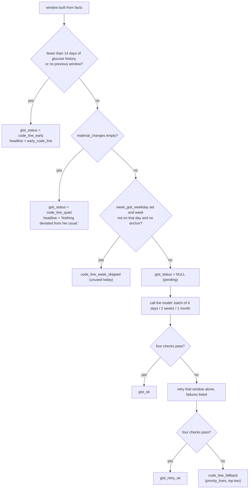

# Baseline Engine v2: working brief

*For an engineer or new teammate who has never seen this project and must run it, debug it, extend it and trust its output.*

**How this document was produced.** It was generated on 2026-10-02 by a script that read the code, the config, the tests, the log files and the database **read-only** and wrote every number and every example block in it at that moment (the generator is a scratch script, not part of the repository). Behaviour statements cite `file: function`. Blocks marked "exactly as stored" are copied byte for byte from the database or the logs. Nothing in the repository (code, config, database rows) was changed to write it.

State of the system when the numbers were taken:

| Item | Value |
|---|---|
| Repository | `/Users/ankityadav/IAIRO_CODE/v0_code`, branch `main`, last commit `e58e98c Add clinical timeline dashboard and GitHub Pages workflow` (the Baseline Engine v2 files are uncommitted: `git status --short` lists `src/`, `tests/`, `config/`, `task/` as untracked) |
| Database | `output/personal_data_store.db`, md5 `8b3f4f9293f58c80a068a760b5d2555a` |
| Config version | `meera_iyer_v1-fb3c0fa91857` |
| Windows in `memory_v2` | day 352, week 346, month 12 |
| Test suite | 452 tests (section 10) |

Words in this brief are defined where they first appear and again in the glossary (section 14.1).

## Table of contents

- [1. One-page summary](#1-one-page-summary)
- [2. Where it sits](#2-where-it-sits)
  - [2.1 What created the inputs (implemented)](#21-what-created-the-inputs-implemented)
  - [2.2 What is intended to read `memory_v2` (intent only, not implemented)](#22-what-is-intended-to-read-memory_v2-intent-only-not-implemented)
  - [2.3 Which table is the v2 source of truth](#23-which-table-is-the-v2-source-of-truth)
- [3. Inputs](#3-inputs)
  - [3.1 Tables and columns the engine reads](#31-tables-and-columns-the-engine-reads)
  - [3.2 The stream registry](#32-the-stream-registry)
  - [3.3 The config file: every key](#33-the-config-file-every-key)
  - [3.4 How the config hash (version) is computed](#34-how-the-config-hash-version-is-computed)
- [4. Processing, in order](#4-processing-in-order)
  - [4.1 Ingest of context streams (upstream, done before this engine runs)](#41-ingest-of-context-streams-upstream-done-before-this-engine-runs)
  - [4.2 Load and group (`data.py: StoreView.__init__`)](#42-load-and-group-datapy-storeview__init__)
  - [4.3 Cleaning of questionable readings (`trust.py: clean_series`)](#43-cleaning-of-questionable-readings-trustpy-clean_series)
  - [4.4 Per-day facts (`engine.py: build_days`)](#44-per-day-facts-enginepy-build_days)
  - [4.5 The profile, as of a date (`profile.py: build_profile`)](#45-the-profile-as-of-a-date-profilepy-build_profile)
  - [4.6 Windows](#46-windows)
  - [4.7 Window-level values (`windows.py: window_values`)](#47-window-level-values-windowspy-window_values)
  - [4.8 Comparison with the previous window](#48-comparison-with-the-previous-window)
  - [4.9 Direction tags and size labels (`tags.py: make_tag`, `_make_tag`)](#49-direction-tags-and-size-labels-tagspy-make_tag-_make_tag)
  - [4.10 Co-movement (`tags.py: co_movement`)](#410-co-movement-tagspy-co_movement)
  - [4.11 Material changes (`material.py: build_material`)](#411-material-changes-materialpy-build_material)
  - [4.12 Anchors, `is_notable`, `notable_reason` (`anchors.py`)](#412-anchors-is_notable-notable_reason-anchorspy)
  - [4.13 Reliability and confidence (`trust.py`)](#413-reliability-and-confidence-trustpy)
  - [4.14 Chronic findings and lab link (month tier only, `windows.py`)](#414-chronic-findings-and-lab-link-month-tier-only-windowspy)
  - [4.15 Week and month extras, and the day-by-day list](#415-week-and-month-extras-and-the-day-by-day-list)
  - [4.16 Data-quality flags and their "affects" lists](#416-data-quality-flags-and-their-affects-lists)
  - [4.17 The code-rendered text (`render.py`)](#417-the-code-rendered-text-renderpy)
- [5. The gist (LLM step)](#5-the-gist-llm-step)
  - [5.1 When the model runs, and the status of every window](#51-when-the-model-runs-and-the-status-of-every-window)
  - [5.2 How `top_items` is ordered](#52-how-top_items-is-ordered)
  - [5.3 The gist view: what the model sees (`gist_view.py: build_gist_view`)](#53-the-gist-view-what-the-model-sees-gist_viewpy-build_gist_view)
  - [5.4 The exact prompts (copied from `gist.py` at build time)](#54-the-exact-prompts-copied-from-gistpy-at-build-time)
  - [5.5 Batching and call settings](#55-batching-and-call-settings)
  - [5.6 The four checks (`gist_check.py: check_gist`)](#56-the-four-checks-gist_checkpy-check_gist)
  - [5.7 The sanitizer](#57-the-sanitizer)
  - [5.8 Retry and fallback behaviour (`gist.py: run_gist`)](#58-retry-and-fallback-behaviour-gistpy-run_gist)
  - [5.9 The code-line templates (`render.py`)](#59-the-code-line-templates-renderpy)
- [6. Outputs and storage](#6-outputs-and-storage)
  - [6.1 The schema of `memory_v2`](#61-the-schema-of-memory_v2)
  - [6.2 What every `gist_status` value means](#62-what-every-gist_status-value-means)
  - [6.3 How rows are keyed and updated](#63-how-rows-are-keyed-and-updated)
  - [6.4 The retrieval API (`storage.py: MemoryV2Store`)](#64-the-retrieval-api-storagepy-memoryv2store)
  - [6.5 What the other tables hold](#65-what-the-other-tables-hold)
  - [6.6 The v1 tables are untouched by v2](#66-the-v1-tables-are-untouched-by-v2)
  - [6.7 Backups](#67-backups)
- [7. Worked examples](#7-worked-examples)
  - [7.0 How to read a stored entry](#70-how-to-read-a-stored-entry)
  - [7a. An early day (no model call): `day_2025-10-13`](#7a-an-early-day-no-model-call-day_2025-10-13)
  - [7b. A quiet day (code line): `day_2026-01-16`](#7b-a-quiet-day-code-line-day_2026-01-16)
  - [7c. A day with a missed dose and no anchor: `day_2026-07-11`](#7c-a-day-with-a-missed-dose-and-no-anchor-day_2026-07-11)
  - [7d. The day with the removed 590 reading: `day_2026-04-23`](#7d-the-day-with-the-removed-590-reading-day_2026-04-23)
  - [7e. The hospitalization week: `week_ENDING_2025-11-22`](#7e-the-hospitalization-week-week_ending_2025-11-22)
  - [7f. The week with the removed 599 reading: `week_ENDING_2025-12-09`](#7f-the-week-with-the-removed-599-reading-week_ending_2025-12-09)
  - [7g. A month checkpoint with a lab gap: `month_ENDING_2025-12-29`](#7g-a-month-checkpoint-with-a-lab-gap-month_ending_2025-12-29)
  - [7h. A window that needed a retry: `day_2025-12-25`](#7h-a-window-that-needed-a-retry-day_2025-12-25)
  - [7i. Short-term, mid-term and long-term memory for the same date](#7i-short-term-mid-term-and-long-term-memory-for-the-same-date)
- [8. Real values from the database](#8-real-values-from-the-database)
  - [8.1 Counts by tier and status](#81-counts-by-tier-and-status)
  - [8.2 Quiet and notable fractions](#82-quiet-and-notable-fractions)
  - [8.3 Anchor fire rates by tier, and dead anchors](#83-anchor-fire-rates-by-tier-and-dead-anchors)
  - [8.4 Reliability](#84-reliability)
  - [8.5 Data-quality flags, and every questionable reading removed](#85-data-quality-flags-and-every-questionable-reading-removed)
  - [8.6 Lab HbA1c versus the glucose-based estimate at each checkpoint](#86-lab-hba1c-versus-the-glucose-based-estimate-at-each-checkpoint)
  - [8.7 Distribution of `top_items` kinds](#87-distribution-of-top_items-kinds)
  - [8.8 Tokens and time (from the call logs)](#88-tokens-and-time-from-the-call-logs)
  - [8.9 Five random stored rows per tier, in full](#89-five-random-stored-rows-per-tier-in-full)
- [9. How to run and operate](#9-how-to-run-and-operate)
  - [9.1 The upstream pipeline (creates `raw_events` and `context_events`)](#91-the-upstream-pipeline-creates-raw_events-and-context_events)
  - [9.2 The fact stages (no model)](#92-the-fact-stages-no-model)
  - [9.3 The gist stages (the only model calls)](#93-the-gist-stages-the-only-model-calls)
  - [9.4 How to rebuild, resume, back up](#94-how-to-rebuild-resume-back-up)
  - [9.5 How to add a new patient](#95-how-to-add-a-new-patient)
  - [9.6 How to add a stream](#96-how-to-add-a-stream)
- [10. Tests](#10-tests)
- [11. Troubleshooting](#11-troubleshooting)
  - [11.1 First-attempt failures in the full run](#111-first-attempt-failures-in-the-full-run)
  - [11.2 Wrong-direction false positives (the check, not the model, was wrong)](#112-wrong-direction-false-positives-the-check-not-the-model-was-wrong)
  - [11.3 Timeouts and API errors](#113-timeouts-and-api-errors)
  - [11.4 Causal wording](#114-causal-wording)
  - [11.5 "Tentative" wording](#115-tentative-wording)
  - [11.6 Poor fallback lines](#116-poor-fallback-lines)
  - [11.7 Other symptoms](#117-other-symptoms)
- [12. Spec vs implementation](#12-spec-vs-implementation)
- [13. Known limits and parked items](#13-known-limits-and-parked-items)
  - [13.1 What the engine does not do (scope)](#131-what-the-engine-does-not-do-scope)
  - [13.2 Limits of the method](#132-limits-of-the-method)
  - [13.3 Audit of all stored gists (read-only, run now)](#133-audit-of-all-stored-gists-read-only-run-now)
- [14. Glossary and file map](#14-glossary-and-file-map)
  - [14.1 Glossary](#141-glossary)
  - [14.2 File map](#142-file-map)

---

## 1. One-page summary

**What it is.** The Baseline Engine is the part of the UMC pipeline that turns one patient's stream of readings into a *memory*: for every **window** of her life (one day, a rolling seven days, a 30-day checkpoint) it stores what her numbers were, how they compare with the previous window and with her own usual, what deviated, and a short plain-words summary (the **gist**). It exists so that a later component can ask "what is normal for her, what happened, and what was happening alongside it" without recomputing anything.

**The design rule.** Code computes every fact (numbers, dates, directions, sizes, lists, quotes, caveats, `is_notable`, `notable_reason`). The language model writes only a headline of at most 15 words and 2 to 4 sentences, from a version of the facts with all numbers removed. Code checks the model's text with four checks; if the text fails twice, a code-written line is stored instead. A window therefore always has a memory: the code-built entry is the memory, the model gist is the optional wording on top (`src/v0_code/baseline_v2/windows.py: _build_window` builds the entry first; `gist.py: run_gist` only fills gist columns).

**What goes in.** Two tables of the Personal Data Store (`raw_events` rows with `source_type = 'reading'`, and `context_events`) plus one YAML config per patient (`config/patient_meera_iyer_v1.yaml`). No source CSV is read by the engine (`baseline_v2/data.py: StoreView`).

**What comes out.** One row per window in the table `memory_v2` (`baseline_v2/storage.py: SCHEMA`): the facts, tags, material changes, anchors, a code-rendered text, the gist and its audit trail.

**This patient's numbers right now** (query below):

Query (read-only, `output/personal_data_store.db`):

```sql
SELECT tier, COALESCE(gist_status, 'pending') AS gist_status, COUNT(*) AS windows
FROM memory_v2 GROUP BY tier, gist_status ORDER BY tier, gist_status
```

| tier | gist_status | windows |
|---|---|---|
| day | code_line_early | 14 |
| day | code_line_quiet | 91 |
| day | gist_ok | 225 |
| day | gist_retry_ok | 22 |
| month | code_line_early | 1 |
| month | gist_ok | 8 |
| month | gist_retry_ok | 3 |
| week | code_line_early | 14 |
| week | gist_ok | 295 |
| week | gist_retry_ok | 37 |

**Data flow.**

```mermaid
flowchart LR
  subgraph UP["Upstream (deterministic code, pipeline run: uv run v0-code)"]
    SRC["final/*.csv"] --> LOAD["load_inputs"] --> PF["plausibility_filter"] --> TE["threshold_evaluator"] --> LK["short_range_linker"] --> PDS["personal_data_store node"]
    LOAD --> CI["baseline_engine node (v1) -> context_ingest"]
  end
  PDS -->|"raw_events (readings + pairings)"| DB[("output/personal_data_store.db")]
  CI -->|"context_events"| DB
  subgraph B2["Baseline Engine v2 (separate CLI, not a graph node)"]
    DB -->|"read-only"| SV["StoreView (data.py)"] --> CL["clean_series (trust.py)"] --> DAY["build_days (engine.py)"] --> WK["build_week_and_month (windows.py)"]
    DAY --> UPS["MemoryV2Store.upsert"]
    WK --> UPS
    UPS --> M2[("memory_v2")]
    M2 -->|"facts, tags, material changes"| GV["build_gist_view (gist_view.py)"] --> LLM["LLM call (gist.py)"] --> CK["four checks (gist_check.py)"]
    CK -->|"pass"| SG["save_gist: gist_ok / gist_retry_ok"]
    CK -->|"fail twice"| FB["fallback_code_line: code_line_fallback"]
    SG --> M2
    FB --> M2
  end
  M2 -.->|"intent only, not built"| FUT["State Engine / Findings Engine"]
```



**Code versus model.**

| Part | Who | Where |
|---|---|---|
| Cleaning of questionable glucose readings | code | `trust.py: clean_series` |
| Daily values, profile, tags, co-movement, material changes, anchors, notable flag and reason, reliability, confidence, chronic findings, lab link, day-by-day list, data-quality flags | code | `engine.py`, `windows.py`, `profile.py`, `tags.py`, `material.py`, `anchors.py`, `trust.py` |
| The human-readable `deviation_text`, early / quiet / fallback code lines | code | `render.py` |
| The gist view (facts without numbers) and the `top_items` | code | `gist_view.py` |
| Headline + sentences | **LLM** (`openai/gpt-5-mini` through OpenRouter) | `gist.py: llm_call` |
| Checking the LLM text; finishing the headline (capital letter, full stop) | code | `gist_check.py: check_gist`, `finalize_headline` |

The engine is **not** a node of the LangGraph pipeline: `src/v0_code/graph/builder.py` ends with `personal_data_store -> baseline_engine (v1) -> END`, and no file outside `baseline_v2/` imports `baseline_v2` (checked with `grep -rn "baseline_v2" src --include="*.py"`, no hits outside the package). v2 is run by its own commands (section 9).

## 2. Where it sits

### 2.1 What created the inputs (implemented)

| Table | Created by | How |
|---|---|---|
| `raw_events`, rows with `source_type = 'reading'` | `src/v0_code/nodes/personal_data_store.py: personal_data_store_node` | writes every Threshold Evaluator output row (`state.threshold_results`: event_id, timestamp, biomarker, value, status) through `data/store.py: PersonalDataStore.insert_readings` |
| `raw_events`, rows with `source_type = 'pairing'` | same node | writes the Short-Range Linker's pairings (`state.pairings`) through `insert_pairings`: one glucose reading can have several pairings (meal, medication, activity, heart rate, sleep, context event, diary, mood). Only glucose readings with status high or low qualify (`nodes/short_range_linker.py`, `logic/linker.py`) |
| `context_events` | `src/v0_code/nodes/baseline_engine.py` (the **v1** Baseline Engine node, lines around `store.insert_context_events(build_context_rows(state))`) | `data/context_ingest.py: build_context_rows` reshapes streams that never pass through the Threshold Evaluator (meals, medication adherence, diary/context events, sleep quality, mood, location, and the full continuous heart-rate stream) into rows `(stream, timestamp, date, value_text, value_num, category, meta_json)` |

Consequences worth knowing:

- v2 depends on the v1 graph node having filled `context_events` in the same pipeline run (`baseline_engine.py` deletes and re-inserts `context_events` on every run).
- A pipeline run with `--rebuild` calls `PersonalDataStore(path, reset=True)`, which drops four tables only: `raw_events`, `numeric_summary`, `context_events`, `memory_records` (`data/store.py: PersonalDataStore.__init__`). **`memory_v2` is not in that list**, so it survives a pipeline rebuild but would then describe the *previous* inputs until the v2 CLI is re-run. The CLI itself refuses to run when the database file exists unless `--rebuild` is given (`cli.py: main`).
- Single readings and pairings are read from `raw_events`, **not** from baseline windows. A window stores aggregated facts (and a few lists such as blood pressure readings); it does not copy the underlying readings, and it never reads `source_type = 'pairing'` rows.

### 2.2 What is intended to read `memory_v2` (intent only, not implemented)

The repository contains design notes that name the next components: `mm2.md` (a chain "Personal Data Store -> Baseline Engine -> State Engine -> Rulebook Lookup -> Evidence Engine -> Findings Engine -> Personalized Rulebook"; "Baseline Engine = short + mid-term memory"), `task/baseline.md` ("A later component (Findings Engine) will query these records"; read API `get_memory`, `get_memories_overlapping`, `get_notable_memories`), and `task/baselineV2.md` section 13 (Findings Engine, episodic write-back and embeddings are out of scope). **No State Engine or Findings Engine code exists in this repository** (`grep -rIl "State Engine\|Findings Engine"` finds only those Markdown notes). The retrieval functions of `storage.py` (section 6.4) are the read API that such a component would use; nothing calls them today except tests and the report scripts.

### 2.3 Which table is the v2 source of truth

`memory_v2` is written only by `MemoryV2Store`. The v1 tables (`numeric_summary`, `memory_records`) are produced by the v1 node and are not read or written by v2 (see section 6.6 for the verification).

## 3. Inputs

### 3.1 Tables and columns the engine reads

`baseline_v2/data.py: StoreView.__init__` runs exactly two queries (read-only connection, `mode=ro`):

```sql
SELECT timestamp, biomarker, value, status FROM raw_events WHERE source_type = 'reading' ORDER BY timestamp
SELECT stream, timestamp, date, value_text, value_num, category, meta_json FROM context_events ORDER BY id
```

Row counts now:

Query (read-only, `output/personal_data_store.db`):

```sql
SELECT source_type, COUNT(*) AS rows FROM raw_events GROUP BY source_type
```

| source_type | rows |
|---|---|
| pairing | 138118 |
| reading | 44469 |

`raw_events` readings by biomarker (the engine uses only the biomarkers named by a stream row, the blood-pressure pair and the lab biomarker; the rest are present but ignored):

Query: `SELECT biomarker, COUNT(*) FROM raw_events WHERE source_type='reading' GROUP BY biomarker ORDER BY COUNT(*) DESC`

| biomarker | rows | used by v2 |
|---|---|---|
| cgm_glucose_reading | 33576 | yes |
| continuous_heart_rate | 8348 | yes |
| resting_heart_rate | 353 | yes |
| sleep_duration | 352 | yes |
| sedentary_time | 352 | yes |
| screen_time | 352 | yes |
| hydration | 352 | yes |
| step_count | 340 | yes |
| blood_pressure_systolic | 141 | yes |
| blood_pressure_diastolic | 141 | yes |
| waist_hip_ratio | 59 | no |
| bmi | 59 | no |
| triglycerides | 4 | no |
| total_cholesterol | 4 | no |
| ldl_c | 4 | no |
| hdl_c | 4 | no |
| hba1c | 4 | yes |
| ggt | 4 | no |
| fasting_glucose | 4 | no |
| egfr | 4 | no |
| creatinine | 4 | no |
| ast | 4 | no |
| alt | 4 | no |

`context_events` by stream:

Query (read-only, `output/personal_data_store.db`):

```sql
SELECT stream, COUNT(*) AS rows, MIN(date) AS first_date, MAX(date) AS last_date FROM context_events GROUP BY stream ORDER BY rows DESC
```

| stream | rows | first_date | last_date |
|---|---|---|---|
| continuous_heart_rate | 33792 | 2025-10-01 | 2026-09-17 |
| medication_adherence | 1056 | 2025-10-01 | 2026-09-17 |
| mood_state | 1056 | 2025-10-01 | 2026-09-17 |
| meal_events | 1055 | 2025-10-01 | 2026-09-17 |
| location | 352 | 2025-10-01 | 2026-09-17 |
| sleep_quality | 352 | 2025-10-01 | 2026-09-17 |
| diary_context | 129 | 2025-10-01 | 2026-09-17 |

Which `context_events` stream feeds what (from `baseline_v2/engine.py: build_days`): `meal_events` -> yes (post-meal peak, meal list); `medication_adherence` -> yes (adherence, missed doses); `diary_context` -> yes (diary events); `sleep_quality` -> yes (sleep quality text); `mood_state` -> yes (mood blocks, strained count); `location` -> yes (lifestyle.location); `continuous_heart_rate` -> yes (heart-rate mean/min/max).

### 3.2 The stream registry

A **stream** is one measured quantity the engine tracks per window. Each stream is one row in the config (`config.py: StreamCfg`); adding a stream is adding a row (section 9.6). The columns:

- `domain`: the family (glucose, sleep, activity, heart_rate, adherence, mood, lifestyle, meals). Co-movement keeps one entry per domain (`tags.py: co_movement`).
- `kind`: `continuous`, `daily`, `hourly`, `event`, `categorical` or `derived`. The only kind the code branches on is `continuous` (no clinical status, `engine.py: stream_day_status`) and `derived` (no completeness, no status; `engine.py: build_days`).
- `agg`: how one day's value is computed (generic aggregators in `engine.py: build_days`, the dict `aggs`): `glucose_mean`, `glucose_tir_pct`, `glucose_cv_pct` (from the cleaned glucose metrics); `value` (the first raw row of that biomarker for the day); `mean` (mean of the day's values: `context_events.value_num` if `source: context_num`, else raw rows); `adherence_pct` (share of that day's medicines with value `taken`); `strained_count` (mood blocks whose category is in `strain_mood_categories`); `post_meal_peak` (mean of the day's post-meal peaks).
- `source`: `raw` (`raw_events`), `context_num` (`context_events.value_num`), `context` (`context_events` rows).
- `expected_per_day`: readings expected per day, for completeness; for adherence the expected number is the count of medicines seen so far.
- `count_like`: true for a count of periods; its change reads "N more / N fewer" and never "up / down" (`tags.py: direction_word`).

The registry for this patient (generated from `CFG.streams`, config version `meera_iyer_v1-fb3c0fa91857`):

| name | domain | kind | label | unit | agg | source | expected_per_day | count_like |
|---|---|---|---|---|---|---|---|---|
| cgm_glucose_reading | glucose | continuous | average glucose | mg/dL | glucose_mean | raw | 96 | False |
| time_in_range | glucose | derived | time in range | percentage points | glucose_tir_pct | raw |  | False |
| variability | glucose | derived | variability | percentage points | glucose_cv_pct | raw |  | False |
| sleep_duration | sleep | daily | sleep | hours | value | raw | 1 | False |
| step_count | activity | hourly | steps | steps | value | raw | 1 | False |
| sedentary_time | activity | daily | sedentary time | minutes | value | raw | 1 | False |
| continuous_heart_rate | heart_rate | continuous | heart rate | bpm | mean | context_num | 96 | False |
| resting_heart_rate | heart_rate | daily | resting heart rate | bpm | value | raw | 1 | False |
| medication_adherence | adherence | event | medication adherence | percentage points | adherence_pct | context |  | False |
| mood_state | mood | categorical | strained periods of the day | "" | strained_count | context | 3 | True |
| hydration | lifestyle | daily | hydration | mL | value | raw | 1 | False |
| screen_time | lifestyle | daily | screen time | hours | value | raw | 1 | False |
| post_meal_peak | meals | derived | post-meal glucose peak | mg/dL | post_meal_peak | raw |  | False |

Status streams (judged reading by reading at week/month level): `[('blood_pressure', ('systolic', 'diastolic'), 'blood_pressure')]` (`config.py: StatusStreamCfg`, used by `windows.py: reading_status_items`). Blood pressure appears in the facts as a list of readings; it is judged only through the threshold statuses already stored on each systolic/diastolic reading.

### 3.3 The config file: every key

File: `config/patient_meera_iyer_v1.yaml`. Loaded by `config.py: Config.from_yaml`. "Required" means the loader raises `KeyError` if the key is missing.

| Key | Meaning | Default | Read by |
|---|---|---|---|
| `patient.id` | patient id, part of the config version | required | `config.py` |
| `patient.timezone` | timezone in which calendar days are cut (`"Asia/Kolkata"`) | required | `config.py: Config.tz`; `data.py: StoreView`; `engine.py` |
| `patient.pronoun` | `she` / `he` / anything else = "their" | required | `config.py: possessive`; `gist.py: user_prompt` |
| `patient.strain_mood_categories` | mood categories that count as a strained period | `[]` | `engine.py: build_days` |
| `patient.mood_distress_order` | mood categories from least to most distressed (ranks a day's "worst mood") | the strain categories | `config.py: distress_rank`; `windows.py: worst_mood` |
| `patient.medication_id_regex` | stripped from a medicine id to get its name (`med_002_metformin` -> `metformin`) | `""` | `config.py: medicine_name` |
| `history.min_days_for_compare` | history needed (strictly before the window) for a flat band, usual status, direction tags; also the "early" rule and reliability's minimum days | required | `profile.py`; `trust.py: is_reliable`; `engine.py`; `windows.py` |
| `history.reliable_completeness_pct` | completeness (%) a window needs to be reliable; also the low-completeness flag | required | `trust.py`; `engine.py`; `windows.py` |
| `glucose.device_range` | `[low, high]`; readings outside are questionable | required | `trust.py: clean_series` |
| `glucose.max_step_change_per_15min` | jump limit (mg/dL), scaled by the gap in 15-minute units | required | `trust.py: clean_series` |
| `glucose.expected_per_day` | expected glucose readings per day (completeness denominator) | 96 | `engine.py`; `windows.py`; `report.py` |
| `glucose.gap_hours_flag` | a gap between kept readings longer than this is flagged | 1.0 | `engine.py` (day); `report.py` |
| `glucose.lab_biomarker` | the lab compared with the glucose-based estimate | `hba1c` | `windows.py: _month_extras`, `lab_link` |
| `streams` | the stream registry (3.2) | required | everywhere |
| `status_streams` | readings judged one by one at window level | `[]` | `windows.py: _aggregate_material_inputs`; `render.py` |
| `diary.severity_order` | keywords searched in a diary note, most to least severe | `[severe, moderate, mild]` | `render.py: diary_severity_rank` |
| `diary.month_min_severity` | the month tier lists diary entries at this severity or worse; also the "diary theme" cut-off in `top_items` | `moderate` | `windows.py: split_month_diary`; `gist_view.py`; `render.py: priority_lines` |
| `diary.month_max_listed` | cap on listed diary entries in a month | 8 | `windows.py: split_month_diary` |
| `rendering.whole_number_units` | units printed as whole numbers | `[steps, mL, minutes]` | `render.py: fmt_unit` |
| `min_material_status` | lowest threshold status that can be a material deviation: `abnormal` (low/high) or `borderline` | `abnormal` | `config.py: MATERIAL_STATUS_RANK`; `engine.py`; `windows.py`; `material.py` |
| `windows.week_days` | length of the rolling week | 7 | `windows.py: build_week_and_month` |
| `windows.month_every_days` | checkpoint spacing and length of the month's compared window | 30 | `windows.py`; `render.py` |
| `windows.min_days_in_window` | days with data a window-level mean needs | 4 | `windows.py: window_values` |
| `chronic.min_share_pct` | share of days non-normal that makes a chronic finding | 50 | `windows.py: chronic_findings` |
| `flat_band.sd_multiplier` | flat band = this x SD of earlier daily values | required | `profile.py: build_profile` |
| `size_labels.small_below` / `moderate_below` | size boundaries in multiples of the flat band (2 and 4) | required | `tags.py: _make_tag` |
| `anchors.<name>` | per-tier thresholds (4.12) | `{}` | `anchors.py` |
| `gist.model`, `reasoning_effort`, `timeout_seconds`, `sdk_retries` | model call settings | required for LLM runs | `gist.py: make_client`, `llm_call` |
| `gist.concurrency` | worker threads | 1 | `gist.py: run_gist` |
| `gist.batch_size` | windows per call, per tier | required | `gist.py`, `stage_d.py` |
| `gist.wave_windows` | windows per wave in the full run | required for Stage D | `stage_d.py: run_stage_d` |
| `gist.sentence_direction` | `strict` or `warn` | `strict` | `gist.py: run_gist`; `stage_d.py` |
| `gist.usual_place_count` | places named in the view only if not among her N most frequent | 2 | `gist_view.py: usual_places` |
| `gist.anchor_size_floor` | wording size floor for an anchor-crossed measure | `moderate` | `gist_view.py: wording_tags` |
| `gist.week_gist_weekday` | `none` (every non-early, non-quiet week is queued) or a weekday name | none | `config.py: week_gist_weekday`; `windows.py: build_week_and_month` |
| `gist.measure_names` | how the view and the checker name each measure | the stream label | `config.py: measure_name` |
| `gist.measure_aliases` | other phrases the checker treats as the same measure | `[]` | `config.py: measure_terms` |
| `gist.unchecked_measures` | names the checker recognises but never compares with a tag (the month lab line) | `{}` | `config.py: measure_terms`, `unchecked_name` |

### 3.4 How the config hash (version) is computed

`config.py: Config.from_yaml`: `version = f"{patient.id}-{sha256(<the YAML file text>).hexdigest()[:12]}"`. Every row of `memory_v2` stores the `config_version` it was built with (`windows.py` and `engine.py` put `cfg.version` on each row). Because the hash covers the whole file text, any edit (even a comment) changes the version.

Verified now:

```
$ sha256sum config/patient_meera_iyer_v1.yaml | cut -c1-12
fb3c0fa91857
```

Query (read-only, `output/personal_data_store.db`):

```sql
SELECT config_version, COUNT(*) AS rows FROM memory_v2 GROUP BY config_version
```

| config_version | rows |
|---|---|
| meera_iyer_v1-fb3c0fa91857 | 710 |

The stored version equals the hash of the current file, so every stored row was built with the config as it is now. **Limit:** a gist is not marked stale if the config changes later; `MemoryV2Store.upsert` keeps a model gist (`gist_ok`, `gist_retry_ok`) when facts are re-written (section 13).

## 4. Processing, in order

The whole engine is `baseline_v2/engine.py: build_windows(cfg, view)`, which calls `build_days` (the day tier) and then `windows.py: build_week_and_month` (week and month tiers, built *from the day rows*). `run.py: run_stage_b` then writes everything with `MemoryV2Store.upsert`. Nothing in this chain calls a model. The model is a separate, later step (section 5) that only fills the gist columns.

**Terms used below.**

- **Window**: a span of calendar days for which one memory row exists. **Tier**: the kind of window: `day`, `week`, `month`.
- **Cleaned / kept / removed**: a glucose reading is *kept* if it passes the cleaning rules (4.3), otherwise *removed* (a **questionable reading**). Every metric, comparison and anchor uses kept readings only.
- **Profile**: what is normal for her for a stream, learned only from days strictly before the window (4.5).
- **Flat band**: the size of change that still counts as "no change" for a stream (4.5, 4.9).
- **Tag**: `{direction, size, delta}` for one stream in one window versus the previous window (4.9). **Size label**: `none`, `small`, `moderate` or `large`.
- **Material change**: one typed item in the list of things that deviated (4.11). A window is **quiet** when that list is empty.
- **Anchor**: a configured rule that says a change is big enough to call the window **notable** (4.12).
- **Reliable**: enough glucose data and enough days so far for the window to be trusted (4.13).

### 4.1 Ingest of context streams (upstream, done before this engine runs)

See 2.1. `data/context_ingest.py: build_context_rows` writes the non-threshold streams into `context_events`; v2 only reads them.

### 4.2 Load and group (`data.py: StoreView.__init__`)

- Every timestamp is converted to the config timezone (`Asia/Kolkata`) and grouped by **local calendar date**: `raw[(biomarker, date)]`, `ctx[(stream, date)]`. A context row with a timestamp uses the local date of that timestamp, otherwise its stored `date`.
- The **window dates** are every calendar day from the first to the last day that has a glucose reading, with no gaps: a day without readings is still a window (with 0% completeness). `StoreView.dates`.
- `meds_by_date[d]` = the set of medicines seen up to and including `d`. A medicine that first appears later does not exist yet (as-of).

Real values (Python run against the store, read-only):

```
view = StoreView(sqlite3.connect('file:output/personal_data_store.db?mode=ro', uri=True), cfg)
len(view.dates)            -> 352
view.dates[0], view.dates[-1] -> '2025-10-01', '2026-09-17'
len(view.glucose_series)   -> 33576   # glucose readings before cleaning

```

### 4.3 Cleaning of questionable readings (`trust.py: clean_series`)

The whole glucose timeline is walked once, in time order, so a spike at midnight is judged against the previous day's last reading. A reading is **removed** when:

1. its value is outside `glucose.device_range` ([40, 400] mg/dL), or
2. its value differs from the **last kept** reading by more than `max_step_change_per_15min` x `max(1, minutes_since_last_kept / 15)` (jump limit 75 mg/dL per 15 minutes, scaled by the gap).

Only earlier readings are looked at, so the cleaning of a day never depends on later data. Removed readings keep their value, time and reason (`trust.py: Removed`) and are shown only in a caveat that states what the metrics would have been with them included (`trust.py: with_questionable`; stored as `data_quality.metrics_with_questionable`). The ADA metrics come from `src/v0_code/logic/baseline_glucose.py: _metrics` (the v1 verified formulas, reused unchanged): mean, GMI, TIR (70-180), TAR (>180 and >250), TBR (<70 and <54), %CV, completeness.

Real result of the rule on this store (`clean_series(view.glucose_series, cfg)`): **33573 kept, 3 removed** of 33576 readings. Every removed reading is listed in section 8.5.

**What the rules do not catch** (reported, not patched): five isolated readings of exactly 65.0 mg/dL (section 13).

### 4.4 Per-day facts (`engine.py: build_days`)

For each calendar day the engine builds one `facts` object. Sections, fields and where each comes from:

| `facts` key | Content | Source |
|---|---|---|
| `date` | the local date | `StoreView.dates` |
| `glucose` | `mean`, `gmi_pct`, `tir_pct`, `tar_pct`, `tar_severe_pct`, `tbr_pct`, `tbr_severe_pct`, `cv_pct`, `n_readings`, `completeness_pct`, `min_value`, `max_value` of the day's **kept** readings; `null` if none | `trust.py: glucose_metrics` |
| `glucose_by_period` | `mean`, `max`, `tir_pct` for overnight (00-06), morning (06-12), afternoon (12-18), evening (18-24) | `engine.py: _period_stats` |
| `post_meal` | per meal: `meal_label`, `meal_time`, `food_description`, `pre_meal_glucose` (last kept reading at or before the meal), `peak_glucose` (max kept reading in the 150 minutes after the meal), `rise`, `minutes_to_peak`; a meal with no reading before or after is skipped | `engine.py: _post_meal`, `MEAL_WINDOW_MIN = 150`; `context_events.meal_events` |
| `sleep` | `duration_hours`, `status` (the Threshold Evaluator's status on that reading), `quality` (text) | `raw_events.sleep_duration`; `context_events.sleep_quality` |
| `activity` | `total_steps`, `status`, `sedentary_minutes`, `sedentary_status` | `raw_events.step_count`, `sedentary_time` |
| `heart_rate` | `continuous_mean/min/max` of the 15-minute stream; `resting_daily` and `resting_status` (the single daily resting value) | `context_events.continuous_heart_rate`; `raw_events.resting_heart_rate` |
| `blood_pressure` | list of `{timestamp, systolic, diastolic, systolic_status, diastolic_status}` where a systolic and a diastolic reading share a timestamp | `raw_events.blood_pressure_systolic/_diastolic` |
| `adherence` | `per_medication` (`taken` / `missed` per medicine), `overall_pct` | `context_events.medication_adherence` |
| `mood` | `blocks` (time block -> `{label, category}`), `strained_count` (blocks whose category is in `strain_mood_categories`) | `context_events.mood_state` |
| `meals` | label, time, food text per meal | `context_events.meal_events` |
| `lifestyle` | `hydration_ml` + status, `screen_time_hours` + status, `location` | `raw_events.hydration`, `screen_time`; `context_events.location` |
| `diary_events` | `category`, `text`, `severity_note` per diary entry, in time order | `context_events.diary_context` (`meta.note` is the severity note) |
| `statuses` | per stream, the day's clinical status (4.4.1) | `engine.py: stream_day_status` |
| `completeness_by_stream` | % of expected readings present, per stream with an `expected_per_day` | `engine.py: build_days` |
| `daily_values` | one number per configured stream (the `agg` of 3.2) | `engine.py: build_days` (`aggs`) |
| `profile_asof` | the profile of every stream as of the start of this day (4.5) | `profile.py: build_profile` |
| `deltas` | `clean` and `raw` anchor deltas (4.12) | `engine.py: build_days` |
| `days_of_data_so_far`, `n_medications` | counters | `engine.py` |

Week and month rows have their own `facts` (4.15).

**4.4.1 Day status.** A day's status for a stream is the most common status among that day's readings (ties broken by name): `profile.py: day_status`. Two streams get none: glucose (its per-reading statuses use fasting cut-offs 70/99/125, a different purpose than the ADA management bands, see the comment in `trust.py`) and any stream whose `kind` is `continuous` (the per-reading "at rest" status of continuous heart rate is not used: `engine.py: stream_day_status`). The daily resting heart-rate value keeps its status.

### 4.5 The profile, as of a date (`profile.py: build_profile`)

For each stream, from the list of that stream's **daily values strictly before the window** and the list of its daily statuses strictly before the window:

| Field | Rule |
|---|---|
| `n_days` | number of earlier days with a value |
| `median` | median of the earlier daily values (3 decimals) |
| `sd` | population standard deviation (`statistics.pstdev`), needs 2+ values |
| `flat_band` | `flat_band.sd_multiplier` x `sd` (0.5); only if `n_days >= min_days_for_compare` (14), else `null` |
| `usual_status` | the most common earlier day status; only if `status_days >= 14`, else `null` |
| `status_days` | number of earlier days with a status |
| `share_non_normal` | share of earlier days whose status was not `normal` (feeds chronic findings) |

The profile is computed in one place per tier (`engine.py` for days, `windows.py: profile_before` for weeks/months) and stored in `facts.profile_asof`. Real example, read through the retrieval API (`MemoryV2Store.get_profile_asof`):

```
STORE.get_profile_asof('sleep_duration', '2025-11-22')
  -> {"n_days": 52, "median": 6.5, "sd": 1.1454, "flat_band": 0.5727, "usual_status": "borderline_low", "status_days": 52, "share_non_normal": 0.712}
STORE.get_profile_asof('step_count', '2025-11-22')
  -> {"n_days": 50, "median": 1636.0, "sd": 1807.5315, "flat_band": 903.7658, "usual_status": "low", "status_days": 50, "share_non_normal": 1.0}
STORE.get_profile_asof('cgm_glucose_reading', '2025-11-22')
  -> {"n_days": 52, "median": 132.48, "sd": 9.5646, "flat_band": 4.7823, "usual_status": null, "status_days": 0, "share_non_normal": null}
STORE.get_profile_asof('sleep_duration', '2025-10-05')
  -> {"n_days": 4, "median": 6.55, "sd": 1.0356, "flat_band": null, "usual_status": null, "status_days": 4, "share_non_normal": 0.75}
```

(The profile stored on a **week or month** row is as of the window's *start*, i.e. built from the days before the window begins; a **day** row's profile is as of that day. That is why the golden week, which starts on 2025-11-16, shows 46 earlier days in section 4.9 while the day profile for 2025-11-22 shows 52.)

The last call shows the first-14-days rule: with fewer than 14 earlier days, `flat_band` and `usual_status` are `null` and every tag for that stream is `not_enough_data`.

### 4.6 Windows

| Tier | Window | Compared with | Count now |
|---|---|---|---|
| `day` | one calendar day (config timezone) | the previous day | 352 |
| `week` | the rolling trailing `7` days, **one for every day from the 7th on** (so consecutive weeks overlap by six days) | the 7 days before it | 346 |
| `month` | cumulative from day 1 **plus** the last `30` days, at a checkpoint every 30 days and one final partial checkpoint for the latest data | the previous checkpoint's last-30-day window | 12 |

Week and month windows are built from the **day rows**, never from raw data again (`windows.py: build_week_and_month`). Window ids are `day_YYYY-MM-DD`, `week_ENDING_YYYY-MM-DD`, `month_ENDING_YYYY-MM-DD` (`windows.py: _build_window`, `engine.py: build_days`). `get_memory(tier, date)` finds a window by its **end date**.

Month checkpoints (`windows.py: checkpoint_indices(n_days, every)` = `[every-1, 2*every-1, ...]` plus the last day if it is not already one), real list:

Query (read-only, `output/personal_data_store.db`):

```sql
SELECT window_id, start_date, end_date, json_extract(facts_json, '$.last_n_start') AS compared_window_starts, json_extract(facts_json, '$.partial') AS partial FROM memory_v2 WHERE tier='month' ORDER BY end_date
```

| window_id | start_date | end_date | compared_window_starts | partial |
|---|---|---|---|---|
| month_ENDING_2025-10-30 | 2025-10-01 | 2025-10-30 | 2025-10-01 | 0 |
| month_ENDING_2025-11-29 | 2025-10-01 | 2025-11-29 | 2025-10-31 | 0 |
| month_ENDING_2025-12-29 | 2025-10-01 | 2025-12-29 | 2025-11-30 | 0 |
| month_ENDING_2026-01-28 | 2025-10-01 | 2026-01-28 | 2025-12-30 | 0 |
| month_ENDING_2026-02-27 | 2025-10-01 | 2026-02-27 | 2026-01-29 | 0 |
| month_ENDING_2026-03-29 | 2025-10-01 | 2026-03-29 | 2026-02-28 | 0 |
| month_ENDING_2026-04-28 | 2025-10-01 | 2026-04-28 | 2026-03-30 | 0 |
| month_ENDING_2026-05-28 | 2025-10-01 | 2026-05-28 | 2026-04-29 | 0 |
| month_ENDING_2026-06-27 | 2025-10-01 | 2026-06-27 | 2026-05-29 | 0 |
| month_ENDING_2026-07-27 | 2025-10-01 | 2026-07-27 | 2026-06-28 | 0 |
| month_ENDING_2026-08-26 | 2025-10-01 | 2026-08-26 | 2026-07-28 | 0 |
| month_ENDING_2026-09-17 | 2025-10-01 | 2026-09-17 | 2026-08-19 | 1 |

`start_date` of a month row is day 1 (cumulative window); `last_n_start` is where its compared last-30-day window begins (`windows.py: _month_extras`, `build_week_and_month`).

**Timezone handling.** Timestamps in the store carry an offset; they are converted with `ZoneInfo(patient.timezone)` and only then cut into dates (`data.py: StoreView`, `engine.py`, `trust.py`). A UTC+0 patient works from the same code (`tests/test_v2_fixture_patient.py`).

**The first-14-days rule ("early").** A window has not enough history when fewer than `min_days_for_compare` earlier days have a glucose daily value (`engine.py: build_days`: `len(hist_val[gname]) < min_days`; `windows.py: _build_window`: `hist_glucose_days < min_days or prev is None`). Such a window has no flat bands, so every tag is `not_enough_data`, and its gist status is `code_line_early` (5.1). Real counts:

Query (read-only, `output/personal_data_store.db`):

```sql
SELECT tier, COUNT(*) AS early_windows, MIN(end_date) AS first_end_date, MAX(end_date) AS last_end_date FROM memory_v2 WHERE gist_status='code_line_early' GROUP BY tier
```

| tier | early_windows | first_end_date | last_end_date |
|---|---|---|---|
| day | 14 | 2025-10-01 | 2025-10-14 |
| month | 1 | 2025-10-30 | 2025-10-30 |
| week | 14 | 2025-10-07 | 2025-10-20 |

### 4.7 Window-level values (`windows.py: window_values`)

A week or month window needs one value per stream:

- glucose metrics are **pooled** over the window's kept readings (not an average of daily averages); expected readings = `96 x days`;
- medication adherence is **pooled** taken / expected doses over the window's days;
- post-meal peak is the mean of all peaks in the window;
- every other stream is the **mean of its daily values**, and only if at least `windows.min_days_in_window` (4) days have a value, else `null`.

### 4.8 Comparison with the previous window

`_build_window` builds the same values for the previous window (`prev`) and takes `delta = value - previous value` per stream. Day: previous calendar day (`build_days`: `prev`). Week: the 7 days before (`prev = (start-7, start-1)`). Month: the previous checkpoint's last-30-day window. **Only the immediately previous window is used** for the change; "her usual" enters through the profile (flat band, usual status), not through a second comparison window (limit, section 13).

### 4.9 Direction tags and size labels (`tags.py: make_tag`, `_make_tag`)

For every stream, per window:

```
delta = value - previous value                       (null if either is missing)
band  = profile.flat_band                            (null before 14 days of history)
if delta is null or band is null:   direction = not_enough_data, size = none
elif delta == 0 or |delta| < band:  direction = flat,            size = none
else: ratio = |delta| / band         (band == 0 -> ratio = infinity, stored as 999.0)
      direction = up if delta > 0 else down
      size = small     if ratio <  size_labels.small_below    (2)
             moderate  if ratio <  size_labels.moderate_below (4)
             large     otherwise
```

Stored tag fields: `measure`, `label`, `unit`, `domain`, `count_like`, `delta`, `direction`, `size`, `ratio`, `direction_word` (`more` / `fewer` for count-like streams, else the direction).

Real example, `week_ENDING_2025-11-22`, stream `sleep_duration` (query: `SELECT tags_json, json_extract(facts_json,'$.profile_asof.sleep_duration') FROM memory_v2 WHERE window_id='week_ENDING_2025-11-22'`):

```
tag            = {"measure": "sleep_duration", "label": "sleep", "unit": "hours", "domain": "sleep", "count_like": false, "delta": -1.82, "direction": "down", "size": "large", "ratio": 4.072, "direction_word": "down"}
profile_asof   = {"n_days": 46, "median": 6.7, "sd": 0.8938, "flat_band": 0.4469, "usual_status": "borderline_low", "status_days": 46, "share_non_normal": 0.674}
check: |delta| / flat_band = 1.82 / 0.4469 = 4.072   (stored ratio 4.072; 4x or more -> large)
```

### 4.10 Co-movement (`tags.py: co_movement`)

Computed from the tags, never by the model. It is reported only if glucose itself moved beyond its flat band (`up` or `down`). Every other stream that moved (`up`/`down`) is grouped by **domain**; for each domain only the strongest move (largest `ratio`) is kept, so heart-rate variants collapse into one entry; the glucose domain (glucose, time in range, variability) is the reference and is excluded. Entries go to `same_direction` or `opposite_direction` relative to glucose. `flat` and `not_enough_data` lists are kept. Flat/flat is never reported. Real example (same week):

```
{
 "glucose_direction": "up",
 "same_direction": [
  {
   "measure": "post-meal glucose peak",
   "direction": "up",
   "direction_word": "up",
   "size": "small",
   "domain": "meals"
  },
  {
   "measure": "resting heart rate",
   "direction": "up",
   "direction_word": "up",
   "size": "large",
   "domain": "heart_rate"
  },
  {
   "measure": "sedentary time",
   "direction": "up",
   "direction_word": "up",
   "size": "small",
   "domain": "activity"
  },
  {
   "measure": "strained periods of the day",
   "direction": "up",
   "direction_word": "more",
   "size": "moderate",
   "domain": "mood"
  }
 ],
 "opposite_direction": [
  {
   "measure": "hydration",
   "direction": "down",
   "direction_word": "down",
   "size": "moderate",
   "domain": "lifestyle"
  },
  {
   "measure": "medication adherence",
   "direction": "down",
   "direction_word": "down",
   "size": "moderate",
   "domain": "adherence"
  },
  {
   "measure": "sleep",
   "direction": "down",
   "direction_word": "down",
   "size": "large",
   "domain": "sleep"
  }
 ],
 "flat": [
  "steps"
 ],
 "not_enough_data": []
}
```

### 4.11 Material changes (`material.py: build_material`)

A **material change** is one typed item. They form a list in this fixed order; `quiet` is exactly "the list is empty".

| # | `kind` | Definition (day tier) | Week / month difference |
|---|---|---|---|
| 1 | `anchor_crossed` | one item per anchor crossed on **cleaned** values (4.12) | same |
| 2 | `missed_dose` | one item per medicine with status other than `taken` that day; `days: 1` | `days` = days missed in the window, `of` = days with that medicine in the window |
| 3 | `diary_event` | every diary entry that day, with category, text, severity note, date | week: every entry; month: only entries at `diary.month_min_severity` (moderate) or worse, at most `diary.month_max_listed` (8), most severe then most recent first (`windows.py: split_month_diary`) |
| 3b | `diary_summary` | (day/week: never) | month only: `{count, by_category}` for the entries not listed, e.g. "7 other diary entries: ..." |
| 4 | `status_worse_than_usual` | a stream whose day status is **worse than its own usual status** (rank `normal 0 < borderline_* 1 < low/high 2`, `profile.py: STATUS_RANK`) AND at least `min_material_status` (`abnormal` = rank 2). A stream with no usual status yet (fewer than 14 days) contributes nothing | the days' own items are counted: `days` of `of`. Plus status streams judged reading by reading (blood pressure): the reading takes the worse of its systolic / diastolic status, "usual" = most common earlier reading status (needs 14 earlier readings), `unit: readings` (`windows.py: reading_status_items`) |
| 5 | `large_change` | any tag with size `large`, except a measure already represented by an anchor crossed, a status deviation, or (for adherence) a missed dose | same, from the window's tags |
| 6 | `data_gap` / `low_completeness` | a gap between kept glucose readings longer than `gap_hours_flag` (1 h); a stream under the reliability threshold (including 0%) | max gap in the window; stream completeness averaged over the window's days |
| 7 | `questionable_reading_removed` | each removed reading with time, value and reason | all in the window |

Missed doses and diary events are always material. Because of that, almost every week has at least one item (section 8: no quiet week).

The definition of **quiet**: `row["quiet"] = not material` (`engine.py`, `windows.py`) and `gist_status = code_line_quiet` for it. This is about deviation from *her own* usual, not "no anchor crossed" (an anchor can cross while a window has other items, and a window can have items without any anchor). Chronic oddities (steps low on 98% of days) are *not* repeated in every row: they are recorded once per month checkpoint as `chronic_findings` (4.14).

Real example, `week_ENDING_2025-11-22` (query: `SELECT material_changes_json FROM memory_v2 WHERE window_id='week_ENDING_2025-11-22'`):

```
[
 {
  "kind": "anchor_crossed",
  "anchor": "glucose_GMI_change"
 },
 {
  "kind": "anchor_crossed",
  "anchor": "sleep_hours_change"
 },
 {
  "kind": "anchor_crossed",
  "anchor": "adherence_pct_change"
 },
 {
  "kind": "missed_dose",
  "medicine": "med_002_metformin",
  "days": 2,
  "of": 7
 },
 {
  "kind": "missed_dose",
  "medicine": "med_003_amlodipine",
  "days": 5,
  "of": 7
 },
 {
  "kind": "missed_dose",
  "medicine": "med_004_levothyroxine",
  "days": 4,
  "of": 7
 },
 {
  "kind": "diary_event",
  "date": "2025-11-16",
  "category": "symptom",
  "text": "Noticed father unusually tired and low-appetite at family lunch",
  "severity_note": "concerning, not her own symptom"
 },
 {
  "kind": "diary_event",
  "date": "2025-11-18",
  "category": "life_event",
  "text": "Father hospitalized overnight - chest pain and weakness",
  "severity_note": "severe, family crisis"
 },
 {
  "kind": "diary_event",
  "date": "2025-11-19",
  "category": "life_event",
  "text": "Hospital day 2, coordinating care and family logistics",
  "severity_note": "severe"
 },
 {
  "kind": "diary_event",
  "date": "2025-11-20",
  "category": "life_event",
  "text": "Hospital day 3, father stabilizing, first night home",
  "severity_note": "moderate, improving"
 },
 {
  "kind": "diary_event",
  "date": "2025-11-21",
  "category": "life_event",
  "text": "Father showing clearer improvement, cautiously relieved",
  "severity_note": "improving"
 },
 {
  "kind": "status_worse_than_usual",
  "measure": "hydration",
  "status": "low",
  "usual": "normal",
  "days": 3,
  "of": 7
 },
 {
  "kind": "status_worse_than_usual",
  "measure": "sleep_duration",
  "status": "low",
  "usual": "borderline_low",
  "days": 4,
  "of": 7
 },
 {
  "kind": "large_change",
  "measure": "resting_heart_rate",
  "label": "resting heart rate",
  "direction": "up",
  "direction_word": "up",
  "size": "large"
 }
]
```

### 4.12 Anchors, `is_notable`, `notable_reason` (`anchors.py`)

An **anchor** is a configured rule that makes a window **notable**. Thresholds are starting heuristics, not clinical standards, and are not retuned. They are read per tier (`anchors.py: _threshold`, `configured_for`); a tier with no threshold for an anchor does not evaluate it. Thresholds now (generated by `anchors.configured_for` / `_threshold`; `True` = no number, any flip counts; `-` = not configured for the tier):

| anchor | day | week | month |
|---|---|---|---|
| glucose_TIR_change_points | 10 | 10 | 10 |
| glucose_CV_change_points | 8 | 8 | 8 |
| glucose_GMI_change | - | 0.3 | 0.2 |
| severe_range_appeared_or_cleared | True | True | True |
| sleep_hours_change | 1.5 | 1.5 | 1.5 |
| resting_hr_change_bpm | 8 | 8 | 8 |
| adherence_meds_changed | min(2, n_meds) | - | - |
| adherence_pct_change | - | 15 | 10 |
| steps_abs_change | 3000 | 1500 | - |
| lab_cgm_discordance | - | - | 0.5 |

Rules (`anchors.py: evaluate`):

- Numeric anchors fire when the **absolute** change is **strictly greater** than the threshold (equal does not fire). `SOURCE` maps each anchor to its delta key: `glucose_TIR_change_points` -> time in range (percentage points), `glucose_CV_change_points` -> variability, `glucose_GMI_change` -> GMI, `sleep_hours_change`, `resting_hr_change_bpm` (the **daily resting value**, not the continuous stream), `adherence_pct_change`, `steps_abs_change` (the week tier uses the key `week_mean`: the change in mean daily steps).
- `adherence_pct_change` fires on a **drop only** (`anchors.py: DROP_ONLY`); a recovery still appears under "what changed".
- `adherence_meds_changed` (day tier only) counts medicines that went from taken the previous day to missed today (`engine.py: meds_worsened`; a recovery or a medicine with no previous day is not counted) and fires when that count is `>= min(2, n_meds)` and `> 0` (`config.py: resolve_threshold`).
- `severe_range_appeared_or_cleared` fires when "time above 250 + time below 54" flips between zero and non-zero compared with the previous window.
- `lab_cgm_discordance` (month only) fires when `|lab HbA1c - GMI over the 90 days before the lab| >= 0.5` (inclusive) for a lab drawn in the checkpoint's own last 30 days (`windows.py: _month_extras`).
- **Evaluated on cleaned values.** The engine evaluates every anchor twice, on the cleaned deltas and on the raw deltas (kept + removed readings). A crossing present only on raw values is *not* counted; it goes to `anchors_questionable` (`anchors.py: split_questionable`) and the row prints a caveat.
- `is_notable = bool(anchors_crossed)`, decided by code (`engine.py`, `windows.py`). `notable_reason` is a code sentence built from the crossed anchors (`render.py: notable_reason`, `anchor_phrase`): what changed, which way, by how much and, where a tag exists, the tag's size label; numbers are allowed here because it is code. The model never decides either.

Real example, `week_ENDING_2025-11-22`: `deltas.clean` -> anchors crossed (query: `SELECT anchors_crossed, anchors_questionable, is_notable, notable_reason, json_extract(facts_json,'$.deltas.clean') FROM memory_v2 WHERE window_id='week_ENDING_2025-11-22'`):

```
deltas.clean        = {"tir": -3.45, "cv": 0.14, "gmi": 0.33, "sleep": -1.82, "resting_hr": 6.71, "steps": -802.76, "adherence_pct": -33.4, "meds_changed": null, "severe_curr": 0.0, "severe_prior": 0.0, "lab_gap": null}
anchors_crossed     = ["glucose_GMI_change", "sleep_hours_change", "adherence_pct_change"]
anchors_questionable= []
is_notable          = True
notable_reason      = GMI up 0.33 points (moderate); sleep down 1.82 hours (large); medication adherence down 33.4 percentage points (moderate).
thresholds (week)   : GMI 0.3, sleep 1.5, adherence_pct 15 (drop), resting_hr 8, steps_week_mean 1500
check: GMI 0.33 > 0.3, sleep |-1.82| > 1.5, adherence -33.4 (a drop) > 15 fire; time in range -3.45 (<10), variability 0.14 (<8), resting HR +6.71 (<8), steps -802.76 (<1500) do not
```

### 4.13 Reliability and confidence (`trust.py`)

- `reliable = completeness_pct >= reliable_completeness_pct (70) AND days_of_data_so_far >= min_days_for_compare (14)` (`is_reliable`; an adaptation of the ADA 14-day / 70% guidance to window level, as the code comment says).
- `confidence`: `high` if reliable and completeness >= 90; `moderate` if reliable; `low` otherwise (`confidence`). Both are computed in code and stored on the row; the model does not write them.

Query (read-only, `output/personal_data_store.db`):

```sql
SELECT tier, SUM(reliable) AS reliable, COUNT(*) - SUM(reliable) AS not_reliable, SUM(confidence='high') AS high, SUM(confidence='moderate') AS moderate, SUM(confidence='low') AS low FROM memory_v2 GROUP BY tier
```

| tier | reliable | not_reliable | high | moderate | low |
|---|---|---|---|---|---|
| day | 339 | 13 | 329 | 10 | 13 |
| month | 12 | 0 | 12 | 0 | 0 |
| week | 339 | 7 | 339 | 0 | 7 |

### 4.14 Chronic findings and lab link (month tier only, `windows.py`)

- **`chronic_findings`** (`chronic_findings`): from the day statuses *so far* (day 1 to the checkpoint). A stream with at least `min_days_for_compare` status days and a non-normal share of at least `chronic.min_share_pct` (50%) is listed with `share_pct`, `days`, `usual_status` (the most common status). The gist view uses a finding only if the share is **above** 50% and the usual status is not `normal` (`gist_view.py`).
- **`lab_link`** (`lab_link`): each lab (up to the checkpoint's date) next to the GMI computed from kept readings in the 90 days **before** the lab, and the signed gap `HbA1c - GMI`. The glucose-based estimate is GMI = 3.31 + 0.02392 x mean glucose, rounded to 2 decimals (`src/v0_code/logic/baseline_glucose.py: _metrics`). Real values are in section 8.7.

### 4.15 Week and month extras, and the day-by-day list

- **Week** (`windows.py: _week_extras`): `daily_trajectory` (per day: date, average glucose, time in range, sleep hours, steps, adherence %, worst mood, missed medicines, diary event count, removed readings, glucose gap hours); `best_day` / `worst_day` (best = highest time in range, ties by lowest mean glucose; worst = lowest time in range, ties by highest mean; if all days tie on both, neither is named and `best_and_worst_note` says so: `best_and_worst`); `events_in_window` (every diary event with its date); `aggregates` (steps sum / mean per day, adherence per medicine, mood counts per block, meals by label, post-meal peak mean/max, foods on the best and worst day, location day counts, blood pressure readings, completeness per stream).
- **"Worst mood"** (`worst_mood`) ranks categories by `mood_distress_order`, so a positive category is never "worst" while anything else was recorded.
- **Month** (`_month_extras`): `cumulative` glucose metrics from day 1, `last_30_days` glucose metrics, `monthly_trajectory` (per calendar month so far: glucose metrics, mean sleep, mean steps, adherence %, diary counts by category), `lab_link`, `chronic_findings`, `partial`, `last_n_start`, `checkpoint_index`.

### 4.16 Data-quality flags and their "affects" lists

Every flag names the metrics it makes unreliable, and the caveat is printed next to those metrics only (`engine.py`, `windows.py: _build_window`):

| Flag | When | `affects` |
|---|---|---|
| `questionable_reading_removed:<n>` | n readings removed in the window | the metrics that would differ had they been kept (`metrics_with_questionable` keys, e.g. `mean`, `tir_pct`, `max_value`) |
| `gap_hours:<h>` | longest gap between kept readings > 1 h | `completeness_pct`, `n_readings` |
| `low_completeness:<stream>:<pct>` | a stream's completeness < 70% (including 0%) | `[<stream>]` |

Real example, `day_2026-04-23` (query: `SELECT data_quality_json FROM memory_v2 WHERE window_id='day_2026-04-23'`):

```
{
 "flags": [
  {
   "flag": "questionable_reading_removed:1",
   "affects": [
    "cv_pct",
    "gmi_pct",
    "max_value",
    "mean",
    "post_meal_peak_max",
    "tar_pct",
    "tar_severe_pct",
    "tir_pct"
   ]
  }
 ],
 "questionable_readings": [
  {
   "time": "2026-04-23T14:00:00+05:30",
   "value": 590.0,
   "reason": "outside the device range (40-400)"
  }
 ],
 "metrics_with_questionable": {
  "mean": 119.45,
  "gmi_pct": 6.17,
  "tir_pct": 98.96,
  "tar_pct": 1.04,
  "tar_severe_pct": 1.04,
  "cv_pct": 41.63,
  "max_value": 590.0,
  "post_meal_peak_max": 590.0
 },
 "completeness_pct": 98.96,
 "reliable": true
}
```

### 4.17 The code-rendered text (`render.py`)

Each row stores `deviation_text`, a plain-language block written entirely by code (`render.py: deviation_text` for days, `week_text`, `month_text`). Sections, in order: `THINGS THAT DEVIATED` (the material changes as sentences: `material_lines`), `NUMBERS`, `WHAT CHANGED vs the previous <window>`, `MOVED TOGETHER WITH GLUCOSE`, then tier-specific blocks (days: `TRAJECTORY`; weeks: `DAY BY DAY`; months: `MONTH BY MONTH`, `LAB LINK`, `CHRONIC FINDINGS`), `CAVEATS`, `STEADY (no meaningful change)`. Wording rules: anchor lines read "Notable change: ..."; "Large change in X: ..." is used only for a large tag; the lab gap reads "HbA1c ... differ by X points" (a difference, not a change); steps, mL and minutes print as whole numbers (`fmt_unit`); a count of periods reads "N more / N fewer". The first 25 lines of the stored `deviation_text` of `week_ENDING_2025-11-22`, exactly as stored:

```
THINGS THAT DEVIATED:
  - Notable change: GMI up 0.33 points (moderate).
  - Notable change: sleep down 1.82 hours (large).
  - Notable change: medication adherence down 33.4 percentage points (moderate).
  - Missed dose: metformin, 2 of 7 days.
  - Missed dose: amlodipine, 5 of 7 days.
  - Missed dose: levothyroxine, 4 of 7 days.
  - Diary, 2025-11-16 [symptom]: "Noticed father unusually tired and low-appetite at family lunch" (concerning, not her own symptom)
  - Diary, 2025-11-18 [life event]: "Father hospitalized overnight - chest pain and weakness" (severe, family crisis)
  - Diary, 2025-11-19 [life event]: "Hospital day 2, coordinating care and family logistics" (severe)
  - Diary, 2025-11-20 [life event]: "Hospital day 3, father stabilizing, first night home" (moderate, improving)
  - Diary, 2025-11-21 [life event]: "Father showing clearer improvement, cautiously relieved" (improving)
  - Hydration below the reference range on 3 of 7 days, worse than its usual (within the reference range).
  - Sleep below the reference range on 4 of 7 days, worse than its usual (slightly below the reference range).
  - Large change in resting heart rate: up.
NUMBERS:
  - Glucose: average 146.37 mg/dL, GMI 6.81%, time in range 95.21%, above range 4.79% (above 250: 0%), below range 0% (below 54: 0%), variability 12.14%, 647 readings (96.28% of expected).
  - Sleep: average 4.91 hours per day. Steps: average 1474 per day (7 days with data). Sedentary: average 719 minutes per day.
  - Heart rate: average 90.55 bpm, daily resting value average 83.57 bpm.
  - Medicines: 47.6% taken (metformin 5 of 7, amlodipine 2 of 7, levothyroxine 3 of 7).
  - Mood by time of day: morning: anxious 1, calm stable 2, overwhelmed high distress 1, tired low energy 3; afternoon: anxious 2, calm stable 1, mild stress 1, overwhelmed high distress 2, positive uplifted 1; evening: anxious 2, calm stable 1, overwhelmed high distress 1, positive uplifted 2, tired low energy 1.
  - Meals: 19 logged; peak glucose after meals averaged 183.07 mg/dL, highest 232.5 mg/dL.
  - Location: home 1 day, hospital 5 days, office 1 day.
  - Blood pressure 2025-11-16: 126/80 at 08:11.
  - Blood pressure 2025-11-18: 136/91 at 08:17.
```

## 5. The gist (LLM step)

The gist is a short plain-words summary of a window: a **headline** (at most 15 words) and **2 to 4 sentences**. It is the only text a model writes. Everything else in a row is code.

### 5.1 When the model runs, and the status of every window

`gist_status` says how a window's gist came to be. `NULL` means no gist has been decided yet (the window is *pending* for the model).

| `gist_status` | Meaning | Set by |
|---|---|---|
| `NULL` (pending) | enough history, something material happened; waiting for the model | `engine.py` / `windows.py` when building the row |
| `code_line_early` | fewer than 14 days of glucose history (or no previous window); a code line: "Not enough history yet to compare." followed by the two most important material items, if any | `engine.py: build_days`, `windows.py: build_week_and_month` (`render.py: early_code_line`) |
| `code_line_quiet` | the material-changes list is empty; the code line "Nothing deviated from her usual." | `engine.py`, `windows.py` (`render.py: code_line`) |
| `gist_ok` | the model's first attempt passed all four checks | `gist.py: run_gist` -> `MemoryV2Store.save_gist` |
| `gist_retry_ok` | the first attempt failed a check, the single retry passed | `gist.py: run_gist` (`retry`) |
| `code_line_fallback` | both attempts failed; the code line from the top two items of `render.py: priority_lines` is stored with an empty sentence list | `gist.py: run_gist` (`finish`) |
| `code_line_week_skipped` | only used when `gist.week_gist_weekday` names a weekday: a non-early, non-quiet week that neither ends on that weekday nor crossed an anchor gets the top-two code line instead of a model call. **Not used with the current config (`none`)** | `windows.py: build_week_and_month` |

Current counts of every value (query):

Query (read-only, `output/personal_data_store.db`):

```sql
SELECT COALESCE(gist_status,'NULL (pending)') AS gist_status, COUNT(*) AS windows FROM memory_v2 GROUP BY gist_status ORDER BY windows DESC
```

| gist_status | windows |
|---|---|
| gist_ok | 528 |
| code_line_quiet | 91 |
| gist_retry_ok | 62 |
| code_line_early | 29 |



The model is never called for `code_line_early`, `code_line_quiet`, or for a window that already has `gist_ok` / `gist_retry_ok`: `stage_d.py: run_stage_d` only takes windows whose `gist_status` is `NULL`.

### 5.2 How `top_items` is ordered

`gist_view.py: _top_items`. Up to **three** items, one per kind, in this fixed priority order (a kind with nothing in it is skipped):

1. **diary theme**: the single most severe diary entry that is at `diary.month_min_severity` (moderate) or worse (`render.py: diary_severity_rank`; ties by order in the window). Text: `diary entry (<severity note>): <entry text>`.
2. **missed medicines**: all of them, each with a frequency word.
3. **notable or large changes**: anchors crossed and `large_change` items together, ordered by size with `large` first (ties: anchors before large changes; an anchor with no tag, such as the lab difference or the severe-range flip, sorts first). Each member reads `<measure> <up|down|more|fewer> (<size>)`; a measure is listed once.
4. **unusual statuses**: the status deviations.

The first key of the view is `top_items`; the system prompt's rule 12 tells the model that the headline must cover the first item and the others belong in the sentences. If a window has none of the four kinds (for example only a removed reading), the key is omitted.

### 5.3 The gist view: what the model sees (`gist_view.py: build_gist_view`)

Built from the stored row. **No numbers, counts, dates or field names**; frequencies are words (`gist_view.py: freq_word`: `k of n` -> "on one day" / "on a few days" / "on most days" (more than half) / "every day"; a one-day window says "on this day"; blood-pressure readings use "readings").

| Key | Present when | Content |
|---|---|---|
| `top_items` | at least one of the four kinds exists | see 5.2 |
| `tier` | always | `day` / `week` / `month` |
| `reliable` | only when the window is **not** reliable | `"no"` (the prompt's rule 8 then asks for tentative wording; the checker allows the words "tentative" / "uncertain" only in that case) |
| `measures` | always (may be empty) | every stream whose tag moved (`up` / `down`): `{measure (gist name), direction, size}`, largest size first. `direction` is `more`/`fewer` for the count-of-periods stream. **Size is the wording size**: an anchor-crossed measure is shown at least `moderate` (`wording_tags`; the stored tag is unchanged) |
| `moved_the_same_way_as_glucose`, `moved_the_opposite_way_to_glucose` | glucose moved | measure names from the stored co-movement |
| `missed_medicines` | any missed dose | `{medicine, how_often}` |
| `unusual_statuses` | any status deviation | `{measure, status (words), usually (words), how_often}` (blood pressure: "readings") |
| `diary` | any diary entry in the window's material | `{category, text, severity}` verbatim (text and severity may contain digits) |
| `other_diary_entries` | month only, entries not listed | "less serious entries exist in these categories: ..." (names only, no counts) |
| `places` | day: the day's location; week: location days | `{place, how_often}` for places **not** among her `gist.usual_place_count` (2) most frequent places over the days strictly before the window (`gist_view.py: usual_places`); month has no places |
| `long_standing_patterns` | month, a chronic finding with share above 50% and a non-normal usual status | `{measure, status, how_often: "on most days"}`; the same measure's unusual-status item is then dropped to avoid saying it twice |
| `lab_vs_glucose_estimate` | month, the `lab_cgm_discordance` anchor crossed | "HbA1c is higher|lower than the glucose-based estimate (they differ)" |
| `data_notes` | any | one questionable glucose reading was removed / a few ... were removed; glucose readings had a gap; `<stream>` data was incomplete; time at severe high or low glucose appeared or disappeared; an apparent large change was ignored because it came only from a removed reading |

**Deliberately excluded** (and why): every number, delta, ratio and count (rule: the model writes no numbers); dates (they cannot be repeated if never shown); field names and internal labels (the checker forbids them in the output); steady measures (`flat`) and measures with `not_enough_data` (the prompt says not to mention steady measures, and a claim about `not_enough_data` is a check failure); `reliable: yes` (the model should not volunteer reliability); home places; the flat list; anchor names (an anchor appears only as the measure's change, or as a plain phrase).

The only digit-bearing token in the view's own wording is `HbA1c`; the checker's digit rule lets exactly that token through.

### 5.4 The exact prompts (copied from `gist.py` at build time)

**System prompt** (`gist.py: SYSTEM_PROMPT`):

```
You write a short plain-words summary of one time window in a person's health record. The person has diabetes.

You receive a GIST VIEW: a list of measures with direction and size, which measures moved with or against glucose, medicines missed, unusual statuses, diary entries, and data-quality notes. All numbers were removed on purpose. Code already stores every number.

Write:
1. headline: one sentence, at most 15 words.
2. sentences: 2 to 4 short sentences.

RULES. Follow all of them.
1. Do not write any digit, date, month name, count, or number word used as a count. Say "on a few days", "most days", "sharply", not figures.
2. Use only the facts in the GIST VIEW. Do not invent settings, reasons, or details. In particular, do not say where or how something was measured unless the view says so.
3. Direction words (up, down, higher, lower, rose, fell, more, fewer) must match the direction given for that measure, and intensity words must match its size: small = "a little" or "slightly"; moderate = "clearly" or "noticeably"; large = "sharply", "markedly" or "much". Never describe a measure whose direction is "not_enough_data".
4. One measure per direction claim. Do not write one direction word that covers two measures.
5. Describe relationships only as co-occurrence: "alongside", "while", "in a week when", "at the same time as". Never use: caused, because, due to, led to, resulted in, triggered, explains, driven by.
6. If the view contains diary entries, name the main theme in plain words in the headline (for example "a family member's hospitalization" or "a work trip"). Paraphrase. Do not quote the diary. Do not repeat numbers or dates from it.
7. Mention every missed medicine and every unusual status in the view that matters to the picture. Do not mention measures that are steady.
8. If the view says the window is not reliable, say that comparisons are tentative.
9. Do not give advice, diagnoses, or predictions.
10. Do not use these words: anchor, tag, stream, record, field, flag, window, tier, notable.
11. Refer to the person with the pronoun in the view.
12. The headline must cover the first item in TOP ITEMS; mention the others in the sentences.

Return only JSON: {"headline": "...", "sentences": ["...", "..."]}
```
**User template** (`gist.py: USER_TEMPLATE`; one window is sent as itself, several are sent keyed `"1"`, `"2"`, ... with `BATCH_NOTE` replacing the words `GIST VIEW:`):

```
TIER: {tier}
PRONOUN: {pronoun}

TIER GUIDANCE:
{tier_guidance}

GIST VIEW:
{gist_view_json}
```
**Tier guidance** (`gist.py: TIER_GUIDANCE`):

- `day`: Say what stood out about this one day: what changed against the previous day, which medicine was missed, and what the diary says. Keep it to what is in the view.
- `week`: Say what the week looked like overall and what moved with or against glucose. If there were diary entries, give the main theme. Do not list single days.
- `month`: Say how the period compares with the previous checkpoint and how the long-run picture looks. If a lab result and the glucose-based estimate differ, say they differ, in words only. Name any measure that has been non-normal on most days as a long-standing pattern.

**Batch note** (`gist.py: BATCH_NOTE`, used only when a call carries several windows):

```
There are several GIST VIEWs below, keyed "1", "2", .... Return one JSON object with the same keys: {"1": {"headline": "...", "sentences": ["...", "..."]}, "2": {...}}.
```
**Retry addendum** (`gist.py: RETRY_ADDENDUM`; sent as a fourth message after the system prompt, the original user message and the model's previous answer as an assistant message):

```
Your previous answer failed these checks: {failure_list}.
Rewrite it. Keep to the facts in the view. Do not use digits or dates. Make every direction word match the stated direction and size for its own measure.
```

### 5.5 Batching and call settings

| Setting | Value | Where |
|---|---|---|
| model | `openai/gpt-5-mini` through OpenRouter (`https://openrouter.ai/api/v1`), OpenAI SDK | `gist.py: make_client`, `llm_call` |
| reasoning effort | `low`, sent as `extra_body={"reasoning": {"effort": ...}}` | `gist.py: llm_call` |
| response format | `{"type": "json_object"}` | `gist.py: llm_call` |
| timeout | 90 s | `make_client` |
| SDK retries | 0 (a timeout or API error is a failed attempt, handled by the one explicit retry) | `make_client` |
| explicit retry | one per failed window, always alone | `gist.py: run_gist` |
| concurrency | 6 worker threads over batches | `run_gist` (`ThreadPoolExecutor`) |
| batch size | day 4, week 2, month 1 windows per call | `gist.batch_size` |
| API key | environment variable `OPENROUTER_API_KEY` (loaded with `python-dotenv`); never printed or logged | `make_client` |
| usage logging | `usage_json` per attempt: input, output and reasoning tokens, wall seconds | `llm_call`, stored by `save_gist` |

A batched answer must be one JSON object keyed like the request; a missing or malformed key fails only that window (`gist_check.py: parse_batch`), which is then retried alone.

### 5.6 The four checks (`gist_check.py: check_gist`)

Order: structure first; if it fails, the wording checks are skipped. Then direction/size (headline and sentences), causal, forbidden content. Each failure is `{check, detail}` (+ `where` for direction failures). Code first **finishes the headline** (`finalize_headline`: capital first letter, a full stop unless it already ends with `.`, `!` or `?`) and then the checks run on the finished text.

**Check 4: structure** (`check_structure`, `parse_json`): the answer is one JSON object (no prose around it, no code fence); keys are exactly `headline` and `sentences`; headline is a non-empty string of at most 15 words (split on whitespace); `sentences` is a list of 2 to 4 non-empty strings.

**Check 3: forbidden content** (`_forbidden_content`), on the headline and every sentence:
- any digit, except inside the token `HbA1c` (case-insensitive);
- quoted text: a straight or curly double quote;
- a month name: january, february, april, june, july, august, september, october, november, december; plus `May` and `March` only when capitalised and not the first word (they are also ordinary words);
- an internal word: regex `\b(anchor|tag|stream|record|field|flag|window|tier|notable)s?\b|\bdirection table\b`;
- **five or more consecutive words copied from a diary entry** of that window (`COPY_RUN_WORDS = 5`; words are `[a-z']+`, lower-cased);
- the words `tentative`, `tentatively`, `uncertain` unless the window is not reliable (`TENTATIVE`).

**Check 2: causal language** (`_causal`), regex `CAUSAL` (case-insensitive, word boundaries):

```
\b(caus\w*|trigger\w*|led to|resulted in|results in|as a result|due to|because|explains|attributable|driven by|responsible|thanks to|affected|impacted|influenced|contributed)\b
```
Bare `result` is not on the list (a result such as "follow-up results were reassuring" is not causal).

**Check 1: direction and size words agree with the tags** (`_direction_size`), on the headline and each sentence, against the **wording tags** (stored tags with the anchor size floor applied):

1. Text and measure phrases are normalised the same way (`normalize_text`): lower case; soft hyphens removed; the hyphen look-alikes `U+2010 U+2011 U+2012 U+FE63 U+FF0D` become `-`; a hyphen between letters becomes a space; possessive `'s` removed; plurals reduced to a singular stem (`ies`->`y`, trailing `s` removed unless the word ends in `ss`, `us`, `is` or has 3 letters or fewer).
2. The "reference range" status phrase is neutralised (`STATUS_PHRASE`): the verb in "fell below / rose above / was above / was below the reference range" (and "went / remained / stayed / is / are / were / dropped / declined / climbed" variants, optionally with a size adverb) is removed, so it is not read as a trend.
3. The text is split into sentences on `.!?` and clauses on punctuation `, ; : ( )` and the em dash and en dash, and on the words `while, whereas, but, and, alongside, along with, together with, at the same time as, when, as, with, though, although, yet, then, so`.
4. **Measures** are found longest phrase first (so "glucose variability", "average glucose" and "post-meal glucose peak" are separate measures). The phrases are the stream's gist name, its label, its configured aliases, the status-stream labels (blood pressure) and the unchecked names (HbA1c, the glucose-based estimate): `config.py: measure_terms`.
5. A **direction word** binds to the **nearest preceding measure in the same clause**; text between that measure and the next measure is that measure's span. A direction word with no measure before it in its clause binds to nothing (a forward modifier such as "higher average glucose" is therefore *not* checked; section 13).
6. For each measure with a claim in its span: a measure with **no tag** (blood pressure, HbA1c, the estimate) is skipped; a tag that is `flat` or `not_enough_data` makes any direction word a failure; a direction word that disagrees with the tag's direction is a failure; a size word of a different size class than the tag's size is a failure.

Direction words: up-words `up, higher, rose, rise, rises, risen, rising, increase, increased, increases, increasing, more, elevated, greater, climbed, raised, longer`; down-words `down, lower, fell, fall, falls, fallen, falling, fewer, less, decrease, decreased, decreases, decreasing, dropped, drop, drops, reduced, declined, shorter` (matched after normalisation). Size words (`SIZE_WORDS`): small `a little, slightly, somewhat, marginally, modestly`; moderate `clearly, noticeably, moderately`; large `sharply, markedly, much, strongly, dramatically, substantially, greatly, considerably, significantly`. A size word is only checked when the clause contains a direction claim for that measure; no size word at all is fine.

**Sentence-level warning mode.** With `gist.sentence_direction: warn` (CLI `--sentence-direction warn`, or the automatic switch in the full run when fallbacks exceed 10%), direction failures found in the **sentences** are appended to `warnings` (counted, stored in the log) instead of rejecting; the headline stays strict; the other three checks never soften (`check_gist(sentence_mode="warn")`).

### 5.7 The sanitizer

**There is no sanitizer in v2.** `grep -rni sanitiz src/v0_code/baseline_v2` finds nothing. The v1 flow (`nodes/memory_llm.py`, `logic/record_view.py`) had one that rewrote leaked key names; v2 instead keeps the view free of internal names and rejects leaks with check 3. The only code change to model text is `finalize_headline` (capital letter and full stop). The raw model answer is stored untouched in `llm_raw`.

### 5.8 Retry and fallback behaviour (`gist.py: run_gist`)

1. First attempt per batch (windows keyed `"1"`..`"n"`). Each window is validated on its own; a passing window is saved at once with `gist_ok`.
2. Every window that failed (a failed check, an API error/timeout, a missing key in the batch) gets **one** retry, alone, as a multi-turn conversation: system prompt, the original single-window user message, the model's previous answer (if any), then the retry addendum listing `check: detail` of every failure.
3. A passing retry is saved as `gist_retry_ok`; otherwise the window is saved as `code_line_fallback` with `fallback_code_line` as the headline and an empty `gist_sentences`.
4. The audit trail is stored on the row: `llm_raw` = JSON list of the raw answers (one per attempt), `usage_json` = list of usage dicts.

### 5.9 The code-line templates (`render.py`)

| Line | Function | Text |
|---|---|---|
| quiet | `code_line` | `Nothing deviated from her usual.` |
| early | `early_code_line` | `Not enough history yet to compare.` followed by the first two items of `top_material_lines` (priority: anchors crossed, diary entries by severity, missed doses, large changes, statuses, then everything else) |
| fallback | `fallback_code_line` | the first two items of `priority_lines`, each ending with a full stop; `Nothing deviated from her usual.` if there are none |

`priority_lines` has the **same priority as `top_items`**: (1) the diary theme (the most severe entry at moderate or worse, as the dated diary line), (2) **all** missed medicines (one line each, e.g. "Missed dose: metformin, 4 of 30 days."), (3) anchors and large changes together, large first, (4) status deviations. A `diary_summary` ("N other diary entries ...") is never an item.

## 6. Outputs and storage

### 6.1 The schema of `memory_v2`

Defined in `baseline_v2/storage.py: SCHEMA`, created by `MemoryV2Store.__init__` (`CREATE TABLE IF NOT EXISTS`). One real example value per column, from the row `week_ENDING_2025-11-22` (query: `SELECT * FROM memory_v2 WHERE window_id = 'week_ENDING_2025-11-22'`; long values are cut here and marked with their length, the full row is printed in section 7 and 8):

| column | type | meaning | example value |
|---|---|---|---|
| id | INTEGER | surrogate key, autoincrement | 1455 |
| window_id | TEXT | unique window id: `day_YYYY-MM-DD`, `week_ENDING_YYYY-MM-DD`, `month_ENDING_YYYY-MM-DD`; the upsert key | week_ENDING_2025-11-22 |
| tier | TEXT | `day` / `week` / `month` | week |
| start_date | TEXT | first day of the window (for a month: day 1 of the record; the compared last-30-day window starts at `facts.last_n_start`) | 2025-11-16 |
| end_date | TEXT | last day of the window; `get_memory` looks windows up by this | 2025-11-22 |
| reliable | INTEGER | 1/0, completeness and days-so-far rule (4.13) | 1 |
| confidence | TEXT | `high` / `moderate` / `low`, code | high |
| facts_json | TEXT | all code-computed facts (4.4, 4.15), compact JSON | {"start_date": "2025-11-16", "end_date": "2025-11-22", "n_days": 7, "glucose": {"n_readings": 647, "completene… [8886 chars] |
| tags_json | TEXT | `{tags: [...], co_movement: {...}}` | {"tags": [{"measure": "cgm_glucose_reading", "label": "average glucose", "unit": "mg/dL", "domain": "glucose",… [3760 chars] |
| material_changes_json | TEXT | the typed list (4.11) | [{"kind": "anchor_crossed", "anchor": "glucose_GMI_change"}, {"kind": "anchor_crossed", "anchor": "sleep_hours… [1710 chars] |
| anchors_crossed | TEXT | JSON list of anchors that fired on cleaned values | ["glucose_GMI_change", "sleep_hours_change", "adherence_pct_change"] |
| anchors_questionable | TEXT | JSON list of anchors that would fire only on raw values | [] |
| is_notable | INTEGER | 1 if `anchors_crossed` is non-empty; code | 1 |
| notable_reason | TEXT | code sentence from the crossed anchors; NULL if none | GMI up 0.33 points (moderate); sleep down 1.82 hours (large); medication adherence down 33.4 percentage points… [122 chars] |
| deviation_text | TEXT | the code-rendered plain-language block (4.17) | THINGS THAT DEVIATED:   - Notable change: GMI up 0.33 points (moderate).   - Notable change: sleep down 1.82 h… [4798 chars] |
| data_quality_json | TEXT | `{flags, questionable_readings, metrics_with_questionable, completeness_pct, reliable}` | {"flags": [], "questionable_readings": [], "metrics_with_questionable": {}, "completeness_pct": 96.28, "reliab… [120 chars] |
| gist_headline | TEXT | model headline or a code line | Father hospitalized overnight — a family crisis. |
| gist_sentences | TEXT | JSON list of sentences (empty for code lines and fallbacks) | ["She had a family crisis while average glucose was clearly up.", "Resting heart rate was sharply up alongside… [423 chars] |
| gist_status | TEXT | see 5.1; NULL = pending | gist_ok |
| llm_raw | TEXT | JSON list of the raw model answers, one per attempt (for a batched call: that window's part of the answer); NULL for code lines | ["{\"headline\": \"Father hospitalized overnight \u2014 a family crisis.\", \"sentences\": [\"She had a family… [525 chars] |
| usage_json | TEXT | JSON list of per-attempt usage: input/output/reasoning tokens, wall seconds; NULL for code lines | [{"input_tokens": 2419, "output_tokens": 1153, "reasoning_tokens": 896, "wall_seconds": 9.85}] |
| config_version | TEXT | config hash the row was built with (3.4) | meera_iyer_v1-fb3c0fa91857 |

Index: `idx_memory_v2_tier_end ON memory_v2 (tier, end_date)`.

### 6.2 What every `gist_status` value means

See the table in 5.1. In short: `NULL` pending; `code_line_early`, `code_line_quiet`, `code_line_fallback`: a code line, no model text (`gist_sentences` is `[]`); `gist_ok`, `gist_retry_ok`: model text that passed all four checks; `code_line_week_skipped`: reserved for the optional weekday rule.

### 6.3 How rows are keyed and updated

- **Key:** `window_id` (`UNIQUE`). `MemoryV2Store.upsert` is `INSERT ... ON CONFLICT(window_id) DO UPDATE`.
- **What an upsert overwrites:** every fact column (`FACT_COLUMNS`: tier, dates, reliability, confidence, facts, tags, material changes, anchors, notable fields, deviation text, data quality, config version). The **gist columns** (`gist_headline`, `gist_sentences`, `gist_status`, `llm_raw`, `usage_json`) are overwritten **unless** the stored status is in `LLM_STATUSES = ('gist_ok', 'gist_retry_ok')`: a model gist (`gist_ok`, `gist_retry_ok`) survives a re-run of the fact stages. A code line, a fallback or a pending row is recomputed with the facts. **The upsert does not detect that a surviving model gist is stale** (its facts or config changed): see section 13.
- **Idempotent:** running a fact stage twice leaves the table unchanged. Verified now, read-only: the engine was re-run in memory against the store and compared with the stored rows (below).
- **Resume:** the gist stages pick windows with `gist_status IS NULL` (`stage_d.py: run_stage_d`) and save each window as soon as it is decided (`MemoryV2Store.save_gist`), so an interrupted run resumes with what is still pending. A finished run does nothing.
- **`--reset-gists`** (`stage_d.py` CLI, `MemoryV2Store.reset_gists`): returns windows whose status is `gist_ok`, `gist_retry_ok` or `code_line_fallback` to pending (all, or a given list of window ids). It clears only the five gist columns of those windows; early and quiet code lines and all facts are untouched.
- **`--rebuild`** (`run.py` CLI, `MemoryV2Store(rebuild=True)`): `DROP TABLE IF EXISTS memory_v2`, then recreate. This is the **only** destructive statement in the module (the list of every write statement in `baseline_v2/*.py`: `CREATE TABLE/INDEX IF NOT EXISTS`, `DROP TABLE IF EXISTS memory_v2` on rebuild, `INSERT ... ON CONFLICT DO UPDATE`, `UPDATE memory_v2 SET <gist columns>` in `save_gist` and `reset_gists`; found with `grep -n "INSERT\|UPDATE\|DELETE\|DROP\|CREATE" src/v0_code/baseline_v2/*.py`). The default command never wipes anything.

Determinism check, run now (`build_windows(cfg, StoreView(<read-only connection>, cfg))`, then compare each field with the stored row; the in-memory rebuild took 1.5 s):

```
rows rebuilt: 710
facts_json               identical to stored in 710 of 710
tags_json                identical to stored in 710 of 710
material_changes_json    identical to stored in 710 of 710
anchors_crossed          identical to stored in 710 of 710
deviation_text           identical to stored in 710 of 710
data_quality_json        identical to stored in 710 of 710
notable_reason           identical to stored in 710 of 710
config_version           identical to stored in 710 of 710
```

### 6.4 The retrieval API (`storage.py: MemoryV2Store`)

All reads return **parsed objects**, not raw rows. `facts` (the big blob) is left out unless `full=True`. Construct with `MemoryV2Store(db_path, rebuild=False, readonly=False)`; `readonly=True` opens the file with `mode=ro`.

| Function | Signature | Returns |
|---|---|---|
| `get_memory` | `(tier, date, full=False)` | the one window of that tier whose `end_date == date`, or `None` |
| `get_memories_between` | `(start_date, end_date, tier, full=False)` | list of windows of that tier with `start_date <= end_date_of_window <= end_date`, ordered by end date |
| `get_notable` | `(tier, since_date, full=False)` | windows of that tier with `is_notable = 1` and `end_date >= since_date`, ordered |
| `get_profile_asof` | `(stream, date)` | the stream's profile as it stood at the start of `date` (from the day row's `facts.profile_asof`), or `None` |
| `upsert` | `(rows)` | writes engine rows (6.3) |
| `save_gist` | `(window_id, headline, sentences, status, llm_raw=None, usage=None)` | writes the gist columns; `KeyError` if the window does not exist |
| `reset_gists` | `(window_ids=None)` | number of windows returned to pending |

The parsed object has keys: `window_id, tier, start_date, end_date, reliable (bool), confidence, tags, co_movement, material_changes, anchors_crossed, anchors_questionable, is_notable (bool), notable_reason, deviation_text, data_quality, gist {headline, sentences, status}, config_version, quiet (bool)`, plus `facts` and `deltas_clean` when `full=True`.

Real calls (Python, read-only store):

```
m = store.get_memory('day', '2025-10-13')
sorted(m.keys())
  -> ['anchors_crossed', 'anchors_questionable', 'co_movement', 'confidence', 'config_version', 'data_quality', 'deviation_text', 'end_date', 'gist', 'is_notable', 'material_changes', 'notable_reason', 'quiet', 'reliable', 'start_date', 'tags', 'tier', 'window_id']
m['gist']
  -> {"headline": "Not enough history yet to compare. Diary, 2025-10-13 [symptom]: \"Mild headache by evening\" (mild).", "sentences": [], "status": "code_line_early"}
m['quiet'], m['is_notable'], m['reliable'], m['confidence']
  -> False, False, False, 'low'

[(m['window_id'], m['gist']['status'], m['is_notable']) for m in store.get_memories_between('2025-11-18', '2025-11-24', 'day')]
  -> [('day_2025-11-18', 'gist_ok', True), ('day_2025-11-19', 'gist_retry_ok', True), ('day_2025-11-20', 'gist_ok', False), ('day_2025-11-21', 'gist_retry_ok', True), ('day_2025-11-22', 'gist_ok', False), ('day_2025-11-23', 'gist_ok', False), ('day_2025-11-24', 'gist_ok', True)]

[(m['window_id'], m['notable_reason']) for m in store.get_notable('month', '2026-01-01')]
  -> [('month_ENDING_2026-03-29', 'lab HbA1c and the glucose-based estimate differ by 0.55 points.'), ('month_ENDING_2026-08-26', 'GMI down 0.21 points (small).'), ('month_ENDING_2026-09-17', 'GMI up 0.26 points (moderate); medication adherence down 15.6 percentage points (small); lab HbA1c and the glucose-based estimate differ by 1.22 points.')]

store.get_memory('day', '2030-01-01')
  -> None

store.get_profile_asof('step_count', '2025-11-22')
  -> {"n_days": 50, "median": 1636.0, "sd": 1807.5315, "flat_band": 903.7658, "usual_status": "low", "status_days": 50, "share_non_normal": 1.0}
```
The full object returned by `get_memory('day', '2025-10-13')` (an early day, so it is short), exactly as returned:

```
{
 "window_id": "day_2025-10-13",
 "tier": "day",
 "start_date": "2025-10-13",
 "end_date": "2025-10-13",
 "reliable": false,
 "confidence": "low",
 "tags": [
  {
   "measure": "cgm_glucose_reading",
   "label": "average glucose",
   "unit": "mg/dL",
   "domain": "glucose",
   "count_like": false,
   "delta": 5.03,
   "direction": "not_enough_data",
   "size": "none",
   "ratio": null,
   "direction_word": "not_enough_data"
  },
  {
   "measure": "time_in_range",
   "label": "time in range",
   "unit": "percentage points",
   "domain": "glucose",
   "count_like": false,
   "delta": 0.0,
   "direction": "not_enough_data",
   "size": "none",
   "ratio": null,
   "direction_word": "not_enough_data"
  },
  {
   "measure": "variability",
   "label": "variability",
   "unit": "percentage points",
   "domain": "glucose",
   "count_like": false,
   "delta": -0.06,
   "direction": "not_enough_data",
   "size": "none",
   "ratio": null,
   "direction_word": "not_enough_data"
  },
  {
   "measure": "sleep_duration",
   "label": "sleep",
   "unit": "hours",
   "domain": "sleep",
   "count_like": false,
   "delta": -1.2,
   "direction": "not_enough_data",
   "size": "none",
   "ratio": null,
   "direction_word": "not_enough_data"
  },
  {
   "measure": "step_count",
   "label": "steps",
   "unit": "steps",
   "domain": "activity",
   "count_like": false,
   "delta": -1176.0,
   "direction": "not_enough_data",
   "size": "none",
   "ratio": null,
   "direction_word": "not_enough_data"
  },
  {
   "measure": "sedentary_time",
   "label": "sedentary time",
   "unit": "minutes",
   "domain": "activity",
   "count_like": false,
   "delta": 37.0,
   "direction": "not_enough_data",
   "size": "none",
   "ratio": null,
   "direction_word": "not_enough_data"
  },
  {
   "measure": "continuous_heart_rate",
   "label": "heart rate",
   "unit": "bpm",
   "domain": "heart_rate",
   "count_like": false,
   "delta": -3.2,
   "direction": "not_enough_data",
   "size": "none",
   "ratio": null,
   "direction_word": "not_enough_data"
  },
  {
   "measure": "resting_heart_rate",
   "label": "resting heart rate",
   "unit": "bpm",
   "domain": "heart_rate",
   "count_like": false,
   "delta": 0.0,
   "direction": "not_enough_data",
   "size": "none",
   "ratio": null,
   "direction_word": "not_enough_data"
  },
  {
   "measure": "medication_adherence",
   "label": "medication adherence",
   "unit": "percentage points",
   "domain": "adherence",
   "count_like": false,
   "delta": 33.3,
   "direction": "not_enough_data",
   "size": "none",
   "ratio": null,
   "direction_word": "not_enough_data"
  },
  {
   "measure": "mood_state",
   "label": "strained periods of the day",
   "unit": "",
   "domain": "mood",
   "count_like": true,
   "delta": 0.0,
   "direction": "not_enough_data",
   "size": "none",
   "ratio": null,
   "direction_word": "not_enough_data"
  },
  {
   "measure": "hydration",
   "label": "hydration",
   "unit": "mL",
   "domain": "lifestyle",
   "count_like": false,
   "delta": -133.0,
   "direction": "not_enough_data",
   "size": "none",
   "ratio": null,
   "direction_word": "not_enough_data"
  },
  {
   "measure": "screen_time",
   "label": "screen time",
   "unit": "hours",
   "domain": "lifestyle",
   "count_like": false,
   "delta": -0.6,
   "direction": "not_enough_data",
   "size": "none",
   "ratio": null,
   "direction_word": "not_enough_data"
  },
  {
   "measure": "post_meal_peak",
   "label": "post-meal glucose peak",
   "unit": "mg/dL",
   "domain": "meals",
   "count_like": false,
   "delta": 6.3,
   "direction": "not_enough_data",
   "size": "none",
   "ratio": null,
   "direction_word": "not_enough_data"
  }
 ],
 "co_movement": {
  "glucose_direction": "not_enough_data",
  "same_direction": [],
  "opposite_direction": [],
  "flat": [],
  "not_enough_data": [
   "sleep",
   "steps",
   "sedentary time",
   "heart rate",
   "resting heart rate",
   "medication adherence",
   "strained periods of the day",
   "hydration",
   "screen time",
   "post-meal glucose peak"
  ]
 },
 "material_changes": [
  {
   "kind": "diary_event",
   "date": "2025-10-13",
   "category": "symptom",
   "text": "Mild headache by evening",
   "severity_note": "mild"
  }
 ],
 "anchors_crossed": [],
 "anchors_questionable": [],
 "is_notable": false,
 "notable_reason": null,
 "deviation_text": "THINGS THAT DEVIATED:\n  - Diary, 2025-10-13 [symptom]: \"Mild headache by evening\" (mild)\nNUMBERS:\n  - Glucose: average 122.98 mg/dL, GMI 6.25%, time in range 100%, above range 0% (above 250: 0%), below range 0% (below 54: 0%), variability 12.51%, 95 readings (98.96% of expected).\n  - Sleep: 6.3 hours (slightly below the reference range), quality fair.\n  - Activity: steps 2148 (below the reference range), sedentary time 670 minutes (above the reference range).\n  - Heart rate: average 82.4 bpm, daily resting value 78 bpm.\n  - Blood pressure: 124/80 at 08:15.\n  - Medicines: metformin taken, amlodipine taken, levothyroxine taken (100% taken).\n  - Mood by time of day: morning calm stable, afternoon calm stable, evening calm stable (0 strained periods of the day).\n  - Lifestyle: hydration 2026 mL, screen time 4.8 hours, location office.\nWHAT CHANGED vs the previous day:\n  - none\nMOVED TOGETHER WITH GLUCOSE:\n  - none\nTRAJECTORY:\n  - Overnight: average 114.02 mg/dL, highest 121 mg/dL, 100% in range.\n  - Morning: average 125.29 mg/dL, highest 169.6 mg/dL, 100% in range.\n  - Afternoon: average 125.75 mg/dL, highest 170.9 mg/dL, 100% in range.\n  - Evening: average 126.97 mg/dL, highest 164.3 mg/dL, 100% in range.\n  - After breakfast (\"Cereal, milk, banana\"): glucose 111.5 before, peak 169.6 mg/dL 74 minutes after.\n  - After lunch (\"Curd rice, papad\"): glucose 110.3 before, peak 170.9 mg/dL 84 minutes after.\n  - After dinner (\"Rice, sambar, vegetable stir-fry\"): glucose 113.8 before, peak 164.3 mg/dL 71 minutes after.\nCAVEATS:\n  - This window is not clinically reliable (too little glucose data, or too early in the record).\n  - Not enough history to compare: average glucose, time in range, variability, sleep, steps, sedentary time, heart rate, resting heart rate, medication adherence, strained periods of the day, hydration, screen time, post-meal glucose peak.\nSTEADY (no meaningful change):\n  - none",
 "data_quality": {
  "flags": [],
  "questionable_readings": [],
  "metrics_with_questionable": {},
  "completeness_pct": 98.96,
  "reliable": false
 },
 "gist": {
  "headline": "Not enough history yet to compare. Diary, 2025-10-13 [symptom]: \"Mild headache by evening\" (mild).",
  "sentences": [],
  "status": "code_line_early"
 },
 "config_version": "meera_iyer_v1-fb3c0fa91857",
 "quiet": false
}
```

### 6.5 What the other tables hold

Query (read-only, `output/personal_data_store.db`):

```sql
SELECT 'raw_events (reading)' AS tbl, COUNT(*) AS rows FROM raw_events WHERE source_type='reading'
UNION ALL SELECT 'raw_events (pairing)', COUNT(*) FROM raw_events WHERE source_type='pairing'
UNION ALL SELECT 'context_events', COUNT(*) FROM context_events
UNION ALL SELECT 'numeric_summary', COUNT(*) FROM numeric_summary
UNION ALL SELECT 'memory_records', COUNT(*) FROM memory_records
UNION ALL SELECT 'memory_v2', COUNT(*) FROM memory_v2
```

| tbl | rows |
|---|---|
| raw_events (reading) | 44469 |
| raw_events (pairing) | 138118 |
| context_events | 37792 |
| numeric_summary | 698 |
| memory_records | 710 |
| memory_v2 | 710 |

- `raw_events`: upstream readings (Threshold Evaluator output, one row per reading with its status) and linker pairings (2.1). Read by v2 (readings only).
- `context_events`: verbatim context streams (2.1). Read by v2.
- `numeric_summary` (day and week glucose windows) and `memory_records` (710 v1 records with `record_json`, `memory_json`, `llm_status`): written by the **v1** Baseline Engine node. v2 neither reads nor writes them.

### 6.6 The v1 tables are untouched by v2

Evidence: the only write statements in `baseline_v2/` are the ones listed in 6.3, and they all target `memory_v2`. The only SQL in `baseline_v2/data.py` is the two `SELECT`s in 3.1.

### 6.7 Backups

The database is one SQLite file, `output/personal_data_store.db`. There is no automatic backup. `cli.py` refuses to run the upstream pipeline over an existing file without `--rebuild` and tells the user to back the file up. During development, copies were made by hand before each risky step, into the session scratchpad (outside the repository). Copies that exist now (`ls -la <scratchpad>/*.db`):

| file (in the session scratchpad) | bytes | modified |
|---|---|---|
| store_before_stage1.db | 53956608 | 2026-10-02 09:52 |
| store_after_stage1_stop.db | 54157312 | 2026-10-02 09:55 |
| store_after_stage_run_stopped.db | 56221696 | 2026-10-02 14:17 |
| store_before_baseline_v2.db | 56221696 | 2026-10-02 15:10 |
| store_before_stage_b.db | 60817408 | 2026-10-02 20:48 |
| store_before_round2.db | 66650112 | 2026-10-02 21:06 |
| store_before_stage_c.db | 66662400 | 2026-10-02 21:27 |
| store_before_stage_c_rerun.db | 66662400 | 2026-10-02 21:43 |
| store_before_stage_d.db | 66699264 | 2026-10-02 21:57 |
| store_before_cleanup.db | 67473408 | 2026-10-02 22:40 |

These are temporary files; copy them somewhere durable if they matter. To back up now: `cp output/personal_data_store.db <somewhere>/store_YYYYMMDD.db` while no run is writing.

## 7. Worked examples

Every example below is a real row of `output/personal_data_store.db`, read now. Blocks marked "exactly as stored" are printed byte for byte from the database or the logs; nothing was reworded.

### 7.0 How to read a stored entry

Take the row `day_2026-07-11` (`SELECT * FROM memory_v2 WHERE window_id = 'day_2026-07-11'`), a day with one missed dose and one diary entry, and no anchor crossed. Line by line:

| Column | Value (exactly) | How to read it |
|---|---|---|
| `window_id` | `day_2026-07-11` | a day window |
| `tier`, `start_date`, `end_date` | `day`, `2026-07-11`, `2026-07-11` | one calendar day in the patient's timezone |
| `reliable`, `confidence` | `1`, `high` | enough glucose data and days of history (4.13) |
| `is_notable`, `notable_reason` | `0`, `NULL` | no anchor crossed, so not notable and no reason (code decides) |
| `anchors_crossed`, `anchors_questionable` | `[]`, `[]` | none fired on cleaned values; none would have fired on raw values only |
| `material_changes_json` | `[{"kind": "missed_dose", "medicine": "med_003_amlodipine", "days": 1}, {"kind": "diary_event", "date": "2026-07-11", "category": "social_interaction", "text": "Deliberate low-pressure day with daughter, walked to a cafe and back", "severity_note": "positive, active"}]` | the list of things that deviated: one missed dose and one diary entry. Not empty, so the window is not quiet |
| `gist_status` | `gist_ok` | the model's first attempt passed all four checks |
| `gist_headline`, `gist_sentences` | `Missed amlodipine during a low-pressure day with her daughter.` / `["She missed amlodipine on this day.", "Her sleep was clearly up.", "Her heart rate was noticeably down.", "She had a low-pressure social day with her daughter and went to a cafe."]` | the model's words; every number behind them is in `facts_json` and `tags_json`. The raw headline in `llm_raw` has no final full stop; code added it before storing (`finalize_headline`) |
| `llm_raw` | `["{\"headline\": \"Missed amlodipine during a low-pressure day with her daughter\", \"sentences\": [\"She missed amlodipine on this day.\", \"Her sleep was clearly up.\", \"Her heart rate was noticeably down.\", \"She had a low-pressure social day with her daughter and went to a cafe.\"]}"]` | the raw answer(s): one attempt here |
| `usage_json` | `[{"input_tokens": 1625, "output_tokens": 1998, "reasoning_tokens": 1664, "wall_seconds": 20.25}]` | tokens and seconds of that call |
| `config_version` | `meera_iyer_v1-fb3c0fa91857` | the config hash it was built with |

`facts_json` (5977 chars) holds the numbers; `tags_json` how each stream moved against the previous day; `deviation_text` is the same information as plain sentences. The next examples show each stage.

### 7a. An early day (no model call): `day_2025-10-13`

Fewer than 14 days of history, so there are no flat bands: every tag is `not_enough_data`, and the window gets a code line (the standard sentence plus up to two material items; here there is one). It is also not reliable yet.

Stored status: `code_line_early` | tier `day` | reliable `False` | confidence `low` | is_notable `False` | quiet `False`

**1. Facts** (code; `facts_json`). The parts that matter here, then the whole object:

```json
{"window": ["2025-10-13", "2025-10-13"], "reliable": false, "confidence": "low", "glucose": {"n_readings": 95, "completeness_pct": 98.96, "mean": 122.98, "gmi_pct": 6.25, "tir_pct": 100.0, "tar_pct": 0.0, "tar_severe_pct": 0.0, "tbr_pct": 0.0, "tbr_severe_pct": 0.0, "cv_pct": 12.51, "min_value": 109.7, "max_value": 170.9}, "sleep": {"duration_hours": 6.3, "status": "borderline_low", "quality": "fair"}, "activity": {"total_steps": 2148.0, "status": "low", "sedentary_minutes": 670.0, "sedentary_status": "high"}, "heart_rate": {"continuous_mean": 82.4, "continuous_min": 66.2, "continuous_max": 109.1, "resting_daily": 78.0, "resting_status": "normal"}, "adherence": {"per_medication": {"med_002_metformin": "taken", "med_003_amlodipine": "taken", "med_004_levothyroxine": "taken"}, "overall_pct": 100.0}, "mood": {"blocks": {"morning": {"label": "calm", "category": "calm_stable"}, "afternoon": {"label": "focused", "category": "calm_stable"}, "evening": {"label": "content", "category": "calm_stable"}}, "strained_count": 0}, "lifestyle": {"hydration_ml": 2026.0, "hydration_status": "normal", "screen_time_hours": 4.8, "screen_time_status": "normal", "location": "office"}, "blood_pressure": [{"timestamp": "2025-10-13T08:15:00+05:30", "systolic": 124.0, "diastolic": 80.0, "systolic_status": "borderline_high", "diastolic_status": "borderline_high"}], "diary_events": [{"category": "symptom", "text": "Mild headache by evening", "severity_note": "mild"}], "statuses": {"sleep_duration": "borderline_low", "step_count": "low", "sedentary_time": "high", "resting_heart_rate": "normal", "medication_adherence": null, "mood_state": null, "hydration": "normal", "screen_time": "normal"}, "completeness_by_stream": {"cgm_glucose_reading": 99.0, "sleep_duration": 100.0, "step_count": 100.0, "sedentary_time": 100.0, "continuous_heart_rate": 100.0, "resting_heart_rate": 100.0, "medication_adherence": 100.0, "mood_state": 100.0, "hydration": 100.0, "screen_time": 100.0}}
```
<details>
<summary>full `facts_json` of day_2025-10-13 (5881 chars), exactly as stored</summary>

```
{"date": "2025-10-13", "glucose": {"n_readings": 95, "completeness_pct": 98.96, "mean": 122.98, "gmi_pct": 6.25, "tir_pct": 100.0, "tar_pct": 0.0, "tar_severe_pct": 0.0, "tbr_pct": 0.0, "tbr_severe_pct": 0.0, "cv_pct": 12.51, "min_value": 109.7, "max_value": 170.9}, "glucose_by_period": {"overnight": {"mean": 114.02, "max": 121.0, "tir_pct": 100.0}, "morning": {"mean": 125.29, "max": 169.6, "tir_pct": 100.0}, "afternoon": {"mean": 125.75, "max": 170.9, "tir_pct": 100.0}, "evening": {"mean": 126.97, "max": 164.3, "tir_pct": 100.0}}, "post_meal": [{"meal_label": "breakfast", "meal_time": "2025-10-13T08:16:00+05:30", "food_description": "Cereal, milk, banana", "pre_meal_glucose": 111.5, "peak_glucose": 169.6, "rise": 58.1, "minutes_to_peak": 74}, {"meal_label": "lunch", "meal_time": "2025-10-13T13:21:00+05:30", "food_description": "Curd rice, papad", "pre_meal_glucose": 110.3, "peak_glucose": 170.9, "rise": 60.6, "minutes_to_peak": 84}, {"meal_label": "dinner", "meal_time": "2025-10-13T20:04:00+05:30", "food_description": "Rice, sambar, vegetable stir-fry", "pre_meal_glucose": 113.8, "peak_glucose": 164.3, "rise": 50.5, "minutes_to_peak": 71}], "sleep": {"duration_hours": 6.3, "status": "borderline_low", "quality": "fair"}, "activity": {"total_steps": 2148.0, "status": "low", "sedentary_minutes": 670.0, "sedentary_status": "high"}, "heart_rate": {"continuous_mean": 82.4, "continuous_min": 66.2, "continuous_max": 109.1, "resting_daily": 78.0, "resting_status": "normal"}, "blood_pressure": [{"timestamp": "2025-10-13T08:15:00+05:30", "systolic": 124.0, "diastolic": 80.0, "systolic_status": "borderline_high", "diastolic_status": "borderline_high"}], "adherence": {"per_medication": {"med_002_metformin": "taken", "med_003_amlodipine": "taken", "med_004_levothyroxine": "taken"}, "overall_pct": 100.0}, "mood": {"blocks": {"morning": {"label": "calm", "category": "calm_stable"}, "afternoon": {"label": "focused", "category": "calm_stable"}, "evening": {"label": "content", "category": "calm_stable"}}, "strained_count": 0}, "meals": [{"label": "breakfast", "time": "2025-10-13T08:16:00+05:30", "food_description": "Cereal, milk, banana"}, {"label": "lunch", "time": "2025-10-13T13:21:00+05:30", "food_description": "Curd rice, papad"}, {"label": "dinner", "time": "2025-10-13T20:04:00+05:30", "food_description": "Rice, sambar, vegetable stir-fry"}], "lifestyle": {"hydration_ml": 2026.0, "hydration_status": "normal", "screen_time_hours": 4.8, "screen_time_status": "normal", "location": "office"}, "diary_events": [{"category": "symptom", "text": "Mild headache by evening", "severity_note": "mild"}], "statuses": {"sleep_duration": "borderline_low", "step_count": "low", "sedentary_time": "high", "resting_heart_rate": "normal", "medication_adherence": null, "mood_state": null, "hydration": "normal", "screen_time": "normal"}, "completeness_by_stream": {"cgm_glucose_reading": 99.0, "sleep_duration": 100.0, "step_count": 100.0, "sedentary_time": 100.0, "continuous_heart_rate": 100.0, "resting_heart_rate": 100.0, "medication_adherence": 100.0, "mood_state": 100.0, "hydration": 100.0, "screen_time": 100.0}, "daily_values": {"cgm_glucose_reading": 122.98, "time_in_range": 100.0, "variability": 12.51, "sleep_duration": 6.3, "step_count": 2148.0, "sedentary_time": 670.0, "continuous_heart_rate": 82.38, "resting_heart_rate": 78.0, "medication_adherence": 100.0, "mood_state": 0.0, "hydration": 2026.0, "screen_time": 4.8, "post_meal_peak": 168.27}, "profile_asof": {"cgm_glucose_reading": {"n_days": 12, "median": 128.74, "sd": 7.0436, "flat_band": null, "usual_status": null, "status_days": 0, "share_non_normal": null}, "time_in_range": {"n_days": 12, "median": 100.0, "sd": 1.845, "flat_band": null, "usual_status": null, "status_days": 0, "share_non_normal": null}, "variability": {"n_days": 12, "median": 11.155, "sd": 2.0118, "flat_band": null, "usual_status": null, "status_days": 0, "share_non_normal": null}, "sleep_duration": {"n_days": 12, "median": 6.85, "sd": 0.8552, "flat_band": null, "usual_status": null, "status_days": 12, "share_non_normal": 0.583}, "step_count": {"n_days": 11, "median": 1672.0, "sd": 2224.5316, "flat_band": null, "usual_status": null, "status_days": 11, "share_non_normal": 1.0}, "sedentary_time": {"n_days": 12, "median": 670.5, "sd": 109.702, "flat_band": null, "usual_status": null, "status_days": 12, "share_non_normal": 0.75}, "continuous_heart_rate": {"n_days": 12, "median": 82.65, "sd": 7.1466, "flat_band": null, "usual_status": null, "status_days": 0, "share_non_normal": null}, "resting_heart_rate": {"n_days": 12, "median": 77.5, "sd": 2.2776, "flat_band": null, "usual_status": null, "status_days": 12, "share_non_normal": 0.0}, "medication_adherence": {"n_days": 12, "median": 66.7, "sd": 21.3401, "flat_band": null, "usual_status": null, "status_days": 0, "share_non_normal": null}, "mood_state": {"n_days": 12, "median": 0.0, "sd": 0.5951, "flat_band": null, "usual_status": null, "status_days": 0, "share_non_normal": null}, "hydration": {"n_days": 12, "median": 1994.5, "sd": 274.6342, "flat_band": null, "usual_status": null, "status_days": 12, "share_non_normal": 0.5}, "screen_time": {"n_days": 12, "median": 4.95, "sd": 1.4353, "flat_band": null, "usual_status": null, "status_days": 12, "share_non_normal": 0.167}, "post_meal_peak": {"n_days": 12, "median": 168.0, "sd": 11.7796, "flat_band": null, "usual_status": null, "status_days": 0, "share_non_normal": null}}, "deltas": {"clean": {"tir": 0.0, "cv": -0.06, "gmi": 0.12, "sleep": -1.2, "resting_hr": 0.0, "steps": -1176.0, "adherence_pct": 33.3, "meds_changed": 0, "severe_curr": 0.0, "severe_prior": 0.0}, "raw": {"tir": 0.0, "cv": -0.06, "gmi": 0.12, "sleep": -1.2, "resting_hr": 0.0, "steps": -1176.0, "adherence_pct": 33.3, "meds_changed": 0, "severe_curr": 0.0, "severe_prior": 0.0}}, "days_of_data_so_far": 13, "n_medications": 3}
```


</details>
**2. Tags and co-movement** (code; `tags_json`). Table form (the stored JSON follows):

| measure | direction | size | delta | ratio |
|---|---|---|---|---|
| average glucose | not_enough_data | none | 5.03 |  |
| time in range | not_enough_data | none | 0.0 |  |
| variability | not_enough_data | none | -0.06 |  |
| sleep | not_enough_data | none | -1.2 |  |
| steps | not_enough_data | none | -1176.0 |  |
| sedentary time | not_enough_data | none | 37.0 |  |
| heart rate | not_enough_data | none | -3.2 |  |
| resting heart rate | not_enough_data | none | 0.0 |  |
| medication adherence | not_enough_data | none | 33.3 |  |
| strained periods of the day | not_enough_data | none | 0.0 |  |
| hydration | not_enough_data | none | -133.0 |  |
| screen time | not_enough_data | none | -0.6 |  |
| post-meal glucose peak | not_enough_data | none | 6.3 |  |

co-movement: glucose is `not_enough_data`; same direction: []; opposite: []

<details>
<summary>`tags_json` exactly as stored</summary>

```
{"tags": [{"measure": "cgm_glucose_reading", "label": "average glucose", "unit": "mg/dL", "domain": "glucose", "count_like": false, "delta": 5.03, "direction": "not_enough_data", "size": "none", "ratio": null, "direction_word": "not_enough_data"}, {"measure": "time_in_range", "label": "time in range", "unit": "percentage points", "domain": "glucose", "count_like": false, "delta": 0.0, "direction": "not_enough_data", "size": "none", "ratio": null, "direction_word": "not_enough_data"}, {"measure": "variability", "label": "variability", "unit": "percentage points", "domain": "glucose", "count_like": false, "delta": -0.06, "direction": "not_enough_data", "size": "none", "ratio": null, "direction_word": "not_enough_data"}, {"measure": "sleep_duration", "label": "sleep", "unit": "hours", "domain": "sleep", "count_like": false, "delta": -1.2, "direction": "not_enough_data", "size": "none", "ratio": null, "direction_word": "not_enough_data"}, {"measure": "step_count", "label": "steps", "unit": "steps", "domain": "activity", "count_like": false, "delta": -1176.0, "direction": "not_enough_data", "size": "none", "ratio": null, "direction_word": "not_enough_data"}, {"measure": "sedentary_time", "label": "sedentary time", "unit": "minutes", "domain": "activity", "count_like": false, "delta": 37.0, "direction": "not_enough_data", "size": "none", "ratio": null, "direction_word": "not_enough_data"}, {"measure": "continuous_heart_rate", "label": "heart rate", "unit": "bpm", "domain": "heart_rate", "count_like": false, "delta": -3.2, "direction": "not_enough_data", "size": "none", "ratio": null, "direction_word": "not_enough_data"}, {"measure": "resting_heart_rate", "label": "resting heart rate", "unit": "bpm", "domain": "heart_rate", "count_like": false, "delta": 0.0, "direction": "not_enough_data", "size": "none", "ratio": null, "direction_word": "not_enough_data"}, {"measure": "medication_adherence", "label": "medication adherence", "unit": "percentage points", "domain": "adherence", "count_like": false, "delta": 33.3, "direction": "not_enough_data", "size": "none", "ratio": null, "direction_word": "not_enough_data"}, {"measure": "mood_state", "label": "strained periods of the day", "unit": "", "domain": "mood", "count_like": true, "delta": 0.0, "direction": "not_enough_data", "size": "none", "ratio": null, "direction_word": "not_enough_data"}, {"measure": "hydration", "label": "hydration", "unit": "mL", "domain": "lifestyle", "count_like": false, "delta": -133.0, "direction": "not_enough_data", "size": "none", "ratio": null, "direction_word": "not_enough_data"}, {"measure": "screen_time", "label": "screen time", "unit": "hours", "domain": "lifestyle", "count_like": false, "delta": -0.6, "direction": "not_enough_data", "size": "none", "ratio": null, "direction_word": "not_enough_data"}, {"measure": "post_meal_peak", "label": "post-meal glucose peak", "unit": "mg/dL", "domain": "meals", "count_like": false, "delta": 6.3, "direction": "not_enough_data", "size": "none", "ratio": null, "direction_word": "not_enough_data"}], "co_movement": {"glucose_direction": "not_enough_data", "same_direction": [], "opposite_direction": [], "flat": [], "not_enough_data": ["sleep", "steps", "sedentary time", "heart rate", "resting heart rate", "medication adherence", "strained periods of the day", "hydration", "screen time", "post-meal glucose peak"]}}
```


</details>
**3. Material changes** (code; `material_changes_json`), exactly as stored:

```json
[{"kind": "diary_event", "date": "2025-10-13", "category": "symptom", "text": "Mild headache by evening", "severity_note": "mild"}]
```
**4. Anchors** (code):

```
deltas.clean         = {"tir": 0.0, "cv": -0.06, "gmi": 0.12, "sleep": -1.2, "resting_hr": 0.0, "steps": -1176.0, "adherence_pct": 33.3, "meds_changed": 0, "severe_curr": 0.0, "severe_prior": 0.0}
deltas.raw           = {"tir": 0.0, "cv": -0.06, "gmi": 0.12, "sleep": -1.2, "resting_hr": 0.0, "steps": -1176.0, "adherence_pct": 33.3, "meds_changed": 0, "severe_curr": 0.0, "severe_prior": 0.0}
anchors_crossed      = []
anchors_questionable = []
is_notable          = False
notable_reason      = None
data_quality.flags   = []
```
**5. Gist view / model call: none.** The window's status is `code_line_early`, so no model is called and there is no view.

**6. The code line** (stored as the gist):

```
gist_headline  = Not enough history yet to compare. Diary, 2025-10-13 [symptom]: "Mild headache by evening" (mild).
gist_sentences = []
gist_status    = code_line_early
```

**Stored row** (every column; the large JSON columns are the blocks above):

```
id = 13
window_id = day_2025-10-13
tier = day
start_date = 2025-10-13
end_date = 2025-10-13
reliable = 0
confidence = low
facts_json = <the block shown above, 5881 chars>
tags_json = <the block shown above, 3379 chars>
material_changes_json = <the block shown above, 131 chars>
anchors_crossed = []
anchors_questionable = []
is_notable = 0
notable_reason = None
deviation_text = <the block shown above, 1919 chars>
data_quality_json = <the block shown above, 121 chars>
gist_headline = Not enough history yet to compare. Diary, 2025-10-13 [symptom]: "Mild headache by evening" (mild).
gist_sentences = []
gist_status = code_line_early
llm_raw = None
usage_json = None
config_version = meera_iyer_v1-fb3c0fa91857
```
<details>
<summary>what `get_memory('day', '2025-10-13')` returns (default `full=False`)</summary>

Keys: `window_id, tier, start_date, end_date, reliable, confidence, tags, co_movement, material_changes, anchors_crossed, anchors_questionable, is_notable, notable_reason, deviation_text, data_quality, gist, config_version, quiet`. The scalar keys and `gist`, exactly as returned:

```json
{
 "window_id": "day_2025-10-13",
 "tier": "day",
 "start_date": "2025-10-13",
 "end_date": "2025-10-13",
 "reliable": false,
 "confidence": "low",
 "is_notable": false,
 "notable_reason": null,
 "quiet": false,
 "anchors_crossed": [],
 "anchors_questionable": [],
 "config_version": "meera_iyer_v1-fb3c0fa91857",
 "gist": {
  "headline": "Not enough history yet to compare. Diary, 2025-10-13 [symptom]: \"Mild headache by evening\" (mild).",
  "sentences": [],
  "status": "code_line_early"
 }
}
```

`tags` and `co_movement` are the parsed `tags_json` above; `material_changes`, `data_quality` and `deviation_text` are the parsed/plain blocks above; `facts` is left out (`full=False`). The complete object for one window is printed in 6.4.

</details>

### 7b. A quiet day (code line): `day_2026-01-16`

Nothing deviated from her own usual: the material-changes list is empty, so the status is `code_line_quiet` and no model is called.

Stored status: `code_line_quiet` | tier `day` | reliable `True` | confidence `high` | is_notable `False` | quiet `True`

**1. Facts** (code; `facts_json`). The parts that matter here, then the whole object:

```json
{"window": ["2026-01-16", "2026-01-16"], "reliable": true, "confidence": "high", "glucose": {"n_readings": 96, "completeness_pct": 100.0, "mean": 133.19, "gmi_pct": 6.5, "tir_pct": 100.0, "tar_pct": 0.0, "tar_severe_pct": 0.0, "tbr_pct": 0.0, "tbr_severe_pct": 0.0, "cv_pct": 10.01, "min_value": 120.1, "max_value": 175.9}, "sleep": {"duration_hours": 6.8, "status": "borderline_low", "quality": "fair"}, "activity": {"total_steps": 1889.0, "status": "low", "sedentary_minutes": 686.0, "sedentary_status": "high"}, "heart_rate": {"continuous_mean": 78.6, "continuous_min": 61.7, "continuous_max": 104.2, "resting_daily": 75.0, "resting_status": "normal"}, "adherence": {"per_medication": {"med_002_metformin": "taken", "med_003_amlodipine": "taken", "med_004_levothyroxine": "taken"}, "overall_pct": 100.0}, "mood": {"blocks": {"morning": {"label": "calm", "category": "calm_stable"}, "afternoon": {"label": "focused", "category": "calm_stable"}, "evening": {"label": "content", "category": "calm_stable"}}, "strained_count": 0}, "lifestyle": {"hydration_ml": 1937.0, "hydration_status": "borderline_low", "screen_time_hours": 6.2, "screen_time_status": "borderline_high", "location": "home_wfh"}, "blood_pressure": [{"timestamp": "2026-01-16T08:01:00+05:30", "systolic": 129.0, "diastolic": 82.0, "systolic_status": "borderline_high", "diastolic_status": "borderline_high"}], "diary_events": [], "statuses": {"sleep_duration": "borderline_low", "step_count": "low", "sedentary_time": "high", "resting_heart_rate": "normal", "medication_adherence": null, "mood_state": null, "hydration": "borderline_low", "screen_time": "borderline_high"}, "completeness_by_stream": {"cgm_glucose_reading": 100.0, "sleep_duration": 100.0, "step_count": 100.0, "sedentary_time": 100.0, "continuous_heart_rate": 100.0, "resting_heart_rate": 100.0, "medication_adherence": 100.0, "mood_state": 100.0, "hydration": 100.0, "screen_time": 100.0}}
```
<details>
<summary>full `facts_json` of day_2026-01-16 (5869 chars), exactly as stored</summary>

```
{"date": "2026-01-16", "glucose": {"n_readings": 96, "completeness_pct": 100.0, "mean": 133.19, "gmi_pct": 6.5, "tir_pct": 100.0, "tar_pct": 0.0, "tar_severe_pct": 0.0, "tbr_pct": 0.0, "tbr_severe_pct": 0.0, "cv_pct": 10.01, "min_value": 120.1, "max_value": 175.9}, "glucose_by_period": {"overnight": {"mean": 126.26, "max": 131.4, "tir_pct": 100.0}, "morning": {"mean": 136.15, "max": 175.9, "tir_pct": 100.0}, "afternoon": {"mean": 135.09, "max": 174.1, "tir_pct": 100.0}, "evening": {"mean": 135.24, "max": 167.3, "tir_pct": 100.0}}, "post_meal": [{"meal_label": "breakfast", "meal_time": "2026-01-16T08:09:00+05:30", "food_description": "Toast, eggs, chai", "pre_meal_glucose": 120.6, "peak_glucose": 175.9, "rise": 55.3, "minutes_to_peak": 66}, {"meal_label": "lunch", "meal_time": "2026-01-16T13:22:00+05:30", "food_description": "Curd rice, papad", "pre_meal_glucose": 128.2, "peak_glucose": 174.1, "rise": 45.9, "minutes_to_peak": 68}, {"meal_label": "dinner", "meal_time": "2026-01-16T20:09:00+05:30", "food_description": "Khichdi, curd", "pre_meal_glucose": 121.1, "peak_glucose": 167.3, "rise": 46.2, "minutes_to_peak": 66}], "sleep": {"duration_hours": 6.8, "status": "borderline_low", "quality": "fair"}, "activity": {"total_steps": 1889.0, "status": "low", "sedentary_minutes": 686.0, "sedentary_status": "high"}, "heart_rate": {"continuous_mean": 78.6, "continuous_min": 61.7, "continuous_max": 104.2, "resting_daily": 75.0, "resting_status": "normal"}, "blood_pressure": [{"timestamp": "2026-01-16T08:01:00+05:30", "systolic": 129.0, "diastolic": 82.0, "systolic_status": "borderline_high", "diastolic_status": "borderline_high"}], "adherence": {"per_medication": {"med_002_metformin": "taken", "med_003_amlodipine": "taken", "med_004_levothyroxine": "taken"}, "overall_pct": 100.0}, "mood": {"blocks": {"morning": {"label": "calm", "category": "calm_stable"}, "afternoon": {"label": "focused", "category": "calm_stable"}, "evening": {"label": "content", "category": "calm_stable"}}, "strained_count": 0}, "meals": [{"label": "breakfast", "time": "2026-01-16T08:09:00+05:30", "food_description": "Toast, eggs, chai"}, {"label": "lunch", "time": "2026-01-16T13:22:00+05:30", "food_description": "Curd rice, papad"}, {"label": "dinner", "time": "2026-01-16T20:09:00+05:30", "food_description": "Khichdi, curd"}], "lifestyle": {"hydration_ml": 1937.0, "hydration_status": "borderline_low", "screen_time_hours": 6.2, "screen_time_status": "borderline_high", "location": "home_wfh"}, "diary_events": [], "statuses": {"sleep_duration": "borderline_low", "step_count": "low", "sedentary_time": "high", "resting_heart_rate": "normal", "medication_adherence": null, "mood_state": null, "hydration": "borderline_low", "screen_time": "borderline_high"}, "completeness_by_stream": {"cgm_glucose_reading": 100.0, "sleep_duration": 100.0, "step_count": 100.0, "sedentary_time": 100.0, "continuous_heart_rate": 100.0, "resting_heart_rate": 100.0, "medication_adherence": 100.0, "mood_state": 100.0, "hydration": 100.0, "screen_time": 100.0}, "daily_values": {"cgm_glucose_reading": 133.19, "time_in_range": 100.0, "variability": 10.01, "sleep_duration": 6.8, "step_count": 1889.0, "sedentary_time": 686.0, "continuous_heart_rate": 78.58, "resting_heart_rate": 75.0, "medication_adherence": 100.0, "mood_state": 0.0, "hydration": 1937.0, "screen_time": 6.2, "post_meal_peak": 172.43}, "profile_asof": {"cgm_glucose_reading": {"n_days": 107, "median": 131.44, "sd": 8.3865, "flat_band": 4.1933, "usual_status": null, "status_days": 0, "share_non_normal": null}, "time_in_range": {"n_days": 107, "median": 100.0, "sd": 2.9827, "flat_band": 1.4914, "usual_status": null, "status_days": 0, "share_non_normal": null}, "variability": {"n_days": 107, "median": 10.72, "sd": 2.0482, "flat_band": 1.0241, "usual_status": null, "status_days": 0, "share_non_normal": null}, "sleep_duration": {"n_days": 107, "median": 6.8, "sd": 0.9396, "flat_band": 0.4698, "usual_status": "borderline_low", "status_days": 107, "share_non_normal": 0.664}, "step_count": {"n_days": 103, "median": 1915.0, "sd": 1605.3851, "flat_band": 802.6925, "usual_status": "low", "status_days": 103, "share_non_normal": 0.981}, "sedentary_time": {"n_days": 107, "median": 698.0, "sd": 79.7944, "flat_band": 39.8972, "usual_status": "high", "status_days": 107, "share_non_normal": 0.916}, "continuous_heart_rate": {"n_days": 107, "median": 82.66, "sd": 5.2509, "flat_band": 2.6255, "usual_status": null, "status_days": 0, "share_non_normal": null}, "resting_heart_rate": {"n_days": 107, "median": 78.0, "sd": 3.2231, "flat_band": 1.6116, "usual_status": "normal", "status_days": 107, "share_non_normal": 0.0}, "medication_adherence": {"n_days": 107, "median": 66.7, "sd": 24.4465, "flat_band": 12.2232, "usual_status": null, "status_days": 0, "share_non_normal": null}, "mood_state": {"n_days": 107, "median": 0.0, "sd": 0.9006, "flat_band": 0.4503, "usual_status": null, "status_days": 0, "share_non_normal": null}, "hydration": {"n_days": 107, "median": 1990.0, "sd": 227.8249, "flat_band": 113.9124, "usual_status": "normal", "status_days": 107, "share_non_normal": 0.523}, "screen_time": {"n_days": 107, "median": 5.4, "sd": 1.793, "flat_band": 0.8965, "usual_status": "normal", "status_days": 107, "share_non_normal": 0.262}, "post_meal_peak": {"n_days": 107, "median": 169.77, "sd": 12.2624, "flat_band": 6.1312, "usual_status": null, "status_days": 0, "share_non_normal": null}}, "deltas": {"clean": {"tir": 0.0, "cv": 0.55, "gmi": -0.13, "sleep": -0.7, "resting_hr": -1.0, "steps": -106.0, "adherence_pct": 0.0, "meds_changed": 0, "severe_curr": 0.0, "severe_prior": 0.0}, "raw": {"tir": 0.0, "cv": 0.55, "gmi": -0.13, "sleep": -0.7, "resting_hr": -1.0, "steps": -106.0, "adherence_pct": 0.0, "meds_changed": 0, "severe_curr": 0.0, "severe_prior": 0.0}}, "days_of_data_so_far": 108, "n_medications": 3}
```


</details>
**2. Tags and co-movement** (code; `tags_json`). Table form (the stored JSON follows):

| measure | direction | size | delta | ratio |
|---|---|---|---|---|
| average glucose | down | small | -5.41 | 1.29 |
| time in range | flat | none | 0.0 | 0.0 |
| variability | flat | none | 0.55 | 0.537 |
| sleep | down | small | -0.7 | 1.49 |
| steps | flat | none | -106.0 | 0.132 |
| sedentary time | flat | none | 1.0 | 0.025 |
| heart rate | flat | none | -1.44 | 0.548 |
| resting heart rate | flat | none | -1.0 | 0.621 |
| medication adherence | flat | none | 0.0 | 0.0 |
| strained periods of the day | flat | none | 0.0 | 0.0 |
| hydration | down | small | -176.0 | 1.545 |
| screen time | flat | none | 0.8 | 0.892 |
| post-meal glucose peak | flat | none | -1.6 | 0.261 |

co-movement: glucose is `down`; same direction: [('hydration', 'small'), ('sleep', 'small')]; opposite: []

<details>
<summary>`tags_json` exactly as stored</summary>

```
{"tags": [{"measure": "cgm_glucose_reading", "label": "average glucose", "unit": "mg/dL", "domain": "glucose", "count_like": false, "delta": -5.41, "direction": "down", "size": "small", "ratio": 1.29, "direction_word": "down"}, {"measure": "time_in_range", "label": "time in range", "unit": "percentage points", "domain": "glucose", "count_like": false, "delta": 0.0, "direction": "flat", "size": "none", "ratio": 0.0, "direction_word": "flat"}, {"measure": "variability", "label": "variability", "unit": "percentage points", "domain": "glucose", "count_like": false, "delta": 0.55, "direction": "flat", "size": "none", "ratio": 0.537, "direction_word": "flat"}, {"measure": "sleep_duration", "label": "sleep", "unit": "hours", "domain": "sleep", "count_like": false, "delta": -0.7, "direction": "down", "size": "small", "ratio": 1.49, "direction_word": "down"}, {"measure": "step_count", "label": "steps", "unit": "steps", "domain": "activity", "count_like": false, "delta": -106.0, "direction": "flat", "size": "none", "ratio": 0.132, "direction_word": "flat"}, {"measure": "sedentary_time", "label": "sedentary time", "unit": "minutes", "domain": "activity", "count_like": false, "delta": 1.0, "direction": "flat", "size": "none", "ratio": 0.025, "direction_word": "flat"}, {"measure": "continuous_heart_rate", "label": "heart rate", "unit": "bpm", "domain": "heart_rate", "count_like": false, "delta": -1.44, "direction": "flat", "size": "none", "ratio": 0.548, "direction_word": "flat"}, {"measure": "resting_heart_rate", "label": "resting heart rate", "unit": "bpm", "domain": "heart_rate", "count_like": false, "delta": -1.0, "direction": "flat", "size": "none", "ratio": 0.621, "direction_word": "flat"}, {"measure": "medication_adherence", "label": "medication adherence", "unit": "percentage points", "domain": "adherence", "count_like": false, "delta": 0.0, "direction": "flat", "size": "none", "ratio": 0.0, "direction_word": "flat"}, {"measure": "mood_state", "label": "strained periods of the day", "unit": "", "domain": "mood", "count_like": true, "delta": 0.0, "direction": "flat", "size": "none", "ratio": 0.0, "direction_word": "flat"}, {"measure": "hydration", "label": "hydration", "unit": "mL", "domain": "lifestyle", "count_like": false, "delta": -176.0, "direction": "down", "size": "small", "ratio": 1.545, "direction_word": "down"}, {"measure": "screen_time", "label": "screen time", "unit": "hours", "domain": "lifestyle", "count_like": false, "delta": 0.8, "direction": "flat", "size": "none", "ratio": 0.892, "direction_word": "flat"}, {"measure": "post_meal_peak", "label": "post-meal glucose peak", "unit": "mg/dL", "domain": "meals", "count_like": false, "delta": -1.6, "direction": "flat", "size": "none", "ratio": 0.261, "direction_word": "flat"}], "co_movement": {"glucose_direction": "down", "same_direction": [{"measure": "hydration", "direction": "down", "direction_word": "down", "size": "small", "domain": "lifestyle"}, {"measure": "sleep", "direction": "down", "direction_word": "down", "size": "small", "domain": "sleep"}], "opposite_direction": [], "flat": ["steps", "sedentary time", "heart rate", "resting heart rate", "medication adherence", "strained periods of the day", "screen time", "post-meal glucose peak"], "not_enough_data": []}}
```


</details>
**3. Material changes** (code; `material_changes_json`), exactly as stored:

```json
[]
```
**4. Anchors** (code):

```
deltas.clean         = {"tir": 0.0, "cv": 0.55, "gmi": -0.13, "sleep": -0.7, "resting_hr": -1.0, "steps": -106.0, "adherence_pct": 0.0, "meds_changed": 0, "severe_curr": 0.0, "severe_prior": 0.0}
deltas.raw           = {"tir": 0.0, "cv": 0.55, "gmi": -0.13, "sleep": -0.7, "resting_hr": -1.0, "steps": -106.0, "adherence_pct": 0.0, "meds_changed": 0, "severe_curr": 0.0, "severe_prior": 0.0}
anchors_crossed      = []
anchors_questionable = []
is_notable          = False
notable_reason      = None
data_quality.flags   = []
```
**5. Gist view / model call: none.** The window's status is `code_line_quiet`, so no model is called and there is no view.

**6. The code line** (stored as the gist):

```
gist_headline  = Nothing deviated from her usual.
gist_sentences = []
gist_status    = code_line_quiet
```

**Stored row** (every column; the large JSON columns are the blocks above):

```
id = 108
window_id = day_2026-01-16
tier = day
start_date = 2026-01-16
end_date = 2026-01-16
reliable = 1
confidence = high
facts_json = <the block shown above, 5869 chars>
tags_json = <the block shown above, 3283 chars>
material_changes_json = <the block shown above, 2 chars>
anchors_crossed = []
anchors_questionable = []
is_notable = 0
notable_reason = None
deviation_text = <the block shown above, 1988 chars>
data_quality_json = <the block shown above, 120 chars>
gist_headline = Nothing deviated from her usual.
gist_sentences = []
gist_status = code_line_quiet
llm_raw = None
usage_json = None
config_version = meera_iyer_v1-fb3c0fa91857
```
<details>
<summary>what `get_memory('day', '2026-01-16')` returns (default `full=False`)</summary>

Keys: `window_id, tier, start_date, end_date, reliable, confidence, tags, co_movement, material_changes, anchors_crossed, anchors_questionable, is_notable, notable_reason, deviation_text, data_quality, gist, config_version, quiet`. The scalar keys and `gist`, exactly as returned:

```json
{
 "window_id": "day_2026-01-16",
 "tier": "day",
 "start_date": "2026-01-16",
 "end_date": "2026-01-16",
 "reliable": true,
 "confidence": "high",
 "is_notable": false,
 "notable_reason": null,
 "quiet": true,
 "anchors_crossed": [],
 "anchors_questionable": [],
 "config_version": "meera_iyer_v1-fb3c0fa91857",
 "gist": {
  "headline": "Nothing deviated from her usual.",
  "sentences": [],
  "status": "code_line_quiet"
 }
}
```

`tags` and `co_movement` are the parsed `tags_json` above; `material_changes`, `data_quality` and `deviation_text` are the parsed/plain blocks above; `facts` is left out (`full=False`). The complete object for one window is printed in 6.4.

</details>

### 7c. A day with a missed dose and no anchor: `day_2026-07-11`

One missed dose (amlodipine) and one diary entry are material; no anchor crossed, so `is_notable` is false. The gist is a model gist.

Stored status: `gist_ok` | tier `day` | reliable `True` | confidence `high` | is_notable `False` | quiet `False`

**1. Facts** (code; `facts_json`). The parts that matter here, then the whole object:

```json
{"window": ["2026-07-11", "2026-07-11"], "reliable": true, "confidence": "high", "glucose": {"n_readings": 96, "completeness_pct": 100.0, "mean": 111.67, "gmi_pct": 5.98, "tir_pct": 100.0, "tar_pct": 0.0, "tar_severe_pct": 0.0, "tbr_pct": 0.0, "tbr_severe_pct": 0.0, "cv_pct": 11.73, "min_value": 94.8, "max_value": 152.2}, "sleep": {"duration_hours": 7.0, "status": "normal", "quality": "fair"}, "activity": {"total_steps": 1641.0, "status": "low", "sedentary_minutes": 716.0, "sedentary_status": "high"}, "heart_rate": {"continuous_mean": 78.0, "continuous_min": 61.7, "continuous_max": 103.8, "resting_daily": 75.0, "resting_status": "normal"}, "adherence": {"per_medication": {"med_002_metformin": "taken", "med_003_amlodipine": "missed", "med_004_levothyroxine": "taken"}, "overall_pct": 66.7}, "mood": {"blocks": {"morning": {"label": "calm", "category": "calm_stable"}, "afternoon": {"label": "content", "category": "calm_stable"}, "evening": {"label": "grateful", "category": "positive_uplifted"}}, "strained_count": 0}, "lifestyle": {"hydration_ml": 2031.0, "hydration_status": "normal", "screen_time_hours": 6.3, "screen_time_status": "borderline_high", "location": "cafe"}, "blood_pressure": [{"timestamp": "2026-07-11T08:22:00+05:30", "systolic": 113.0, "diastolic": 77.0, "systolic_status": "normal", "diastolic_status": "normal"}], "diary_events": [{"category": "social_interaction", "text": "Deliberate low-pressure day with daughter, walked to a cafe and back", "severity_note": "positive, active"}], "statuses": {"sleep_duration": "normal", "step_count": "low", "sedentary_time": "high", "resting_heart_rate": "normal", "medication_adherence": null, "mood_state": null, "hydration": "normal", "screen_time": "borderline_high"}, "completeness_by_stream": {"cgm_glucose_reading": 100.0, "sleep_duration": 100.0, "step_count": 100.0, "sedentary_time": 100.0, "continuous_heart_rate": 100.0, "resting_heart_rate": 100.0, "medication_adherence": 100.0, "mood_state": 100.0, "hydration": 100.0, "screen_time": 100.0}}
```
<details>
<summary>full `facts_json` of day_2026-07-11 (5977 chars), exactly as stored</summary>

```
{"date": "2026-07-11", "glucose": {"n_readings": 96, "completeness_pct": 100.0, "mean": 111.67, "gmi_pct": 5.98, "tir_pct": 100.0, "tar_pct": 0.0, "tar_severe_pct": 0.0, "tbr_pct": 0.0, "tbr_severe_pct": 0.0, "cv_pct": 11.73, "min_value": 94.8, "max_value": 152.2}, "glucose_by_period": {"overnight": {"mean": 105.31, "max": 110.6, "tir_pct": 100.0}, "morning": {"mean": 114.52, "max": 152.0, "tir_pct": 100.0}, "afternoon": {"mean": 112.0, "max": 150.0, "tir_pct": 100.0}, "evening": {"mean": 114.86, "max": 152.2, "tir_pct": 100.0}}, "post_meal": [{"meal_label": "breakfast", "meal_time": "2026-07-11T08:19:00+05:30", "food_description": "Dosa, chutney, coffee", "pre_meal_glucose": 108.8, "peak_glucose": 152.0, "rise": 43.2, "minutes_to_peak": 71}, {"meal_label": "lunch", "meal_time": "2026-07-11T13:21:00+05:30", "food_description": "Curd rice, papad", "pre_meal_glucose": 100.7, "peak_glucose": 150.0, "rise": 49.3, "minutes_to_peak": 84}, {"meal_label": "dinner", "meal_time": "2026-07-11T20:14:00+05:30", "food_description": "Dosa, chutney", "pre_meal_glucose": 107.8, "peak_glucose": 152.2, "rise": 44.4, "minutes_to_peak": 76}], "sleep": {"duration_hours": 7.0, "status": "normal", "quality": "fair"}, "activity": {"total_steps": 1641.0, "status": "low", "sedentary_minutes": 716.0, "sedentary_status": "high"}, "heart_rate": {"continuous_mean": 78.0, "continuous_min": 61.7, "continuous_max": 103.8, "resting_daily": 75.0, "resting_status": "normal"}, "blood_pressure": [{"timestamp": "2026-07-11T08:22:00+05:30", "systolic": 113.0, "diastolic": 77.0, "systolic_status": "normal", "diastolic_status": "normal"}], "adherence": {"per_medication": {"med_002_metformin": "taken", "med_003_amlodipine": "missed", "med_004_levothyroxine": "taken"}, "overall_pct": 66.7}, "mood": {"blocks": {"morning": {"label": "calm", "category": "calm_stable"}, "afternoon": {"label": "content", "category": "calm_stable"}, "evening": {"label": "grateful", "category": "positive_uplifted"}}, "strained_count": 0}, "meals": [{"label": "breakfast", "time": "2026-07-11T08:19:00+05:30", "food_description": "Dosa, chutney, coffee"}, {"label": "lunch", "time": "2026-07-11T13:21:00+05:30", "food_description": "Curd rice, papad"}, {"label": "dinner", "time": "2026-07-11T20:14:00+05:30", "food_description": "Dosa, chutney"}], "lifestyle": {"hydration_ml": 2031.0, "hydration_status": "normal", "screen_time_hours": 6.3, "screen_time_status": "borderline_high", "location": "cafe"}, "diary_events": [{"category": "social_interaction", "text": "Deliberate low-pressure day with daughter, walked to a cafe and back", "severity_note": "positive, active"}], "statuses": {"sleep_duration": "normal", "step_count": "low", "sedentary_time": "high", "resting_heart_rate": "normal", "medication_adherence": null, "mood_state": null, "hydration": "normal", "screen_time": "borderline_high"}, "completeness_by_stream": {"cgm_glucose_reading": 100.0, "sleep_duration": 100.0, "step_count": 100.0, "sedentary_time": 100.0, "continuous_heart_rate": 100.0, "resting_heart_rate": 100.0, "medication_adherence": 100.0, "mood_state": 100.0, "hydration": 100.0, "screen_time": 100.0}, "daily_values": {"cgm_glucose_reading": 111.67, "time_in_range": 100.0, "variability": 11.73, "sleep_duration": 7.0, "step_count": 1641.0, "sedentary_time": 716.0, "continuous_heart_rate": 78.04, "resting_heart_rate": 75.0, "medication_adherence": 66.7, "mood_state": 0.0, "hydration": 2031.0, "screen_time": 6.3, "post_meal_peak": 151.4}, "profile_asof": {"cgm_glucose_reading": {"n_days": 283, "median": 128.37, "sd": 9.7955, "flat_band": 4.8977, "usual_status": null, "status_days": 0, "share_non_normal": null}, "time_in_range": {"n_days": 283, "median": 100.0, "sd": 2.2684, "flat_band": 1.1342, "usual_status": null, "status_days": 0, "share_non_normal": null}, "variability": {"n_days": 283, "median": 10.47, "sd": 1.7759, "flat_band": 0.8879, "usual_status": null, "status_days": 0, "share_non_normal": null}, "sleep_duration": {"n_days": 283, "median": 6.9, "sd": 0.8143, "flat_band": 0.4071, "usual_status": "borderline_low", "status_days": 283, "share_non_normal": 0.583}, "step_count": {"n_days": 274, "median": 1998.5, "sd": 1442.8264, "flat_band": 721.4132, "usual_status": "low", "status_days": 274, "share_non_normal": 0.978}, "sedentary_time": {"n_days": 283, "median": 690.0, "sd": 71.9677, "flat_band": 35.9839, "usual_status": "high", "status_days": 283, "share_non_normal": 0.94}, "continuous_heart_rate": {"n_days": 283, "median": 81.46, "sd": 6.3571, "flat_band": 3.1785, "usual_status": null, "status_days": 0, "share_non_normal": null}, "resting_heart_rate": {"n_days": 283, "median": 77.0, "sd": 4.6149, "flat_band": 2.3074, "usual_status": "normal", "status_days": 283, "share_non_normal": 0.0}, "medication_adherence": {"n_days": 283, "median": 66.7, "sd": 22.8891, "flat_band": 11.4445, "usual_status": null, "status_days": 0, "share_non_normal": null}, "mood_state": {"n_days": 283, "median": 0.0, "sd": 0.8678, "flat_band": 0.4339, "usual_status": null, "status_days": 0, "share_non_normal": null}, "hydration": {"n_days": 283, "median": 2014.0, "sd": 183.6412, "flat_band": 91.8206, "usual_status": "normal", "status_days": 283, "share_non_normal": 0.466}, "screen_time": {"n_days": 283, "median": 5.5, "sd": 1.4334, "flat_band": 0.7167, "usual_status": "normal", "status_days": 283, "share_non_normal": 0.198}, "post_meal_peak": {"n_days": 283, "median": 166.13, "sd": 12.9162, "flat_band": 6.4581, "usual_status": null, "status_days": 0, "share_non_normal": null}}, "deltas": {"clean": {"tir": 0.0, "cv": -0.07, "gmi": 0.01, "sleep": 1.0, "resting_hr": -5.0, "steps": 242.0, "adherence_pct": -33.3, "meds_changed": 1, "severe_curr": 0.0, "severe_prior": 0.0}, "raw": {"tir": 0.0, "cv": -0.07, "gmi": 0.01, "sleep": 1.0, "resting_hr": -5.0, "steps": 242.0, "adherence_pct": -33.3, "meds_changed": 1, "severe_curr": 0.0, "severe_prior": 0.0}}, "days_of_data_so_far": 284, "n_medications": 3}
```


</details>
**2. Tags and co-movement** (code; `tags_json`). Table form (the stored JSON follows):

| measure | direction | size | delta | ratio |
|---|---|---|---|---|
| average glucose | flat | none | 0.45 | 0.092 |
| time in range | flat | none | 0.0 | 0.0 |
| variability | flat | none | -0.07 | 0.079 |
| sleep | up | moderate | 1.0 | 2.456 |
| steps | flat | none | 242.0 | 0.335 |
| sedentary time | flat | none | 11.0 | 0.306 |
| heart rate | down | moderate | -7.02 | 2.209 |
| resting heart rate | down | moderate | -5.0 | 2.167 |
| medication adherence | down | moderate | -33.3 | 2.91 |
| strained periods of the day | down | moderate | -1.0 | 2.305 |
| hydration | flat | none | -2.0 | 0.022 |
| screen time | flat | none | 0.6 | 0.837 |
| post-meal glucose peak | flat | none | -1.87 | 0.29 |

co-movement: glucose is `flat`; same direction: []; opposite: []

<details>
<summary>`tags_json` exactly as stored</summary>

```
{"tags": [{"measure": "cgm_glucose_reading", "label": "average glucose", "unit": "mg/dL", "domain": "glucose", "count_like": false, "delta": 0.45, "direction": "flat", "size": "none", "ratio": 0.092, "direction_word": "flat"}, {"measure": "time_in_range", "label": "time in range", "unit": "percentage points", "domain": "glucose", "count_like": false, "delta": 0.0, "direction": "flat", "size": "none", "ratio": 0.0, "direction_word": "flat"}, {"measure": "variability", "label": "variability", "unit": "percentage points", "domain": "glucose", "count_like": false, "delta": -0.07, "direction": "flat", "size": "none", "ratio": 0.079, "direction_word": "flat"}, {"measure": "sleep_duration", "label": "sleep", "unit": "hours", "domain": "sleep", "count_like": false, "delta": 1.0, "direction": "up", "size": "moderate", "ratio": 2.456, "direction_word": "up"}, {"measure": "step_count", "label": "steps", "unit": "steps", "domain": "activity", "count_like": false, "delta": 242.0, "direction": "flat", "size": "none", "ratio": 0.335, "direction_word": "flat"}, {"measure": "sedentary_time", "label": "sedentary time", "unit": "minutes", "domain": "activity", "count_like": false, "delta": 11.0, "direction": "flat", "size": "none", "ratio": 0.306, "direction_word": "flat"}, {"measure": "continuous_heart_rate", "label": "heart rate", "unit": "bpm", "domain": "heart_rate", "count_like": false, "delta": -7.02, "direction": "down", "size": "moderate", "ratio": 2.209, "direction_word": "down"}, {"measure": "resting_heart_rate", "label": "resting heart rate", "unit": "bpm", "domain": "heart_rate", "count_like": false, "delta": -5.0, "direction": "down", "size": "moderate", "ratio": 2.167, "direction_word": "down"}, {"measure": "medication_adherence", "label": "medication adherence", "unit": "percentage points", "domain": "adherence", "count_like": false, "delta": -33.3, "direction": "down", "size": "moderate", "ratio": 2.91, "direction_word": "down"}, {"measure": "mood_state", "label": "strained periods of the day", "unit": "", "domain": "mood", "count_like": true, "delta": -1.0, "direction": "down", "size": "moderate", "ratio": 2.305, "direction_word": "fewer"}, {"measure": "hydration", "label": "hydration", "unit": "mL", "domain": "lifestyle", "count_like": false, "delta": -2.0, "direction": "flat", "size": "none", "ratio": 0.022, "direction_word": "flat"}, {"measure": "screen_time", "label": "screen time", "unit": "hours", "domain": "lifestyle", "count_like": false, "delta": 0.6, "direction": "flat", "size": "none", "ratio": 0.837, "direction_word": "flat"}, {"measure": "post_meal_peak", "label": "post-meal glucose peak", "unit": "mg/dL", "domain": "meals", "count_like": false, "delta": -1.87, "direction": "flat", "size": "none", "ratio": 0.29, "direction_word": "flat"}], "co_movement": {"glucose_direction": "flat", "same_direction": [], "opposite_direction": [], "flat": ["steps", "sedentary time", "hydration", "screen time", "post-meal glucose peak"], "not_enough_data": []}}
```


</details>
**3. Material changes** (code; `material_changes_json`), exactly as stored:

```json
[{"kind": "missed_dose", "medicine": "med_003_amlodipine", "days": 1}, {"kind": "diary_event", "date": "2026-07-11", "category": "social_interaction", "text": "Deliberate low-pressure day with daughter, walked to a cafe and back", "severity_note": "positive, active"}]
```
**4. Anchors** (code):

```
deltas.clean         = {"tir": 0.0, "cv": -0.07, "gmi": 0.01, "sleep": 1.0, "resting_hr": -5.0, "steps": 242.0, "adherence_pct": -33.3, "meds_changed": 1, "severe_curr": 0.0, "severe_prior": 0.0}
deltas.raw           = {"tir": 0.0, "cv": -0.07, "gmi": 0.01, "sleep": 1.0, "resting_hr": -5.0, "steps": 242.0, "adherence_pct": -33.3, "meds_changed": 1, "severe_curr": 0.0, "severe_prior": 0.0}
anchors_crossed      = []
anchors_questionable = []
is_notable          = False
notable_reason      = None
data_quality.flags   = []
```
**5. The gist view as sent** (`gist_view.py: build_gist_view`). It was sent in a call of mode `batch of 4` (log `gist_stage_d_1790958475.jsonl`); the view logged in that call is identical to the view recomputed now by `build_gist_view`:

```json
{
  "top_items": [
    "missed medicines: amlodipine on this day"
  ],
  "tier": "day",
  "measures": [
    {
      "measure": "sleep",
      "direction": "up",
      "size": "moderate"
    },
    {
      "measure": "heart rate",
      "direction": "down",
      "size": "moderate"
    },
    {
      "measure": "resting heart rate",
      "direction": "down",
      "size": "moderate"
    },
    {
      "measure": "medication adherence",
      "direction": "down",
      "size": "moderate"
    },
    {
      "measure": "strained periods of the day",
      "direction": "fewer",
      "size": "moderate"
    }
  ],
  "missed_medicines": [
    {
      "medicine": "amlodipine",
      "how_often": "on this day"
    }
  ],
  "diary": [
    {
      "category": "social interaction",
      "text": "Deliberate low-pressure day with daughter, walked to a cafe and back",
      "severity": "positive, active"
    }
  ],
  "places": [
    {
      "place": "cafe",
      "how_often": "on this day"
    }
  ]
}
```
<details>
<summary>the complete user message of that call, exactly as logged (`prompt_sent`; the system prompt is the one in 5.4)</summary>

```
TIER: day
PRONOUN: she

TIER GUIDANCE:
Say what stood out about this one day: what changed against the previous day, which medicine was missed, and what the diary says. Keep it to what is in the view.

There are several GIST VIEWs below, keyed "1", "2", .... Return one JSON object with the same keys: {"1": {"headline": "...", "sentences": ["...", "..."]}, "2": {...}}.

GIST VIEWS:
{
  "1": {
    "top_items": [
      "missed medicines: amlodipine on this day"
    ],
    "tier": "day",
    "measures": [
      {
        "measure": "sleep",
        "direction": "up",
        "size": "moderate"
      },
      {
        "measure": "heart rate",
        "direction": "down",
        "size": "moderate"
      },
      {
        "measure": "resting heart rate",
        "direction": "down",
        "size": "moderate"
      },
      {
        "measure": "medication adherence",
        "direction": "down",
        "size": "moderate"
      },
      {
        "measure": "strained periods of the day",
        "direction": "fewer",
        "size": "moderate"
      }
    ],
    "missed_medicines": [
      {
        "medicine": "amlodipine",
        "how_often": "on this day"
      }
    ],
    "diary": [
      {
        "category": "social interaction",
        "text": "Deliberate low-pressure day with daughter, walked to a cafe and back",
        "severity": "positive, active"
      }
    ],
    "places": [
      {
        "place": "cafe",
        "how_often": "on this day"
      }
    ]
  },
  "2": {
    "top_items": [
      "missed medicines: levothyroxine on this day"
    ],
    "tier": "day",
    "measures": [
      {
        "measure": "average glucose",
        "direction": "up",
        "size": "moderate"
      },
      {
        "measure": "glucose variability",
        "direction": "down",
        "size": "moderate"
      },
      {
        "measure": "resting heart rate",
        "direction": "up",
        "size": "moderate"
      },
      {
        "measure": "sleep",
        "direction": "down",
        "size": "small"
      },
      {
        "measure": "sedentary time",
        "direction": "up",
        "size": "small"
      },
      {
        "measure": "heart rate",
        "direction": "up",
        "size": "small"
      },
      {
        "measure": "screen time",
        "direction": "down",
        "size": "small"
      },
      {
        "measure": "post-meal glucose peak",
        "direction": "up",
        "size": "small"
      }
    ],
    "moved_the_same_way_as_glucose": [
      "post-meal glucose peak",
      "resting heart rate",
      "sedentary time"
    ],
    "moved_the_opposite_way_to_glucose": [
      "screen time",
      "sleep"
    ],
    "missed_medicines": [
      {
        "medicine": "levothyroxine",
        "how_often": "on this day"
      }
    ],
    "places": [
      {
        "place": "home",
        "how_often": "on this day"
      }
    ]
  },
  "3": {
    "tier": "day",
    "measures": [
      {
        "measure": "medication adherence",
        "direction": "up",
        "size": "moderate"
      },
      {
        "measure": "sleep",
        "direction": "up",
        "size": "small"
      }
    ],
    "diary": [
      {
        "category": "healthcare interaction",
        "text": "Follow-up call with class teacher, cautiously positive",
        "severity": "easing"
      }
    ]
  },
  "4": {
    "top_items": [
      "missed medicines: amlodipine on this day"
    ],
    "tier": "day",
    "measures": [
      {
        "measure": "medication adherence",
        "direction": "down",
        "size": "moderate"
      },
      {
        "measure": "glucose variability",
        "direction": "down",
        "size": "small"
      },
      {
        "measure": "steps",
        "direction": "up",
        "size": "small"
      }
    ],
    "missed_medicines": [
      {
        "medicine": "amlodipine",
        "how_often": "on this day"
      }
    ]
  }
}
```


</details>
**6. Raw model output** (`llm_raw`, exactly as stored; for a batched call this window's own part of the answer):

Attempt 1:

```
{"headline": "Missed amlodipine during a low-pressure day with her daughter", "sentences": ["She missed amlodipine on this day.", "Her sleep was clearly up.", "Her heart rate was noticeably down.", "She had a low-pressure social day with her daughter and went to a cafe."]}
```
**7. Validation** (logged at the time, then re-checked now with the current checker):

- attempt 1: passed = `True`, failures = `[]`, warnings = `[]`
- re-check of the stored gist with today's `check_gist`: `[]`  (empty list = passes all four checks)

Tokens and time per attempt (`usage_json`; in a batched call the numbers are for the whole call, shared by the windows in it):

```
[{"input_tokens": 1625, "output_tokens": 1998, "reasoning_tokens": 1664, "wall_seconds": 20.25}]
```
**8. Stored gist**:

```
gist_headline  = Missed amlodipine during a low-pressure day with her daughter.
gist_sentences = ["She missed amlodipine on this day.", "Her sleep was clearly up.", "Her heart rate was noticeably down.", "She had a low-pressure social day with her daughter and went to a cafe."]
gist_status    = gist_ok
```

**Stored row** (every column; the large JSON columns are the blocks above):

```
id = 284
window_id = day_2026-07-11
tier = day
start_date = 2026-07-11
end_date = 2026-07-11
reliable = 1
confidence = high
facts_json = <the block shown above, 5977 chars>
tags_json = <the block shown above, 3008 chars>
material_changes_json = <the block shown above, 268 chars>
anchors_crossed = []
anchors_questionable = []
is_notable = 0
notable_reason = None
deviation_text = <the block shown above, 2017 chars>
data_quality_json = <the block shown above, 120 chars>
gist_headline = Missed amlodipine during a low-pressure day with her daughter.
gist_sentences = ["She missed amlodipine on this day.", "Her sleep was clearly up.", "Her heart rate was noticeably down.", "She had a low-pressure social day with her daughter and went to a cafe."]
gist_status = gist_ok
llm_raw = ["{\"headline\": \"Missed amlodipine during a low-pressure day with her daughter\", \"sentences\": [\"She missed amlodipine on this day.\", \"Her sleep was clearly up.\", \"Her heart rate was noticeably down.\", \"She had a low-pressure social day with her daughter and went to a cafe.\"]}"]
usage_json = [{"input_tokens": 1625, "output_tokens": 1998, "reasoning_tokens": 1664, "wall_seconds": 20.25}]
config_version = meera_iyer_v1-fb3c0fa91857
```
<details>
<summary>what `get_memory('day', '2026-07-11')` returns (default `full=False`)</summary>

Keys: `window_id, tier, start_date, end_date, reliable, confidence, tags, co_movement, material_changes, anchors_crossed, anchors_questionable, is_notable, notable_reason, deviation_text, data_quality, gist, config_version, quiet`. The scalar keys and `gist`, exactly as returned:

```json
{
 "window_id": "day_2026-07-11",
 "tier": "day",
 "start_date": "2026-07-11",
 "end_date": "2026-07-11",
 "reliable": true,
 "confidence": "high",
 "is_notable": false,
 "notable_reason": null,
 "quiet": false,
 "anchors_crossed": [],
 "anchors_questionable": [],
 "config_version": "meera_iyer_v1-fb3c0fa91857",
 "gist": {
  "headline": "Missed amlodipine during a low-pressure day with her daughter.",
  "sentences": [
   "She missed amlodipine on this day.",
   "Her sleep was clearly up.",
   "Her heart rate was noticeably down.",
   "She had a low-pressure social day with her daughter and went to a cafe."
  ],
  "status": "gist_ok"
 }
}
```

`tags` and `co_movement` are the parsed `tags_json` above; `material_changes`, `data_quality` and `deviation_text` are the parsed/plain blocks above; `facts` is left out (`full=False`). The complete object for one window is printed in 6.4.

</details>

### 7d. The day with the removed 590 reading: `day_2026-04-23`

A reading of 590 mg/dL is outside the device range (40-400), so it is removed before any metric is computed; the raw values appear only in the caveat (`metrics_with_questionable`). On raw values two anchors would have fired (`glucose_CV_change_points`, `severe_range_appeared_or_cleared`); they are recorded in `anchors_questionable` and do not count, so the day is not notable.

Stored status: `gist_ok` | tier `day` | reliable `True` | confidence `high` | is_notable `False` | quiet `False`

**1. Facts** (code; `facts_json`). The parts that matter here, then the whole object:

```json
{"window": ["2026-04-23", "2026-04-23"], "reliable": true, "confidence": "high", "glucose": {"n_readings": 95, "completeness_pct": 98.96, "mean": 114.49, "gmi_pct": 6.05, "tir_pct": 100.0, "tar_pct": 0.0, "tar_severe_pct": 0.0, "tbr_pct": 0.0, "tbr_severe_pct": 0.0, "cv_pct": 10.47, "min_value": 102.6, "max_value": 152.4}, "sleep": {"duration_hours": 7.6, "status": "normal", "quality": "good"}, "activity": {"total_steps": 2668.0, "status": "low", "sedentary_minutes": 680.0, "sedentary_status": "high"}, "heart_rate": {"continuous_mean": 80.2, "continuous_min": 60.8, "continuous_max": 105.2, "resting_daily": 74.0, "resting_status": "normal"}, "adherence": {"per_medication": {"med_002_metformin": "taken", "med_003_amlodipine": "taken", "med_004_levothyroxine": "taken"}, "overall_pct": 100.0}, "mood": {"blocks": {"morning": {"label": "calm", "category": "calm_stable"}, "afternoon": {"label": "focused", "category": "calm_stable"}, "evening": {"label": "content", "category": "calm_stable"}}, "strained_count": 0}, "lifestyle": {"hydration_ml": 2008.0, "hydration_status": "normal", "screen_time_hours": 5.9, "screen_time_status": "normal", "location": "home_wfh"}, "blood_pressure": [], "diary_events": [], "statuses": {"sleep_duration": "normal", "step_count": "low", "sedentary_time": "high", "resting_heart_rate": "normal", "medication_adherence": null, "mood_state": null, "hydration": "normal", "screen_time": "normal"}, "completeness_by_stream": {"cgm_glucose_reading": 99.0, "sleep_duration": 100.0, "step_count": 100.0, "sedentary_time": 100.0, "continuous_heart_rate": 100.0, "resting_heart_rate": 100.0, "medication_adherence": 100.0, "mood_state": 100.0, "hydration": 100.0, "screen_time": 100.0}}
```
<details>
<summary>full `facts_json` of day_2026-04-23 (5672 chars), exactly as stored</summary>

```
{"date": "2026-04-23", "glucose": {"n_readings": 95, "completeness_pct": 98.96, "mean": 114.49, "gmi_pct": 6.05, "tir_pct": 100.0, "tar_pct": 0.0, "tar_severe_pct": 0.0, "tbr_pct": 0.0, "tbr_severe_pct": 0.0, "cv_pct": 10.47, "min_value": 102.6, "max_value": 152.4}, "glucose_by_period": {"overnight": {"mean": 107.09, "max": 112.9, "tir_pct": 100.0}, "morning": {"mean": 116.75, "max": 143.7, "tir_pct": 100.0}, "afternoon": {"mean": 117.36, "max": 152.4, "tir_pct": 100.0}, "evening": {"mean": 116.89, "max": 142.8, "tir_pct": 100.0}}, "post_meal": [{"meal_label": "breakfast", "meal_time": "2026-04-23T08:10:00+05:30", "food_description": "Paratha, curd", "pre_meal_glucose": 107.3, "peak_glucose": 143.7, "rise": 36.4, "minutes_to_peak": 65}, {"meal_label": "lunch", "meal_time": "2026-04-23T13:42:00+05:30", "food_description": "Roti, chana masala, salad", "pre_meal_glucose": 107.6, "peak_glucose": 152.4, "rise": 44.8, "minutes_to_peak": 78}, {"meal_label": "dinner", "meal_time": "2026-04-23T20:25:00+05:30", "food_description": "Khichdi, curd", "pre_meal_glucose": 104.6, "peak_glucose": 142.8, "rise": 38.2, "minutes_to_peak": 65}], "sleep": {"duration_hours": 7.6, "status": "normal", "quality": "good"}, "activity": {"total_steps": 2668.0, "status": "low", "sedentary_minutes": 680.0, "sedentary_status": "high"}, "heart_rate": {"continuous_mean": 80.2, "continuous_min": 60.8, "continuous_max": 105.2, "resting_daily": 74.0, "resting_status": "normal"}, "blood_pressure": [], "adherence": {"per_medication": {"med_002_metformin": "taken", "med_003_amlodipine": "taken", "med_004_levothyroxine": "taken"}, "overall_pct": 100.0}, "mood": {"blocks": {"morning": {"label": "calm", "category": "calm_stable"}, "afternoon": {"label": "focused", "category": "calm_stable"}, "evening": {"label": "content", "category": "calm_stable"}}, "strained_count": 0}, "meals": [{"label": "breakfast", "time": "2026-04-23T08:10:00+05:30", "food_description": "Paratha, curd"}, {"label": "lunch", "time": "2026-04-23T13:42:00+05:30", "food_description": "Roti, chana masala, salad"}, {"label": "dinner", "time": "2026-04-23T20:25:00+05:30", "food_description": "Khichdi, curd"}], "lifestyle": {"hydration_ml": 2008.0, "hydration_status": "normal", "screen_time_hours": 5.9, "screen_time_status": "normal", "location": "home_wfh"}, "diary_events": [], "statuses": {"sleep_duration": "normal", "step_count": "low", "sedentary_time": "high", "resting_heart_rate": "normal", "medication_adherence": null, "mood_state": null, "hydration": "normal", "screen_time": "normal"}, "completeness_by_stream": {"cgm_glucose_reading": 99.0, "sleep_duration": 100.0, "step_count": 100.0, "sedentary_time": 100.0, "continuous_heart_rate": 100.0, "resting_heart_rate": 100.0, "medication_adherence": 100.0, "mood_state": 100.0, "hydration": 100.0, "screen_time": 100.0}, "daily_values": {"cgm_glucose_reading": 114.49, "time_in_range": 100.0, "variability": 10.47, "sleep_duration": 7.6, "step_count": 2668.0, "sedentary_time": 680.0, "continuous_heart_rate": 80.16, "resting_heart_rate": 74.0, "medication_adherence": 100.0, "mood_state": 0.0, "hydration": 2008.0, "screen_time": 5.9, "post_meal_peak": 146.3}, "profile_asof": {"cgm_glucose_reading": {"n_days": 204, "median": 130.255, "sd": 9.1436, "flat_band": 4.5718, "usual_status": null, "status_days": 0, "share_non_normal": null}, "time_in_range": {"n_days": 204, "median": 100.0, "sd": 2.5974, "flat_band": 1.2987, "usual_status": null, "status_days": 0, "share_non_normal": null}, "variability": {"n_days": 204, "median": 10.56, "sd": 1.9968, "flat_band": 0.9984, "usual_status": null, "status_days": 0, "share_non_normal": null}, "sleep_duration": {"n_days": 204, "median": 6.8, "sd": 0.899, "flat_band": 0.4495, "usual_status": "borderline_low", "status_days": 204, "share_non_normal": 0.608}, "step_count": {"n_days": 198, "median": 1964.0, "sd": 1624.7001, "flat_band": 812.3501, "usual_status": "low", "status_days": 198, "share_non_normal": 0.97}, "sedentary_time": {"n_days": 204, "median": 692.0, "sd": 80.9468, "flat_band": 40.4734, "usual_status": "high", "status_days": 204, "share_non_normal": 0.917}, "continuous_heart_rate": {"n_days": 204, "median": 82.345, "sd": 6.5042, "flat_band": 3.2521, "usual_status": null, "status_days": 0, "share_non_normal": null}, "resting_heart_rate": {"n_days": 204, "median": 78.0, "sd": 4.2854, "flat_band": 2.1427, "usual_status": "normal", "status_days": 204, "share_non_normal": 0.0}, "medication_adherence": {"n_days": 204, "median": 66.7, "sd": 24.2868, "flat_band": 12.1434, "usual_status": null, "status_days": 0, "share_non_normal": null}, "mood_state": {"n_days": 204, "median": 0.0, "sd": 0.8556, "flat_band": 0.4278, "usual_status": null, "status_days": 0, "share_non_normal": null}, "hydration": {"n_days": 204, "median": 2015.0, "sd": 202.9191, "flat_band": 101.4595, "usual_status": "normal", "status_days": 204, "share_non_normal": 0.475}, "screen_time": {"n_days": 204, "median": 5.4, "sd": 1.6584, "flat_band": 0.8292, "usual_status": "normal", "status_days": 204, "share_non_normal": 0.235}, "post_meal_peak": {"n_days": 204, "median": 168.35, "sd": 12.4496, "flat_band": 6.2248, "usual_status": null, "status_days": 0, "share_non_normal": null}}, "deltas": {"clean": {"tir": 0.0, "cv": 0.87, "gmi": -0.19, "sleep": 0.6, "resting_hr": -1.0, "steps": 273.0, "adherence_pct": 0.0, "meds_changed": 0, "severe_curr": 0.0, "severe_prior": 0.0}, "raw": {"tir": -1.04, "cv": 32.03, "gmi": -0.07, "sleep": 0.6, "resting_hr": -1.0, "steps": 273.0, "adherence_pct": 0.0, "meds_changed": 0, "severe_curr": 1.04, "severe_prior": 0.0}}, "days_of_data_so_far": 205, "n_medications": 3}
```


</details>
**2. Tags and co-movement** (code; `tags_json`). Table form (the stored JSON follows):

| measure | direction | size | delta | ratio |
|---|---|---|---|---|
| average glucose | down | small | -7.84 | 1.715 |
| time in range | flat | none | 0.0 | 0.0 |
| variability | flat | none | 0.87 | 0.871 |
| sleep | up | small | 0.6 | 1.335 |
| steps | flat | none | 273.0 | 0.336 |
| sedentary time | flat | none | 3.0 | 0.074 |
| heart rate | flat | none | 0.14 | 0.043 |
| resting heart rate | flat | none | -1.0 | 0.467 |
| medication adherence | flat | none | 0.0 | 0.0 |
| strained periods of the day | flat | none | 0.0 | 0.0 |
| hydration | flat | none | -11.0 | 0.108 |
| screen time | flat | none | 0.2 | 0.241 |
| post-meal glucose peak | down | small | -8.67 | 1.393 |

co-movement: glucose is `down`; same direction: [('post-meal glucose peak', 'small')]; opposite: [('sleep', 'small')]

<details>
<summary>`tags_json` exactly as stored</summary>

```
{"tags": [{"measure": "cgm_glucose_reading", "label": "average glucose", "unit": "mg/dL", "domain": "glucose", "count_like": false, "delta": -7.84, "direction": "down", "size": "small", "ratio": 1.715, "direction_word": "down"}, {"measure": "time_in_range", "label": "time in range", "unit": "percentage points", "domain": "glucose", "count_like": false, "delta": 0.0, "direction": "flat", "size": "none", "ratio": 0.0, "direction_word": "flat"}, {"measure": "variability", "label": "variability", "unit": "percentage points", "domain": "glucose", "count_like": false, "delta": 0.87, "direction": "flat", "size": "none", "ratio": 0.871, "direction_word": "flat"}, {"measure": "sleep_duration", "label": "sleep", "unit": "hours", "domain": "sleep", "count_like": false, "delta": 0.6, "direction": "up", "size": "small", "ratio": 1.335, "direction_word": "up"}, {"measure": "step_count", "label": "steps", "unit": "steps", "domain": "activity", "count_like": false, "delta": 273.0, "direction": "flat", "size": "none", "ratio": 0.336, "direction_word": "flat"}, {"measure": "sedentary_time", "label": "sedentary time", "unit": "minutes", "domain": "activity", "count_like": false, "delta": 3.0, "direction": "flat", "size": "none", "ratio": 0.074, "direction_word": "flat"}, {"measure": "continuous_heart_rate", "label": "heart rate", "unit": "bpm", "domain": "heart_rate", "count_like": false, "delta": 0.14, "direction": "flat", "size": "none", "ratio": 0.043, "direction_word": "flat"}, {"measure": "resting_heart_rate", "label": "resting heart rate", "unit": "bpm", "domain": "heart_rate", "count_like": false, "delta": -1.0, "direction": "flat", "size": "none", "ratio": 0.467, "direction_word": "flat"}, {"measure": "medication_adherence", "label": "medication adherence", "unit": "percentage points", "domain": "adherence", "count_like": false, "delta": 0.0, "direction": "flat", "size": "none", "ratio": 0.0, "direction_word": "flat"}, {"measure": "mood_state", "label": "strained periods of the day", "unit": "", "domain": "mood", "count_like": true, "delta": 0.0, "direction": "flat", "size": "none", "ratio": 0.0, "direction_word": "flat"}, {"measure": "hydration", "label": "hydration", "unit": "mL", "domain": "lifestyle", "count_like": false, "delta": -11.0, "direction": "flat", "size": "none", "ratio": 0.108, "direction_word": "flat"}, {"measure": "screen_time", "label": "screen time", "unit": "hours", "domain": "lifestyle", "count_like": false, "delta": 0.2, "direction": "flat", "size": "none", "ratio": 0.241, "direction_word": "flat"}, {"measure": "post_meal_peak", "label": "post-meal glucose peak", "unit": "mg/dL", "domain": "meals", "count_like": false, "delta": -8.67, "direction": "down", "size": "small", "ratio": 1.393, "direction_word": "down"}], "co_movement": {"glucose_direction": "down", "same_direction": [{"measure": "post-meal glucose peak", "direction": "down", "direction_word": "down", "size": "small", "domain": "meals"}], "opposite_direction": [{"measure": "sleep", "direction": "up", "direction_word": "up", "size": "small", "domain": "sleep"}], "flat": ["steps", "sedentary time", "heart rate", "resting heart rate", "medication adherence", "strained periods of the day", "hydration", "screen time"], "not_enough_data": []}}
```


</details>
**3. Material changes** (code; `material_changes_json`), exactly as stored:

```json
[{"kind": "questionable_reading_removed", "time": "2026-04-23T14:00:00+05:30", "value": 590.0, "reason": "outside the device range (40-400)"}]
```
**4. Anchors** (code):

```
deltas.clean         = {"tir": 0.0, "cv": 0.87, "gmi": -0.19, "sleep": 0.6, "resting_hr": -1.0, "steps": 273.0, "adherence_pct": 0.0, "meds_changed": 0, "severe_curr": 0.0, "severe_prior": 0.0}
deltas.raw           = {"tir": -1.04, "cv": 32.03, "gmi": -0.07, "sleep": 0.6, "resting_hr": -1.0, "steps": 273.0, "adherence_pct": 0.0, "meds_changed": 0, "severe_curr": 1.04, "severe_prior": 0.0}
anchors_crossed      = []
anchors_questionable = ["glucose_CV_change_points", "severe_range_appeared_or_cleared"]
is_notable          = False
notable_reason      = None
data_quality.flags   = [{"flag": "questionable_reading_removed:1", "affects": ["cv_pct", "gmi_pct", "max_value", "mean", "post_meal_peak_max", "tar_pct", "tar_severe_pct", "tir_pct"]}]
```
**5. The gist view as sent** (`gist_view.py: build_gist_view`). It was sent in a call of mode `batch of 4` (log `gist_stage_d_1790958475.jsonl`); the view logged in that call is identical to the view recomputed now by `build_gist_view`:

```json
{
  "tier": "day",
  "measures": [
    {
      "measure": "average glucose",
      "direction": "down",
      "size": "small"
    },
    {
      "measure": "sleep",
      "direction": "up",
      "size": "small"
    },
    {
      "measure": "post-meal glucose peak",
      "direction": "down",
      "size": "small"
    }
  ],
  "moved_the_same_way_as_glucose": [
    "post-meal glucose peak"
  ],
  "moved_the_opposite_way_to_glucose": [
    "sleep"
  ],
  "data_notes": [
    "one questionable glucose reading was removed",
    "an apparent large change was ignored because it came only from a removed reading"
  ]
}
```
<details>
<summary>the complete user message of that call, exactly as logged (`prompt_sent`; the system prompt is the one in 5.4)</summary>

```
TIER: day
PRONOUN: she

TIER GUIDANCE:
Say what stood out about this one day: what changed against the previous day, which medicine was missed, and what the diary says. Keep it to what is in the view.

There are several GIST VIEWs below, keyed "1", "2", .... Return one JSON object with the same keys: {"1": {"headline": "...", "sentences": ["...", "..."]}, "2": {...}}.

GIST VIEWS:
{
  "1": {
    "top_items": [
      "notable or large changes: steps down (large); sedentary time up (large); heart rate down (large)"
    ],
    "tier": "day",
    "measures": [
      {
        "measure": "steps",
        "direction": "down",
        "size": "large"
      },
      {
        "measure": "sedentary time",
        "direction": "up",
        "size": "large"
      },
      {
        "measure": "heart rate",
        "direction": "down",
        "size": "large"
      },
      {
        "measure": "average glucose",
        "direction": "up",
        "size": "moderate"
      },
      {
        "measure": "glucose variability",
        "direction": "down",
        "size": "moderate"
      },
      {
        "measure": "resting heart rate",
        "direction": "down",
        "size": "moderate"
      },
      {
        "measure": "hydration",
        "direction": "down",
        "size": "small"
      },
      {
        "measure": "post-meal glucose peak",
        "direction": "up",
        "size": "small"
      }
    ],
    "moved_the_same_way_as_glucose": [
      "post-meal glucose peak",
      "sedentary time"
    ],
    "moved_the_opposite_way_to_glucose": [
      "heart rate",
      "hydration"
    ],
    "places": [
      {
        "place": "home",
        "how_often": "on this day"
      }
    ]
  },
  "2": {
    "tier": "day",
    "measures": [
      {
        "measure": "average glucose",
        "direction": "down",
        "size": "small"
      },
      {
        "measure": "sedentary time",
        "direction": "down",
        "size": "small"
      },
      {
        "measure": "heart rate",
        "direction": "up",
        "size": "small"
      },
      {
        "measure": "resting heart rate",
        "direction": "up",
        "size": "small"
      },
      {
        "measure": "hydration",
        "direction": "down",
        "size": "small"
      },
      {
        "measure": "screen time",
        "direction": "up",
        "size": "small"
      },
      {
        "measure": "post-meal glucose peak",
        "direction": "down",
        "size": "small"
      }
    ],
    "moved_the_same_way_as_glucose": [
      "hydration",
      "post-meal glucose peak",
      "sedentary time"
    ],
    "moved_the_opposite_way_to_glucose": [
      "resting heart rate"
    ],
    "diary": [
      {
        "category": "life event",
        "text": "Two full weeks of consistent evening walks - habit feeling established",
        "severity": "milestone"
      }
    ]
  },
  "3": {
    "tier": "day",
    "measures": [
      {
        "measure": "average glucose",
        "direction": "down",
        "size": "small"
      },
      {
        "measure": "sleep",
        "direction": "up",
        "size": "small"
      },
      {
        "measure": "post-meal glucose peak",
        "direction": "down",
        "size": "small"
      }
    ],
    "moved_the_same_way_as_glucose": [
      "post-meal glucose peak"
    ],
    "moved_the_opposite_way_to_glucose": [
      "sleep"
    ],
    "data_notes": [
      "one questionable glucose reading was removed",
      "an apparent large change was ignored because it came only from a removed reading"
    ]
  },
  "4": {
    "top_items": [
      "missed medicines: levothyroxine on this day",
      "notable or large changes: heart rate down (large)"
    ],
    "tier": "day",
    "measures": [
      {
        "measure": "heart rate",
        "direction": "down",
        "size": "large"
      },
      {
        "measure": "resting heart rate",
        "direction": "down",
        "size": "moderate"
      },
      {
        "measure": "medication adherence",
        "direction": "down",
        "size": "moderate"
      },
      {
        "measure": "hydration",
        "direction": "down",
        "size": "moderate"
      },
      {
        "measure": "average glucose",
        "direction": "down",
        "size": "small"
      },
      {
        "measure": "glucose variability",
        "direction": "up",
        "size": "small"
      }
    ],
    "moved_the_same_way_as_glucose": [
      "heart rate",
      "hydration",
      "medication adherence"
    ],
    "moved_the_opposite_way_to_glucose": [],
    "missed_medicines": [
      {
        "medicine": "levothyroxine",
        "how_often": "on this day"
      }
    ],
    "places": [
      {
        "place": "home",
        "how_often": "on this day"
      }
    ],
    "data_notes": [
      "steps data was incomplete"
    ]
  }
}
```


</details>
**6. Raw model output** (`llm_raw`, exactly as stored; for a batched call this window's own part of the answer):

Attempt 1:

```
{"headline": "Slight drop in average glucose.", "sentences": ["Average glucose fell slightly while post-meal glucose peaks were slightly lower.", "Sleep was slightly higher at the same time as the lower glucose.", "A questionable glucose reading was removed from the data."]}
```
**7. Validation** (logged at the time, then re-checked now with the current checker):

- attempt 1: passed = `True`, failures = `[]`, warnings = `[]`
- re-check of the stored gist with today's `check_gist`: `[]`  (empty list = passes all four checks)

Tokens and time per attempt (`usage_json`; in a batched call the numbers are for the whole call, shared by the windows in it):

```
[{"input_tokens": 1848, "output_tokens": 1900, "reasoning_tokens": 1600, "wall_seconds": 16.72}]
```
**8. Stored gist**:

```
gist_headline  = Slight drop in average glucose.
gist_sentences = ["Average glucose fell slightly while post-meal glucose peaks were slightly lower.", "Sleep was slightly higher at the same time as the lower glucose.", "A questionable glucose reading was removed from the data."]
gist_status    = gist_ok
```

**Stored row** (every column; the large JSON columns are the blocks above):

```
id = 205
window_id = day_2026-04-23
tier = day
start_date = 2026-04-23
end_date = 2026-04-23
reliable = 1
confidence = high
facts_json = <the block shown above, 5672 chars>
tags_json = <the block shown above, 3268 chars>
material_changes_json = <the block shown above, 142 chars>
anchors_crossed = []
anchors_questionable = ["glucose_CV_change_points", "severe_range_appeared_or_cleared"]
is_notable = 0
notable_reason = None
deviation_text = <the block shown above, 2482 chars>
data_quality_json = <the block shown above, 535 chars>
gist_headline = Slight drop in average glucose.
gist_sentences = ["Average glucose fell slightly while post-meal glucose peaks were slightly lower.", "Sleep was slightly higher at the same time as the lower glucose.", "A questionable glucose reading was removed from the data."]
gist_status = gist_ok
llm_raw = ["{\"headline\": \"Slight drop in average glucose.\", \"sentences\": [\"Average glucose fell slightly while post-meal glucose peaks were slightly lower.\", \"Sleep was slightly higher at the same time as the lower glucose.\", \"A questionable glucose reading was removed from the data.\"]}"]
usage_json = [{"input_tokens": 1848, "output_tokens": 1900, "reasoning_tokens": 1600, "wall_seconds": 16.72}]
config_version = meera_iyer_v1-fb3c0fa91857
```
<details>
<summary>what `get_memory('day', '2026-04-23')` returns (default `full=False`)</summary>

Keys: `window_id, tier, start_date, end_date, reliable, confidence, tags, co_movement, material_changes, anchors_crossed, anchors_questionable, is_notable, notable_reason, deviation_text, data_quality, gist, config_version, quiet`. The scalar keys and `gist`, exactly as returned:

```json
{
 "window_id": "day_2026-04-23",
 "tier": "day",
 "start_date": "2026-04-23",
 "end_date": "2026-04-23",
 "reliable": true,
 "confidence": "high",
 "is_notable": false,
 "notable_reason": null,
 "quiet": false,
 "anchors_crossed": [],
 "anchors_questionable": [
  "glucose_CV_change_points",
  "severe_range_appeared_or_cleared"
 ],
 "config_version": "meera_iyer_v1-fb3c0fa91857",
 "gist": {
  "headline": "Slight drop in average glucose.",
  "sentences": [
   "Average glucose fell slightly while post-meal glucose peaks were slightly lower.",
   "Sleep was slightly higher at the same time as the lower glucose.",
   "A questionable glucose reading was removed from the data."
  ],
  "status": "gist_ok"
 }
}
```

`tags` and `co_movement` are the parsed `tags_json` above; `material_changes`, `data_quality` and `deviation_text` are the parsed/plain blocks above; `facts` is left out (`full=False`). The complete object for one window is printed in 6.4.

</details>

### 7e. The hospitalization week: `week_ENDING_2025-11-22`

The week of a relative's hospitalization: three anchors cross (GMI, sleep, adherence drop), three medicines are missed, diary entries mark the theme.

Stored status: `gist_ok` | tier `week` | reliable `True` | confidence `high` | is_notable `True` | quiet `False`

**1. Facts** (code; `facts_json`). The parts that matter here, then the whole object:

```json
{"window": ["2025-11-16", "2025-11-22"], "reliable": true, "confidence": "high", "glucose": {"n_readings": 647, "completeness_pct": 96.28, "mean": 146.37, "gmi_pct": 6.81, "tir_pct": 95.21, "tar_pct": 4.79, "tar_severe_pct": 0.0, "tbr_pct": 0.0, "tbr_severe_pct": 0.0, "cv_pct": 12.14, "min_value": 119.5, "max_value": 232.5}, "window_values": {"cgm_glucose_reading": 146.37, "time_in_range": 95.21, "variability": 12.14, "sleep_duration": 4.91, "step_count": 1473.57, "sedentary_time": 719.0, "continuous_heart_rate": 90.55, "resting_heart_rate": 83.57, "medication_adherence": 47.6, "mood_state": 2.0, "hydration": 1713.0, "screen_time": 5.5, "post_meal_peak": 183.07}, "prev_window_values": {"cgm_glucose_reading": 132.36, "time_in_range": 98.66, "variability": 12.0, "sleep_duration": 6.73, "step_count": 2276.33, "sedentary_time": 669.29, "continuous_heart_rate": 81.31, "resting_heart_rate": 76.86, "medication_adherence": 81.0, "mood_state": 0.43, "hydration": 2018.71, "screen_time": 6.96, "post_meal_peak": 171.6}, "best_day": {"date": "2025-11-16", "tir_pct": 100.0, "glucose_mean": 132.41}, "worst_day": {"date": "2025-11-20", "tir_pct": 86.46, "glucose_mean": 166.32}, "aggregates.adherence": {"overall_pct": 47.6, "per_medication": {"med_002_metformin": {"taken": 5, "expected": 7}, "med_003_amlodipine": {"taken": 2, "expected": 7}, "med_004_levothyroxine": {"taken": 3, "expected": 7}}}, "aggregates.location_days": {"home": 1, "office": 1, "hospital": 5}, "aggregates.blood_pressure": [{"timestamp": "2025-11-16T08:11:00+05:30", "systolic": 126.0, "diastolic": 80.0, "systolic_status": "borderline_high", "diastolic_status": "borderline_high", "date": "2025-11-16"}, {"timestamp": "2025-11-18T08:17:00+05:30", "systolic": 136.0, "diastolic": 91.0, "systolic_status": "high", "diastolic_status": "high", "date": "2025-11-18"}, {"timestamp": "2025-11-19T08:22:00+05:30", "systolic": 142.0, "diastolic": 92.0, "systolic_status": "high", "diastolic_status": "high", "date": "2025-11-19"}, {"timestamp": "2025-11-20T08:18:00+05:30", "systolic": 152.0, "diastolic": 94.0, "systolic_status": "high", "diastolic_status": "high", "date": "2025-11-20"}, {"timestamp": "2025-11-22T08:10:00+05:30", "systolic": 142.0, "diastolic": 86.0, "systolic_status": "high", "diastolic_status": "borderline_high", "date": "2025-11-22"}], "events_in_window": [{"category": "symptom", "text": "Noticed father unusually tired and low-appetite at family lunch", "severity_note": "concerning, not her own symptom", "date": "2025-11-16"}, {"category": "life_event", "text": "Father hospitalized overnight - chest pain and weakness", "severity_note": "severe, family crisis", "date": "2025-11-18"}, {"category": "life_event", "text": "Hospital day 2, coordinating care and family logistics", "severity_note": "severe", "date": "2025-11-19"}, {"category": "life_event", "text": "Hospital day 3, father stabilizing, first night home", "severity_note": "moderate, improving", "date": "2025-11-20"}, {"category": "life_event", "text": "Father showing clearer improvement, cautiously relieved", "severity_note": "improving", "date": "2025-11-21"}]}
```
<details>
<summary>full `facts_json` of week_ENDING_2025-11-22 (8886 chars), exactly as stored</summary>

```
{"start_date": "2025-11-16", "end_date": "2025-11-22", "n_days": 7, "glucose": {"n_readings": 647, "completeness_pct": 96.28, "mean": 146.37, "gmi_pct": 6.81, "tir_pct": 95.21, "tar_pct": 4.79, "tar_severe_pct": 0.0, "tbr_pct": 0.0, "tbr_severe_pct": 0.0, "cv_pct": 12.14, "min_value": 119.5, "max_value": 232.5}, "window_values": {"cgm_glucose_reading": 146.37, "time_in_range": 95.21, "variability": 12.14, "sleep_duration": 4.91, "step_count": 1473.57, "sedentary_time": 719.0, "continuous_heart_rate": 90.55, "resting_heart_rate": 83.57, "medication_adherence": 47.6, "mood_state": 2.0, "hydration": 1713.0, "screen_time": 5.5, "post_meal_peak": 183.07}, "prev_window_values": {"cgm_glucose_reading": 132.36, "time_in_range": 98.66, "variability": 12.0, "sleep_duration": 6.73, "step_count": 2276.33, "sedentary_time": 669.29, "continuous_heart_rate": 81.31, "resting_heart_rate": 76.86, "medication_adherence": 81.0, "mood_state": 0.43, "hydration": 2018.71, "screen_time": 6.96, "post_meal_peak": 171.6}, "profile_asof": {"cgm_glucose_reading": {"n_days": 46, "median": 131.88, "sd": 7.3566, "flat_band": 3.6783, "usual_status": null, "status_days": 0, "share_non_normal": null}, "time_in_range": {"n_days": 46, "median": 100.0, "sd": 2.7179, "flat_band": 1.3589, "usual_status": null, "status_days": 0, "share_non_normal": null}, "variability": {"n_days": 46, "median": 11.105, "sd": 2.2949, "flat_band": 1.1474, "usual_status": null, "status_days": 0, "share_non_normal": null}, "sleep_duration": {"n_days": 46, "median": 6.7, "sd": 0.8938, "flat_band": 0.4469, "usual_status": "borderline_low", "status_days": 46, "share_non_normal": 0.674}, "step_count": {"n_days": 44, "median": 1636.0, "sd": 1874.8452, "flat_band": 937.4226, "usual_status": "low", "status_days": 44, "share_non_normal": 1.0}, "sedentary_time": {"n_days": 46, "median": 706.5, "sd": 94.3079, "flat_band": 47.154, "usual_status": "high", "status_days": 46, "share_non_normal": 0.87}, "continuous_heart_rate": {"n_days": 46, "median": 83.01, "sd": 5.6386, "flat_band": 2.8193, "usual_status": null, "status_days": 0, "share_non_normal": null}, "resting_heart_rate": {"n_days": 46, "median": 78.0, "sd": 2.7718, "flat_band": 1.3859, "usual_status": "normal", "status_days": 46, "share_non_normal": 0.0}, "medication_adherence": {"n_days": 46, "median": 66.7, "sd": 22.0333, "flat_band": 11.0167, "usual_status": null, "status_days": 0, "share_non_normal": null}, "mood_state": {"n_days": 46, "median": 0.0, "sd": 0.9203, "flat_band": 0.4601, "usual_status": null, "status_days": 0, "share_non_normal": null}, "hydration": {"n_days": 46, "median": 2024.5, "sd": 238.229, "flat_band": 119.1145, "usual_status": "normal", "status_days": 46, "share_non_normal": 0.457}, "screen_time": {"n_days": 46, "median": 5.45, "sd": 2.4842, "flat_band": 1.2421, "usual_status": "normal", "status_days": 46, "share_non_normal": 0.348}, "post_meal_peak": {"n_days": 46, "median": 169.685, "sd": 12.5168, "flat_band": 6.2584, "usual_status": null, "status_days": 0, "share_non_normal": null}}, "deltas": {"clean": {"tir": -3.45, "cv": 0.14, "gmi": 0.33, "sleep": -1.82, "resting_hr": 6.71, "steps": -802.76, "adherence_pct": -33.4, "meds_changed": null, "severe_curr": 0.0, "severe_prior": 0.0, "lab_gap": null}, "raw": {"tir": -3.45, "cv": 0.14, "gmi": 0.33, "sleep": -1.82, "resting_hr": 6.71, "steps": -802.76, "adherence_pct": -33.4, "meds_changed": null, "severe_curr": 0.0, "severe_prior": 0.0, "lab_gap": null}}, "days_of_data_so_far": 53, "n_medications": 3, "daily_trajectory": [{"date": "2025-11-16", "glucose_mean": 132.41, "tir_pct": 100.0, "sleep_hours": 6.3, "steps": 1750.0, "adherence_pct": 100.0, "worst_mood": "anxious", "missed_medicines": [], "diary_event_count": 1, "removed_readings": 0, "gap_hours": null}, {"date": "2025-11-17", "glucose_mean": 135.2, "tir_pct": 95.83, "sleep_hours": 4.8, "steps": 2166.0, "adherence_pct": 33.3, "worst_mood": "anxious", "missed_medicines": ["med_003_amlodipine", "med_004_levothyroxine"], "diary_event_count": 0, "removed_readings": 0, "gap_hours": null}, {"date": "2025-11-18", "glucose_mean": 150.97, "tir_pct": 97.73, "sleep_hours": 2.5, "steps": 747.0, "adherence_pct": 0.0, "worst_mood": "overwhelmed_high_distress", "missed_medicines": ["med_002_metformin", "med_003_amlodipine", "med_004_levothyroxine"], "diary_event_count": 1, "removed_readings": 0, "gap_hours": null}, {"date": "2025-11-19", "glucose_mean": 156.81, "tir_pct": 91.14, "sleep_hours": 3.0, "steps": 907.0, "adherence_pct": 33.3, "worst_mood": "overwhelmed_high_distress", "missed_medicines": ["med_003_amlodipine", "med_004_levothyroxine"], "diary_event_count": 1, "removed_readings": 0, "gap_hours": null}, {"date": "2025-11-20", "glucose_mean": 166.32, "tir_pct": 86.46, "sleep_hours": 4.5, "steps": 664.0, "adherence_pct": 33.3, "worst_mood": "anxious", "missed_medicines": ["med_002_metformin", "med_003_amlodipine"], "diary_event_count": 1, "removed_readings": 0, "gap_hours": null}, {"date": "2025-11-21", "glucose_mean": 144.44, "tir_pct": 95.83, "sleep_hours": 6.8, "steps": 2255.0, "adherence_pct": 33.3, "worst_mood": "tired_low_energy", "missed_medicines": ["med_003_amlodipine", "med_004_levothyroxine"], "diary_event_count": 1, "removed_readings": 0, "gap_hours": null}, {"date": "2025-11-22", "glucose_mean": 140.67, "tir_pct": 98.96, "sleep_hours": 6.5, "steps": 1826.0, "adherence_pct": 100.0, "worst_mood": "calm_stable", "missed_medicines": [], "diary_event_count": 0, "removed_readings": 0, "gap_hours": null}], "best_day": {"date": "2025-11-16", "tir_pct": 100.0, "glucose_mean": 132.41}, "worst_day": {"date": "2025-11-20", "tir_pct": 86.46, "glucose_mean": 166.32}, "best_and_worst_note": null, "events_in_window": [{"category": "symptom", "text": "Noticed father unusually tired and low-appetite at family lunch", "severity_note": "concerning, not her own symptom", "date": "2025-11-16"}, {"category": "life_event", "text": "Father hospitalized overnight - chest pain and weakness", "severity_note": "severe, family crisis", "date": "2025-11-18"}, {"category": "life_event", "text": "Hospital day 2, coordinating care and family logistics", "severity_note": "severe", "date": "2025-11-19"}, {"category": "life_event", "text": "Hospital day 3, father stabilizing, first night home", "severity_note": "moderate, improving", "date": "2025-11-20"}, {"category": "life_event", "text": "Father showing clearer improvement, cautiously relieved", "severity_note": "improving", "date": "2025-11-21"}], "aggregates": {"steps": {"sum": 10315.0, "mean_per_day": 1473.57, "n_days": 7}, "adherence": {"overall_pct": 47.6, "per_medication": {"med_002_metformin": {"taken": 5, "expected": 7}, "med_003_amlodipine": {"taken": 2, "expected": 7}, "med_004_levothyroxine": {"taken": 3, "expected": 7}}}, "mood_by_block": {"morning": {"calm_stable": 2, "anxious": 1, "overwhelmed_high_distress": 1, "tired_low_energy": 3}, "afternoon": {"anxious": 2, "mild_stress": 1, "overwhelmed_high_distress": 2, "positive_uplifted": 1, "calm_stable": 1}, "evening": {"anxious": 2, "overwhelmed_high_distress": 1, "tired_low_energy": 1, "positive_uplifted": 2, "calm_stable": 1}}, "meals_by_label": {"breakfast": 5, "lunch": 7, "dinner": 3, "light_dinner": 4}, "post_meal_peak_mean": 183.07, "post_meal_peak_max": 232.5, "foods_best_day": [{"label": "breakfast", "food": "Cereal, milk, banana"}, {"label": "lunch", "food": "Rice, rasam, potato fry"}, {"label": "dinner", "food": "Rice, dal, sabzi"}], "foods_worst_day": [{"label": "breakfast", "food": "Idli, sambar, filter coffee"}, {"label": "lunch", "food": "Rice, sambar, beans poriyal, curd"}, {"label": "light_dinner", "food": "Roti, mixed vegetable curry"}], "location_days": {"home": 1, "office": 1, "hospital": 5}, "blood_pressure": [{"timestamp": "2025-11-16T08:11:00+05:30", "systolic": 126.0, "diastolic": 80.0, "systolic_status": "borderline_high", "diastolic_status": "borderline_high", "date": "2025-11-16"}, {"timestamp": "2025-11-18T08:17:00+05:30", "systolic": 136.0, "diastolic": 91.0, "systolic_status": "high", "diastolic_status": "high", "date": "2025-11-18"}, {"timestamp": "2025-11-19T08:22:00+05:30", "systolic": 142.0, "diastolic": 92.0, "systolic_status": "high", "diastolic_status": "high", "date": "2025-11-19"}, {"timestamp": "2025-11-20T08:18:00+05:30", "systolic": 152.0, "diastolic": 94.0, "systolic_status": "high", "diastolic_status": "high", "date": "2025-11-20"}, {"timestamp": "2025-11-22T08:10:00+05:30", "systolic": 142.0, "diastolic": 86.0, "systolic_status": "high", "diastolic_status": "borderline_high", "date": "2025-11-22"}], "completeness_by_stream": {"cgm_glucose_reading": 96.3, "sleep_duration": 100.0, "step_count": 100.0, "sedentary_time": 100.0, "continuous_heart_rate": 100.0, "resting_heart_rate": 100.0, "medication_adherence": 100.0, "mood_state": 100.0, "hydration": 100.0, "screen_time": 100.0}}}
```


</details>
**2. Tags and co-movement** (code; `tags_json`). Table form (the stored JSON follows):

| measure | direction | size | delta | ratio |
|---|---|---|---|---|
| average glucose | up | moderate | 14.01 | 3.809 |
| time in range | down | moderate | -3.45 | 2.539 |
| variability | flat | none | 0.14 | 0.122 |
| sleep | down | large | -1.82 | 4.072 |
| steps | flat | none | -802.76 | 0.856 |
| sedentary time | up | small | 49.71 | 1.054 |
| heart rate | up | moderate | 9.24 | 3.277 |
| resting heart rate | up | large | 6.71 | 4.842 |
| medication adherence | down | moderate | -33.4 | 3.032 |
| strained periods of the day | up | moderate | 1.57 | 3.412 |
| hydration | down | moderate | -305.71 | 2.567 |
| screen time | down | small | -1.46 | 1.175 |
| post-meal glucose peak | up | small | 11.47 | 1.833 |

co-movement: glucose is `up`; same direction: [('post-meal glucose peak', 'small'), ('resting heart rate', 'large'), ('sedentary time', 'small'), ('strained periods of the day', 'moderate')]; opposite: [('hydration', 'moderate'), ('medication adherence', 'moderate'), ('sleep', 'large')]

<details>
<summary>`tags_json` exactly as stored</summary>

```
{"tags": [{"measure": "cgm_glucose_reading", "label": "average glucose", "unit": "mg/dL", "domain": "glucose", "count_like": false, "delta": 14.01, "direction": "up", "size": "moderate", "ratio": 3.809, "direction_word": "up"}, {"measure": "time_in_range", "label": "time in range", "unit": "percentage points", "domain": "glucose", "count_like": false, "delta": -3.45, "direction": "down", "size": "moderate", "ratio": 2.539, "direction_word": "down"}, {"measure": "variability", "label": "variability", "unit": "percentage points", "domain": "glucose", "count_like": false, "delta": 0.14, "direction": "flat", "size": "none", "ratio": 0.122, "direction_word": "flat"}, {"measure": "sleep_duration", "label": "sleep", "unit": "hours", "domain": "sleep", "count_like": false, "delta": -1.82, "direction": "down", "size": "large", "ratio": 4.072, "direction_word": "down"}, {"measure": "step_count", "label": "steps", "unit": "steps", "domain": "activity", "count_like": false, "delta": -802.76, "direction": "flat", "size": "none", "ratio": 0.856, "direction_word": "flat"}, {"measure": "sedentary_time", "label": "sedentary time", "unit": "minutes", "domain": "activity", "count_like": false, "delta": 49.71, "direction": "up", "size": "small", "ratio": 1.054, "direction_word": "up"}, {"measure": "continuous_heart_rate", "label": "heart rate", "unit": "bpm", "domain": "heart_rate", "count_like": false, "delta": 9.24, "direction": "up", "size": "moderate", "ratio": 3.277, "direction_word": "up"}, {"measure": "resting_heart_rate", "label": "resting heart rate", "unit": "bpm", "domain": "heart_rate", "count_like": false, "delta": 6.71, "direction": "up", "size": "large", "ratio": 4.842, "direction_word": "up"}, {"measure": "medication_adherence", "label": "medication adherence", "unit": "percentage points", "domain": "adherence", "count_like": false, "delta": -33.4, "direction": "down", "size": "moderate", "ratio": 3.032, "direction_word": "down"}, {"measure": "mood_state", "label": "strained periods of the day", "unit": "", "domain": "mood", "count_like": true, "delta": 1.57, "direction": "up", "size": "moderate", "ratio": 3.412, "direction_word": "more"}, {"measure": "hydration", "label": "hydration", "unit": "mL", "domain": "lifestyle", "count_like": false, "delta": -305.71, "direction": "down", "size": "moderate", "ratio": 2.567, "direction_word": "down"}, {"measure": "screen_time", "label": "screen time", "unit": "hours", "domain": "lifestyle", "count_like": false, "delta": -1.46, "direction": "down", "size": "small", "ratio": 1.175, "direction_word": "down"}, {"measure": "post_meal_peak", "label": "post-meal glucose peak", "unit": "mg/dL", "domain": "meals", "count_like": false, "delta": 11.47, "direction": "up", "size": "small", "ratio": 1.833, "direction_word": "up"}], "co_movement": {"glucose_direction": "up", "same_direction": [{"measure": "post-meal glucose peak", "direction": "up", "direction_word": "up", "size": "small", "domain": "meals"}, {"measure": "resting heart rate", "direction": "up", "direction_word": "up", "size": "large", "domain": "heart_rate"}, {"measure": "sedentary time", "direction": "up", "direction_word": "up", "size": "small", "domain": "activity"}, {"measure": "strained periods of the day", "direction": "up", "direction_word": "more", "size": "moderate", "domain": "mood"}], "opposite_direction": [{"measure": "hydration", "direction": "down", "direction_word": "down", "size": "moderate", "domain": "lifestyle"}, {"measure": "medication adherence", "direction": "down", "direction_word": "down", "size": "moderate", "domain": "adherence"}, {"measure": "sleep", "direction": "down", "direction_word": "down", "size": "large", "domain": "sleep"}], "flat": ["steps"], "not_enough_data": []}}
```


</details>
**3. Material changes** (code; `material_changes_json`), exactly as stored:

```json
[{"kind": "anchor_crossed", "anchor": "glucose_GMI_change"}, {"kind": "anchor_crossed", "anchor": "sleep_hours_change"}, {"kind": "anchor_crossed", "anchor": "adherence_pct_change"}, {"kind": "missed_dose", "medicine": "med_002_metformin", "days": 2, "of": 7}, {"kind": "missed_dose", "medicine": "med_003_amlodipine", "days": 5, "of": 7}, {"kind": "missed_dose", "medicine": "med_004_levothyroxine", "days": 4, "of": 7}, {"kind": "diary_event", "date": "2025-11-16", "category": "symptom", "text": "Noticed father unusually tired and low-appetite at family lunch", "severity_note": "concerning, not her own symptom"}, {"kind": "diary_event", "date": "2025-11-18", "category": "life_event", "text": "Father hospitalized overnight - chest pain and weakness", "severity_note": "severe, family crisis"}, {"kind": "diary_event", "date": "2025-11-19", "category": "life_event", "text": "Hospital day 2, coordinating care and family logistics", "severity_note": "severe"}, {"kind": "diary_event", "date": "2025-11-20", "category": "life_event", "text": "Hospital day 3, father stabilizing, first night home", "severity_note": "moderate, improving"}, {"kind": "diary_event", "date": "2025-11-21", "category": "life_event", "text": "Father showing clearer improvement, cautiously relieved", "severity_note": "improving"}, {"kind": "status_worse_than_usual", "measure": "hydration", "status": "low", "usual": "normal", "days": 3, "of": 7}, {"kind": "status_worse_than_usual", "measure": "sleep_duration", "status": "low", "usual": "borderline_low", "days": 4, "of": 7}, {"kind": "large_change", "measure": "resting_heart_rate", "label": "resting heart rate", "direction": "up", "direction_word": "up", "size": "large"}]
```
**4. Anchors** (code):

```
deltas.clean         = {"tir": -3.45, "cv": 0.14, "gmi": 0.33, "sleep": -1.82, "resting_hr": 6.71, "steps": -802.76, "adherence_pct": -33.4, "meds_changed": null, "severe_curr": 0.0, "severe_prior": 0.0, "lab_gap": null}
deltas.raw           = {"tir": -3.45, "cv": 0.14, "gmi": 0.33, "sleep": -1.82, "resting_hr": 6.71, "steps": -802.76, "adherence_pct": -33.4, "meds_changed": null, "severe_curr": 0.0, "severe_prior": 0.0, "lab_gap": null}
anchors_crossed      = ["glucose_GMI_change", "sleep_hours_change", "adherence_pct_change"]
anchors_questionable = []
is_notable          = True
notable_reason      = GMI up 0.33 points (moderate); sleep down 1.82 hours (large); medication adherence down 33.4 percentage points (moderate).
data_quality.flags   = []
```
**5. The gist view as sent** (`gist_view.py: build_gist_view`). It was sent in a call of mode `batch of 2` (log `gist_stage_d_1790958475.jsonl`); the view logged in that call is identical to the view recomputed now by `build_gist_view`:

```json
{
  "top_items": [
    "diary entry (severe, family crisis): Father hospitalized overnight - chest pain and weakness",
    "missed medicines: metformin on a few days; amlodipine on most days; levothyroxine on most days",
    "notable or large changes: sleep down (large); resting heart rate up (large); average glucose up (moderate); medication adherence down (moderate)"
  ],
  "tier": "week",
  "measures": [
    {
      "measure": "sleep",
      "direction": "down",
      "size": "large"
    },
    {
      "measure": "resting heart rate",
      "direction": "up",
      "size": "large"
    },
    {
      "measure": "average glucose",
      "direction": "up",
      "size": "moderate"
    },
    {
      "measure": "time in range",
      "direction": "down",
      "size": "moderate"
    },
    {
      "measure": "heart rate",
      "direction": "up",
      "size": "moderate"
    },
    {
      "measure": "medication adherence",
      "direction": "down",
      "size": "moderate"
    },
    {
      "measure": "strained periods of the day",
      "direction": "more",
      "size": "moderate"
    },
    {
      "measure": "hydration",
      "direction": "down",
      "size": "moderate"
    },
    {
      "measure": "sedentary time",
      "direction": "up",
      "size": "small"
    },
    {
      "measure": "screen time",
      "direction": "down",
      "size": "small"
    },
    {
      "measure": "post-meal glucose peak",
      "direction": "up",
      "size": "small"
    }
  ],
  "moved_the_same_way_as_glucose": [
    "post-meal glucose peak",
    "resting heart rate",
    "sedentary time",
    "strained periods of the day"
  ],
  "moved_the_opposite_way_to_glucose": [
    "hydration",
    "medication adherence",
    "sleep"
  ],
  "missed_medicines": [
    {
      "medicine": "metformin",
      "how_often": "on a few days"
    },
    {
      "medicine": "amlodipine",
      "how_often": "on most days"
    },
    {
      "medicine": "levothyroxine",
      "how_often": "on most days"
    }
  ],
  "unusual_statuses": [
    {
      "measure": "hydration",
      "status": "below the reference range",
      "usually": "within the reference range",
      "how_often": "on a few days"
    },
    {
      "measure": "sleep",
      "status": "below the reference range",
      "usually": "slightly below the reference range",
      "how_often": "on most days"
    }
  ],
  "diary": [
    {
      "category": "symptom",
      "text": "Noticed father unusually tired and low-appetite at family lunch",
      "severity": "concerning, not her own symptom"
    },
    {
      "category": "life event",
      "text": "Father hospitalized overnight - chest pain and weakness",
      "severity": "severe, family crisis"
    },
    {
      "category": "life event",
      "text": "Hospital day 2, coordinating care and family logistics",
      "severity": "severe"
    },
    {
      "category": "life event",
      "text": "Hospital day 3, father stabilizing, first night home",
      "severity": "moderate, improving"
    },
    {
      "category": "life event",
      "text": "Father showing clearer improvement, cautiously relieved",
      "severity": "improving"
    }
  ],
  "places": [
    {
      "place": "home",
      "how_often": "on one day"
    },
    {
      "place": "hospital",
      "how_often": "on most days"
    }
  ]
}
```
<details>
<summary>the complete user message of that call, exactly as logged (`prompt_sent`; the system prompt is the one in 5.4)</summary>

```
TIER: week
PRONOUN: she

TIER GUIDANCE:
Say what the week looked like overall and what moved with or against glucose. If there were diary entries, give the main theme. Do not list single days.

There are several GIST VIEWs below, keyed "1", "2", .... Return one JSON object with the same keys: {"1": {"headline": "...", "sentences": ["...", "..."]}, "2": {...}}.

GIST VIEWS:
{
  "1": {
    "top_items": [
      "diary entry (severe, family crisis): Father hospitalized overnight - chest pain and weakness",
      "missed medicines: metformin on a few days; amlodipine on most days; levothyroxine on most days",
      "notable or large changes: sleep down (large); resting heart rate up (large); average glucose up (moderate); medication adherence down (moderate)"
    ],
    "tier": "week",
    "measures": [
      {
        "measure": "sleep",
        "direction": "down",
        "size": "large"
      },
      {
        "measure": "resting heart rate",
        "direction": "up",
        "size": "large"
      },
      {
        "measure": "average glucose",
        "direction": "up",
        "size": "moderate"
      },
      {
        "measure": "time in range",
        "direction": "down",
        "size": "moderate"
      },
      {
        "measure": "heart rate",
        "direction": "up",
        "size": "moderate"
      },
      {
        "measure": "medication adherence",
        "direction": "down",
        "size": "moderate"
      },
      {
        "measure": "strained periods of the day",
        "direction": "more",
        "size": "moderate"
      },
      {
        "measure": "hydration",
        "direction": "down",
        "size": "moderate"
      },
      {
        "measure": "sedentary time",
        "direction": "up",
        "size": "small"
      },
      {
        "measure": "screen time",
        "direction": "down",
        "size": "small"
      },
      {
        "measure": "post-meal glucose peak",
        "direction": "up",
        "size": "small"
      }
    ],
    "moved_the_same_way_as_glucose": [
      "post-meal glucose peak",
      "resting heart rate",
      "sedentary time",
      "strained periods of the day"
    ],
    "moved_the_opposite_way_to_glucose": [
      "hydration",
      "medication adherence",
      "sleep"
    ],
    "missed_medicines": [
      {
        "medicine": "metformin",
        "how_often": "on a few days"
      },
      {
        "medicine": "amlodipine",
        "how_often": "on most days"
      },
      {
        "medicine": "levothyroxine",
        "how_often": "on most days"
      }
    ],
    "unusual_statuses": [
      {
        "measure": "hydration",
        "status": "below the reference range",
        "usually": "within the reference range",
        "how_often": "on a few days"
      },
      {
        "measure": "sleep",
        "status": "below the reference range",
        "usually": "slightly below the reference range",
        "how_often": "on most days"
      }
    ],
    "diary": [
      {
        "category": "symptom",
        "text": "Noticed father unusually tired and low-appetite at family lunch",
        "severity": "concerning, not her own symptom"
      },
      {
        "category": "life event",
        "text": "Father hospitalized overnight - chest pain and weakness",
        "severity": "severe, family crisis"
      },
      {
        "category": "life event",
        "text": "Hospital day 2, coordinating care and family logistics",
        "severity": "severe"
      },
      {
        "category": "life event",
        "text": "Hospital day 3, father stabilizing, first night home",
        "severity": "moderate, improving"
      },
      {
        "category": "life event",
        "text": "Father showing clearer improvement, cautiously relieved",
        "severity": "improving"
      }
    ],
    "places": [
      {
        "place": "home",
        "how_often": "on one day"
      },
      {
        "place": "hospital",
        "how_often": "on most days"
      }
    ]
  },
  "2": {
    "top_items": [
      "diary entry (severe, family crisis): Father hospitalized overnight - chest pain and weakness",
      "missed medicines: metformin on a few days; amlodipine on most days; levothyroxine on most days",
      "notable or large changes: resting heart rate up (large); average glucose up (moderate); medication adherence down (moderate)"
    ],
    "tier": "week",
    "measures": [
      {
        "measure": "resting heart rate",
        "direction": "up",
        "size": "large"
      },
      {
        "measure": "average glucose",
        "direction": "up",
        "size": "moderate"
      },
      {
        "measure": "time in range",
        "direction": "down",
        "size": "moderate"
      },
      {
        "measure": "sleep",
        "direction": "down",
        "size": "moderate"
      },
      {
        "measure": "heart rate",
        "direction": "up",
        "size": "moderate"
      },
      {
        "measure": "medication adherence",
        "direction": "down",
        "size": "moderate"
      },
      {
        "measure": "strained periods of the day",
        "direction": "more",
        "size": "moderate"
      },
      {
        "measure": "hydration",
        "direction": "down",
        "size": "moderate"
      },
      {
        "measure": "post-meal glucose peak",
        "direction": "up",
        "size": "moderate"
      },
      {
        "measure": "screen time",
        "direction": "down",
        "size": "small"
      }
    ],
    "moved_the_same_way_as_glucose": [
      "post-meal glucose peak",
      "resting heart rate",
      "strained periods of the day"
    ],
    "moved_the_opposite_way_to_glucose": [
      "hydration",
      "medication adherence",
      "sleep"
    ],
    "missed_medicines": [
      {
        "medicine": "metformin",
        "how_often": "on a few days"
      },
      {
        "medicine": "amlodipine",
        "how_often": "on most days"
      },
      {
        "medicine": "levothyroxine",
        "how_often": "on most days"
      }
    ],
    "unusual_statuses": [
      {
        "measure": "hydration",
        "status": "below the reference range",
        "usually": "within the reference range",
        "how_often": "on a few days"
      },
      {
        "measure": "sleep",
        "status": "below the reference range",
        "usually": "slightly below the reference range",
        "how_often": "on most days"
      }
    ],
    "diary": [
      {
        "category": "life event",
        "text": "Father hospitalized overnight - chest pain and weakness",
        "severity": "severe, family crisis"
      },
      {
        "category": "life event",
        "text": "Hospital day 2, coordinating care and family logistics",
        "severity": "severe"
      },
      {
        "category": "life event",
        "text": "Hospital day 3, father stabilizing, first night home",
        "severity": "moderate, improving"
      },
      {
        "category": "life event",
        "text": "Father showing clearer improvement, cautiously relieved",
        "severity": "improving"
      }
    ],
    "places": [
      {
        "place": "home",
        "how_often": "on one day"
      },
      {
        "place": "hospital",
        "how_often": "on most days"
      }
    ]
  }
}
```


</details>
**6. Raw model output** (`llm_raw`, exactly as stored; for a batched call this window's own part of the answer):

Attempt 1:

```
{"headline": "Father hospitalized overnight — a family crisis.", "sentences": ["She had a family crisis while average glucose was clearly up.", "Resting heart rate was sharply up alongside more strained periods of the day.", "Sleep was sharply down and noted below the reference range on most days, while hydration was down and below the reference range on a few days; medication adherence was clearly down.", "She missed metformin on a few days and missed amlodipine and levothyroxine on most days."]}
```
**7. Validation** (logged at the time, then re-checked now with the current checker):

- attempt 1: passed = `True`, failures = `[]`, warnings = `[]`
- re-check of the stored gist with today's `check_gist`: `[]`  (empty list = passes all four checks)

Tokens and time per attempt (`usage_json`; in a batched call the numbers are for the whole call, shared by the windows in it):

```
[{"input_tokens": 2419, "output_tokens": 1153, "reasoning_tokens": 896, "wall_seconds": 9.85}]
```
**8. Stored gist**:

```
gist_headline  = Father hospitalized overnight — a family crisis.
gist_sentences = ["She had a family crisis while average glucose was clearly up.", "Resting heart rate was sharply up alongside more strained periods of the day.", "Sleep was sharply down and noted below the reference range on most days, while hydration was down and below the reference range on a few days; medication adherence was clearly down.", "She missed metformin on a few days and missed amlodipine and levothyroxine on most days."]
gist_status    = gist_ok
```

**Stored row** (every column; the large JSON columns are the blocks above):

```
id = 1455
window_id = week_ENDING_2025-11-22
tier = week
start_date = 2025-11-16
end_date = 2025-11-22
reliable = 1
confidence = high
facts_json = <the block shown above, 8886 chars>
tags_json = <the block shown above, 3760 chars>
material_changes_json = <the block shown above, 1710 chars>
anchors_crossed = ["glucose_GMI_change", "sleep_hours_change", "adherence_pct_change"]
anchors_questionable = []
is_notable = 1
notable_reason = GMI up 0.33 points (moderate); sleep down 1.82 hours (large); medication adherence down 33.4 percentage points (moderate).
deviation_text = <the block shown above, 4798 chars>
data_quality_json = <the block shown above, 120 chars>
gist_headline = Father hospitalized overnight — a family crisis.
gist_sentences = ["She had a family crisis while average glucose was clearly up.", "Resting heart rate was sharply up alongside more strained periods of the day.", "Sleep was sharply down and noted below the reference range on most days, while hydration was down and below the reference range on a few days; medication adherence was clearly down.", "She missed metformin on a few days and missed amlodipine and levothyroxine on most days."]
gist_status = gist_ok
llm_raw = ["{\"headline\": \"Father hospitalized overnight \u2014 a family crisis.\", \"sentences\": [\"She had a family crisis while average glucose was clearly up.\", \"Resting heart rate was sharply up alongside more strained periods of the day.\", \"Sleep was sharply down and noted below the reference range on most days, while hydration was down and below the reference range on a few days; medication adherence was clearly down.\", \"She missed metformin on a few days and missed amlodipine and levothyroxine on most days.\"]}"]
usage_json = [{"input_tokens": 2419, "output_tokens": 1153, "reasoning_tokens": 896, "wall_seconds": 9.85}]
config_version = meera_iyer_v1-fb3c0fa91857
```
<details>
<summary>what `get_memory('week', '2025-11-22')` returns (default `full=False`)</summary>

Keys: `window_id, tier, start_date, end_date, reliable, confidence, tags, co_movement, material_changes, anchors_crossed, anchors_questionable, is_notable, notable_reason, deviation_text, data_quality, gist, config_version, quiet`. The scalar keys and `gist`, exactly as returned:

```json
{
 "window_id": "week_ENDING_2025-11-22",
 "tier": "week",
 "start_date": "2025-11-16",
 "end_date": "2025-11-22",
 "reliable": true,
 "confidence": "high",
 "is_notable": true,
 "notable_reason": "GMI up 0.33 points (moderate); sleep down 1.82 hours (large); medication adherence down 33.4 percentage points (moderate).",
 "quiet": false,
 "anchors_crossed": [
  "glucose_GMI_change",
  "sleep_hours_change",
  "adherence_pct_change"
 ],
 "anchors_questionable": [],
 "config_version": "meera_iyer_v1-fb3c0fa91857",
 "gist": {
  "headline": "Father hospitalized overnight — a family crisis.",
  "sentences": [
   "She had a family crisis while average glucose was clearly up.",
   "Resting heart rate was sharply up alongside more strained periods of the day.",
   "Sleep was sharply down and noted below the reference range on most days, while hydration was down and below the reference range on a few days; medication adherence was clearly down.",
   "She missed metformin on a few days and missed amlodipine and levothyroxine on most days."
  ],
  "status": "gist_ok"
 }
}
```

`tags` and `co_movement` are the parsed `tags_json` above; `material_changes`, `data_quality` and `deviation_text` are the parsed/plain blocks above; `facts` is left out (`full=False`). The complete object for one window is printed in 6.4.

</details>

### 7f. The week with the removed 599 reading: `week_ENDING_2025-12-09`

A 599 mg/dL reading (outside the device range) falls in this week and is removed. On raw values `severe_range_appeared_or_cleared` would have fired; it is recorded in `anchors_questionable` and does not count, so the week is not notable.

Stored status: `gist_ok` | tier `week` | reliable `True` | confidence `high` | is_notable `False` | quiet `False`

**1. Facts** (code; `facts_json`). The parts that matter here, then the whole object:

```json
{"window": ["2025-12-03", "2025-12-09"], "reliable": true, "confidence": "high", "glucose": {"n_readings": 671, "completeness_pct": 99.85, "mean": 131.4, "gmi_pct": 6.45, "tir_pct": 99.55, "tar_pct": 0.45, "tar_severe_pct": 0.0, "tbr_pct": 0.0, "tbr_severe_pct": 0.0, "cv_pct": 11.2, "min_value": 111.9, "max_value": 184.4}, "window_values": {"cgm_glucose_reading": 131.4, "time_in_range": 99.55, "variability": 11.2, "sleep_duration": 7.1, "step_count": 2128.43, "sedentary_time": 692.0, "continuous_heart_rate": 82.41, "resting_heart_rate": 78.14, "medication_adherence": 76.2, "mood_state": 0.0, "hydration": 1936.29, "screen_time": 5.74, "post_meal_peak": 170.18}, "prev_window_values": {"cgm_glucose_reading": 131.21, "time_in_range": 99.55, "variability": 11.26, "sleep_duration": 6.76, "step_count": 2365.29, "sedentary_time": 673.71, "continuous_heart_rate": 82.77, "resting_heart_rate": 78.0, "medication_adherence": 90.5, "mood_state": 0.0, "hydration": 1978.57, "screen_time": 5.39, "post_meal_peak": 170.85}, "best_day": {"date": "2025-12-09", "tir_pct": 100.0, "glucose_mean": 125.01}, "worst_day": {"date": "2025-12-05", "tir_pct": 97.92, "glucose_mean": 139.31}, "aggregates.adherence": {"overall_pct": 76.2, "per_medication": {"med_002_metformin": {"taken": 5, "expected": 7}, "med_003_amlodipine": {"taken": 4, "expected": 7}, "med_004_levothyroxine": {"taken": 7, "expected": 7}}}, "aggregates.location_days": {"office": 3, "home_wfh": 2, "home": 1, "clinic": 1}, "aggregates.blood_pressure": [{"timestamp": "2025-12-04T08:17:00+05:30", "systolic": 134.0, "diastolic": 82.0, "systolic_status": "high", "diastolic_status": "borderline_high", "date": "2025-12-04"}, {"timestamp": "2025-12-07T08:24:00+05:30", "systolic": 125.0, "diastolic": 84.0, "systolic_status": "borderline_high", "diastolic_status": "borderline_high", "date": "2025-12-07"}], "events_in_window": [{"category": "social_interaction", "text": "Visited parents, father recovering well, social not clinical visit", "severity_note": "positive", "date": "2025-12-07"}]}
```
<details>
<summary>full `facts_json` of week_ENDING_2025-12-09 (7330 chars), exactly as stored</summary>

```
{"start_date": "2025-12-03", "end_date": "2025-12-09", "n_days": 7, "glucose": {"n_readings": 671, "completeness_pct": 99.85, "mean": 131.4, "gmi_pct": 6.45, "tir_pct": 99.55, "tar_pct": 0.45, "tar_severe_pct": 0.0, "tbr_pct": 0.0, "tbr_severe_pct": 0.0, "cv_pct": 11.2, "min_value": 111.9, "max_value": 184.4}, "window_values": {"cgm_glucose_reading": 131.4, "time_in_range": 99.55, "variability": 11.2, "sleep_duration": 7.1, "step_count": 2128.43, "sedentary_time": 692.0, "continuous_heart_rate": 82.41, "resting_heart_rate": 78.14, "medication_adherence": 76.2, "mood_state": 0.0, "hydration": 1936.29, "screen_time": 5.74, "post_meal_peak": 170.18}, "prev_window_values": {"cgm_glucose_reading": 131.21, "time_in_range": 99.55, "variability": 11.26, "sleep_duration": 6.76, "step_count": 2365.29, "sedentary_time": 673.71, "continuous_heart_rate": 82.77, "resting_heart_rate": 78.0, "medication_adherence": 90.5, "mood_state": 0.0, "hydration": 1978.57, "screen_time": 5.39, "post_meal_peak": 170.85}, "profile_asof": {"cgm_glucose_reading": {"n_days": 63, "median": 132.51, "sd": 8.9594, "flat_band": 4.4797, "usual_status": null, "status_days": 0, "share_non_normal": null}, "time_in_range": {"n_days": 63, "median": 100.0, "sd": 3.006, "flat_band": 1.503, "usual_status": null, "status_days": 0, "share_non_normal": null}, "variability": {"n_days": 63, "median": 10.79, "sd": 2.1406, "flat_band": 1.0703, "usual_status": null, "status_days": 0, "share_non_normal": null}, "sleep_duration": {"n_days": 63, "median": 6.5, "sd": 1.0851, "flat_band": 0.5426, "usual_status": "borderline_low", "status_days": 63, "share_non_normal": 0.714}, "step_count": {"n_days": 61, "median": 1806.0, "sd": 1657.431, "flat_band": 828.7155, "usual_status": "low", "status_days": 61, "share_non_normal": 1.0}, "sedentary_time": {"n_days": 63, "median": 702.0, "sd": 83.908, "flat_band": 41.954, "usual_status": "high", "status_days": 63, "share_non_normal": 0.905}, "continuous_heart_rate": {"n_days": 63, "median": 83.22, "sd": 5.6053, "flat_band": 2.8026, "usual_status": null, "status_days": 0, "share_non_normal": null}, "resting_heart_rate": {"n_days": 63, "median": 79.0, "sd": 3.4317, "flat_band": 1.7159, "usual_status": "normal", "status_days": 63, "share_non_normal": 0.0}, "medication_adherence": {"n_days": 63, "median": 66.7, "sd": 25.3417, "flat_band": 12.6709, "usual_status": null, "status_days": 0, "share_non_normal": null}, "mood_state": {"n_days": 63, "median": 0.0, "sd": 1.0213, "flat_band": 0.5107, "usual_status": null, "status_days": 0, "share_non_normal": null}, "hydration": {"n_days": 63, "median": 1996.0, "sd": 257.0603, "flat_band": 128.5302, "usual_status": "normal", "status_days": 63, "share_non_normal": 0.508}, "screen_time": {"n_days": 63, "median": 5.4, "sd": 2.1523, "flat_band": 1.0762, "usual_status": "normal", "status_days": 63, "share_non_normal": 0.302}, "post_meal_peak": {"n_days": 63, "median": 171.07, "sd": 12.2222, "flat_band": 6.1111, "usual_status": null, "status_days": 0, "share_non_normal": null}}, "deltas": {"clean": {"tir": 0.0, "cv": -0.06, "gmi": 0.0, "sleep": 0.34, "resting_hr": 0.14, "steps": -236.86, "adherence_pct": -14.3, "meds_changed": null, "severe_curr": 0.0, "severe_prior": 0.0, "lab_gap": null}, "raw": {"tir": -0.15, "cv": 6.35, "gmi": 0.02, "sleep": 0.34, "resting_hr": 0.14, "steps": -236.86, "adherence_pct": -14.3, "meds_changed": null, "severe_curr": 0.15, "severe_prior": 0.0, "lab_gap": null}}, "days_of_data_so_far": 70, "n_medications": 3, "daily_trajectory": [{"date": "2025-12-03", "glucose_mean": 131.9, "tir_pct": 100.0, "sleep_hours": 7.5, "steps": 1997.0, "adherence_pct": 100.0, "worst_mood": "calm_stable", "missed_medicines": [], "diary_event_count": 0, "removed_readings": 0, "gap_hours": null}, {"date": "2025-12-04", "glucose_mean": 133.55, "tir_pct": 98.96, "sleep_hours": 6.7, "steps": 1909.0, "adherence_pct": 100.0, "worst_mood": "calm_stable", "missed_medicines": [], "diary_event_count": 0, "removed_readings": 0, "gap_hours": null}, {"date": "2025-12-05", "glucose_mean": 139.31, "tir_pct": 97.92, "sleep_hours": 6.7, "steps": 2050.0, "adherence_pct": 66.7, "worst_mood": "calm_stable", "missed_medicines": ["med_002_metformin"], "diary_event_count": 0, "removed_readings": 0, "gap_hours": null}, {"date": "2025-12-06", "glucose_mean": 127.54, "tir_pct": 100.0, "sleep_hours": 6.9, "steps": 3390.0, "adherence_pct": 100.0, "worst_mood": "calm_stable", "missed_medicines": [], "diary_event_count": 0, "removed_readings": 0, "gap_hours": null}, {"date": "2025-12-07", "glucose_mean": 125.83, "tir_pct": 100.0, "sleep_hours": 7.5, "steps": 1639.0, "adherence_pct": 66.7, "worst_mood": "calm_stable", "missed_medicines": ["med_003_amlodipine"], "diary_event_count": 1, "removed_readings": 0, "gap_hours": null}, {"date": "2025-12-08", "glucose_mean": 136.57, "tir_pct": 100.0, "sleep_hours": 7.4, "steps": 1964.0, "adherence_pct": 66.7, "worst_mood": "calm_stable", "missed_medicines": ["med_003_amlodipine"], "diary_event_count": 0, "removed_readings": 0, "gap_hours": null}, {"date": "2025-12-09", "glucose_mean": 125.01, "tir_pct": 100.0, "sleep_hours": 7.0, "steps": 1950.0, "adherence_pct": 33.3, "worst_mood": "calm_stable", "missed_medicines": ["med_002_metformin", "med_003_amlodipine"], "diary_event_count": 0, "removed_readings": 1, "gap_hours": null}], "best_day": {"date": "2025-12-09", "tir_pct": 100.0, "glucose_mean": 125.01}, "worst_day": {"date": "2025-12-05", "tir_pct": 97.92, "glucose_mean": 139.31}, "best_and_worst_note": null, "events_in_window": [{"category": "social_interaction", "text": "Visited parents, father recovering well, social not clinical visit", "severity_note": "positive", "date": "2025-12-07"}], "aggregates": {"steps": {"sum": 14899.0, "mean_per_day": 2128.43, "n_days": 7}, "adherence": {"overall_pct": 76.2, "per_medication": {"med_002_metformin": {"taken": 5, "expected": 7}, "med_003_amlodipine": {"taken": 4, "expected": 7}, "med_004_levothyroxine": {"taken": 7, "expected": 7}}}, "mood_by_block": {"morning": {"calm_stable": 7}, "afternoon": {"calm_stable": 7}, "evening": {"calm_stable": 7}}, "meals_by_label": {"breakfast": 7, "lunch": 7, "dinner": 7}, "post_meal_peak_mean": 170.18, "post_meal_peak_max": 184.4, "foods_best_day": [{"label": "breakfast", "food": "Dosa, chutney, coffee"}, {"label": "lunch", "food": "Curd rice, papad"}, {"label": "dinner", "food": "Roti, paneer curry, salad"}], "foods_worst_day": [{"label": "breakfast", "food": "Poha, chai"}, {"label": "lunch", "food": "Roti, chana masala, salad"}, {"label": "dinner", "food": "Khichdi, curd"}], "location_days": {"office": 3, "home_wfh": 2, "home": 1, "clinic": 1}, "blood_pressure": [{"timestamp": "2025-12-04T08:17:00+05:30", "systolic": 134.0, "diastolic": 82.0, "systolic_status": "high", "diastolic_status": "borderline_high", "date": "2025-12-04"}, {"timestamp": "2025-12-07T08:24:00+05:30", "systolic": 125.0, "diastolic": 84.0, "systolic_status": "borderline_high", "diastolic_status": "borderline_high", "date": "2025-12-07"}], "completeness_by_stream": {"cgm_glucose_reading": 99.9, "sleep_duration": 100.0, "step_count": 100.0, "sedentary_time": 100.0, "continuous_heart_rate": 100.0, "resting_heart_rate": 100.0, "medication_adherence": 100.0, "mood_state": 100.0, "hydration": 100.0, "screen_time": 100.0}}}
```


</details>
**2. Tags and co-movement** (code; `tags_json`). Table form (the stored JSON follows):

| measure | direction | size | delta | ratio |
|---|---|---|---|---|
| average glucose | flat | none | 0.19 | 0.042 |
| time in range | flat | none | 0.0 | 0.0 |
| variability | flat | none | -0.06 | 0.056 |
| sleep | flat | none | 0.34 | 0.627 |
| steps | flat | none | -236.86 | 0.286 |
| sedentary time | flat | none | 18.29 | 0.436 |
| heart rate | flat | none | -0.36 | 0.128 |
| resting heart rate | flat | none | 0.14 | 0.082 |
| medication adherence | down | small | -14.3 | 1.129 |
| strained periods of the day | flat | none | 0.0 | 0.0 |
| hydration | flat | none | -42.28 | 0.329 |
| screen time | flat | none | 0.35 | 0.325 |
| post-meal glucose peak | flat | none | -0.67 | 0.11 |

co-movement: glucose is `flat`; same direction: []; opposite: []

<details>
<summary>`tags_json` exactly as stored</summary>

```
{"tags": [{"measure": "cgm_glucose_reading", "label": "average glucose", "unit": "mg/dL", "domain": "glucose", "count_like": false, "delta": 0.19, "direction": "flat", "size": "none", "ratio": 0.042, "direction_word": "flat"}, {"measure": "time_in_range", "label": "time in range", "unit": "percentage points", "domain": "glucose", "count_like": false, "delta": 0.0, "direction": "flat", "size": "none", "ratio": 0.0, "direction_word": "flat"}, {"measure": "variability", "label": "variability", "unit": "percentage points", "domain": "glucose", "count_like": false, "delta": -0.06, "direction": "flat", "size": "none", "ratio": 0.056, "direction_word": "flat"}, {"measure": "sleep_duration", "label": "sleep", "unit": "hours", "domain": "sleep", "count_like": false, "delta": 0.34, "direction": "flat", "size": "none", "ratio": 0.627, "direction_word": "flat"}, {"measure": "step_count", "label": "steps", "unit": "steps", "domain": "activity", "count_like": false, "delta": -236.86, "direction": "flat", "size": "none", "ratio": 0.286, "direction_word": "flat"}, {"measure": "sedentary_time", "label": "sedentary time", "unit": "minutes", "domain": "activity", "count_like": false, "delta": 18.29, "direction": "flat", "size": "none", "ratio": 0.436, "direction_word": "flat"}, {"measure": "continuous_heart_rate", "label": "heart rate", "unit": "bpm", "domain": "heart_rate", "count_like": false, "delta": -0.36, "direction": "flat", "size": "none", "ratio": 0.128, "direction_word": "flat"}, {"measure": "resting_heart_rate", "label": "resting heart rate", "unit": "bpm", "domain": "heart_rate", "count_like": false, "delta": 0.14, "direction": "flat", "size": "none", "ratio": 0.082, "direction_word": "flat"}, {"measure": "medication_adherence", "label": "medication adherence", "unit": "percentage points", "domain": "adherence", "count_like": false, "delta": -14.3, "direction": "down", "size": "small", "ratio": 1.129, "direction_word": "down"}, {"measure": "mood_state", "label": "strained periods of the day", "unit": "", "domain": "mood", "count_like": true, "delta": 0.0, "direction": "flat", "size": "none", "ratio": 0.0, "direction_word": "flat"}, {"measure": "hydration", "label": "hydration", "unit": "mL", "domain": "lifestyle", "count_like": false, "delta": -42.28, "direction": "flat", "size": "none", "ratio": 0.329, "direction_word": "flat"}, {"measure": "screen_time", "label": "screen time", "unit": "hours", "domain": "lifestyle", "count_like": false, "delta": 0.35, "direction": "flat", "size": "none", "ratio": 0.325, "direction_word": "flat"}, {"measure": "post_meal_peak", "label": "post-meal glucose peak", "unit": "mg/dL", "domain": "meals", "count_like": false, "delta": -0.67, "direction": "flat", "size": "none", "ratio": 0.11, "direction_word": "flat"}], "co_movement": {"glucose_direction": "flat", "same_direction": [], "opposite_direction": [], "flat": ["sleep", "steps", "sedentary time", "heart rate", "resting heart rate", "strained periods of the day", "hydration", "screen time", "post-meal glucose peak"], "not_enough_data": []}}
```


</details>
**3. Material changes** (code; `material_changes_json`), exactly as stored:

```json
[{"kind": "missed_dose", "medicine": "med_002_metformin", "days": 2, "of": 7}, {"kind": "missed_dose", "medicine": "med_003_amlodipine", "days": 3, "of": 7}, {"kind": "diary_event", "date": "2025-12-07", "category": "social_interaction", "text": "Visited parents, father recovering well, social not clinical visit", "severity_note": "positive"}, {"kind": "questionable_reading_removed", "time": "2025-12-09T10:00:00+05:30", "value": 599.0, "reason": "outside the device range (40-400)"}]
```
**4. Anchors** (code):

```
deltas.clean         = {"tir": 0.0, "cv": -0.06, "gmi": 0.0, "sleep": 0.34, "resting_hr": 0.14, "steps": -236.86, "adherence_pct": -14.3, "meds_changed": null, "severe_curr": 0.0, "severe_prior": 0.0, "lab_gap": null}
deltas.raw           = {"tir": -0.15, "cv": 6.35, "gmi": 0.02, "sleep": 0.34, "resting_hr": 0.14, "steps": -236.86, "adherence_pct": -14.3, "meds_changed": null, "severe_curr": 0.15, "severe_prior": 0.0, "lab_gap": null}
anchors_crossed      = []
anchors_questionable = ["severe_range_appeared_or_cleared"]
is_notable          = False
notable_reason      = None
data_quality.flags   = [{"flag": "questionable_reading_removed:1", "affects": ["cv_pct", "gmi_pct", "max_value", "mean", "tar_pct", "tar_severe_pct", "tir_pct"]}]
```
**5. The gist view as sent** (`gist_view.py: build_gist_view`). It was sent in a call of mode `batch of 2` (log `gist_cleanup_1790961043.jsonl`); the view logged in that call is identical to the view recomputed now by `build_gist_view`:

```json
{
  "top_items": [
    "missed medicines: metformin on a few days; amlodipine on a few days"
  ],
  "tier": "week",
  "measures": [
    {
      "measure": "medication adherence",
      "direction": "down",
      "size": "small"
    }
  ],
  "missed_medicines": [
    {
      "medicine": "metformin",
      "how_often": "on a few days"
    },
    {
      "medicine": "amlodipine",
      "how_often": "on a few days"
    }
  ],
  "diary": [
    {
      "category": "social interaction",
      "text": "Visited parents, father recovering well, social not clinical visit",
      "severity": "positive"
    }
  ],
  "places": [
    {
      "place": "clinic",
      "how_often": "on one day"
    },
    {
      "place": "home",
      "how_often": "on one day"
    }
  ],
  "data_notes": [
    "one questionable glucose reading was removed",
    "an apparent large change was ignored because it came only from a removed reading"
  ]
}
```
<details>
<summary>the complete user message of that call, exactly as logged (`prompt_sent`; the system prompt is the one in 5.4)</summary>

```
TIER: week
PRONOUN: she

TIER GUIDANCE:
Say what the week looked like overall and what moved with or against glucose. If there were diary entries, give the main theme. Do not list single days.

There are several GIST VIEWs below, keyed "1", "2", .... Return one JSON object with the same keys: {"1": {"headline": "...", "sentences": ["...", "..."]}, "2": {...}}.

GIST VIEWS:
{
  "1": {
    "top_items": [
      "missed medicines: metformin on a few days; amlodipine on a few days"
    ],
    "tier": "week",
    "measures": [
      {
        "measure": "medication adherence",
        "direction": "down",
        "size": "small"
      }
    ],
    "missed_medicines": [
      {
        "medicine": "metformin",
        "how_often": "on a few days"
      },
      {
        "medicine": "amlodipine",
        "how_often": "on a few days"
      }
    ],
    "diary": [
      {
        "category": "social interaction",
        "text": "Visited parents, father recovering well, social not clinical visit",
        "severity": "positive"
      }
    ],
    "places": [
      {
        "place": "clinic",
        "how_often": "on one day"
      },
      {
        "place": "home",
        "how_often": "on one day"
      }
    ],
    "data_notes": [
      "one questionable glucose reading was removed",
      "an apparent large change was ignored because it came only from a removed reading"
    ]
  },
  "2": {
    "top_items": [
      "missed medicines: metformin on a few days; amlodipine on a few days",
      "unusual statuses: sleep below the reference range on one day"
    ],
    "tier": "week",
    "measures": [
      {
        "measure": "medication adherence",
        "direction": "down",
        "size": "small"
      }
    ],
    "missed_medicines": [
      {
        "medicine": "metformin",
        "how_often": "on a few days"
      },
      {
        "medicine": "amlodipine",
        "how_often": "on a few days"
      }
    ],
    "unusual_statuses": [
      {
        "measure": "sleep",
        "status": "below the reference range",
        "usually": "slightly below the reference range",
        "how_often": "on one day"
      }
    ],
    "diary": [
      {
        "category": "life event",
        "text": "Holiday shopping at the mall"
      }
    ],
    "places": [
      {
        "place": "home",
        "how_often": "on one day"
      },
      {
        "place": "mall",
        "how_often": "on one day"
      }
    ],
    "data_notes": [
      "one questionable glucose reading was removed",
      "glucose readings had a gap",
      "an apparent large change was ignored because it came only from a removed reading"
    ]
  }
}
```


</details>
**6. Raw model output** (`llm_raw`, exactly as stored; for a batched call this window's own part of the answer):

Attempt 1:

```
{"headline": "Missed some medicines while visiting her parents", "sentences": ["Medication adherence was slightly down this week.", "She missed metformin on a few days and missed amlodipine on a few days.", "She visited her parents for a social visit and a questionable glucose reading was removed."]}
```
**7. Validation** (logged at the time, then re-checked now with the current checker):

- attempt 1: passed = `True`, failures = `[]`, warnings = `[]`
- re-check of the stored gist with today's `check_gist`: `[]`  (empty list = passes all four checks)

Tokens and time per attempt (`usage_json`; in a batched call the numbers are for the whole call, shared by the windows in it):

```
[{"input_tokens": 1257, "output_tokens": 1091, "reasoning_tokens": 896, "wall_seconds": 18.97}]
```
**8. Stored gist**:

```
gist_headline  = Missed some medicines while visiting her parents.
gist_sentences = ["Medication adherence was slightly down this week.", "She missed metformin on a few days and missed amlodipine on a few days.", "She visited her parents for a social visit and a questionable glucose reading was removed."]
gist_status    = gist_ok
```

**Stored row** (every column; the large JSON columns are the blocks above):

```
id = 1472
window_id = week_ENDING_2025-12-09
tier = week
start_date = 2025-12-03
end_date = 2025-12-09
reliable = 1
confidence = high
facts_json = <the block shown above, 7330 chars>
tags_json = <the block shown above, 3073 chars>
material_changes_json = <the block shown above, 487 chars>
anchors_crossed = []
anchors_questionable = ["severe_range_appeared_or_cleared"]
is_notable = 0
notable_reason = None
deviation_text = <the block shown above, 3103 chars>
data_quality_json = <the block shown above, 482 chars>
gist_headline = Missed some medicines while visiting her parents.
gist_sentences = ["Medication adherence was slightly down this week.", "She missed metformin on a few days and missed amlodipine on a few days.", "She visited her parents for a social visit and a questionable glucose reading was removed."]
gist_status = gist_ok
llm_raw = ["{\"headline\": \"Missed some medicines while visiting her parents\", \"sentences\": [\"Medication adherence was slightly down this week.\", \"She missed metformin on a few days and missed amlodipine on a few days.\", \"She visited her parents for a social visit and a questionable glucose reading was removed.\"]}"]
usage_json = [{"input_tokens": 1257, "output_tokens": 1091, "reasoning_tokens": 896, "wall_seconds": 18.97}]
config_version = meera_iyer_v1-fb3c0fa91857
```
<details>
<summary>what `get_memory('week', '2025-12-09')` returns (default `full=False`)</summary>

Keys: `window_id, tier, start_date, end_date, reliable, confidence, tags, co_movement, material_changes, anchors_crossed, anchors_questionable, is_notable, notable_reason, deviation_text, data_quality, gist, config_version, quiet`. The scalar keys and `gist`, exactly as returned:

```json
{
 "window_id": "week_ENDING_2025-12-09",
 "tier": "week",
 "start_date": "2025-12-03",
 "end_date": "2025-12-09",
 "reliable": true,
 "confidence": "high",
 "is_notable": false,
 "notable_reason": null,
 "quiet": false,
 "anchors_crossed": [],
 "anchors_questionable": [
  "severe_range_appeared_or_cleared"
 ],
 "config_version": "meera_iyer_v1-fb3c0fa91857",
 "gist": {
  "headline": "Missed some medicines while visiting her parents.",
  "sentences": [
   "Medication adherence was slightly down this week.",
   "She missed metformin on a few days and missed amlodipine on a few days.",
   "She visited her parents for a social visit and a questionable glucose reading was removed."
  ],
  "status": "gist_ok"
 }
}
```

`tags` and `co_movement` are the parsed `tags_json` above; `material_changes`, `data_quality` and `deviation_text` are the parsed/plain blocks above; `facts` is left out (`full=False`). The complete object for one window is printed in 6.4.

</details>

### 7g. A month checkpoint with a lab gap: `month_ENDING_2025-12-29`

The lab HbA1c drawn on 2025-12-18 is compared with the glucose-based estimate (GMI) over the 90 days before it; the gap crosses `lab_cgm_discordance`.

Stored status: `gist_ok` | tier `month` | reliable `True` | confidence `high` | is_notable `True` | quiet `False`

**1. Facts** (code; `facts_json`). The parts that matter here, then the whole object:

```json
{"window": ["2025-10-01", "2025-12-29"], "reliable": true, "confidence": "high", "last_30_days": {"n_readings": 2862, "completeness_pct": 99.38, "mean": 130.04, "gmi_pct": 6.42, "tir_pct": 99.2, "tar_pct": 0.8, "tar_severe_pct": 0.0, "tbr_pct": 0.0, "tbr_severe_pct": 0.0, "cv_pct": 12.15, "min_value": 105.5, "max_value": 246.8}, "cumulative": {"n_readings": 8588, "completeness_pct": 99.4, "mean": 131.98, "gmi_pct": 6.47, "tir_pct": 98.5, "tar_pct": 1.49, "tar_severe_pct": 0.0, "tbr_pct": 0.01, "tbr_severe_pct": 0.0, "cv_pct": 12.85, "min_value": 65.0, "max_value": 246.8}, "window_values": {"cgm_glucose_reading": 130.04, "time_in_range": 99.2, "variability": 12.15, "sleep_duration": 6.83, "step_count": 2752.0, "sedentary_time": 656.37, "continuous_heart_rate": 82.66, "resting_heart_rate": 76.93, "medication_adherence": 86.7, "mood_state": 0.0, "hydration": 2030.53, "screen_time": 5.2, "post_meal_peak": 171.95}, "prev_window_values": {"cgm_glucose_reading": 134.76, "time_in_range": 98.11, "variability": 12.92, "sleep_duration": 6.21, "step_count": 1912.48, "sedentary_time": 694.67, "continuous_heart_rate": 84.2, "resting_heart_rate": 79.43, "medication_adherence": 75.6, "mood_state": 0.67, "hydration": 1938.37, "screen_time": 6.48, "post_meal_peak": 173.27}, "lab_link": [{"lab_date": "2025-09-15", "hba1c_pct": 7.1, "hba1c_status": "high", "gmi_90d_prior": null, "gap_hba1c_minus_gmi": null, "cgm_days": 0}, {"lab_date": "2025-12-18", "hba1c_pct": 7.6, "hba1c_status": "high", "gmi_90d_prior": 6.48, "gap_hba1c_minus_gmi": 1.12, "cgm_days": 78}], "chronic_findings": [{"measure": "step_count", "label": "steps", "share_pct": 97.7, "days": 87, "usual_status": "low"}, {"measure": "sedentary_time", "label": "sedentary time", "share_pct": 90.0, "days": 90, "usual_status": "high"}, {"measure": "sleep_duration", "label": "sleep", "share_pct": 64.4, "days": 90, "usual_status": "borderline_low"}, {"measure": "hydration", "label": "hydration", "share_pct": 50.0, "days": 90, "usual_status": "normal"}], "partial": false, "last_n_start": "2025-11-30"}
```
<details>
<summary>full `facts_json` of month_ENDING_2025-12-29 (5981 chars), exactly as stored</summary>

```
{"start_date": "2025-10-01", "end_date": "2025-12-29", "n_days": 30, "window_values": {"cgm_glucose_reading": 130.04, "time_in_range": 99.2, "variability": 12.15, "sleep_duration": 6.83, "step_count": 2752.0, "sedentary_time": 656.37, "continuous_heart_rate": 82.66, "resting_heart_rate": 76.93, "medication_adherence": 86.7, "mood_state": 0.0, "hydration": 2030.53, "screen_time": 5.2, "post_meal_peak": 171.95}, "prev_window_values": {"cgm_glucose_reading": 134.76, "time_in_range": 98.11, "variability": 12.92, "sleep_duration": 6.21, "step_count": 1912.48, "sedentary_time": 694.67, "continuous_heart_rate": 84.2, "resting_heart_rate": 79.43, "medication_adherence": 75.6, "mood_state": 0.67, "hydration": 1938.37, "screen_time": 6.48, "post_meal_peak": 173.27}, "profile_asof": {"cgm_glucose_reading": {"n_days": 60, "median": 132.46, "sd": 9.1204, "flat_band": 4.5602, "usual_status": null, "status_days": 0, "share_non_normal": null}, "time_in_range": {"n_days": 60, "median": 100.0, "sd": 3.0572, "flat_band": 1.5286, "usual_status": null, "status_days": 0, "share_non_normal": null}, "variability": {"n_days": 60, "median": 10.97, "sd": 2.189, "flat_band": 1.0945, "usual_status": null, "status_days": 0, "share_non_normal": null}, "sleep_duration": {"n_days": 60, "median": 6.5, "sd": 1.1087, "flat_band": 0.5543, "usual_status": "borderline_low", "status_days": 60, "share_non_normal": 0.7}, "step_count": {"n_days": 58, "median": 1778.0, "sd": 1697.7447, "flat_band": 848.8724, "usual_status": "low", "status_days": 58, "share_non_normal": 1.0}, "sedentary_time": {"n_days": 60, "median": 702.5, "sd": 85.7466, "flat_band": 42.8733, "usual_status": "high", "status_days": 60, "share_non_normal": 0.9}, "continuous_heart_rate": {"n_days": 60, "median": 83.175, "sd": 5.74, "flat_band": 2.87, "usual_status": null, "status_days": 0, "share_non_normal": null}, "resting_heart_rate": {"n_days": 60, "median": 78.5, "sd": 3.5024, "flat_band": 1.7512, "usual_status": "normal", "status_days": 60, "share_non_normal": 0.0}, "medication_adherence": {"n_days": 60, "median": 66.7, "sd": 25.3622, "flat_band": 12.6811, "usual_status": null, "status_days": 0, "share_non_normal": null}, "mood_state": {"n_days": 60, "median": 0.0, "sd": 1.0396, "flat_band": 0.5198, "usual_status": null, "status_days": 0, "share_non_normal": null}, "hydration": {"n_days": 60, "median": 2008.5, "sd": 262.8584, "flat_band": 131.4292, "usual_status": "normal", "status_days": 60, "share_non_normal": 0.5}, "screen_time": {"n_days": 60, "median": 5.4, "sd": 2.1997, "flat_band": 1.0998, "usual_status": "normal", "status_days": 60, "share_non_normal": 0.317}, "post_meal_peak": {"n_days": 60, "median": 170.77, "sd": 12.4323, "flat_band": 6.2162, "usual_status": null, "status_days": 0, "share_non_normal": null}}, "deltas": {"clean": {"tir": 1.09, "cv": -0.77, "gmi": -0.11, "sleep": 0.62, "resting_hr": -2.5, "steps": 839.52, "adherence_pct": 11.1, "meds_changed": null, "severe_curr": 0.0, "severe_prior": 0.0, "lab_gap": 1.12}, "raw": {"tir": 1.05, "cv": 0.96, "gmi": -0.11, "sleep": 0.62, "resting_hr": -2.5, "steps": 839.52, "adherence_pct": 11.1, "meds_changed": null, "severe_curr": 0.03, "severe_prior": 0.0, "lab_gap": 1.12}}, "days_of_data_so_far": 90, "n_medications": 3, "partial": false, "cumulative": {"n_readings": 8588, "completeness_pct": 99.4, "mean": 131.98, "gmi_pct": 6.47, "tir_pct": 98.5, "tar_pct": 1.49, "tar_severe_pct": 0.0, "tbr_pct": 0.01, "tbr_severe_pct": 0.0, "cv_pct": 12.85, "min_value": 65.0, "max_value": 246.8}, "monthly_trajectory": [{"month": "2025-10", "partial": false, "n_days": 31, "glucose": {"n_readings": 2967, "completeness_pct": 99.7, "mean": 131.51, "gmi_pct": 6.46, "tir_pct": 98.21, "tar_pct": 1.79, "tar_severe_pct": 0.0, "tbr_pct": 0.0, "tbr_severe_pct": 0.0, "cv_pct": 13.12, "min_value": 104.2, "max_value": 212.8}, "mean_sleep_hours": 6.39, "mean_steps": 2687.37, "adherence_pct": 73.1, "diary_events_by_category": {"life_event": 8, "symptom": 4, "social_interaction": 2}}, {"month": "2025-11", "partial": false, "n_days": 30, "glucose": {"n_readings": 2855, "completeness_pct": 99.13, "mean": 134.3, "gmi_pct": 6.52, "tir_pct": 98.14, "tar_pct": 1.82, "tar_severe_pct": 0.0, "tbr_pct": 0.04, "tbr_severe_pct": 0.0, "cv_pct": 12.96, "min_value": 65.0, "max_value": 232.5}, "mean_sleep_hours": 6.19, "mean_steps": 1928.83, "adherence_pct": 76.7, "diary_events_by_category": {"symptom": 2, "life_event": 8, "social_interaction": 2}}, {"month": "2025-12", "partial": true, "n_days": 29, "glucose": {"n_readings": 2766, "completeness_pct": 99.35, "mean": 130.09, "gmi_pct": 6.42, "tir_pct": 99.17, "tar_pct": 0.83, "tar_severe_pct": 0.0, "tbr_pct": 0.0, "tbr_severe_pct": 0.0, "cv_pct": 12.2, "min_value": 105.5, "max_value": 246.8}, "mean_sleep_hours": 6.85, "mean_steps": 2786.39, "adherence_pct": 86.2, "diary_events_by_category": {"social_interaction": 2, "life_event": 4, "substance_use": 1}}], "lab_link": [{"lab_date": "2025-09-15", "hba1c_pct": 7.1, "hba1c_status": "high", "gmi_90d_prior": null, "gap_hba1c_minus_gmi": null, "cgm_days": 0}, {"lab_date": "2025-12-18", "hba1c_pct": 7.6, "hba1c_status": "high", "gmi_90d_prior": 6.48, "gap_hba1c_minus_gmi": 1.12, "cgm_days": 78}], "chronic_findings": [{"measure": "step_count", "label": "steps", "share_pct": 97.7, "days": 87, "usual_status": "low"}, {"measure": "sedentary_time", "label": "sedentary time", "share_pct": 90.0, "days": 90, "usual_status": "high"}, {"measure": "sleep_duration", "label": "sleep", "share_pct": 64.4, "days": 90, "usual_status": "borderline_low"}, {"measure": "hydration", "label": "hydration", "share_pct": 50.0, "days": 90, "usual_status": "normal"}], "last_n_start": "2025-11-30", "checkpoint_index": 89, "last_30_days": {"n_readings": 2862, "completeness_pct": 99.38, "mean": 130.04, "gmi_pct": 6.42, "tir_pct": 99.2, "tar_pct": 0.8, "tar_severe_pct": 0.0, "tbr_pct": 0.0, "tbr_severe_pct": 0.0, "cv_pct": 12.15, "min_value": 105.5, "max_value": 246.8}}
```


</details>
**2. Tags and co-movement** (code; `tags_json`). Table form (the stored JSON follows):

| measure | direction | size | delta | ratio |
|---|---|---|---|---|
| average glucose | down | small | -4.72 | 1.035 |
| time in range | flat | none | 1.09 | 0.713 |
| variability | flat | none | -0.77 | 0.704 |
| sleep | up | small | 0.62 | 1.119 |
| steps | flat | none | 839.52 | 0.989 |
| sedentary time | flat | none | -38.3 | 0.893 |
| heart rate | flat | none | -1.54 | 0.537 |
| resting heart rate | down | small | -2.5 | 1.428 |
| medication adherence | flat | none | 11.1 | 0.875 |
| strained periods of the day | down | small | -0.67 | 1.289 |
| hydration | flat | none | 92.16 | 0.701 |
| screen time | down | small | -1.28 | 1.164 |
| post-meal glucose peak | flat | none | -1.32 | 0.212 |

co-movement: glucose is `down`; same direction: [('resting heart rate', 'small'), ('screen time', 'small'), ('strained periods of the day', 'small')]; opposite: [('sleep', 'small')]

<details>
<summary>`tags_json` exactly as stored</summary>

```
{"tags": [{"measure": "cgm_glucose_reading", "label": "average glucose", "unit": "mg/dL", "domain": "glucose", "count_like": false, "delta": -4.72, "direction": "down", "size": "small", "ratio": 1.035, "direction_word": "down"}, {"measure": "time_in_range", "label": "time in range", "unit": "percentage points", "domain": "glucose", "count_like": false, "delta": 1.09, "direction": "flat", "size": "none", "ratio": 0.713, "direction_word": "flat"}, {"measure": "variability", "label": "variability", "unit": "percentage points", "domain": "glucose", "count_like": false, "delta": -0.77, "direction": "flat", "size": "none", "ratio": 0.704, "direction_word": "flat"}, {"measure": "sleep_duration", "label": "sleep", "unit": "hours", "domain": "sleep", "count_like": false, "delta": 0.62, "direction": "up", "size": "small", "ratio": 1.119, "direction_word": "up"}, {"measure": "step_count", "label": "steps", "unit": "steps", "domain": "activity", "count_like": false, "delta": 839.52, "direction": "flat", "size": "none", "ratio": 0.989, "direction_word": "flat"}, {"measure": "sedentary_time", "label": "sedentary time", "unit": "minutes", "domain": "activity", "count_like": false, "delta": -38.3, "direction": "flat", "size": "none", "ratio": 0.893, "direction_word": "flat"}, {"measure": "continuous_heart_rate", "label": "heart rate", "unit": "bpm", "domain": "heart_rate", "count_like": false, "delta": -1.54, "direction": "flat", "size": "none", "ratio": 0.537, "direction_word": "flat"}, {"measure": "resting_heart_rate", "label": "resting heart rate", "unit": "bpm", "domain": "heart_rate", "count_like": false, "delta": -2.5, "direction": "down", "size": "small", "ratio": 1.428, "direction_word": "down"}, {"measure": "medication_adherence", "label": "medication adherence", "unit": "percentage points", "domain": "adherence", "count_like": false, "delta": 11.1, "direction": "flat", "size": "none", "ratio": 0.875, "direction_word": "flat"}, {"measure": "mood_state", "label": "strained periods of the day", "unit": "", "domain": "mood", "count_like": true, "delta": -0.67, "direction": "down", "size": "small", "ratio": 1.289, "direction_word": "fewer"}, {"measure": "hydration", "label": "hydration", "unit": "mL", "domain": "lifestyle", "count_like": false, "delta": 92.16, "direction": "flat", "size": "none", "ratio": 0.701, "direction_word": "flat"}, {"measure": "screen_time", "label": "screen time", "unit": "hours", "domain": "lifestyle", "count_like": false, "delta": -1.28, "direction": "down", "size": "small", "ratio": 1.164, "direction_word": "down"}, {"measure": "post_meal_peak", "label": "post-meal glucose peak", "unit": "mg/dL", "domain": "meals", "count_like": false, "delta": -1.32, "direction": "flat", "size": "none", "ratio": 0.212, "direction_word": "flat"}], "co_movement": {"glucose_direction": "down", "same_direction": [{"measure": "resting heart rate", "direction": "down", "direction_word": "down", "size": "small", "domain": "heart_rate"}, {"measure": "screen time", "direction": "down", "direction_word": "down", "size": "small", "domain": "lifestyle"}, {"measure": "strained periods of the day", "direction": "down", "direction_word": "fewer", "size": "small", "domain": "mood"}], "opposite_direction": [{"measure": "sleep", "direction": "up", "direction_word": "up", "size": "small", "domain": "sleep"}], "flat": ["steps", "sedentary time", "heart rate", "medication adherence", "hydration", "post-meal glucose peak"], "not_enough_data": []}}
```


</details>
**3. Material changes** (code; `material_changes_json`), exactly as stored:

```json
[{"kind": "anchor_crossed", "anchor": "lab_cgm_discordance"}, {"kind": "missed_dose", "medicine": "med_002_metformin", "days": 7, "of": 30}, {"kind": "missed_dose", "medicine": "med_003_amlodipine", "days": 5, "of": 30}, {"kind": "diary_summary", "count": 7, "by_category": {"social_interaction": 2, "life_event": 4, "substance_use": 1}}, {"kind": "status_worse_than_usual", "measure": "sleep_duration", "status": "low", "usual": "borderline_low", "days": 2, "of": 30}, {"kind": "data_gap", "hours": 4.5, "days": 1}, {"kind": "questionable_reading_removed", "time": "2025-12-09T10:00:00+05:30", "value": 599.0, "reason": "outside the device range (40-400)"}]
```
**4. Anchors** (code):

```
deltas.clean         = {"tir": 1.09, "cv": -0.77, "gmi": -0.11, "sleep": 0.62, "resting_hr": -2.5, "steps": 839.52, "adherence_pct": 11.1, "meds_changed": null, "severe_curr": 0.0, "severe_prior": 0.0, "lab_gap": 1.12}
deltas.raw           = {"tir": 1.05, "cv": 0.96, "gmi": -0.11, "sleep": 0.62, "resting_hr": -2.5, "steps": 839.52, "adherence_pct": 11.1, "meds_changed": null, "severe_curr": 0.03, "severe_prior": 0.0, "lab_gap": 1.12}
anchors_crossed      = ["lab_cgm_discordance"]
anchors_questionable = ["severe_range_appeared_or_cleared"]
is_notable          = True
notable_reason      = lab HbA1c and the glucose-based estimate differ by 1.12 points.
data_quality.flags   = [{"flag": "questionable_reading_removed:1", "affects": ["cv_pct", "max_value", "mean", "tar_pct", "tar_severe_pct", "tir_pct"]}, {"flag": "gap_hours:4.5", "affects": ["completeness_pct", "n_readings"]}]
```
**5. The gist view as sent** (`gist_view.py: build_gist_view`). It was sent in a call of mode `single` (log `gist_stage_d_1790958475.jsonl`); the view logged in that call is identical to the view recomputed now by `build_gist_view`:

```json
{
  "top_items": [
    "missed medicines: metformin on a few days; amlodipine on a few days",
    "notable or large changes: HbA1c and the glucose-based estimate differ"
  ],
  "tier": "month",
  "measures": [
    {
      "measure": "average glucose",
      "direction": "down",
      "size": "small"
    },
    {
      "measure": "sleep",
      "direction": "up",
      "size": "small"
    },
    {
      "measure": "resting heart rate",
      "direction": "down",
      "size": "small"
    },
    {
      "measure": "strained periods of the day",
      "direction": "fewer",
      "size": "small"
    },
    {
      "measure": "screen time",
      "direction": "down",
      "size": "small"
    }
  ],
  "moved_the_same_way_as_glucose": [
    "resting heart rate",
    "screen time",
    "strained periods of the day"
  ],
  "moved_the_opposite_way_to_glucose": [
    "sleep"
  ],
  "missed_medicines": [
    {
      "medicine": "metformin",
      "how_often": "on a few days"
    },
    {
      "medicine": "amlodipine",
      "how_often": "on a few days"
    }
  ],
  "other_diary_entries": "less serious entries exist in these categories: life event, social interaction, substance use",
  "long_standing_patterns": [
    {
      "measure": "steps",
      "status": "below the reference range",
      "how_often": "on most days"
    },
    {
      "measure": "sedentary time",
      "status": "above the reference range",
      "how_often": "on most days"
    },
    {
      "measure": "sleep",
      "status": "slightly below the reference range",
      "how_often": "on most days"
    }
  ],
  "lab_vs_glucose_estimate": "HbA1c is higher than the glucose-based estimate (they differ)",
  "data_notes": [
    "one questionable glucose reading was removed",
    "glucose readings had a gap",
    "an apparent large change was ignored because it came only from a removed reading"
  ]
}
```
<details>
<summary>the complete user message of that call, exactly as logged (`prompt_sent`; the system prompt is the one in 5.4)</summary>

```
TIER: month
PRONOUN: she

TIER GUIDANCE:
Say how the period compares with the previous checkpoint and how the long-run picture looks. If a lab result and the glucose-based estimate differ, say they differ, in words only. Name any measure that has been non-normal on most days as a long-standing pattern.

GIST VIEW:
{
  "top_items": [
    "missed medicines: metformin on a few days; amlodipine on a few days",
    "notable or large changes: HbA1c and the glucose-based estimate differ"
  ],
  "tier": "month",
  "measures": [
    {
      "measure": "average glucose",
      "direction": "down",
      "size": "small"
    },
    {
      "measure": "sleep",
      "direction": "up",
      "size": "small"
    },
    {
      "measure": "resting heart rate",
      "direction": "down",
      "size": "small"
    },
    {
      "measure": "strained periods of the day",
      "direction": "fewer",
      "size": "small"
    },
    {
      "measure": "screen time",
      "direction": "down",
      "size": "small"
    }
  ],
  "moved_the_same_way_as_glucose": [
    "resting heart rate",
    "screen time",
    "strained periods of the day"
  ],
  "moved_the_opposite_way_to_glucose": [
    "sleep"
  ],
  "missed_medicines": [
    {
      "medicine": "metformin",
      "how_often": "on a few days"
    },
    {
      "medicine": "amlodipine",
      "how_often": "on a few days"
    }
  ],
  "other_diary_entries": "less serious entries exist in these categories: life event, social interaction, substance use",
  "long_standing_patterns": [
    {
      "measure": "steps",
      "status": "below the reference range",
      "how_often": "on most days"
    },
    {
      "measure": "sedentary time",
      "status": "above the reference range",
      "how_often": "on most days"
    },
    {
      "measure": "sleep",
      "status": "slightly below the reference range",
      "how_often": "on most days"
    }
  ],
  "lab_vs_glucose_estimate": "HbA1c is higher than the glucose-based estimate (they differ)",
  "data_notes": [
    "one questionable glucose reading was removed",
    "glucose readings had a gap",
    "an apparent large change was ignored because it came only from a removed reading"
  ]
}
```


</details>
**6. Raw model output** (`llm_raw`, exactly as stored; for a batched call this window's own part of the answer):

Attempt 1:

```
{"headline":"She missed metformin and amlodipine on a few days amid life and social notes","sentences":["Average glucose fell a little this month.","Resting heart rate fell a little at the same time, and screen time fell a little while strained periods of the day were a little fewer.","Sleep rose a little even though sleep has been slightly below the reference range on most days.","HbA1c is higher than the glucose-based estimate, and steps have been below the reference range on most days while sedentary time has been above it on most days."]}
```
**7. Validation** (logged at the time, then re-checked now with the current checker):

- attempt 1: passed = `True`, failures = `[]`, warnings = `[]`
- re-check of the stored gist with today's `check_gist`: `[]`  (empty list = passes all four checks)

Tokens and time per attempt (`usage_json`; in a batched call the numbers are for the whole call, shared by the windows in it):

```
[{"input_tokens": 1142, "output_tokens": 1047, "reasoning_tokens": 896, "wall_seconds": 9.22}]
```
**8. Stored gist**:

```
gist_headline  = She missed metformin and amlodipine on a few days amid life and social notes.
gist_sentences = ["Average glucose fell a little this month.", "Resting heart rate fell a little at the same time, and screen time fell a little while strained periods of the day were a little fewer.", "Sleep rose a little even though sleep has been slightly below the reference range on most days.", "HbA1c is higher than the glucose-based estimate, and steps have been below the reference range on most days while sedentary time has been above it on most days."]
gist_status    = gist_ok
```

**Stored row** (every column; the large JSON columns are the blocks above):

```
id = 1757
window_id = month_ENDING_2025-12-29
tier = month
start_date = 2025-10-01
end_date = 2025-12-29
reliable = 1
confidence = high
facts_json = <the block shown above, 5981 chars>
tags_json = <the block shown above, 3490 chars>
material_changes_json = <the block shown above, 658 chars>
anchors_crossed = ["lab_cgm_discordance"]
anchors_questionable = ["severe_range_appeared_or_cleared"]
is_notable = 1
notable_reason = lab HbA1c and the glucose-based estimate differ by 1.12 points.
deviation_text = <the block shown above, 3221 chars>
data_quality_json = <the block shown above, 529 chars>
gist_headline = She missed metformin and amlodipine on a few days amid life and social notes.
gist_sentences = ["Average glucose fell a little this month.", "Resting heart rate fell a little at the same time, and screen time fell a little while strained periods of the day were a little fewer.", "Sleep rose a little even though sleep has been slightly below the reference range on most days.", "HbA1c is higher than the glucose-based estimate, and steps have been below the reference range on most days while sedentary time has been above it on most days."]
gist_status = gist_ok
llm_raw = ["{\"headline\":\"She missed metformin and amlodipine on a few days amid life and social notes\",\"sentences\":[\"Average glucose fell a little this month.\",\"Resting heart rate fell a little at the same time, and screen time fell a little while strained periods of the day were a little fewer.\",\"Sleep rose a little even though sleep has been slightly below the reference range on most days.\",\"HbA1c is higher than the glucose-based estimate, and steps have been below the reference range on most days while sedentary time has been above it on most days.\"]}"]
usage_json = [{"input_tokens": 1142, "output_tokens": 1047, "reasoning_tokens": 896, "wall_seconds": 9.22}]
config_version = meera_iyer_v1-fb3c0fa91857
```
<details>
<summary>what `get_memory('month', '2025-12-29')` returns (default `full=False`)</summary>

Keys: `window_id, tier, start_date, end_date, reliable, confidence, tags, co_movement, material_changes, anchors_crossed, anchors_questionable, is_notable, notable_reason, deviation_text, data_quality, gist, config_version, quiet`. The scalar keys and `gist`, exactly as returned:

```json
{
 "window_id": "month_ENDING_2025-12-29",
 "tier": "month",
 "start_date": "2025-10-01",
 "end_date": "2025-12-29",
 "reliable": true,
 "confidence": "high",
 "is_notable": true,
 "notable_reason": "lab HbA1c and the glucose-based estimate differ by 1.12 points.",
 "quiet": false,
 "anchors_crossed": [
  "lab_cgm_discordance"
 ],
 "anchors_questionable": [
  "severe_range_appeared_or_cleared"
 ],
 "config_version": "meera_iyer_v1-fb3c0fa91857",
 "gist": {
  "headline": "She missed metformin and amlodipine on a few days amid life and social notes.",
  "sentences": [
   "Average glucose fell a little this month.",
   "Resting heart rate fell a little at the same time, and screen time fell a little while strained periods of the day were a little fewer.",
   "Sleep rose a little even though sleep has been slightly below the reference range on most days.",
   "HbA1c is higher than the glucose-based estimate, and steps have been below the reference range on most days while sedentary time has been above it on most days."
  ],
  "status": "gist_ok"
 }
}
```

`tags` and `co_movement` are the parsed `tags_json` above; `material_changes`, `data_quality` and `deviation_text` are the parsed/plain blocks above; `facts` is left out (`full=False`). The complete object for one window is printed in 6.4.

</details>

### 7h. A window that needed a retry: `day_2025-12-25`

The first attempt failed a check (reason in the validation section), the single retry, sent alone with the failure listed, passed: status `gist_retry_ok`.

Stored status: `gist_retry_ok` | tier `day` | reliable `True` | confidence `high` | is_notable `False` | quiet `False`

**1. Facts** (code; `facts_json`). The parts that matter here, then the whole object:

```json
{"window": ["2025-12-25", "2025-12-25"], "reliable": true, "confidence": "high", "glucose": {"n_readings": 96, "completeness_pct": 100.0, "mean": 127.24, "gmi_pct": 6.35, "tir_pct": 96.88, "tar_pct": 3.12, "tar_severe_pct": 0.0, "tbr_pct": 0.0, "tbr_severe_pct": 0.0, "cv_pct": 18.35, "min_value": 110.3, "max_value": 246.8}, "sleep": {"duration_hours": 7.2, "status": "normal", "quality": "good"}, "activity": {"total_steps": 7003.0, "status": "normal", "sedentary_minutes": 434.0, "sedentary_status": "normal"}, "heart_rate": {"continuous_mean": 92.7, "continuous_min": 63.8, "continuous_max": 125.5, "resting_daily": 74.0, "resting_status": "normal"}, "adherence": {"per_medication": {"med_002_metformin": "taken", "med_003_amlodipine": "taken", "med_004_levothyroxine": "taken"}, "overall_pct": 100.0}, "mood": {"blocks": {"morning": {"label": "happy", "category": "positive_uplifted"}, "afternoon": {"label": "happy", "category": "positive_uplifted"}, "evening": {"label": "happy", "category": "positive_uplifted"}}, "strained_count": 0}, "lifestyle": {"hydration_ml": 2419.0, "hydration_status": "normal", "screen_time_hours": 1.4, "screen_time_status": "normal", "location": "home_wfh"}, "blood_pressure": [{"timestamp": "2025-12-25T08:20:00+05:30", "systolic": 131.0, "diastolic": 84.0, "systolic_status": "high", "diastolic_status": "borderline_high"}], "diary_events": [{"category": "life_event", "text": "Christmas Day, visiting friends, festive indulgent meal", "severity_note": null}, {"category": "substance_use", "text": "Social drink with friends during Christmas gathering", "severity_note": "mild"}], "statuses": {"sleep_duration": "normal", "step_count": "normal", "sedentary_time": "normal", "resting_heart_rate": "normal", "medication_adherence": null, "mood_state": null, "hydration": "normal", "screen_time": "normal"}, "completeness_by_stream": {"cgm_glucose_reading": 100.0, "sleep_duration": 100.0, "step_count": 100.0, "sedentary_time": 100.0, "continuous_heart_rate": 100.0, "resting_heart_rate": 100.0, "medication_adherence": 100.0, "mood_state": 100.0, "hydration": 100.0, "screen_time": 100.0}}
```
<details>
<summary>full `facts_json` of day_2025-12-25 (6161 chars), exactly as stored</summary>

```
{"date": "2025-12-25", "glucose": {"n_readings": 96, "completeness_pct": 100.0, "mean": 127.24, "gmi_pct": 6.35, "tir_pct": 96.88, "tar_pct": 3.12, "tar_severe_pct": 0.0, "tbr_pct": 0.0, "tbr_severe_pct": 0.0, "cv_pct": 18.35, "min_value": 110.3, "max_value": 246.8}, "glucose_by_period": {"overnight": {"mean": 115.57, "max": 121.9, "tir_pct": 100.0}, "morning": {"mean": 130.05, "max": 191.1, "tir_pct": 95.83}, "afternoon": {"mean": 133.16, "max": 246.8, "tir_pct": 95.83}, "evening": {"mean": 130.2, "max": 185.3, "tir_pct": 95.83}}, "post_meal": [{"meal_label": "breakfast", "meal_time": "2025-12-25T08:27:00+05:30", "food_description": "Poha, chai", "pre_meal_glucose": 116.4, "peak_glucose": 191.1, "rise": 74.7, "minutes_to_peak": 78}, {"meal_label": "lunch", "meal_time": "2025-12-25T13:43:00+05:30", "food_description": "Christmas lunch with friends - roast chicken, salad, plum cake", "pre_meal_glucose": 112.2, "peak_glucose": 246.8, "rise": 134.6, "minutes_to_peak": 77}, {"meal_label": "dinner", "meal_time": "2025-12-25T20:21:00+05:30", "food_description": "Rice, sambar, vegetable stir-fry", "pre_meal_glucose": 120.1, "peak_glucose": 185.3, "rise": 65.2, "minutes_to_peak": 69}], "sleep": {"duration_hours": 7.2, "status": "normal", "quality": "good"}, "activity": {"total_steps": 7003.0, "status": "normal", "sedentary_minutes": 434.0, "sedentary_status": "normal"}, "heart_rate": {"continuous_mean": 92.7, "continuous_min": 63.8, "continuous_max": 125.5, "resting_daily": 74.0, "resting_status": "normal"}, "blood_pressure": [{"timestamp": "2025-12-25T08:20:00+05:30", "systolic": 131.0, "diastolic": 84.0, "systolic_status": "high", "diastolic_status": "borderline_high"}], "adherence": {"per_medication": {"med_002_metformin": "taken", "med_003_amlodipine": "taken", "med_004_levothyroxine": "taken"}, "overall_pct": 100.0}, "mood": {"blocks": {"morning": {"label": "happy", "category": "positive_uplifted"}, "afternoon": {"label": "happy", "category": "positive_uplifted"}, "evening": {"label": "happy", "category": "positive_uplifted"}}, "strained_count": 0}, "meals": [{"label": "breakfast", "time": "2025-12-25T08:27:00+05:30", "food_description": "Poha, chai"}, {"label": "lunch", "time": "2025-12-25T13:43:00+05:30", "food_description": "Christmas lunch with friends - roast chicken, salad, plum cake"}, {"label": "dinner", "time": "2025-12-25T20:21:00+05:30", "food_description": "Rice, sambar, vegetable stir-fry"}], "lifestyle": {"hydration_ml": 2419.0, "hydration_status": "normal", "screen_time_hours": 1.4, "screen_time_status": "normal", "location": "home_wfh"}, "diary_events": [{"category": "life_event", "text": "Christmas Day, visiting friends, festive indulgent meal", "severity_note": null}, {"category": "substance_use", "text": "Social drink with friends during Christmas gathering", "severity_note": "mild"}], "statuses": {"sleep_duration": "normal", "step_count": "normal", "sedentary_time": "normal", "resting_heart_rate": "normal", "medication_adherence": null, "mood_state": null, "hydration": "normal", "screen_time": "normal"}, "completeness_by_stream": {"cgm_glucose_reading": 100.0, "sleep_duration": 100.0, "step_count": 100.0, "sedentary_time": 100.0, "continuous_heart_rate": 100.0, "resting_heart_rate": 100.0, "medication_adherence": 100.0, "mood_state": 100.0, "hydration": 100.0, "screen_time": 100.0}, "daily_values": {"cgm_glucose_reading": 127.24, "time_in_range": 96.88, "variability": 18.35, "sleep_duration": 7.2, "step_count": 7003.0, "sedentary_time": 434.0, "continuous_heart_rate": 92.72, "resting_heart_rate": 74.0, "medication_adherence": 100.0, "mood_state": 0.0, "hydration": 2419.0, "screen_time": 1.4, "post_meal_peak": 207.73}, "profile_asof": {"cgm_glucose_reading": {"n_days": 85, "median": 131.9, "sd": 8.294, "flat_band": 4.147, "usual_status": null, "status_days": 0, "share_non_normal": null}, "time_in_range": {"n_days": 85, "median": 100.0, "sd": 2.7865, "flat_band": 1.3933, "usual_status": null, "status_days": 0, "share_non_normal": null}, "variability": {"n_days": 85, "median": 10.78, "sd": 1.9761, "flat_band": 0.9881, "usual_status": null, "status_days": 0, "share_non_normal": null}, "sleep_duration": {"n_days": 85, "median": 6.7, "sd": 0.9894, "flat_band": 0.4947, "usual_status": "borderline_low", "status_days": 85, "share_non_normal": 0.659}, "step_count": {"n_days": 83, "median": 1909.0, "sd": 1654.6174, "flat_band": 827.3087, "usual_status": "low", "status_days": 83, "share_non_normal": 0.988}, "sedentary_time": {"n_days": 85, "median": 699.0, "sd": 83.0545, "flat_band": 41.5273, "usual_status": "high", "status_days": 85, "share_non_normal": 0.906}, "continuous_heart_rate": {"n_days": 85, "median": 83.0, "sd": 5.5252, "flat_band": 2.7626, "usual_status": null, "status_days": 0, "share_non_normal": null}, "resting_heart_rate": {"n_days": 85, "median": 78.0, "sd": 3.2885, "flat_band": 1.6443, "usual_status": "normal", "status_days": 85, "share_non_normal": 0.0}, "medication_adherence": {"n_days": 85, "median": 66.7, "sd": 24.1917, "flat_band": 12.0959, "usual_status": null, "status_days": 0, "share_non_normal": null}, "mood_state": {"n_days": 85, "median": 0.0, "sd": 0.9087, "flat_band": 0.4544, "usual_status": null, "status_days": 0, "share_non_normal": null}, "hydration": {"n_days": 85, "median": 1996.0, "sd": 229.4328, "flat_band": 114.7164, "usual_status": "normal", "status_days": 85, "share_non_normal": 0.506}, "screen_time": {"n_days": 85, "median": 5.4, "sd": 1.9359, "flat_band": 0.968, "usual_status": "normal", "status_days": 85, "share_non_normal": 0.282}, "post_meal_peak": {"n_days": 85, "median": 171.03, "sd": 11.6125, "flat_band": 5.8062, "usual_status": null, "status_days": 0, "share_non_normal": null}}, "deltas": {"clean": {"tir": 3.13, "cv": 3.64, "gmi": -0.24, "sleep": 1.2, "resting_hr": -6.0, "steps": 125.0, "adherence_pct": 0.0, "meds_changed": 0, "severe_curr": 0.0, "severe_prior": 0.0}, "raw": {"tir": 3.13, "cv": 3.64, "gmi": -0.24, "sleep": 1.2, "resting_hr": -6.0, "steps": 125.0, "adherence_pct": 0.0, "meds_changed": 0, "severe_curr": 0.0, "severe_prior": 0.0}}, "days_of_data_so_far": 86, "n_medications": 3}
```


</details>
**2. Tags and co-movement** (code; `tags_json`). Table form (the stored JSON follows):

| measure | direction | size | delta | ratio |
|---|---|---|---|---|
| average glucose | down | moderate | -9.69 | 2.337 |
| time in range | up | moderate | 3.13 | 2.246 |
| variability | up | moderate | 3.64 | 3.684 |
| sleep | up | moderate | 1.2 | 2.426 |
| steps | flat | none | 125.0 | 0.151 |
| sedentary time | flat | none | -33.0 | 0.795 |
| heart rate | down | small | -4.67 | 1.69 |
| resting heart rate | down | moderate | -6.0 | 3.649 |
| medication adherence | flat | none | 0.0 | 0.0 |
| strained periods of the day | flat | none | 0.0 | 0.0 |
| hydration | up | moderate | 231.0 | 2.014 |
| screen time | flat | none | 0.2 | 0.207 |
| post-meal glucose peak | up | moderate | 14.63 | 2.52 |

co-movement: glucose is `down`; same direction: [('resting heart rate', 'moderate')]; opposite: [('hydration', 'moderate'), ('post-meal glucose peak', 'moderate'), ('sleep', 'moderate')]

<details>
<summary>`tags_json` exactly as stored</summary>

```
{"tags": [{"measure": "cgm_glucose_reading", "label": "average glucose", "unit": "mg/dL", "domain": "glucose", "count_like": false, "delta": -9.69, "direction": "down", "size": "moderate", "ratio": 2.337, "direction_word": "down"}, {"measure": "time_in_range", "label": "time in range", "unit": "percentage points", "domain": "glucose", "count_like": false, "delta": 3.13, "direction": "up", "size": "moderate", "ratio": 2.246, "direction_word": "up"}, {"measure": "variability", "label": "variability", "unit": "percentage points", "domain": "glucose", "count_like": false, "delta": 3.64, "direction": "up", "size": "moderate", "ratio": 3.684, "direction_word": "up"}, {"measure": "sleep_duration", "label": "sleep", "unit": "hours", "domain": "sleep", "count_like": false, "delta": 1.2, "direction": "up", "size": "moderate", "ratio": 2.426, "direction_word": "up"}, {"measure": "step_count", "label": "steps", "unit": "steps", "domain": "activity", "count_like": false, "delta": 125.0, "direction": "flat", "size": "none", "ratio": 0.151, "direction_word": "flat"}, {"measure": "sedentary_time", "label": "sedentary time", "unit": "minutes", "domain": "activity", "count_like": false, "delta": -33.0, "direction": "flat", "size": "none", "ratio": 0.795, "direction_word": "flat"}, {"measure": "continuous_heart_rate", "label": "heart rate", "unit": "bpm", "domain": "heart_rate", "count_like": false, "delta": -4.67, "direction": "down", "size": "small", "ratio": 1.69, "direction_word": "down"}, {"measure": "resting_heart_rate", "label": "resting heart rate", "unit": "bpm", "domain": "heart_rate", "count_like": false, "delta": -6.0, "direction": "down", "size": "moderate", "ratio": 3.649, "direction_word": "down"}, {"measure": "medication_adherence", "label": "medication adherence", "unit": "percentage points", "domain": "adherence", "count_like": false, "delta": 0.0, "direction": "flat", "size": "none", "ratio": 0.0, "direction_word": "flat"}, {"measure": "mood_state", "label": "strained periods of the day", "unit": "", "domain": "mood", "count_like": true, "delta": 0.0, "direction": "flat", "size": "none", "ratio": 0.0, "direction_word": "flat"}, {"measure": "hydration", "label": "hydration", "unit": "mL", "domain": "lifestyle", "count_like": false, "delta": 231.0, "direction": "up", "size": "moderate", "ratio": 2.014, "direction_word": "up"}, {"measure": "screen_time", "label": "screen time", "unit": "hours", "domain": "lifestyle", "count_like": false, "delta": 0.2, "direction": "flat", "size": "none", "ratio": 0.207, "direction_word": "flat"}, {"measure": "post_meal_peak", "label": "post-meal glucose peak", "unit": "mg/dL", "domain": "meals", "count_like": false, "delta": 14.63, "direction": "up", "size": "moderate", "ratio": 2.52, "direction_word": "up"}], "co_movement": {"glucose_direction": "down", "same_direction": [{"measure": "resting heart rate", "direction": "down", "direction_word": "down", "size": "moderate", "domain": "heart_rate"}], "opposite_direction": [{"measure": "hydration", "direction": "up", "direction_word": "up", "size": "moderate", "domain": "lifestyle"}, {"measure": "post-meal glucose peak", "direction": "up", "direction_word": "up", "size": "moderate", "domain": "meals"}, {"measure": "sleep", "direction": "up", "direction_word": "up", "size": "moderate", "domain": "sleep"}], "flat": ["steps", "sedentary time", "medication adherence", "strained periods of the day", "screen time"], "not_enough_data": []}}
```


</details>
**3. Material changes** (code; `material_changes_json`), exactly as stored:

```json
[{"kind": "diary_event", "date": "2025-12-25", "category": "life_event", "text": "Christmas Day, visiting friends, festive indulgent meal", "severity_note": null}, {"kind": "diary_event", "date": "2025-12-25", "category": "substance_use", "text": "Social drink with friends during Christmas gathering", "severity_note": "mild"}]
```
**4. Anchors** (code):

```
deltas.clean         = {"tir": 3.13, "cv": 3.64, "gmi": -0.24, "sleep": 1.2, "resting_hr": -6.0, "steps": 125.0, "adherence_pct": 0.0, "meds_changed": 0, "severe_curr": 0.0, "severe_prior": 0.0}
deltas.raw           = {"tir": 3.13, "cv": 3.64, "gmi": -0.24, "sleep": 1.2, "resting_hr": -6.0, "steps": 125.0, "adherence_pct": 0.0, "meds_changed": 0, "severe_curr": 0.0, "severe_prior": 0.0}
anchors_crossed      = []
anchors_questionable = []
is_notable          = False
notable_reason      = None
data_quality.flags   = []
```
**5. The gist view as sent** (`gist_view.py: build_gist_view`). It was sent in a call of mode `batch of 4` (log `gist_stage_d_1790958475.jsonl`); the view logged in that call is identical to the view recomputed now by `build_gist_view`:

```json
{
  "tier": "day",
  "measures": [
    {
      "measure": "average glucose",
      "direction": "down",
      "size": "moderate"
    },
    {
      "measure": "time in range",
      "direction": "up",
      "size": "moderate"
    },
    {
      "measure": "glucose variability",
      "direction": "up",
      "size": "moderate"
    },
    {
      "measure": "sleep",
      "direction": "up",
      "size": "moderate"
    },
    {
      "measure": "resting heart rate",
      "direction": "down",
      "size": "moderate"
    },
    {
      "measure": "hydration",
      "direction": "up",
      "size": "moderate"
    },
    {
      "measure": "post-meal glucose peak",
      "direction": "up",
      "size": "moderate"
    },
    {
      "measure": "heart rate",
      "direction": "down",
      "size": "small"
    }
  ],
  "moved_the_same_way_as_glucose": [
    "resting heart rate"
  ],
  "moved_the_opposite_way_to_glucose": [
    "hydration",
    "post-meal glucose peak",
    "sleep"
  ],
  "diary": [
    {
      "category": "life event",
      "text": "Christmas Day, visiting friends, festive indulgent meal"
    },
    {
      "category": "substance use",
      "text": "Social drink with friends during Christmas gathering",
      "severity": "mild"
    }
  ]
}
```
<details>
<summary>the complete user message of that call, exactly as logged (`prompt_sent`; the system prompt is the one in 5.4)</summary>

```
TIER: day
PRONOUN: she

TIER GUIDANCE:
Say what stood out about this one day: what changed against the previous day, which medicine was missed, and what the diary says. Keep it to what is in the view.

There are several GIST VIEWs below, keyed "1", "2", .... Return one JSON object with the same keys: {"1": {"headline": "...", "sentences": ["...", "..."]}, "2": {...}}.

GIST VIEWS:
{
  "1": {
    "top_items": [
      "notable or large changes: steps up (large); time in range down (large); heart rate up (large); screen time down (large)"
    ],
    "tier": "day",
    "measures": [
      {
        "measure": "time in range",
        "direction": "down",
        "size": "large"
      },
      {
        "measure": "steps",
        "direction": "up",
        "size": "large"
      },
      {
        "measure": "heart rate",
        "direction": "up",
        "size": "large"
      },
      {
        "measure": "screen time",
        "direction": "down",
        "size": "large"
      },
      {
        "measure": "average glucose",
        "direction": "up",
        "size": "moderate"
      },
      {
        "measure": "sleep",
        "direction": "down",
        "size": "moderate"
      },
      {
        "measure": "sedentary time",
        "direction": "down",
        "size": "moderate"
      },
      {
        "measure": "resting heart rate",
        "direction": "up",
        "size": "moderate"
      },
      {
        "measure": "post-meal glucose peak",
        "direction": "up",
        "size": "moderate"
      },
      {
        "measure": "glucose variability",
        "direction": "up",
        "size": "small"
      }
    ],
    "moved_the_same_way_as_glucose": [
      "heart rate",
      "post-meal glucose peak",
      "steps"
    ],
    "moved_the_opposite_way_to_glucose": [
      "screen time",
      "sleep"
    ],
    "diary": [
      {
        "category": "life event",
        "text": "Christmas Eve preparations, family shopping and cooking"
      }
    ],
    "places": [
      {
        "place": "mall",
        "how_often": "on this day"
      }
    ]
  },
  "2": {
    "tier": "day",
    "measures": [
      {
        "measure": "average glucose",
        "direction": "down",
        "size": "moderate"
      },
      {
        "measure": "time in range",
        "direction": "up",
        "size": "moderate"
      },
      {
        "measure": "glucose variability",
        "direction": "up",
        "size": "moderate"
      },
      {
        "measure": "sleep",
        "direction": "up",
        "size": "moderate"
      },
      {
        "measure": "resting heart rate",
        "direction": "down",
        "size": "moderate"
      },
      {
        "measure": "hydration",
        "direction": "up",
        "size": "moderate"
      },
      {
        "measure": "post-meal glucose peak",
        "direction": "up",
        "size": "moderate"
      },
      {
        "measure": "heart rate",
        "direction": "down",
        "size": "small"
      }
    ],
    "moved_the_same_way_as_glucose": [
      "resting heart rate"
    ],
    "moved_the_opposite_way_to_glucose": [
      "hydration",
      "post-meal glucose peak",
      "sleep"
    ],
    "diary": [
      {
        "category": "life event",
        "text": "Christmas Day, visiting friends, festive indulgent meal"
      },
      {
        "category": "substance use",
        "text": "Social drink with friends during Christmas gathering",
        "severity": "mild"
      }
    ]
  },
  "3": {
    "top_items": [
      "missed medicines: metformin on this day",
      "notable or large changes: glucose variability down (large); sedentary time up (large); heart rate down (large); hydration down (large); screen time up (large); post-meal glucose peak down (large)"
    ],
    "tier": "day",
    "measures": [
      {
        "measure": "glucose variability",
        "direction": "down",
        "size": "large"
      },
      {
        "measure": "sedentary time",
        "direction": "up",
        "size": "large"
      },
      {
        "measure": "heart rate",
        "direction": "down",
        "size": "large"
      },
      {
        "measure": "hydration",
        "direction": "down",
        "size": "large"
      },
      {
        "measure": "screen time",
        "direction": "up",
        "size": "large"
      },
      {
        "measure": "post-meal glucose peak",
        "direction": "down",
        "size": "large"
      },
      {
        "measure": "time in range",
        "direction": "up",
        "size": "moderate"
      },
      {
        "measure": "medication adherence",
        "direction": "down",
        "size": "moderate"
      },
      {
        "measure": "average glucose",
        "direction": "down",
        "size": "small"
      },
      {
        "measure": "sleep",
        "direction": "down",
        "size": "small"
      },
      {
        "measure": "resting heart rate",
        "direction": "up",
        "size": "small"
      }
    ],
    "moved_the_same_way_as_glucose": [
      "heart rate",
      "medication adherence",
      "post-meal glucose peak",
      "sleep"
    ],
    "moved_the_opposite_way_to_glucose": [
      "screen time",
      "sedentary time"
    ],
    "missed_medicines": [
      {
        "medicine": "metformin",
        "how_often": "on this day"
      }
    ],
    "data_notes": [
      "steps data was incomplete"
    ]
  },
  "4": {
    "tier": "day",
    "measures": [
      {
        "measure": "heart rate",
        "direction": "up",
        "size": "moderate"
      },
      {
        "measure": "resting heart rate",
        "direction": "up",
        "size": "moderate"
      },
      {
        "measure": "average glucose",
        "direction": "up",
        "size": "small"
      }
    ],
    "moved_the_same_way_as_glucose": [
      "resting heart rate"
    ],
    "moved_the_opposite_way_to_glucose": [],
    "diary": [
      {
        "category": "social interaction",
        "text": "Visited parents, father doing well, happy low-stress visit",
        "severity": "positive"
      }
    ],
    "places": [
      {
        "place": "home",
        "how_often": "on this day"
      }
    ]
  }
}
```


</details>
**6. Raw model output** (`llm_raw`, exactly as stored; for a batched call this window's own part of the answer):

Attempt 1:

```
{"headline": "Noticeably lower average glucose during a holiday visit with friends", "sentences": ["Average glucose fell noticeably.", "Time in range rose noticeably while she visited friends and had a festive meal.", "She had a social drink with friends during the gathering.", "Resting heart rate fell noticeably."]}
```
Attempt 2:

```
{"headline": "Noticeably lower average glucose during a holiday visit with friends", "sentences": ["Average glucose fell noticeably.","Time in range rose noticeably while she had a festive, indulgent meal with friends.","Glucose variability rose noticeably; post-meal glucose peaks rose noticeably; hydration increased noticeably; sleep increased noticeably; resting heart rate fell noticeably; overall heart rate fell slightly.","She also reported a mild social drink at the gathering."]}
```
**7. Validation** (logged at the time, then re-checked now with the current checker):

- attempt 1: passed = `False`, failures = `[{"check": "forbidden_content", "detail": "5 or more words copied from a diary entry: 'social drink with friends during'"}]`, warnings = `[]`
- attempt 2: passed = `True`, failures = `[]`, warnings = `[]`
- re-check of the stored gist with today's `check_gist`: `[]`  (empty list = passes all four checks)

The retry message (the fourth message of the second call; the first three were the system prompt, this window's single-window user message and the model's attempt-1 answer):

```
Your previous answer failed these checks: forbidden_content: 5 or more words copied from a diary entry: 'social drink with friends during'.
Rewrite it. Keep to the facts in the view. Do not use digits or dates. Make every direction word match the stated direction and size for its own measure.
```
Tokens and time per attempt (`usage_json`; in a batched call the numbers are for the whole call, shared by the windows in it):

```
[{"input_tokens": 2187, "output_tokens": 2231, "reasoning_tokens": 1920, "wall_seconds": 14.94}, {"input_tokens": 1102, "output_tokens": 909, "reasoning_tokens": 768, "wall_seconds": 8.32}]
```
**8. Stored gist**:

```
gist_headline  = Noticeably lower average glucose during a holiday visit with friends.
gist_sentences = ["Average glucose fell noticeably.", "Time in range rose noticeably while she had a festive, indulgent meal with friends.", "Glucose variability rose noticeably; post-meal glucose peaks rose noticeably; hydration increased noticeably; sleep increased noticeably; resting heart rate fell noticeably; overall heart rate fell slightly.", "She also reported a mild social drink at the gathering."]
gist_status    = gist_retry_ok
```

**Stored row** (every column; the large JSON columns are the blocks above):

```
id = 86
window_id = day_2025-12-25
tier = day
start_date = 2025-12-25
end_date = 2025-12-25
reliable = 1
confidence = high
facts_json = <the block shown above, 6161 chars>
tags_json = <the block shown above, 3473 chars>
material_changes_json = <the block shown above, 328 chars>
anchors_crossed = []
anchors_questionable = []
is_notable = 0
notable_reason = None
deviation_text = <the block shown above, 2408 chars>
data_quality_json = <the block shown above, 120 chars>
gist_headline = Noticeably lower average glucose during a holiday visit with friends.
gist_sentences = ["Average glucose fell noticeably.", "Time in range rose noticeably while she had a festive, indulgent meal with friends.", "Glucose variability rose noticeably; post-meal glucose peaks rose noticeably; hydration increased noticeably; sleep increased noticeably; resting heart rate fell noticeably; overall heart rate fell slightly.", "She also reported a mild social drink at the gathering."]
gist_status = gist_retry_ok
llm_raw = ["{\"headline\": \"Noticeably lower average glucose during a holiday visit with friends\", \"sentences\": [\"Average glucose fell noticeably.\", \"Time in range rose noticeably while she visited friends and had a festive meal.\", \"She had a social drink with friends during the gathering.\", \"Resting heart rate fell noticeably.\"]}", "{\"headline\": \"Noticeably lower average glucose during a holiday visit with friends\", \"sentences\": [\"Average glucose fell noticeably.\",\"Time in range rose noticeably while she had a festive, indulgent meal with friends.\",\"Glucose variability rose noticeably; post-meal glucose peaks rose noticeably; hydration increased noticeably; sleep increased noticeably; resting heart rate fell noticeably; overall heart rate fell slightly.\",\"She also reported a mild social drink at the gathering.\"]}"]
usage_json = [{"input_tokens": 2187, "output_tokens": 2231, "reasoning_tokens": 1920, "wall_seconds": 14.94}, {"input_tokens": 1102, "output_tokens": 909, "reasoning_tokens": 768, "wall_seconds": 8.32}]
config_version = meera_iyer_v1-fb3c0fa91857
```
<details>
<summary>what `get_memory('day', '2025-12-25')` returns (default `full=False`)</summary>

Keys: `window_id, tier, start_date, end_date, reliable, confidence, tags, co_movement, material_changes, anchors_crossed, anchors_questionable, is_notable, notable_reason, deviation_text, data_quality, gist, config_version, quiet`. The scalar keys and `gist`, exactly as returned:

```json
{
 "window_id": "day_2025-12-25",
 "tier": "day",
 "start_date": "2025-12-25",
 "end_date": "2025-12-25",
 "reliable": true,
 "confidence": "high",
 "is_notable": false,
 "notable_reason": null,
 "quiet": false,
 "anchors_crossed": [],
 "anchors_questionable": [],
 "config_version": "meera_iyer_v1-fb3c0fa91857",
 "gist": {
  "headline": "Noticeably lower average glucose during a holiday visit with friends.",
  "sentences": [
   "Average glucose fell noticeably.",
   "Time in range rose noticeably while she had a festive, indulgent meal with friends.",
   "Glucose variability rose noticeably; post-meal glucose peaks rose noticeably; hydration increased noticeably; sleep increased noticeably; resting heart rate fell noticeably; overall heart rate fell slightly.",
   "She also reported a mild social drink at the gathering."
  ],
  "status": "gist_retry_ok"
 }
}
```

`tags` and `co_movement` are the parsed `tags_json` above; `material_changes`, `data_quality` and `deviation_text` are the parsed/plain blocks above; `facts` is left out (`full=False`). The complete object for one window is printed in 6.4.

</details>

### 7i. Short-term, mid-term and long-term memory for the same date

The date is 2025-11-22 (the end of the hospitalization week). The day and week end on it; the month checkpoint that contains it ends 2025-11-29 (`get_memory('month', '2025-11-29')`; `get_memories_between` would find any month window that overlaps by end date). Retrieval calls: `STORE.get_memory('day', '2025-11-22')`, `STORE.get_memory('week', '2025-11-22')`, `STORE.get_memory('month', '2025-11-29')`.

**short-term: day** `day_2025-11-22` (2025-11-22 to 2025-11-22) | status `gist_ok` | notable `False` | reliable `True` | confidence `high`

- headline: Marked increase in medication adherence.
- sentences: Medication adherence rose sharply. Time in range rose a little while resting heart rate rose a little. There were fewer strained periods of the day.
- notable_reason (code): None

**mid-term: week (rolling 7 days)** `week_ENDING_2025-11-22` (2025-11-16 to 2025-11-22) | status `gist_ok` | notable `True` | reliable `True` | confidence `high`

- headline: Father hospitalized overnight — a family crisis.
- sentences: She had a family crisis while average glucose was clearly up. Resting heart rate was sharply up alongside more strained periods of the day. Sleep was sharply down and noted below the reference range on most days, while hydration was down and below the reference range on a few days; medication adherence was clearly down. She missed metformin on a few days and missed amlodipine and levothyroxine on most days.
- notable_reason (code): GMI up 0.33 points (moderate); sleep down 1.82 hours (large); medication adherence down 33.4 percentage points (moderate).

**long-term: month checkpoint** `month_ENDING_2025-11-29` (2025-10-01 to 2025-11-29) | status `gist_ok` | notable `False` | reliable `True` | confidence `high`

- headline: Father's overnight hospitalization — a severe family crisis.
- sentences: She recorded a severe family crisis when her father was hospitalized overnight. Average glucose was slightly higher compared with the previous checkpoint. Screen time was slightly higher alongside average glucose and was above the reference range on a few days, and hydration was below the reference range on a few days. She missed metformin on a few days, missed amlodipine on a few days, and missed levothyroxine on a few days; steps were below the reference range, sedentary time was above the reference range, and sleep was slightly below the reference range on most days.
- notable_reason (code): None

| what | day 2025-11-22 | week ending 2025-11-22 | month checkpoint ending 2025-11-29 (last 30 days / cumulative) |
|---|---|---|---|
| average glucose (mg/dL) | 140.67 | 146.37 | 134.76 / 132.96 |
| time in range (%) | 98.96 | 95.21 | 98.11 / 98.15 |
| GMI (%) | 6.67 | 6.81 | 6.53 / 6.49 |
| readings (n) | 96 | 647 | 2855 / 5726 |
| anchors crossed | [] | ["glucose_GMI_change", "sleep_hours_change", "adherence_pct_change"] | [] |
| material items (n) | 1 | 14 | 10 |

Queries: `SELECT window_id, gist_status, is_notable, notable_reason FROM memory_v2 WHERE window_id IN ('day_2025-11-22','week_ENDING_2025-11-22','month_ENDING_2025-11-29')`, and `json_extract(facts_json, ...)` for the numbers (the table above was read through the retrieval API with `full=True`).

## 8. Real values from the database

Every table is the result of the query or command shown with it, run now against `output/personal_data_store.db` (read-only) or the log files in `output/`.

### 8.1 Counts by tier and status

Query (read-only, `output/personal_data_store.db`):

```sql
SELECT tier, COALESCE(gist_status,'NULL (pending)') AS gist_status, COUNT(*) AS windows
FROM memory_v2 GROUP BY tier, gist_status ORDER BY tier, windows DESC
```

| tier | gist_status | windows |
|---|---|---|
| day | gist_ok | 225 |
| day | code_line_quiet | 91 |
| day | gist_retry_ok | 22 |
| day | code_line_early | 14 |
| month | gist_ok | 8 |
| month | gist_retry_ok | 3 |
| month | code_line_early | 1 |
| week | gist_ok | 295 |
| week | gist_retry_ok | 37 |
| week | code_line_early | 14 |
Query (read-only, `output/personal_data_store.db`):

```sql
SELECT tier, COUNT(*) AS windows, MIN(end_date) AS first_end, MAX(end_date) AS last_end FROM memory_v2 GROUP BY tier ORDER BY tier
```

| tier | windows | first_end | last_end |
|---|---|---|---|
| day | 352 | 2025-10-01 | 2026-09-17 |
| month | 12 | 2025-10-30 | 2026-09-17 |
| week | 346 | 2025-10-07 | 2026-09-17 |

### 8.2 Quiet and notable fractions

`quiet` = the material-changes list is empty; `notable` = at least one anchor crossed.

Query (read-only, `output/personal_data_store.db`):

```sql
SELECT tier, COUNT(*) AS windows,
  SUM(material_changes_json = '[]') AS quiet, ROUND(100.0 * SUM(material_changes_json = '[]') / COUNT(*), 1) AS quiet_pct,
  SUM(is_notable) AS notable, ROUND(100.0 * SUM(is_notable) / COUNT(*), 1) AS notable_pct
FROM memory_v2 GROUP BY tier ORDER BY tier
```

| tier | windows | quiet | quiet_pct | notable | notable_pct |
|---|---|---|---|---|---|
| day | 352 | 91 | 25.9 | 67 | 19.0 |
| month | 12 | 0 | 0.0 | 4 | 33.3 |
| week | 346 | 0 | 0.0 | 79 | 22.8 |

No week or month is quiet: a missed dose or a diary entry is always material and almost every 7-day window has one. The report flags a tier whose notable rate is above 60% or below 3% (`report.py: NOTABLE_HIGH`, `NOTABLE_LOW`); none is.

### 8.3 Anchor fire rates by tier, and dead anchors

Queries: `SELECT tier, a.value, COUNT(*) FROM memory_v2, json_each(memory_v2.anchors_crossed) a GROUP BY 1, 2` (fired) and the same on `anchors_questionable` (crossed only on raw values); the list of anchors configured per tier comes from `anchors.configured_for(cfg, tier)`.

| tier | anchor | threshold | windows fired | rate | only on a removed reading |
|---|---|---|---|---|---|
| day | glucose_TIR_change_points | 10 | 3 | 0.9% | 0 |
| day | glucose_CV_change_points | 8 | 2 | 0.6% | 4 |
| day | severe_range_appeared_or_cleared | True | 0 | 0.0% | 4 |
| day | sleep_hours_change | 1.5 | 26 | 7.4% | 0 |
| day | resting_hr_change_bpm | 8 | 14 | 4.0% | 0 |
| day | adherence_meds_changed | min(2, n_meds) | 18 | 5.1% | 0 |
| day | steps_abs_change | 3000 | 19 | 5.4% | 0 |
| week | glucose_TIR_change_points | 10 | 0 | 0.0% | 0 |
| week | glucose_CV_change_points | 8 | 0 | 0.0% | 4 |
| week | glucose_GMI_change | 0.3 | 12 | 3.5% | 0 |
| week | severe_range_appeared_or_cleared | True | 0 | 0.0% | 28 |
| week | sleep_hours_change | 1.5 | 9 | 2.6% | 0 |
| week | resting_hr_change_bpm | 8 | 11 | 3.2% | 0 |
| week | adherence_pct_change | 15 | 30 | 8.7% | 0 |
| week | steps_abs_change | 1500 | 44 | 12.7% | 0 |
| month | glucose_TIR_change_points | 10 | 0 | 0.0% | 0 |
| month | glucose_CV_change_points | 8 | 0 | 0.0% | 0 |
| month | glucose_GMI_change | 0.2 | 2 | 16.7% | 0 |
| month | severe_range_appeared_or_cleared | True | 0 | 0.0% | 4 |
| month | sleep_hours_change | 1.5 | 0 | 0.0% | 0 |
| month | resting_hr_change_bpm | 8 | 0 | 0.0% | 0 |
| month | adherence_pct_change | 10 | 1 | 8.3% | 0 |
| month | lab_cgm_discordance | 0.5 | 3 | 25.0% | 0 |

**Dead anchors** (configured for the tier, never fired): day: severe_range_appeared_or_cleared; week: glucose_TIR_change_points, glucose_CV_change_points, severe_range_appeared_or_cleared; month: glucose_TIR_change_points, glucose_CV_change_points, severe_range_appeared_or_cleared, sleep_hours_change, resting_hr_change_bpm. Dead anchors are reported, never silently retuned.

### 8.4 Reliability

Query (read-only, `output/personal_data_store.db`):

```sql
SELECT tier, SUM(reliable) AS reliable, SUM(1 - reliable) AS not_reliable, MIN(CASE WHEN reliable=0 THEN end_date END) AS first_unreliable_end, MAX(CASE WHEN reliable=0 THEN end_date END) AS last_unreliable_end FROM memory_v2 GROUP BY tier ORDER BY tier
```

| tier | reliable | not_reliable | first_unreliable_end | last_unreliable_end |
|---|---|---|---|---|
| day | 339 | 13 | 2025-10-01 | 2025-10-13 |
| month | 12 | 0 |  |  |
| week | 339 | 7 | 2025-10-07 | 2025-10-13 |
Query (read-only, `output/personal_data_store.db`):

```sql
SELECT tier, confidence, COUNT(*) AS windows FROM memory_v2 GROUP BY tier, confidence ORDER BY tier, confidence
```

| tier | confidence | windows |
|---|---|---|
| day | high | 329 |
| day | low | 13 |
| day | moderate | 10 |
| month | high | 12 |
| week | high | 339 |
| week | low | 7 |

### 8.5 Data-quality flags, and every questionable reading removed

Query (read-only, `output/personal_data_store.db`):

```sql
SELECT tier, substr(f.value ->> '$.flag', 1, instr(f.value ->> '$.flag' || ':', ':') - 1) AS flag_kind, COUNT(*) AS windows
FROM memory_v2, json_each(memory_v2.data_quality_json, '$.flags') f GROUP BY 1, 2 ORDER BY 1, 2
```

| tier | flag_kind | windows |
|---|---|---|
| day | gap_hours | 7 |
| day | low_completeness | 12 |
| day | questionable_reading_removed | 3 |
| month | gap_hours | 7 |
| month | questionable_reading_removed | 3 |
| week | gap_hours | 49 |
| week | questionable_reading_removed | 21 |

Every questionable glucose reading removed (day windows only, so each reading is listed once):

Query (read-only, `output/personal_data_store.db`):

```sql
SELECT m.end_date AS date, substr(r.value ->> '$.time', 12, 5) AS time, r.value ->> '$.value' AS value_mg_dl, r.value ->> '$.reason' AS reason
FROM memory_v2 m, json_each(m.data_quality_json, '$.questionable_readings') r WHERE m.tier = 'day' ORDER BY m.end_date
```

| date | time | value_mg_dl | reason |
|---|---|---|---|
| 2025-12-09 | 10:00 | 599.0 | outside the device range (40-400) |
| 2026-04-23 | 14:00 | 590.0 | outside the device range (40-400) |
| 2026-05-20 | 10:00 | 65.0 | a jump of more than 75 mg/dL per 15 minutes |

The same set from the cleaning function directly (Python, `trust.clean_series`): 3 removed: 2025-12-09 10:00 599; 2026-04-23 14:00 590; 2026-05-20 10:00 65.

Isolated glucose readings of exactly 65.0 mg/dL (Python over `StoreView.glucose_series`): 5 found; 1 removed by the jump rule (2026-05-20T10:00); 4 remain in the metrics (2025-11-08T11:00, 2026-01-20T16:00, 2026-03-22T11:00, 2026-08-19T15:00).

### 8.6 Lab HbA1c versus the glucose-based estimate at each checkpoint

Each row lists the labs that existed at that checkpoint (never a later one). `gap = HbA1c - GMI over the 90 days before the lab`. The anchor looks only at a lab drawn in the checkpoint's own last 30 days (|gap| >= 0.5).

Query (read-only, `output/personal_data_store.db`):

```sql
SELECT m.end_date AS checkpoint, l.value ->> '$.lab_date' AS lab_date, l.value ->> '$.hba1c_pct' AS hba1c, l.value ->> '$.gmi_90d_prior' AS gmi_90d_prior,
  l.value ->> '$.gap_hba1c_minus_gmi' AS gap, l.value ->> '$.cgm_days' AS cgm_days, m.anchors_crossed LIKE '%lab_cgm_discordance%' AS lab_anchor_fired
FROM memory_v2 m, json_each(m.facts_json, '$.lab_link') l WHERE m.tier = 'month' ORDER BY m.end_date, lab_date
```

| checkpoint | lab_date | hba1c | gmi_90d_prior | gap | cgm_days | lab_anchor_fired |
|---|---|---|---|---|---|---|
| 2025-10-30 | 2025-09-15 | 7.1 |  |  | 0 | 0 |
| 2025-11-29 | 2025-09-15 | 7.1 |  |  | 0 | 0 |
| 2025-12-29 | 2025-09-15 | 7.1 |  |  | 0 | 1 |
| 2025-12-29 | 2025-12-18 | 7.6 | 6.48 | 1.12 | 78 | 1 |
| 2026-01-28 | 2025-09-15 | 7.1 |  |  | 0 | 0 |
| 2026-01-28 | 2025-12-18 | 7.6 | 6.48 | 1.12 | 78 | 0 |
| 2026-02-27 | 2025-09-15 | 7.1 |  |  | 0 | 0 |
| 2026-02-27 | 2025-12-18 | 7.6 | 6.48 | 1.12 | 78 | 0 |
| 2026-03-29 | 2025-09-15 | 7.1 |  |  | 0 | 1 |
| 2026-03-29 | 2025-12-18 | 7.6 | 6.48 | 1.12 | 78 | 1 |
| 2026-03-29 | 2026-03-06 | 7.0 | 6.45 | 0.55 | 90 | 1 |
| 2026-04-28 | 2025-09-15 | 7.1 |  |  | 0 | 0 |
| 2026-04-28 | 2025-12-18 | 7.6 | 6.48 | 1.12 | 78 | 0 |
| 2026-04-28 | 2026-03-06 | 7.0 | 6.45 | 0.55 | 90 | 0 |
| 2026-05-28 | 2025-09-15 | 7.1 |  |  | 0 | 0 |
| 2026-05-28 | 2025-12-18 | 7.6 | 6.48 | 1.12 | 78 | 0 |
| 2026-05-28 | 2026-03-06 | 7.0 | 6.45 | 0.55 | 90 | 0 |
| 2026-06-27 | 2025-09-15 | 7.1 |  |  | 0 | 0 |
| 2026-06-27 | 2025-12-18 | 7.6 | 6.48 | 1.12 | 78 | 0 |
| 2026-06-27 | 2026-03-06 | 7.0 | 6.45 | 0.55 | 90 | 0 |
| 2026-07-27 | 2025-09-15 | 7.1 |  |  | 0 | 0 |
| 2026-07-27 | 2025-12-18 | 7.6 | 6.48 | 1.12 | 78 | 0 |
| 2026-07-27 | 2026-03-06 | 7.0 | 6.45 | 0.55 | 90 | 0 |
| 2026-08-26 | 2025-09-15 | 7.1 |  |  | 0 | 0 |
| 2026-08-26 | 2025-12-18 | 7.6 | 6.48 | 1.12 | 78 | 0 |
| 2026-08-26 | 2026-03-06 | 7.0 | 6.45 | 0.55 | 90 | 0 |
| 2026-09-17 | 2025-09-15 | 7.1 |  |  | 0 | 1 |
| 2026-09-17 | 2025-12-18 | 7.6 | 6.48 | 1.12 | 78 | 1 |
| 2026-09-17 | 2026-03-06 | 7.0 | 6.45 | 0.55 | 90 | 1 |
| 2026-09-17 | 2026-09-17 | 7.4 | 6.18 | 1.22 | 90 | 1 |

### 8.7 Distribution of `top_items` kinds

Computed by rebuilding the gist view for every window that has (or had) a model gist, with `gist_view.build_gist_view(cfg, row, usual_places(...))` over the stored rows (Python):

| tier | windows with a model gist | no top_items | first item: diary entry | first item: missed medicines | first item: notable or large changes | first item: unusual statuses | any position: diary entry | any position: missed medicines | any position: notable or large changes | any position: unusual statuses |
|---|---|---|---|---|---|---|---|---|---|---|
| day | 247 | 27 | 7 | 153 | 55 | 5 | 7 | 159 | 136 | 50 |
| week | 332 | 4 | 31 | 297 | 0 | 0 | 31 | 328 | 80 | 146 |
| month | 11 | 0 | 4 | 7 | 0 | 0 | 4 | 11 | 4 | 6 |

### 8.8 Tokens and time (from the call logs)

Each log line is one model attempt; a batched call appears once per window with the same `call_id`, so tokens are summed once per `call_id`. Files: `output/gist_*.jsonl` (written by `gist.py: run_gist` through the callers `run_gist.py`, `stage_d.py`, `cleanup.py`). The earlier files were produced with earlier versions of the prompt/view/checker (Stage C development); the stored gists come from the Stage D and cleanup runs.

| log file | windows (first attempts) | first-attempt failures | model calls | tokens in | tokens out (incl. reasoning) | reasoning tokens | sum of call times (min) |
|---|---|---|---|---|---|---|---|
| gist_stage_c_1790956734.jsonl | 9 | 4 | 13 | 15371 | 15396 | 13504 | 3.5 |
| gist_stage_c_sample_1790957591.jsonl | 9 | 3 | 12 | 13965 | 12447 | 10816 | 3.0 |
| gist_stage_c_batch_1790957591.jsonl | 22 | 4 | 11 | 16564 | 14041 | 11456 | 3.6 |
| gist_stage_d_1790958475.jsonl | 590 | 72 | 311 | 484044 | 388151 | 316224 | 70.6 |
| gist_cleanup_1790961043.jsonl | 38 | 13 | 33 | 44951 | 36598 | 30656 | 7.1 |

All files together: 380 calls, 574,895 tokens in, 466,633 out (382,656 of them reasoning), 87.8 minutes of call time.

Stage D elapsed wall time (`output/gist_stage_d_runs.jsonl`): 21.9 minutes (concurrency 6). Command used: `cat output/gist_stage_d_runs.jsonl`.

Fact stages (no model): `build_windows(cfg, StoreView(...))`, all three tiers, in memory, measured now: 1.7 s (includes loading the store).

### 8.9 Five random stored rows per tier, in full

Seed `20261003` (`random.Random(20261003).sample(...)` over the windows of the tier ordered by end date). Every column exactly as stored (the JSON columns are compact JSON as written by `storage.py: _j`).

<details>
<summary>day: day_2025-10-15 (gist_ok)</summary>

```
id = 15
window_id = day_2025-10-15
tier = day
start_date = 2025-10-15
end_date = 2025-10-15
reliable = 1
confidence = high
facts_json = {"date": "2025-10-15", "glucose": {"n_readings": 96, "completeness_pct": 100.0, "mean": 141.8, "gmi_pct": 6.7, "tir_pct": 100.0, "tar_pct": 0.0, "tar_severe_pct": 0.0, "tbr_pct": 0.0, "tbr_severe_pct": 0.0, "cv_pct": 7.27, "min_value": 130.9, "max_value": 176.5}, "glucose_by_period": {"overnight": {"mean": 136.62, "max": 141.4, "tir_pct": 100.0}, "morning": {"mean": 145.48, "max": 170.2, "tir_pct": 100.0}, "afternoon": {"mean": 145.03, "max": 176.5, "tir_pct": 100.0}, "evening": {"mean": 140.08, "max": 153.8, "tir_pct": 100.0}}, "post_meal": [{"meal_label": "breakfast", "meal_time": "2025-10-15T08:01:00+05:30", "food_description": "Just tea, no appetite", "pre_meal_glucose": 133.6, "peak_glucose": 170.2, "rise": 36.6, "minutes_to_peak": 89}, {"meal_label": "lunch", "meal_time": "2025-10-15T13:39:00+05:30", "food_description": "Light khichdi, barely touched", "pre_meal_glucose": 132.3, "peak_glucose": 176.5, "rise": 44.2, "minutes_to_peak": 81}, {"meal_label": "light_dinner", "meal_time": "2025-10-15T20:25:00+05:30", "food_description": "Soup, toast - fever day", "pre_meal_glucose": 135.3, "peak_glucose": 153.8, "rise": 18.5, "minutes_to_peak": 80}], "sleep": {"duration_hours": 6.1, "status": "borderline_low", "quality": "fair"}, "activity": {"total_steps": 291.0, "status": "low", "sedentary_minutes": 792.0, "sedentary_status": "high"}, "heart_rate": {"continuous_mean": 82.4, "continuous_min": 71.2, "continuous_max": 91.2, "resting_daily": 84.0, "resting_status": "normal"}, "blood_pressure": [], "adherence": {"per_medication": {"med_002_metformin": "missed", "med_003_amlodipine": "missed", "med_004_levothyroxine": "taken"}, "overall_pct": 33.3}, "mood": {"blocks": {"morning": {"label": "tired", "category": "tired_low_energy"}, "afternoon": {"label": "foggy", "category": "tired_low_energy"}, "evening": {"label": "tired", "category": "tired_low_energy"}}, "strained_count": 3}, "meals": [{"label": "breakfast", "time": "2025-10-15T08:01:00+05:30", "food_description": "Just tea, no appetite"}, {"label": "lunch", "time": "2025-10-15T13:39:00+05:30", "food_description": "Light khichdi, barely touched"}, {"label": "light_dinner", "time": "2025-10-15T20:25:00+05:30", "food_description": "Soup, toast - fever day"}], "lifestyle": {"hydration_ml": 1459.0, "hydration_status": "low", "screen_time_hours": 3.6, "screen_time_status": "normal", "location": "home_wfh"}, "diary_events": [{"category": "symptom", "text": "Mild fever, stayed home from office", "severity_note": "moderate"}], "statuses": {"sleep_duration": "borderline_low", "step_count": "low", "sedentary_time": "high", "resting_heart_rate": "normal", "medication_adherence": null, "mood_state": null, "hydration": "low", "screen_time": "normal"}, "completeness_by_stream": {"cgm_glucose_reading": 100.0, "sleep_duration": 100.0, "step_count": 100.0, "sedentary_time": 100.0, "continuous_heart_rate": 100.0, "resting_heart_rate": 100.0, "medication_adherence": 100.0, "mood_state": 100.0, "hydration": 100.0, "screen_time": 100.0}, "daily_values": {"cgm_glucose_reading": 141.8, "time_in_range": 100.0, "variability": 7.27, "sleep_duration": 6.1, "step_count": 291.0, "sedentary_time": 792.0, "continuous_heart_rate": 82.37, "resting_heart_rate": 84.0, "medication_adherence": 33.3, "mood_state": 3.0, "hydration": 1459.0, "screen_time": 3.6, "post_meal_peak": 166.83}, "profile_asof": {"cgm_glucose_reading": {"n_days": 14, "median": 128.74, "sd": 7.1546, "flat_band": 3.5773, "usual_status": null, "status_days": 0, "share_non_normal": null}, "time_in_range": {"n_days": 14, "median": 100.0, "sd": 1.7349, "flat_band": 0.8674, "usual_status": null, "status_days": 0, "share_non_normal": null}, "variability": {"n_days": 14, "median": 11.155, "sd": 2.0689, "flat_band": 1.0344, "usual_status": null, "status_days": 0, "share_non_normal": null}, "sleep_duration": {"n_days": 14, "median": 6.75, "sd": 0.8514, "flat_band": 0.4257, "usual_status": "borderline_low", "status_days": 14, "share_non_normal": 0.643}, "step_count": {"n_days": 13, "median": 1672.0, "sd": 2186.2373, "flat_band": null, "usual_status": null, "status_days": 13, "share_non_normal": 1.0}, "sedentary_time": {"n_days": 14, "median": 689.0, "sd": 107.3777, "flat_band": 53.6888, "usual_status": "high", "status_days": 14, "share_non_normal": 0.786}, "continuous_heart_rate": {"n_days": 14, "median": 82.23, "sd": 6.6609, "flat_band": 3.3305, "usual_status": null, "status_days": 0, "share_non_normal": null}, "resting_heart_rate": {"n_days": 14, "median": 78.0, "sd": 2.438, "flat_band": 1.219, "usual_status": "normal", "status_days": 14, "share_non_normal": 0.0}, "medication_adherence": {"n_days": 14, "median": 66.7, "sd": 23.4472, "flat_band": 11.7236, "usual_status": null, "status_days": 0, "share_non_normal": null}, "mood_state": {"n_days": 14, "median": 0.0, "sd": 0.9035, "flat_band": 0.4518, "usual_status": null, "status_days": 0, "share_non_normal": null}, "hydration": {"n_days": 14, "median": 1991.0, "sd": 267.9705, "flat_band": 133.9853, "usual_status": "normal", "status_days": 14, "share_non_normal": 0.5}, "screen_time": {"n_days": 14, "median": 4.85, "sd": 1.3317, "flat_band": 0.6659, "usual_status": "normal", "status_days": 14, "share_non_normal": 0.143}, "post_meal_peak": {"n_days": 14, "median": 168.25, "sd": 10.9086, "flat_band": 5.4543, "usual_status": null, "status_days": 0, "share_non_normal": null}}, "deltas": {"clean": {"tir": 0.0, "cv": -0.84, "gmi": 0.09, "sleep": 0.6, "resting_hr": 2.0, "steps": 22.0, "adherence_pct": -66.7, "meds_changed": 2, "severe_curr": 0.0, "severe_prior": 0.0}, "raw": {"tir": 0.0, "cv": -0.84, "gmi": 0.09, "sleep": 0.6, "resting_hr": 2.0, "steps": 22.0, "adherence_pct": -66.7, "meds_changed": 2, "severe_curr": 0.0, "severe_prior": 0.0}}, "days_of_data_so_far": 15, "n_medications": 3}
tags_json = {"tags": [{"measure": "cgm_glucose_reading", "label": "average glucose", "unit": "mg/dL", "domain": "glucose", "count_like": false, "delta": 3.92, "direction": "up", "size": "small", "ratio": 1.096, "direction_word": "up"}, {"measure": "time_in_range", "label": "time in range", "unit": "percentage points", "domain": "glucose", "count_like": false, "delta": 0.0, "direction": "flat", "size": "none", "ratio": 0.0, "direction_word": "flat"}, {"measure": "variability", "label": "variability", "unit": "percentage points", "domain": "glucose", "count_like": false, "delta": -0.84, "direction": "flat", "size": "none", "ratio": 0.812, "direction_word": "flat"}, {"measure": "sleep_duration", "label": "sleep", "unit": "hours", "domain": "sleep", "count_like": false, "delta": 0.6, "direction": "up", "size": "small", "ratio": 1.409, "direction_word": "up"}, {"measure": "step_count", "label": "steps", "unit": "steps", "domain": "activity", "count_like": false, "delta": 22.0, "direction": "not_enough_data", "size": "none", "ratio": null, "direction_word": "not_enough_data"}, {"measure": "sedentary_time", "label": "sedentary time", "unit": "minutes", "domain": "activity", "count_like": false, "delta": 18.0, "direction": "flat", "size": "none", "ratio": 0.335, "direction_word": "flat"}, {"measure": "continuous_heart_rate", "label": "heart rate", "unit": "bpm", "domain": "heart_rate", "count_like": false, "delta": 1.76, "direction": "flat", "size": "none", "ratio": 0.528, "direction_word": "flat"}, {"measure": "resting_heart_rate", "label": "resting heart rate", "unit": "bpm", "domain": "heart_rate", "count_like": false, "delta": 2.0, "direction": "up", "size": "small", "ratio": 1.641, "direction_word": "up"}, {"measure": "medication_adherence", "label": "medication adherence", "unit": "percentage points", "domain": "adherence", "count_like": false, "delta": -66.7, "direction": "down", "size": "large", "ratio": 5.689, "direction_word": "down"}, {"measure": "mood_state", "label": "strained periods of the day", "unit": "", "domain": "mood", "count_like": true, "delta": 0.0, "direction": "flat", "size": "none", "ratio": 0.0, "direction_word": "flat"}, {"measure": "hydration", "label": "hydration", "unit": "mL", "domain": "lifestyle", "count_like": false, "delta": -238.0, "direction": "down", "size": "small", "ratio": 1.776, "direction_word": "down"}, {"measure": "screen_time", "label": "screen time", "unit": "hours", "domain": "lifestyle", "count_like": false, "delta": -0.8, "direction": "down", "size": "small", "ratio": 1.201, "direction_word": "down"}, {"measure": "post_meal_peak", "label": "post-meal glucose peak", "unit": "mg/dL", "domain": "meals", "count_like": false, "delta": -2.3, "direction": "flat", "size": "none", "ratio": 0.422, "direction_word": "flat"}], "co_movement": {"glucose_direction": "up", "same_direction": [{"measure": "resting heart rate", "direction": "up", "direction_word": "up", "size": "small", "domain": "heart_rate"}, {"measure": "sleep", "direction": "up", "direction_word": "up", "size": "small", "domain": "sleep"}], "opposite_direction": [{"measure": "hydration", "direction": "down", "direction_word": "down", "size": "small", "domain": "lifestyle"}, {"measure": "medication adherence", "direction": "down", "direction_word": "down", "size": "large", "domain": "adherence"}], "flat": ["sedentary time", "heart rate", "strained periods of the day", "post-meal glucose peak"], "not_enough_data": ["steps"]}}
material_changes_json = [{"kind": "anchor_crossed", "anchor": "adherence_meds_changed"}, {"kind": "missed_dose", "medicine": "med_002_metformin", "days": 1}, {"kind": "missed_dose", "medicine": "med_003_amlodipine", "days": 1}, {"kind": "diary_event", "date": "2025-10-15", "category": "symptom", "text": "Mild fever, stayed home from office", "severity_note": "moderate"}, {"kind": "status_worse_than_usual", "measure": "hydration", "status": "low", "usual": "normal"}]
anchors_crossed = ["adherence_meds_changed"]
anchors_questionable = []
is_notable = 1
notable_reason = 2 medicines went from taken to missed.
deviation_text = THINGS THAT DEVIATED:
  - Notable change: 2 medicines went from taken to missed.
  - Missed dose: metformin.
  - Missed dose: amlodipine.
  - Diary, 2025-10-15 [symptom]: "Mild fever, stayed home from office" (moderate)
  - Hydration below the reference range, worse than its usual (within the reference range).
NUMBERS:
  - Glucose: average 141.8 mg/dL, GMI 6.7%, time in range 100%, above range 0% (above 250: 0%), below range 0% (below 54: 0%), variability 7.27%, 96 readings (100% of expected).
  - Sleep: 6.1 hours (slightly below the reference range), quality fair.
  - Activity: steps 291 (below the reference range), sedentary time 792 minutes (above the reference range).
  - Heart rate: average 82.4 bpm, daily resting value 84 bpm.
  - Medicines: metformin missed, amlodipine missed, levothyroxine taken (33.3% taken).
  - Mood by time of day: morning tired low energy, afternoon tired low energy, evening tired low energy (3 strained periods of the day).
  - Lifestyle: hydration 1459 mL (below the reference range), screen time 3.6 hours, location home wfh.
WHAT CHANGED vs the previous day:
  - Average glucose: up 3.92 mg/dL (small)
  - Sleep: up 0.6 hours (small)
  - Resting heart rate: up 2 bpm (small)
  - Medication adherence: down 66.7 percentage points (large)
  - Hydration: down 238 mL (small)
  - Screen time: down 0.8 hours (small)
MOVED TOGETHER WITH GLUCOSE:
  - Resting heart rate: up (small), the same way as glucose (up)
  - Sleep: up (small), the same way as glucose (up)
  - Hydration: down (small), the opposite way to glucose (up)
  - Medication adherence: down (large), the opposite way to glucose (up)
TRAJECTORY:
  - Overnight: average 136.62 mg/dL, highest 141.4 mg/dL, 100% in range.
  - Morning: average 145.48 mg/dL, highest 170.2 mg/dL, 100% in range.
  - Afternoon: average 145.03 mg/dL, highest 176.5 mg/dL, 100% in range.
  - Evening: average 140.08 mg/dL, highest 153.8 mg/dL, 100% in range.
  - After breakfast ("Just tea, no appetite"): glucose 133.6 before, peak 170.2 mg/dL 89 minutes after.
  - After lunch ("Light khichdi, barely touched"): glucose 132.3 before, peak 176.5 mg/dL 81 minutes after.
  - After light dinner ("Soup, toast - fever day"): glucose 135.3 before, peak 153.8 mg/dL 80 minutes after.
CAVEATS:
  - Not enough history to compare: steps.
STEADY (no meaningful change):
  - time in range
  - variability
  - sedentary time
  - heart rate
  - strained periods of the day
  - post-meal glucose peak
data_quality_json = {"flags": [], "questionable_readings": [], "metrics_with_questionable": {}, "completeness_pct": 100.0, "reliable": true}
gist_headline = Mild fever and staying home from the office.
gist_sentences = ["Her medication adherence fell markedly on this day; she missed metformin and amlodipine on this day.", "Average glucose rose slightly while sleep increased slightly and resting heart rate rose slightly.", "Hydration was slightly down and recorded below the reference range, alongside slightly lower screen time."]
gist_status = gist_ok
llm_raw = ["{\"headline\": \"Mild fever and staying home from the office\", \"sentences\": [\"Her medication adherence fell markedly on this day; she missed metformin and amlodipine on this day.\", \"Average glucose rose slightly while sleep increased slightly and resting heart rate rose slightly.\", \"Hydration was slightly down and recorded below the reference range, alongside slightly lower screen time.\"]}"]
usage_json = [{"input_tokens": 2320, "output_tokens": 2093, "reasoning_tokens": 1664, "wall_seconds": 15.35}]
config_version = meera_iyer_v1-fb3c0fa91857
```


</details>
<details>
<summary>day: day_2026-08-09 (gist_retry_ok)</summary>

```
id = 313
window_id = day_2026-08-09
tier = day
start_date = 2026-08-09
end_date = 2026-08-09
reliable = 1
confidence = moderate
facts_json = {"date": "2026-08-09", "glucose": {"n_readings": 79, "completeness_pct": 82.29, "mean": 116.41, "gmi_pct": 6.09, "tir_pct": 100.0, "tar_pct": 0.0, "tar_severe_pct": 0.0, "tbr_pct": 0.0, "tbr_severe_pct": 0.0, "cv_pct": 8.89, "min_value": 106.1, "max_value": 144.3}, "glucose_by_period": {"overnight": {"mean": 111.8, "max": 115.7, "tir_pct": 100.0}, "morning": {"mean": 120.09, "max": 144.3, "tir_pct": 100.0}, "afternoon": {"mean": 115.26, "max": 138.1, "tir_pct": 100.0}, "evening": {"mean": 118.49, "max": 143.1, "tir_pct": 100.0}}, "post_meal": [{"meal_label": "breakfast", "meal_time": "2026-08-09T08:18:00+05:30", "food_description": "Cereal, milk, banana", "pre_meal_glucose": 108.7, "peak_glucose": 144.3, "rise": 35.6, "minutes_to_peak": 87}, {"meal_label": "lunch", "meal_time": "2026-08-09T13:30:00+05:30", "food_description": "Vegetable pulao, raita", "pre_meal_glucose": 113.8, "peak_glucose": 138.1, "rise": 24.3, "minutes_to_peak": 105}, {"meal_label": "dinner", "meal_time": "2026-08-09T20:06:00+05:30", "food_description": "Dosa, chutney", "pre_meal_glucose": 108.8, "peak_glucose": 143.1, "rise": 34.3, "minutes_to_peak": 69}], "sleep": {"duration_hours": 7.4, "status": "normal", "quality": "fair"}, "activity": {"total_steps": 1987.0, "status": "low", "sedentary_minutes": 680.0, "sedentary_status": "high"}, "heart_rate": {"continuous_mean": 67.6, "continuous_min": 50.6, "continuous_max": 80.8, "resting_daily": 64.0, "resting_status": "normal"}, "blood_pressure": [], "adherence": {"per_medication": {"med_002_metformin": "taken", "med_003_amlodipine": "taken", "med_004_levothyroxine": "taken"}, "overall_pct": 100.0}, "mood": {"blocks": {"morning": {"label": "calm", "category": "calm_stable"}, "afternoon": {"label": "focused", "category": "calm_stable"}, "evening": {"label": "content", "category": "calm_stable"}}, "strained_count": 0}, "meals": [{"label": "breakfast", "time": "2026-08-09T08:18:00+05:30", "food_description": "Cereal, milk, banana"}, {"label": "lunch", "time": "2026-08-09T13:30:00+05:30", "food_description": "Vegetable pulao, raita"}, {"label": "dinner", "time": "2026-08-09T20:06:00+05:30", "food_description": "Dosa, chutney"}], "lifestyle": {"hydration_ml": 2082.0, "hydration_status": "normal", "screen_time_hours": 5.3, "screen_time_status": "normal", "location": "home"}, "diary_events": [], "statuses": {"sleep_duration": "normal", "step_count": "low", "sedentary_time": "high", "resting_heart_rate": "normal", "medication_adherence": null, "mood_state": null, "hydration": "normal", "screen_time": "normal"}, "completeness_by_stream": {"cgm_glucose_reading": 82.3, "sleep_duration": 100.0, "step_count": 100.0, "sedentary_time": 100.0, "continuous_heart_rate": 100.0, "resting_heart_rate": 100.0, "medication_adherence": 100.0, "mood_state": 100.0, "hydration": 100.0, "screen_time": 100.0}, "daily_values": {"cgm_glucose_reading": 116.41, "time_in_range": 100.0, "variability": 8.89, "sleep_duration": 7.4, "step_count": 1987.0, "sedentary_time": 680.0, "continuous_heart_rate": 67.57, "resting_heart_rate": 64.0, "medication_adherence": 100.0, "mood_state": 0.0, "hydration": 2082.0, "screen_time": 5.3, "post_meal_peak": 141.83}, "profile_asof": {"cgm_glucose_reading": {"n_days": 312, "median": 127.26, "sd": 10.0534, "flat_band": 5.0267, "usual_status": null, "status_days": 0, "share_non_normal": null}, "time_in_range": {"n_days": 312, "median": 100.0, "sd": 2.1756, "flat_band": 1.0878, "usual_status": null, "status_days": 0, "share_non_normal": null}, "variability": {"n_days": 312, "median": 10.475, "sd": 1.7104, "flat_band": 0.8552, "usual_status": null, "status_days": 0, "share_non_normal": null}, "sleep_duration": {"n_days": 312, "median": 6.9, "sd": 0.7857, "flat_band": 0.3929, "usual_status": "borderline_low", "status_days": 312, "share_non_normal": 0.571}, "step_count": {"n_days": 302, "median": 2054.5, "sd": 1388.1962, "flat_band": 694.0981, "usual_status": "low", "status_days": 302, "share_non_normal": 0.98}, "sedentary_time": {"n_days": 312, "median": 687.0, "sd": 69.2498, "flat_band": 34.6249, "usual_status": "high", "status_days": 312, "share_non_normal": 0.946}, "continuous_heart_rate": {"n_days": 312, "median": 81.1, "sd": 6.3056, "flat_band": 3.1528, "usual_status": null, "status_days": 0, "share_non_normal": null}, "resting_heart_rate": {"n_days": 312, "median": 77.0, "sd": 4.7733, "flat_band": 2.3866, "usual_status": "normal", "status_days": 312, "share_non_normal": 0.0}, "medication_adherence": {"n_days": 312, "median": 100.0, "sd": 22.9021, "flat_band": 11.451, "usual_status": null, "status_days": 0, "share_non_normal": null}, "mood_state": {"n_days": 312, "median": 0.0, "sd": 0.8322, "flat_band": 0.4161, "usual_status": null, "status_days": 0, "share_non_normal": null}, "hydration": {"n_days": 312, "median": 2021.0, "sd": 178.1707, "flat_band": 89.0853, "usual_status": "normal", "status_days": 312, "share_non_normal": 0.449}, "screen_time": {"n_days": 312, "median": 5.5, "sd": 1.3734, "flat_band": 0.6867, "usual_status": "normal", "status_days": 312, "share_non_normal": 0.186}, "post_meal_peak": {"n_days": 312, "median": 164.875, "sd": 13.2708, "flat_band": 6.6354, "usual_status": null, "status_days": 0, "share_non_normal": null}}, "deltas": {"clean": {"tir": 0.0, "cv": -0.84, "gmi": 0.19, "sleep": 0.4, "resting_hr": -2.0, "steps": -1146.0, "adherence_pct": 0.0, "meds_changed": 0, "severe_curr": 0.0, "severe_prior": 0.0}, "raw": {"tir": 0.0, "cv": -0.84, "gmi": 0.19, "sleep": 0.4, "resting_hr": -2.0, "steps": -1146.0, "adherence_pct": 0.0, "meds_changed": 0, "severe_curr": 0.0, "severe_prior": 0.0}}, "days_of_data_so_far": 313, "n_medications": 3}
tags_json = {"tags": [{"measure": "cgm_glucose_reading", "label": "average glucose", "unit": "mg/dL", "domain": "glucose", "count_like": false, "delta": 8.01, "direction": "up", "size": "small", "ratio": 1.593, "direction_word": "up"}, {"measure": "time_in_range", "label": "time in range", "unit": "percentage points", "domain": "glucose", "count_like": false, "delta": 0.0, "direction": "flat", "size": "none", "ratio": 0.0, "direction_word": "flat"}, {"measure": "variability", "label": "variability", "unit": "percentage points", "domain": "glucose", "count_like": false, "delta": -0.84, "direction": "flat", "size": "none", "ratio": 0.982, "direction_word": "flat"}, {"measure": "sleep_duration", "label": "sleep", "unit": "hours", "domain": "sleep", "count_like": false, "delta": 0.4, "direction": "up", "size": "small", "ratio": 1.018, "direction_word": "up"}, {"measure": "step_count", "label": "steps", "unit": "steps", "domain": "activity", "count_like": false, "delta": -1146.0, "direction": "down", "size": "small", "ratio": 1.651, "direction_word": "down"}, {"measure": "sedentary_time", "label": "sedentary time", "unit": "minutes", "domain": "activity", "count_like": false, "delta": 27.0, "direction": "flat", "size": "none", "ratio": 0.78, "direction_word": "flat"}, {"measure": "continuous_heart_rate", "label": "heart rate", "unit": "bpm", "domain": "heart_rate", "count_like": false, "delta": -5.44, "direction": "down", "size": "small", "ratio": 1.725, "direction_word": "down"}, {"measure": "resting_heart_rate", "label": "resting heart rate", "unit": "bpm", "domain": "heart_rate", "count_like": false, "delta": -2.0, "direction": "flat", "size": "none", "ratio": 0.838, "direction_word": "flat"}, {"measure": "medication_adherence", "label": "medication adherence", "unit": "percentage points", "domain": "adherence", "count_like": false, "delta": 0.0, "direction": "flat", "size": "none", "ratio": 0.0, "direction_word": "flat"}, {"measure": "mood_state", "label": "strained periods of the day", "unit": "", "domain": "mood", "count_like": true, "delta": 0.0, "direction": "flat", "size": "none", "ratio": 0.0, "direction_word": "flat"}, {"measure": "hydration", "label": "hydration", "unit": "mL", "domain": "lifestyle", "count_like": false, "delta": -129.0, "direction": "down", "size": "small", "ratio": 1.448, "direction_word": "down"}, {"measure": "screen_time", "label": "screen time", "unit": "hours", "domain": "lifestyle", "count_like": false, "delta": -0.1, "direction": "flat", "size": "none", "ratio": 0.146, "direction_word": "flat"}, {"measure": "post_meal_peak", "label": "post-meal glucose peak", "unit": "mg/dL", "domain": "meals", "count_like": false, "delta": 2.5, "direction": "flat", "size": "none", "ratio": 0.377, "direction_word": "flat"}], "co_movement": {"glucose_direction": "up", "same_direction": [{"measure": "sleep", "direction": "up", "direction_word": "up", "size": "small", "domain": "sleep"}], "opposite_direction": [{"measure": "heart rate", "direction": "down", "direction_word": "down", "size": "small", "domain": "heart_rate"}, {"measure": "hydration", "direction": "down", "direction_word": "down", "size": "small", "domain": "lifestyle"}, {"measure": "steps", "direction": "down", "direction_word": "down", "size": "small", "domain": "activity"}], "flat": ["sedentary time", "resting heart rate", "medication adherence", "strained periods of the day", "screen time", "post-meal glucose peak"], "not_enough_data": []}}
material_changes_json = [{"kind": "data_gap", "hours": 4.5}]
anchors_crossed = []
anchors_questionable = []
is_notable = 0
notable_reason = None
deviation_text = THINGS THAT DEVIATED:
  - Glucose readings had a gap of 4.5 hours.
NUMBERS:
  - Glucose: average 116.41 mg/dL, GMI 6.09%, time in range 100%, above range 0% (above 250: 0%), below range 0% (below 54: 0%), variability 8.89%, 79 readings (82.29% of expected).
  - Sleep: 7.4 hours, quality fair.
  - Activity: steps 1987 (below the reference range), sedentary time 680 minutes (above the reference range).
  - Heart rate: average 67.6 bpm, daily resting value 64 bpm.
  - Medicines: metformin taken, amlodipine taken, levothyroxine taken (100% taken).
  - Mood by time of day: morning calm stable, afternoon calm stable, evening calm stable (0 strained periods of the day).
  - Lifestyle: hydration 2082 mL, screen time 5.3 hours, location home.
WHAT CHANGED vs the previous day:
  - Average glucose: up 8.01 mg/dL (small)
  - Sleep: up 0.4 hours (small)
  - Steps: down 1146 steps (small)
  - Heart rate: down 5.44 bpm (small)
  - Hydration: down 129 mL (small)
MOVED TOGETHER WITH GLUCOSE:
  - Sleep: up (small), the same way as glucose (up)
  - Heart rate: down (small), the opposite way to glucose (up)
  - Hydration: down (small), the opposite way to glucose (up)
  - Steps: down (small), the opposite way to glucose (up)
TRAJECTORY:
  - Overnight: average 111.8 mg/dL, highest 115.7 mg/dL, 100% in range.
  - Morning: average 120.09 mg/dL, highest 144.3 mg/dL, 100% in range.
  - Afternoon: average 115.26 mg/dL, highest 138.1 mg/dL, 100% in range.
  - Evening: average 118.49 mg/dL, highest 143.1 mg/dL, 100% in range.
  - After breakfast ("Cereal, milk, banana"): glucose 108.7 before, peak 144.3 mg/dL 87 minutes after.
  - After lunch ("Vegetable pulao, raita"): glucose 113.8 before, peak 138.1 mg/dL 105 minutes after.
  - After dinner ("Dosa, chutney"): glucose 108.8 before, peak 143.1 mg/dL 69 minutes after.
CAVEATS:
  - none
STEADY (no meaningful change):
  - time in range
  - variability
  - sedentary time
  - resting heart rate
  - medication adherence
  - strained periods of the day
  - screen time
  - post-meal glucose peak
data_quality_json = {"flags": [{"flag": "gap_hours:4.5", "affects": ["completeness_pct", "n_readings"]}], "questionable_readings": [], "metrics_with_questionable": {}, "completeness_pct": 82.29, "reliable": true}
gist_headline = Slightly higher average glucose that day.
gist_sentences = ["This occurred alongside slightly more sleep.", "Her steps fell a little while heart rate was a little lower and hydration was a little lower.", "She was at home that day and glucose readings had a gap."]
gist_status = gist_retry_ok
llm_raw = ["{\"headline\": \"Slightly higher average glucose that day\", \"sentences\": [\"This occurred alongside slightly more sleep.\", \"Her steps fell a little while heart rate was a little lower and hydration was a little lower.\", \"She was at home that day and glucose readings had a gap so comparisons are tentative.\"]}", "{\"headline\": \"Slightly higher average glucose that day\", \"sentences\": [\"This occurred alongside slightly more sleep.\", \"Her steps fell a little while heart rate was a little lower and hydration was a little lower.\", \"She was at home that day and glucose readings had a gap.\"]}"]
usage_json = [{"input_tokens": 1442, "output_tokens": 1022, "reasoning_tokens": 768, "wall_seconds": 9.22}, {"input_tokens": 997, "output_tokens": 486, "reasoning_tokens": 384, "wall_seconds": 6.23}]
config_version = meera_iyer_v1-fb3c0fa91857
```


</details>
<details>
<summary>day: day_2025-10-03 (code_line_early)</summary>

```
id = 3
window_id = day_2025-10-03
tier = day
start_date = 2025-10-03
end_date = 2025-10-03
reliable = 0
confidence = low
facts_json = {"date": "2025-10-03", "glucose": {"n_readings": 96, "completeness_pct": 100.0, "mean": 132.94, "gmi_pct": 6.49, "tir_pct": 100.0, "tar_pct": 0.0, "tar_severe_pct": 0.0, "tbr_pct": 0.0, "tbr_severe_pct": 0.0, "cv_pct": 10.42, "min_value": 120.0, "max_value": 173.4}, "glucose_by_period": {"overnight": {"mean": 125.95, "max": 131.7, "tir_pct": 100.0}, "morning": {"mean": 135.63, "max": 168.6, "tir_pct": 100.0}, "afternoon": {"mean": 135.85, "max": 168.3, "tir_pct": 100.0}, "evening": {"mean": 134.32, "max": 173.4, "tir_pct": 100.0}}, "post_meal": [{"meal_label": "breakfast", "meal_time": "2025-10-03T08:15:00+05:30", "food_description": "Poha, chai", "pre_meal_glucose": 124.4, "peak_glucose": 168.6, "rise": 44.2, "minutes_to_peak": 75}, {"meal_label": "lunch", "meal_time": "2025-10-03T13:20:00+05:30", "food_description": "Rice, sambar, beans poriyal, curd", "pre_meal_glucose": 131.5, "peak_glucose": 168.3, "rise": 36.8, "minutes_to_peak": 70}, {"meal_label": "dinner", "meal_time": "2025-10-03T20:21:00+05:30", "food_description": "Khichdi, curd", "pre_meal_glucose": 121.3, "peak_glucose": 173.4, "rise": 52.1, "minutes_to_peak": 84}], "sleep": {"duration_hours": 6.7, "status": "borderline_low", "quality": "fair"}, "activity": {"total_steps": 1533.0, "status": "low", "sedentary_minutes": 719.0, "sedentary_status": "high"}, "heart_rate": {"continuous_mean": 80.8, "continuous_min": 66.0, "continuous_max": 107.2, "resting_daily": 78.0, "resting_status": "normal"}, "blood_pressure": [], "adherence": {"per_medication": {"med_002_metformin": "taken", "med_003_amlodipine": "taken", "med_004_levothyroxine": "missed"}, "overall_pct": 66.7}, "mood": {"blocks": {"morning": {"label": "calm", "category": "calm_stable"}, "afternoon": {"label": "focused", "category": "calm_stable"}, "evening": {"label": "content", "category": "calm_stable"}}, "strained_count": 0}, "meals": [{"label": "breakfast", "time": "2025-10-03T08:15:00+05:30", "food_description": "Poha, chai"}, {"label": "lunch", "time": "2025-10-03T13:20:00+05:30", "food_description": "Rice, sambar, beans poriyal, curd"}, {"label": "dinner", "time": "2025-10-03T20:21:00+05:30", "food_description": "Khichdi, curd"}], "lifestyle": {"hydration_ml": 1829.0, "hydration_status": "borderline_low", "screen_time_hours": 4.9, "screen_time_status": "normal", "location": "office"}, "diary_events": [], "statuses": {"sleep_duration": "borderline_low", "step_count": "low", "sedentary_time": "high", "resting_heart_rate": "normal", "medication_adherence": null, "mood_state": null, "hydration": "borderline_low", "screen_time": "normal"}, "completeness_by_stream": {"cgm_glucose_reading": 100.0, "sleep_duration": 100.0, "step_count": 100.0, "sedentary_time": 100.0, "continuous_heart_rate": 100.0, "resting_heart_rate": 100.0, "medication_adherence": 100.0, "mood_state": 100.0, "hydration": 100.0, "screen_time": 100.0}, "daily_values": {"cgm_glucose_reading": 132.94, "time_in_range": 100.0, "variability": 10.42, "sleep_duration": 6.7, "step_count": 1533.0, "sedentary_time": 719.0, "continuous_heart_rate": 80.84, "resting_heart_rate": 78.0, "medication_adherence": 66.7, "mood_state": 0.0, "hydration": 1829.0, "screen_time": 4.9, "post_meal_peak": 170.1}, "profile_asof": {"cgm_glucose_reading": {"n_days": 2, "median": 127.94, "sd": 4.17, "flat_band": null, "usual_status": null, "status_days": 0, "share_non_normal": null}, "time_in_range": {"n_days": 2, "median": 96.875, "sd": 3.125, "flat_band": null, "usual_status": null, "status_days": 0, "share_non_normal": null}, "variability": {"n_days": 2, "median": 14.085, "sd": 2.525, "flat_band": null, "usual_status": null, "status_days": 0, "share_non_normal": null}, "sleep_duration": {"n_days": 2, "median": 6.35, "sd": 1.45, "flat_band": null, "usual_status": null, "status_days": 2, "share_non_normal": 0.5}, "step_count": {"n_days": 2, "median": 6468.5, "sd": 71.5, "flat_band": null, "usual_status": null, "status_days": 2, "share_non_normal": 1.0}, "sedentary_time": {"n_days": 2, "median": 479.0, "sd": 1.0, "flat_band": null, "usual_status": null, "status_days": 2, "share_non_normal": 0.0}, "continuous_heart_rate": {"n_days": 2, "median": 93.305, "sd": 1.915, "flat_band": null, "usual_status": null, "status_days": 0, "share_non_normal": null}, "resting_heart_rate": {"n_days": 2, "median": 76.5, "sd": 1.5, "flat_band": null, "usual_status": null, "status_days": 2, "share_non_normal": 0.0}, "medication_adherence": {"n_days": 2, "median": 66.7, "sd": 0.0, "flat_band": null, "usual_status": null, "status_days": 0, "share_non_normal": null}, "mood_state": {"n_days": 2, "median": 0.5, "sd": 0.5, "flat_band": null, "usual_status": null, "status_days": 0, "share_non_normal": null}, "hydration": {"n_days": 2, "median": 2380.0, "sd": 47.0, "flat_band": null, "usual_status": null, "status_days": 2, "share_non_normal": 0.0}, "screen_time": {"n_days": 2, "median": 1.75, "sd": 0.15, "flat_band": null, "usual_status": null, "status_days": 2, "share_non_normal": 0.0}, "post_meal_peak": {"n_days": 2, "median": 180.585, "sd": 13.385, "flat_band": null, "usual_status": null, "status_days": 0, "share_non_normal": null}}, "deltas": {"clean": {"tir": 0.0, "cv": -1.14, "gmi": 0.22, "sleep": -1.1, "resting_hr": 3.0, "steps": -5007.0, "adherence_pct": 0.0, "meds_changed": 0, "severe_curr": 0.0, "severe_prior": 0.0}, "raw": {"tir": 0.0, "cv": -1.14, "gmi": 0.22, "sleep": -1.1, "resting_hr": 3.0, "steps": -5007.0, "adherence_pct": 0.0, "meds_changed": 0, "severe_curr": 0.0, "severe_prior": 0.0}}, "days_of_data_so_far": 3, "n_medications": 3}
tags_json = {"tags": [{"measure": "cgm_glucose_reading", "label": "average glucose", "unit": "mg/dL", "domain": "glucose", "count_like": false, "delta": 9.17, "direction": "not_enough_data", "size": "none", "ratio": null, "direction_word": "not_enough_data"}, {"measure": "time_in_range", "label": "time in range", "unit": "percentage points", "domain": "glucose", "count_like": false, "delta": 0.0, "direction": "not_enough_data", "size": "none", "ratio": null, "direction_word": "not_enough_data"}, {"measure": "variability", "label": "variability", "unit": "percentage points", "domain": "glucose", "count_like": false, "delta": -1.14, "direction": "not_enough_data", "size": "none", "ratio": null, "direction_word": "not_enough_data"}, {"measure": "sleep_duration", "label": "sleep", "unit": "hours", "domain": "sleep", "count_like": false, "delta": -1.1, "direction": "not_enough_data", "size": "none", "ratio": null, "direction_word": "not_enough_data"}, {"measure": "step_count", "label": "steps", "unit": "steps", "domain": "activity", "count_like": false, "delta": -5007.0, "direction": "not_enough_data", "size": "none", "ratio": null, "direction_word": "not_enough_data"}, {"measure": "sedentary_time", "label": "sedentary time", "unit": "minutes", "domain": "activity", "count_like": false, "delta": 241.0, "direction": "not_enough_data", "size": "none", "ratio": null, "direction_word": "not_enough_data"}, {"measure": "continuous_heart_rate", "label": "heart rate", "unit": "bpm", "domain": "heart_rate", "count_like": false, "delta": -10.55, "direction": "not_enough_data", "size": "none", "ratio": null, "direction_word": "not_enough_data"}, {"measure": "resting_heart_rate", "label": "resting heart rate", "unit": "bpm", "domain": "heart_rate", "count_like": false, "delta": 3.0, "direction": "not_enough_data", "size": "none", "ratio": null, "direction_word": "not_enough_data"}, {"measure": "medication_adherence", "label": "medication adherence", "unit": "percentage points", "domain": "adherence", "count_like": false, "delta": 0.0, "direction": "not_enough_data", "size": "none", "ratio": null, "direction_word": "not_enough_data"}, {"measure": "mood_state", "label": "strained periods of the day", "unit": "", "domain": "mood", "count_like": true, "delta": 0.0, "direction": "not_enough_data", "size": "none", "ratio": null, "direction_word": "not_enough_data"}, {"measure": "hydration", "label": "hydration", "unit": "mL", "domain": "lifestyle", "count_like": false, "delta": -598.0, "direction": "not_enough_data", "size": "none", "ratio": null, "direction_word": "not_enough_data"}, {"measure": "screen_time", "label": "screen time", "unit": "hours", "domain": "lifestyle", "count_like": false, "delta": 3.0, "direction": "not_enough_data", "size": "none", "ratio": null, "direction_word": "not_enough_data"}, {"measure": "post_meal_peak", "label": "post-meal glucose peak", "unit": "mg/dL", "domain": "meals", "count_like": false, "delta": 2.9, "direction": "not_enough_data", "size": "none", "ratio": null, "direction_word": "not_enough_data"}], "co_movement": {"glucose_direction": "not_enough_data", "same_direction": [], "opposite_direction": [], "flat": [], "not_enough_data": ["sleep", "steps", "sedentary time", "heart rate", "resting heart rate", "medication adherence", "strained periods of the day", "hydration", "screen time", "post-meal glucose peak"]}}
material_changes_json = [{"kind": "anchor_crossed", "anchor": "steps_abs_change"}, {"kind": "missed_dose", "medicine": "med_004_levothyroxine", "days": 1}]
anchors_crossed = ["steps_abs_change"]
anchors_questionable = []
is_notable = 1
notable_reason = steps down 5007 steps.
deviation_text = THINGS THAT DEVIATED:
  - Notable change: steps down 5007 steps.
  - Missed dose: levothyroxine.
NUMBERS:
  - Glucose: average 132.94 mg/dL, GMI 6.49%, time in range 100%, above range 0% (above 250: 0%), below range 0% (below 54: 0%), variability 10.42%, 96 readings (100% of expected).
  - Sleep: 6.7 hours (slightly below the reference range), quality fair.
  - Activity: steps 1533 (below the reference range), sedentary time 719 minutes (above the reference range).
  - Heart rate: average 80.8 bpm, daily resting value 78 bpm.
  - Medicines: metformin taken, amlodipine taken, levothyroxine missed (66.7% taken).
  - Mood by time of day: morning calm stable, afternoon calm stable, evening calm stable (0 strained periods of the day).
  - Lifestyle: hydration 1829 mL (slightly below the reference range), screen time 4.9 hours, location office.
WHAT CHANGED vs the previous day:
  - none
MOVED TOGETHER WITH GLUCOSE:
  - none
TRAJECTORY:
  - Overnight: average 125.95 mg/dL, highest 131.7 mg/dL, 100% in range.
  - Morning: average 135.63 mg/dL, highest 168.6 mg/dL, 100% in range.
  - Afternoon: average 135.85 mg/dL, highest 168.3 mg/dL, 100% in range.
  - Evening: average 134.32 mg/dL, highest 173.4 mg/dL, 100% in range.
  - After breakfast ("Poha, chai"): glucose 124.4 before, peak 168.6 mg/dL 75 minutes after.
  - After lunch ("Rice, sambar, beans poriyal, curd"): glucose 131.5 before, peak 168.3 mg/dL 70 minutes after.
  - After dinner ("Khichdi, curd"): glucose 121.3 before, peak 173.4 mg/dL 84 minutes after.
CAVEATS:
  - This window is not clinically reliable (too little glucose data, or too early in the record).
  - Not enough history to compare: average glucose, time in range, variability, sleep, steps, sedentary time, heart rate, resting heart rate, medication adherence, strained periods of the day, hydration, screen time, post-meal glucose peak.
STEADY (no meaningful change):
  - none
data_quality_json = {"flags": [], "questionable_readings": [], "metrics_with_questionable": {}, "completeness_pct": 100.0, "reliable": false}
gist_headline = Not enough history yet to compare. Notable change: steps down 5007 steps. Missed dose: levothyroxine.
gist_sentences = []
gist_status = code_line_early
llm_raw = None
usage_json = None
config_version = meera_iyer_v1-fb3c0fa91857
```


</details>
<details>
<summary>day: day_2026-03-23 (code_line_quiet)</summary>

```
id = 174
window_id = day_2026-03-23
tier = day
start_date = 2026-03-23
end_date = 2026-03-23
reliable = 1
confidence = high
facts_json = {"date": "2026-03-23", "glucose": {"n_readings": 96, "completeness_pct": 100.0, "mean": 123.28, "gmi_pct": 6.26, "tir_pct": 100.0, "tar_pct": 0.0, "tar_severe_pct": 0.0, "tbr_pct": 0.0, "tbr_severe_pct": 0.0, "cv_pct": 10.93, "min_value": 110.5, "max_value": 167.5}, "glucose_by_period": {"overnight": {"mean": 116.49, "max": 122.4, "tir_pct": 100.0}, "morning": {"mean": 124.15, "max": 155.7, "tir_pct": 100.0}, "afternoon": {"mean": 126.07, "max": 167.5, "tir_pct": 100.0}, "evening": {"mean": 126.39, "max": 165.9, "tir_pct": 100.0}}, "post_meal": [{"meal_label": "breakfast", "meal_time": "2026-03-23T08:08:00+05:30", "food_description": "Poha, chai", "pre_meal_glucose": 111.6, "peak_glucose": 155.7, "rise": 44.1, "minutes_to_peak": 82}, {"meal_label": "lunch", "meal_time": "2026-03-23T13:27:00+05:30", "food_description": "Rice, sambar, beans poriyal, curd", "pre_meal_glucose": 120.4, "peak_glucose": 167.5, "rise": 47.1, "minutes_to_peak": 78}, {"meal_label": "dinner", "meal_time": "2026-03-23T20:06:00+05:30", "food_description": "Roti, paneer curry, salad", "pre_meal_glucose": 121.6, "peak_glucose": 165.9, "rise": 44.3, "minutes_to_peak": 69}], "sleep": {"duration_hours": 6.8, "status": "borderline_low", "quality": "good"}, "activity": {"total_steps": 2583.0, "status": "low", "sedentary_minutes": 660.0, "sedentary_status": "high"}, "heart_rate": {"continuous_mean": 83.7, "continuous_min": 66.1, "continuous_max": 116.1, "resting_daily": 78.0, "resting_status": "normal"}, "blood_pressure": [], "adherence": {"per_medication": {"med_002_metformin": "taken", "med_003_amlodipine": "taken", "med_004_levothyroxine": "taken"}, "overall_pct": 100.0}, "mood": {"blocks": {"morning": {"label": "calm", "category": "calm_stable"}, "afternoon": {"label": "focused", "category": "calm_stable"}, "evening": {"label": "content", "category": "calm_stable"}}, "strained_count": 0}, "meals": [{"label": "breakfast", "time": "2026-03-23T08:08:00+05:30", "food_description": "Poha, chai"}, {"label": "lunch", "time": "2026-03-23T13:27:00+05:30", "food_description": "Rice, sambar, beans poriyal, curd"}, {"label": "dinner", "time": "2026-03-23T20:06:00+05:30", "food_description": "Roti, paneer curry, salad"}], "lifestyle": {"hydration_ml": 1995.0, "hydration_status": "borderline_low", "screen_time_hours": 6.1, "screen_time_status": "borderline_high", "location": "office"}, "diary_events": [], "statuses": {"sleep_duration": "borderline_low", "step_count": "low", "sedentary_time": "high", "resting_heart_rate": "normal", "medication_adherence": null, "mood_state": null, "hydration": "borderline_low", "screen_time": "borderline_high"}, "completeness_by_stream": {"cgm_glucose_reading": 100.0, "sleep_duration": 100.0, "step_count": 100.0, "sedentary_time": 100.0, "continuous_heart_rate": 100.0, "resting_heart_rate": 100.0, "medication_adherence": 100.0, "mood_state": 100.0, "hydration": 100.0, "screen_time": 100.0}, "daily_values": {"cgm_glucose_reading": 123.28, "time_in_range": 100.0, "variability": 10.93, "sleep_duration": 6.8, "step_count": 2583.0, "sedentary_time": 660.0, "continuous_heart_rate": 83.75, "resting_heart_rate": 78.0, "medication_adherence": 100.0, "mood_state": 0.0, "hydration": 1995.0, "screen_time": 6.1, "post_meal_peak": 163.03}, "profile_asof": {"cgm_glucose_reading": {"n_days": 173, "median": 131.41, "sd": 9.0217, "flat_band": 4.5109, "usual_status": null, "status_days": 0, "share_non_normal": null}, "time_in_range": {"n_days": 173, "median": 100.0, "sd": 2.7669, "flat_band": 1.3834, "usual_status": null, "status_days": 0, "share_non_normal": null}, "variability": {"n_days": 173, "median": 10.52, "sd": 2.1253, "flat_band": 1.0627, "usual_status": null, "status_days": 0, "share_non_normal": null}, "sleep_duration": {"n_days": 173, "median": 6.8, "sd": 0.9295, "flat_band": 0.4647, "usual_status": "borderline_low", "status_days": 173, "share_non_normal": 0.647}, "step_count": {"n_days": 168, "median": 1907.5, "sd": 1678.4979, "flat_band": 839.2489, "usual_status": "low", "status_days": 168, "share_non_normal": 0.964}, "sedentary_time": {"n_days": 173, "median": 698.0, "sd": 83.5022, "flat_band": 41.7511, "usual_status": "high", "status_days": 173, "share_non_normal": 0.913}, "continuous_heart_rate": {"n_days": 173, "median": 82.53, "sd": 6.4272, "flat_band": 3.2136, "usual_status": null, "status_days": 0, "share_non_normal": null}, "resting_heart_rate": {"n_days": 173, "median": 78.0, "sd": 3.8844, "flat_band": 1.9422, "usual_status": "normal", "status_days": 173, "share_non_normal": 0.0}, "medication_adherence": {"n_days": 173, "median": 66.7, "sd": 24.9309, "flat_band": 12.4655, "usual_status": null, "status_days": 0, "share_non_normal": null}, "mood_state": {"n_days": 173, "median": 0.0, "sd": 0.9006, "flat_band": 0.4503, "usual_status": null, "status_days": 0, "share_non_normal": null}, "hydration": {"n_days": 173, "median": 2013.0, "sd": 213.997, "flat_band": 106.9985, "usual_status": "normal", "status_days": 173, "share_non_normal": 0.491}, "screen_time": {"n_days": 173, "median": 5.4, "sd": 1.7884, "flat_band": 0.8942, "usual_status": "normal", "status_days": 173, "share_non_normal": 0.26}, "post_meal_peak": {"n_days": 173, "median": 170.1, "sd": 12.2862, "flat_band": 6.1431, "usual_status": null, "status_days": 0, "share_non_normal": null}}, "deltas": {"clean": {"tir": 1.04, "cv": -0.96, "gmi": -0.14, "sleep": -0.5, "resting_hr": -1.0, "steps": 1107.0, "adherence_pct": 0.0, "meds_changed": 0, "severe_curr": 0.0, "severe_prior": 0.0}, "raw": {"tir": 1.04, "cv": -0.96, "gmi": -0.14, "sleep": -0.5, "resting_hr": -1.0, "steps": 1107.0, "adherence_pct": 0.0, "meds_changed": 0, "severe_curr": 0.0, "severe_prior": 0.0}}, "days_of_data_so_far": 174, "n_medications": 3}
tags_json = {"tags": [{"measure": "cgm_glucose_reading", "label": "average glucose", "unit": "mg/dL", "domain": "glucose", "count_like": false, "delta": -5.82, "direction": "down", "size": "small", "ratio": 1.29, "direction_word": "down"}, {"measure": "time_in_range", "label": "time in range", "unit": "percentage points", "domain": "glucose", "count_like": false, "delta": 1.04, "direction": "flat", "size": "none", "ratio": 0.752, "direction_word": "flat"}, {"measure": "variability", "label": "variability", "unit": "percentage points", "domain": "glucose", "count_like": false, "delta": -0.96, "direction": "flat", "size": "none", "ratio": 0.903, "direction_word": "flat"}, {"measure": "sleep_duration", "label": "sleep", "unit": "hours", "domain": "sleep", "count_like": false, "delta": -0.5, "direction": "down", "size": "small", "ratio": 1.076, "direction_word": "down"}, {"measure": "step_count", "label": "steps", "unit": "steps", "domain": "activity", "count_like": false, "delta": 1107.0, "direction": "up", "size": "small", "ratio": 1.319, "direction_word": "up"}, {"measure": "sedentary_time", "label": "sedentary time", "unit": "minutes", "domain": "activity", "count_like": false, "delta": -69.0, "direction": "down", "size": "small", "ratio": 1.653, "direction_word": "down"}, {"measure": "continuous_heart_rate", "label": "heart rate", "unit": "bpm", "domain": "heart_rate", "count_like": false, "delta": 2.15, "direction": "flat", "size": "none", "ratio": 0.669, "direction_word": "flat"}, {"measure": "resting_heart_rate", "label": "resting heart rate", "unit": "bpm", "domain": "heart_rate", "count_like": false, "delta": -1.0, "direction": "flat", "size": "none", "ratio": 0.515, "direction_word": "flat"}, {"measure": "medication_adherence", "label": "medication adherence", "unit": "percentage points", "domain": "adherence", "count_like": false, "delta": 0.0, "direction": "flat", "size": "none", "ratio": 0.0, "direction_word": "flat"}, {"measure": "mood_state", "label": "strained periods of the day", "unit": "", "domain": "mood", "count_like": true, "delta": 0.0, "direction": "flat", "size": "none", "ratio": 0.0, "direction_word": "flat"}, {"measure": "hydration", "label": "hydration", "unit": "mL", "domain": "lifestyle", "count_like": false, "delta": 100.0, "direction": "flat", "size": "none", "ratio": 0.935, "direction_word": "flat"}, {"measure": "screen_time", "label": "screen time", "unit": "hours", "domain": "lifestyle", "count_like": false, "delta": 0.1, "direction": "flat", "size": "none", "ratio": 0.112, "direction_word": "flat"}, {"measure": "post_meal_peak", "label": "post-meal glucose peak", "unit": "mg/dL", "domain": "meals", "count_like": false, "delta": -7.64, "direction": "down", "size": "small", "ratio": 1.244, "direction_word": "down"}], "co_movement": {"glucose_direction": "down", "same_direction": [{"measure": "post-meal glucose peak", "direction": "down", "direction_word": "down", "size": "small", "domain": "meals"}, {"measure": "sedentary time", "direction": "down", "direction_word": "down", "size": "small", "domain": "activity"}, {"measure": "sleep", "direction": "down", "direction_word": "down", "size": "small", "domain": "sleep"}], "opposite_direction": [], "flat": ["heart rate", "resting heart rate", "medication adherence", "strained periods of the day", "hydration", "screen time"], "not_enough_data": []}}
material_changes_json = []
anchors_crossed = []
anchors_questionable = []
is_notable = 0
notable_reason = None
deviation_text = THINGS THAT DEVIATED:
  - none
NUMBERS:
  - Glucose: average 123.28 mg/dL, GMI 6.26%, time in range 100%, above range 0% (above 250: 0%), below range 0% (below 54: 0%), variability 10.93%, 96 readings (100% of expected).
  - Sleep: 6.8 hours (slightly below the reference range), quality good.
  - Activity: steps 2583 (below the reference range), sedentary time 660 minutes (above the reference range).
  - Heart rate: average 83.7 bpm, daily resting value 78 bpm.
  - Medicines: metformin taken, amlodipine taken, levothyroxine taken (100% taken).
  - Mood by time of day: morning calm stable, afternoon calm stable, evening calm stable (0 strained periods of the day).
  - Lifestyle: hydration 1995 mL (slightly below the reference range), screen time 6.1 hours (slightly above the reference range), location office.
WHAT CHANGED vs the previous day:
  - Average glucose: down 5.82 mg/dL (small)
  - Sleep: down 0.5 hours (small)
  - Steps: up 1107 steps (small)
  - Sedentary time: down 69 minutes (small)
  - Post-meal glucose peak: down 7.64 mg/dL (small)
MOVED TOGETHER WITH GLUCOSE:
  - Post-meal glucose peak: down (small), the same way as glucose (down)
  - Sedentary time: down (small), the same way as glucose (down)
  - Sleep: down (small), the same way as glucose (down)
TRAJECTORY:
  - Overnight: average 116.49 mg/dL, highest 122.4 mg/dL, 100% in range.
  - Morning: average 124.15 mg/dL, highest 155.7 mg/dL, 100% in range.
  - Afternoon: average 126.07 mg/dL, highest 167.5 mg/dL, 100% in range.
  - Evening: average 126.39 mg/dL, highest 165.9 mg/dL, 100% in range.
  - After breakfast ("Poha, chai"): glucose 111.6 before, peak 155.7 mg/dL 82 minutes after.
  - After lunch ("Rice, sambar, beans poriyal, curd"): glucose 120.4 before, peak 167.5 mg/dL 78 minutes after.
  - After dinner ("Roti, paneer curry, salad"): glucose 121.6 before, peak 165.9 mg/dL 69 minutes after.
CAVEATS:
  - none
STEADY (no meaningful change):
  - time in range
  - variability
  - heart rate
  - resting heart rate
  - medication adherence
  - strained periods of the day
  - hydration
  - screen time
data_quality_json = {"flags": [], "questionable_readings": [], "metrics_with_questionable": {}, "completeness_pct": 100.0, "reliable": true}
gist_headline = Nothing deviated from her usual.
gist_sentences = []
gist_status = code_line_quiet
llm_raw = None
usage_json = None
config_version = meera_iyer_v1-fb3c0fa91857
```


</details>
<details>
<summary>day: day_2025-12-13 (gist_retry_ok)</summary>

```
id = 74
window_id = day_2025-12-13
tier = day
start_date = 2025-12-13
end_date = 2025-12-13
reliable = 1
confidence = high
facts_json = {"date": "2025-12-13", "glucose": {"n_readings": 96, "completeness_pct": 100.0, "mean": 124.61, "gmi_pct": 6.29, "tir_pct": 100.0, "tar_pct": 0.0, "tar_severe_pct": 0.0, "tbr_pct": 0.0, "tbr_severe_pct": 0.0, "cv_pct": 10.16, "min_value": 112.5, "max_value": 160.9}, "glucose_by_period": {"overnight": {"mean": 117.57, "max": 122.9, "tir_pct": 100.0}, "morning": {"mean": 127.6, "max": 159.1, "tir_pct": 100.0}, "afternoon": {"mean": 127.1, "max": 159.1, "tir_pct": 100.0}, "evening": {"mean": 126.18, "max": 160.9, "tir_pct": 100.0}}, "post_meal": [{"meal_label": "breakfast", "meal_time": "2025-12-13T08:16:00+05:30", "food_description": "Upma, coconut chutney, coffee", "pre_meal_glucose": 120.5, "peak_glucose": 159.1, "rise": 38.6, "minutes_to_peak": 74}, {"meal_label": "lunch", "meal_time": "2025-12-13T13:43:00+05:30", "food_description": "Roti, chana masala, salad", "pre_meal_glucose": 113.5, "peak_glucose": 159.1, "rise": 45.6, "minutes_to_peak": 92}, {"meal_label": "dinner", "meal_time": "2025-12-13T20:17:00+05:30", "food_description": "Rice, dal, sabzi", "pre_meal_glucose": 118.3, "peak_glucose": 160.9, "rise": 42.6, "minutes_to_peak": 73}], "sleep": {"duration_hours": 7.0, "status": "normal", "quality": "fair"}, "activity": {"total_steps": 2942.0, "status": "low", "sedentary_minutes": 667.0, "sedentary_status": "high"}, "heart_rate": {"continuous_mean": 80.9, "continuous_min": 62.8, "continuous_max": 98.2, "resting_daily": 74.0, "resting_status": "normal"}, "blood_pressure": [{"timestamp": "2025-12-13T08:14:00+05:30", "systolic": 120.0, "diastolic": 81.0, "systolic_status": "borderline_high", "diastolic_status": "borderline_high"}], "adherence": {"per_medication": {"med_002_metformin": "taken", "med_003_amlodipine": "taken", "med_004_levothyroxine": "taken"}, "overall_pct": 100.0}, "mood": {"blocks": {"morning": {"label": "calm", "category": "calm_stable"}, "afternoon": {"label": "focused", "category": "calm_stable"}, "evening": {"label": "content", "category": "calm_stable"}}, "strained_count": 0}, "meals": [{"label": "breakfast", "time": "2025-12-13T08:16:00+05:30", "food_description": "Upma, coconut chutney, coffee"}, {"label": "lunch", "time": "2025-12-13T13:43:00+05:30", "food_description": "Roti, chana masala, salad"}, {"label": "dinner", "time": "2025-12-13T20:17:00+05:30", "food_description": "Rice, dal, sabzi"}], "lifestyle": {"hydration_ml": 2048.0, "hydration_status": "normal", "screen_time_hours": 5.4, "screen_time_status": "normal", "location": "mall"}, "diary_events": [{"category": "life_event", "text": "Holiday shopping at the mall", "severity_note": null}], "statuses": {"sleep_duration": "normal", "step_count": "low", "sedentary_time": "high", "resting_heart_rate": "normal", "medication_adherence": null, "mood_state": null, "hydration": "normal", "screen_time": "normal"}, "completeness_by_stream": {"cgm_glucose_reading": 100.0, "sleep_duration": 100.0, "step_count": 100.0, "sedentary_time": 100.0, "continuous_heart_rate": 100.0, "resting_heart_rate": 100.0, "medication_adherence": 100.0, "mood_state": 100.0, "hydration": 100.0, "screen_time": 100.0}, "daily_values": {"cgm_glucose_reading": 124.61, "time_in_range": 100.0, "variability": 10.16, "sleep_duration": 7.0, "step_count": 2942.0, "sedentary_time": 667.0, "continuous_heart_rate": 80.94, "resting_heart_rate": 74.0, "medication_adherence": 100.0, "mood_state": 0.0, "hydration": 2048.0, "screen_time": 5.4, "post_meal_peak": 159.7}, "profile_asof": {"cgm_glucose_reading": {"n_days": 73, "median": 132.41, "sd": 8.5247, "flat_band": 4.2624, "usual_status": null, "status_days": 0, "share_non_normal": null}, "time_in_range": {"n_days": 73, "median": 100.0, "sd": 2.8515, "flat_band": 1.4258, "usual_status": null, "status_days": 0, "share_non_normal": null}, "variability": {"n_days": 73, "median": 10.7, "sd": 2.0088, "flat_band": 1.0044, "usual_status": null, "status_days": 0, "share_non_normal": null}, "sleep_duration": {"n_days": 73, "median": 6.7, "sd": 1.0458, "flat_band": 0.5229, "usual_status": "borderline_low", "status_days": 73, "share_non_normal": 0.685}, "step_count": {"n_days": 71, "median": 1900.0, "sd": 1549.7808, "flat_band": 774.8904, "usual_status": "low", "status_days": 71, "share_non_normal": 1.0}, "sedentary_time": {"n_days": 73, "median": 700.0, "sd": 78.7757, "flat_band": 39.3879, "usual_status": "high", "status_days": 73, "share_non_normal": 0.918}, "continuous_heart_rate": {"n_days": 73, "median": 83.08, "sd": 5.3516, "flat_band": 2.6758, "usual_status": null, "status_days": 0, "share_non_normal": null}, "resting_heart_rate": {"n_days": 73, "median": 79.0, "sd": 3.3076, "flat_band": 1.6538, "usual_status": "normal", "status_days": 73, "share_non_normal": 0.0}, "medication_adherence": {"n_days": 73, "median": 66.7, "sd": 24.8344, "flat_band": 12.4172, "usual_status": null, "status_days": 0, "share_non_normal": null}, "mood_state": {"n_days": 73, "median": 0.0, "sd": 0.9657, "flat_band": 0.4829, "usual_status": null, "status_days": 0, "share_non_normal": null}, "hydration": {"n_days": 73, "median": 1990.0, "sd": 240.26, "flat_band": 120.13, "usual_status": "normal", "status_days": 73, "share_non_normal": 0.534}, "screen_time": {"n_days": 73, "median": 5.4, "sd": 2.0087, "flat_band": 1.0043, "usual_status": "normal", "status_days": 73, "share_non_normal": 0.301}, "post_meal_peak": {"n_days": 73, "median": 171.07, "sd": 11.6064, "flat_band": 5.8032, "usual_status": null, "status_days": 0, "share_non_normal": null}}, "deltas": {"clean": {"tir": 0.0, "cv": -1.0, "gmi": -0.15, "sleep": 0.0, "resting_hr": -3.0, "steps": 885.0, "adherence_pct": 0.0, "meds_changed": 0, "severe_curr": 0.0, "severe_prior": 0.0}, "raw": {"tir": 0.0, "cv": -1.0, "gmi": -0.15, "sleep": 0.0, "resting_hr": -3.0, "steps": 885.0, "adherence_pct": 0.0, "meds_changed": 0, "severe_curr": 0.0, "severe_prior": 0.0}}, "days_of_data_so_far": 74, "n_medications": 3}
tags_json = {"tags": [{"measure": "cgm_glucose_reading", "label": "average glucose", "unit": "mg/dL", "domain": "glucose", "count_like": false, "delta": -6.45, "direction": "down", "size": "small", "ratio": 1.513, "direction_word": "down"}, {"measure": "time_in_range", "label": "time in range", "unit": "percentage points", "domain": "glucose", "count_like": false, "delta": 0.0, "direction": "flat", "size": "none", "ratio": 0.0, "direction_word": "flat"}, {"measure": "variability", "label": "variability", "unit": "percentage points", "domain": "glucose", "count_like": false, "delta": -1.0, "direction": "flat", "size": "none", "ratio": 0.996, "direction_word": "flat"}, {"measure": "sleep_duration", "label": "sleep", "unit": "hours", "domain": "sleep", "count_like": false, "delta": 0.0, "direction": "flat", "size": "none", "ratio": 0.0, "direction_word": "flat"}, {"measure": "step_count", "label": "steps", "unit": "steps", "domain": "activity", "count_like": false, "delta": 885.0, "direction": "up", "size": "small", "ratio": 1.142, "direction_word": "up"}, {"measure": "sedentary_time", "label": "sedentary time", "unit": "minutes", "domain": "activity", "count_like": false, "delta": -16.0, "direction": "flat", "size": "none", "ratio": 0.406, "direction_word": "flat"}, {"measure": "continuous_heart_rate", "label": "heart rate", "unit": "bpm", "domain": "heart_rate", "count_like": false, "delta": -0.4, "direction": "flat", "size": "none", "ratio": 0.149, "direction_word": "flat"}, {"measure": "resting_heart_rate", "label": "resting heart rate", "unit": "bpm", "domain": "heart_rate", "count_like": false, "delta": -3.0, "direction": "down", "size": "small", "ratio": 1.814, "direction_word": "down"}, {"measure": "medication_adherence", "label": "medication adherence", "unit": "percentage points", "domain": "adherence", "count_like": false, "delta": 0.0, "direction": "flat", "size": "none", "ratio": 0.0, "direction_word": "flat"}, {"measure": "mood_state", "label": "strained periods of the day", "unit": "", "domain": "mood", "count_like": true, "delta": 0.0, "direction": "flat", "size": "none", "ratio": 0.0, "direction_word": "flat"}, {"measure": "hydration", "label": "hydration", "unit": "mL", "domain": "lifestyle", "count_like": false, "delta": 146.0, "direction": "up", "size": "small", "ratio": 1.215, "direction_word": "up"}, {"measure": "screen_time", "label": "screen time", "unit": "hours", "domain": "lifestyle", "count_like": false, "delta": -0.2, "direction": "flat", "size": "none", "ratio": 0.199, "direction_word": "flat"}, {"measure": "post_meal_peak", "label": "post-meal glucose peak", "unit": "mg/dL", "domain": "meals", "count_like": false, "delta": -12.6, "direction": "down", "size": "moderate", "ratio": 2.171, "direction_word": "down"}], "co_movement": {"glucose_direction": "down", "same_direction": [{"measure": "post-meal glucose peak", "direction": "down", "direction_word": "down", "size": "moderate", "domain": "meals"}, {"measure": "resting heart rate", "direction": "down", "direction_word": "down", "size": "small", "domain": "heart_rate"}], "opposite_direction": [{"measure": "hydration", "direction": "up", "direction_word": "up", "size": "small", "domain": "lifestyle"}, {"measure": "steps", "direction": "up", "direction_word": "up", "size": "small", "domain": "activity"}], "flat": ["sleep", "sedentary time", "heart rate", "medication adherence", "strained periods of the day", "screen time"], "not_enough_data": []}}
material_changes_json = [{"kind": "diary_event", "date": "2025-12-13", "category": "life_event", "text": "Holiday shopping at the mall", "severity_note": null}]
anchors_crossed = []
anchors_questionable = []
is_notable = 0
notable_reason = None
deviation_text = THINGS THAT DEVIATED:
  - Diary, 2025-12-13 [life event]: "Holiday shopping at the mall"
NUMBERS:
  - Glucose: average 124.61 mg/dL, GMI 6.29%, time in range 100%, above range 0% (above 250: 0%), below range 0% (below 54: 0%), variability 10.16%, 96 readings (100% of expected).
  - Sleep: 7 hours, quality fair.
  - Activity: steps 2942 (below the reference range), sedentary time 667 minutes (above the reference range).
  - Heart rate: average 80.9 bpm, daily resting value 74 bpm.
  - Blood pressure: 120/81 at 08:14.
  - Medicines: metformin taken, amlodipine taken, levothyroxine taken (100% taken).
  - Mood by time of day: morning calm stable, afternoon calm stable, evening calm stable (0 strained periods of the day).
  - Lifestyle: hydration 2048 mL, screen time 5.4 hours, location mall.
WHAT CHANGED vs the previous day:
  - Average glucose: down 6.45 mg/dL (small)
  - Steps: up 885 steps (small)
  - Resting heart rate: down 3 bpm (small)
  - Hydration: up 146 mL (small)
  - Post-meal glucose peak: down 12.6 mg/dL (moderate)
MOVED TOGETHER WITH GLUCOSE:
  - Post-meal glucose peak: down (moderate), the same way as glucose (down)
  - Resting heart rate: down (small), the same way as glucose (down)
  - Hydration: up (small), the opposite way to glucose (down)
  - Steps: up (small), the opposite way to glucose (down)
TRAJECTORY:
  - Overnight: average 117.57 mg/dL, highest 122.9 mg/dL, 100% in range.
  - Morning: average 127.6 mg/dL, highest 159.1 mg/dL, 100% in range.
  - Afternoon: average 127.1 mg/dL, highest 159.1 mg/dL, 100% in range.
  - Evening: average 126.18 mg/dL, highest 160.9 mg/dL, 100% in range.
  - After breakfast ("Upma, coconut chutney, coffee"): glucose 120.5 before, peak 159.1 mg/dL 74 minutes after.
  - After lunch ("Roti, chana masala, salad"): glucose 113.5 before, peak 159.1 mg/dL 92 minutes after.
  - After dinner ("Rice, dal, sabzi"): glucose 118.3 before, peak 160.9 mg/dL 73 minutes after.
CAVEATS:
  - none
STEADY (no meaningful change):
  - time in range
  - variability
  - sleep
  - sedentary time
  - heart rate
  - medication adherence
  - strained periods of the day
  - screen time
data_quality_json = {"flags": [], "questionable_readings": [], "metrics_with_questionable": {}, "completeness_pct": 100.0, "reliable": true}
gist_headline = A mall shopping outing.
gist_sentences = ["She had a clearly lower post-meal glucose peak and her resting heart rate was slightly lower alongside it.", "Her average glucose was slightly lower.", "Steps were slightly higher while she was at the mall.", "Hydration was slightly higher while she was at the mall."]
gist_status = gist_retry_ok
llm_raw = ["{\"headline\": \"Holiday shopping at the mall\", \"sentences\": [\"She had a clearly lower post-meal glucose peak.\", \"Her average glucose was slightly lower.\", \"Her resting heart rate was slightly lower.\", \"Hydration was slightly higher while she was shopping at the mall.\"]}", "{\"headline\":\"A mall shopping outing\",\"sentences\":[\"She had a clearly lower post-meal glucose peak and her resting heart rate was slightly lower alongside it.\",\"Her average glucose was slightly lower.\",\"Steps were slightly higher while she was at the mall.\",\"Hydration was slightly higher while she was at the mall.\"]}"]
usage_json = [{"input_tokens": 1698, "output_tokens": 2225, "reasoning_tokens": 1920, "wall_seconds": 20.77}, {"input_tokens": 1001, "output_tokens": 856, "reasoning_tokens": 768, "wall_seconds": 16.92}]
config_version = meera_iyer_v1-fb3c0fa91857
```


</details>
<details>
<summary>week: week_ENDING_2026-06-18 (gist_ok)</summary>

```
id = 1663
window_id = week_ENDING_2026-06-18
tier = week
start_date = 2026-06-12
end_date = 2026-06-18
reliable = 1
confidence = high
facts_json = {"start_date": "2026-06-12", "end_date": "2026-06-18", "n_days": 7, "glucose": {"n_readings": 655, "completeness_pct": 97.47, "mean": 133.45, "gmi_pct": 6.5, "tir_pct": 99.39, "tar_pct": 0.61, "tar_severe_pct": 0.0, "tbr_pct": 0.0, "tbr_severe_pct": 0.0, "cv_pct": 11.65, "min_value": 98.6, "max_value": 184.0}, "window_values": {"cgm_glucose_reading": 133.45, "time_in_range": 99.39, "variability": 11.65, "sleep_duration": 6.86, "step_count": 1132.86, "sedentary_time": 737.29, "continuous_heart_rate": 78.72, "resting_heart_rate": 77.57, "medication_adherence": 90.5, "mood_state": 0.86, "hydration": 1828.29, "screen_time": 5.09, "post_meal_peak": 166.8}, "prev_window_values": {"cgm_glucose_reading": 123.29, "time_in_range": 100.0, "variability": 11.41, "sleep_duration": 6.86, "step_count": 2231.14, "sedentary_time": 676.71, "continuous_heart_rate": 78.65, "resting_heart_rate": 74.14, "medication_adherence": 85.7, "mood_state": 0.0, "hydration": 2020.71, "screen_time": 5.53, "post_meal_peak": 158.81}, "profile_asof": {"cgm_glucose_reading": {"n_days": 254, "median": 128.5, "sd": 9.735, "flat_band": 4.8675, "usual_status": null, "status_days": 0, "share_non_normal": null}, "time_in_range": {"n_days": 254, "median": 100.0, "sd": 2.3749, "flat_band": 1.1875, "usual_status": null, "status_days": 0, "share_non_normal": null}, "variability": {"n_days": 254, "median": 10.47, "sd": 1.8315, "flat_band": 0.9158, "usual_status": null, "status_days": 0, "share_non_normal": null}, "sleep_duration": {"n_days": 254, "median": 6.9, "sd": 0.8428, "flat_band": 0.4214, "usual_status": "normal", "status_days": 254, "share_non_normal": 0.579}, "step_count": {"n_days": 246, "median": 2036.0, "sd": 1490.2573, "flat_band": 745.1286, "usual_status": "low", "status_days": 246, "share_non_normal": 0.976}, "sedentary_time": {"n_days": 254, "median": 690.0, "sd": 74.3372, "flat_band": 37.1686, "usual_status": "high", "status_days": 254, "share_non_normal": 0.933}, "continuous_heart_rate": {"n_days": 254, "median": 81.6, "sd": 6.5639, "flat_band": 3.2819, "usual_status": null, "status_days": 0, "share_non_normal": null}, "resting_heart_rate": {"n_days": 254, "median": 77.0, "sd": 4.7241, "flat_band": 2.3621, "usual_status": "normal", "status_days": 254, "share_non_normal": 0.0}, "medication_adherence": {"n_days": 254, "median": 66.7, "sd": 23.4028, "flat_band": 11.7014, "usual_status": null, "status_days": 0, "share_non_normal": null}, "mood_state": {"n_days": 254, "median": 0.0, "sd": 0.839, "flat_band": 0.4195, "usual_status": null, "status_days": 0, "share_non_normal": null}, "hydration": {"n_days": 254, "median": 2013.5, "sd": 187.4542, "flat_band": 93.7271, "usual_status": "normal", "status_days": 254, "share_non_normal": 0.469}, "screen_time": {"n_days": 254, "median": 5.5, "sd": 1.5022, "flat_band": 0.7511, "usual_status": "normal", "status_days": 254, "share_non_normal": 0.213}, "post_meal_peak": {"n_days": 254, "median": 166.865, "sd": 13.1105, "flat_band": 6.5552, "usual_status": null, "status_days": 0, "share_non_normal": null}}, "deltas": {"clean": {"tir": -0.61, "cv": 0.24, "gmi": 0.24, "sleep": 0.0, "resting_hr": 3.43, "steps": -1098.28, "adherence_pct": 4.8, "meds_changed": null, "severe_curr": 0.0, "severe_prior": 0.0, "lab_gap": null}, "raw": {"tir": -0.61, "cv": 0.24, "gmi": 0.24, "sleep": 0.0, "resting_hr": 3.43, "steps": -1098.28, "adherence_pct": 4.8, "meds_changed": null, "severe_curr": 0.0, "severe_prior": 0.0, "lab_gap": null}}, "days_of_data_so_far": 261, "n_medications": 3, "daily_trajectory": [{"date": "2026-06-12", "glucose_mean": 140.39, "tir_pct": 97.92, "sleep_hours": 6.8, "steps": 1957.0, "adherence_pct": 100.0, "worst_mood": "calm_stable", "missed_medicines": [], "diary_event_count": 0, "removed_readings": 0, "gap_hours": null}, {"date": "2026-06-13", "glucose_mean": 110.12, "tir_pct": 100.0, "sleep_hours": 6.9, "steps": 1210.0, "adherence_pct": 100.0, "worst_mood": "calm_stable", "missed_medicines": [], "diary_event_count": 0, "removed_readings": 0, "gap_hours": 4.5}, {"date": "2026-06-14", "glucose_mean": 132.23, "tir_pct": 100.0, "sleep_hours": 7.2, "steps": 1330.0, "adherence_pct": 100.0, "worst_mood": "calm_stable", "missed_medicines": [], "diary_event_count": 0, "removed_readings": 0, "gap_hours": null}, {"date": "2026-06-15", "glucose_mean": 131.49, "tir_pct": 100.0, "sleep_hours": 6.8, "steps": 2415.0, "adherence_pct": 66.7, "worst_mood": "calm_stable", "missed_medicines": ["med_003_amlodipine"], "diary_event_count": 0, "removed_readings": 0, "gap_hours": null}, {"date": "2026-06-16", "glucose_mean": 140.41, "tir_pct": 98.96, "sleep_hours": 6.3, "steps": 230.0, "adherence_pct": 100.0, "worst_mood": "tired_low_energy", "missed_medicines": [], "diary_event_count": 1, "removed_readings": 0, "gap_hours": null}, {"date": "2026-06-17", "glucose_mean": 141.39, "tir_pct": 98.96, "sleep_hours": 7.2, "steps": 304.0, "adherence_pct": 66.7, "worst_mood": "tired_low_energy", "missed_medicines": ["med_002_metformin"], "diary_event_count": 1, "removed_readings": 0, "gap_hours": null}, {"date": "2026-06-18", "glucose_mean": 133.98, "tir_pct": 100.0, "sleep_hours": 6.8, "steps": 484.0, "adherence_pct": 100.0, "worst_mood": "calm_stable", "missed_medicines": [], "diary_event_count": 0, "removed_readings": 0, "gap_hours": null}], "best_day": {"date": "2026-06-13", "tir_pct": 100.0, "glucose_mean": 110.12}, "worst_day": {"date": "2026-06-12", "tir_pct": 97.92, "glucose_mean": 140.39}, "best_and_worst_note": null, "events_in_window": [{"category": "symptom", "text": "Slightly scratchy throat, suspected monsoon cold beginning", "severity_note": "mild", "date": "2026-06-16"}, {"category": "symptom", "text": "Mild cold and congestion, monsoon seasonal illness, WFH", "severity_note": "mild", "date": "2026-06-17"}], "aggregates": {"steps": {"sum": 7930.0, "mean_per_day": 1132.86, "n_days": 7}, "adherence": {"overall_pct": 90.5, "per_medication": {"med_002_metformin": {"taken": 6, "expected": 7}, "med_003_amlodipine": {"taken": 6, "expected": 7}, "med_004_levothyroxine": {"taken": 7, "expected": 7}}}, "mood_by_block": {"morning": {"calm_stable": 5, "tired_low_energy": 2}, "afternoon": {"calm_stable": 5, "tired_low_energy": 2}, "evening": {"calm_stable": 5, "tired_low_energy": 2}}, "meals_by_label": {"breakfast": 7, "lunch": 7, "dinner": 5, "light_dinner": 2}, "post_meal_peak_mean": 166.8, "post_meal_peak_max": 184.0, "foods_best_day": [{"label": "breakfast", "food": "Dosa, chutney, coffee"}, {"label": "lunch", "food": "Roti, dal, mixed vegetable curry"}, {"label": "dinner", "food": "Rice, sambar, vegetable stir-fry"}], "foods_worst_day": [{"label": "breakfast", "food": "Dosa, chutney, coffee"}, {"label": "lunch", "food": "Roti, dal, mixed vegetable curry"}, {"label": "dinner", "food": "Roti, paneer curry, salad"}], "location_days": {"home_wfh": 3, "home": 2, "office": 2}, "blood_pressure": [{"timestamp": "2026-06-13T08:15:00+05:30", "systolic": 118.0, "diastolic": 83.0, "systolic_status": "normal", "diastolic_status": "borderline_high", "date": "2026-06-13"}, {"timestamp": "2026-06-16T08:25:00+05:30", "systolic": 129.0, "diastolic": 84.0, "systolic_status": "borderline_high", "diastolic_status": "borderline_high", "date": "2026-06-16"}, {"timestamp": "2026-06-17T08:09:00+05:30", "systolic": 131.0, "diastolic": 88.0, "systolic_status": "high", "diastolic_status": "borderline_high", "date": "2026-06-17"}, {"timestamp": "2026-06-18T08:01:00+05:30", "systolic": 127.0, "diastolic": 79.0, "systolic_status": "borderline_high", "diastolic_status": "normal", "date": "2026-06-18"}], "completeness_by_stream": {"cgm_glucose_reading": 97.5, "sleep_duration": 100.0, "step_count": 100.0, "sedentary_time": 100.0, "continuous_heart_rate": 100.0, "resting_heart_rate": 100.0, "medication_adherence": 100.0, "mood_state": 100.0, "hydration": 100.0, "screen_time": 100.0}}}
tags_json = {"tags": [{"measure": "cgm_glucose_reading", "label": "average glucose", "unit": "mg/dL", "domain": "glucose", "count_like": false, "delta": 10.16, "direction": "up", "size": "moderate", "ratio": 2.087, "direction_word": "up"}, {"measure": "time_in_range", "label": "time in range", "unit": "percentage points", "domain": "glucose", "count_like": false, "delta": -0.61, "direction": "flat", "size": "none", "ratio": 0.514, "direction_word": "flat"}, {"measure": "variability", "label": "variability", "unit": "percentage points", "domain": "glucose", "count_like": false, "delta": 0.24, "direction": "flat", "size": "none", "ratio": 0.262, "direction_word": "flat"}, {"measure": "sleep_duration", "label": "sleep", "unit": "hours", "domain": "sleep", "count_like": false, "delta": 0.0, "direction": "flat", "size": "none", "ratio": 0.0, "direction_word": "flat"}, {"measure": "step_count", "label": "steps", "unit": "steps", "domain": "activity", "count_like": false, "delta": -1098.28, "direction": "down", "size": "small", "ratio": 1.474, "direction_word": "down"}, {"measure": "sedentary_time", "label": "sedentary time", "unit": "minutes", "domain": "activity", "count_like": false, "delta": 60.58, "direction": "up", "size": "small", "ratio": 1.63, "direction_word": "up"}, {"measure": "continuous_heart_rate", "label": "heart rate", "unit": "bpm", "domain": "heart_rate", "count_like": false, "delta": 0.07, "direction": "flat", "size": "none", "ratio": 0.021, "direction_word": "flat"}, {"measure": "resting_heart_rate", "label": "resting heart rate", "unit": "bpm", "domain": "heart_rate", "count_like": false, "delta": 3.43, "direction": "up", "size": "small", "ratio": 1.452, "direction_word": "up"}, {"measure": "medication_adherence", "label": "medication adherence", "unit": "percentage points", "domain": "adherence", "count_like": false, "delta": 4.8, "direction": "flat", "size": "none", "ratio": 0.41, "direction_word": "flat"}, {"measure": "mood_state", "label": "strained periods of the day", "unit": "", "domain": "mood", "count_like": true, "delta": 0.86, "direction": "up", "size": "moderate", "ratio": 2.05, "direction_word": "more"}, {"measure": "hydration", "label": "hydration", "unit": "mL", "domain": "lifestyle", "count_like": false, "delta": -192.42, "direction": "down", "size": "moderate", "ratio": 2.053, "direction_word": "down"}, {"measure": "screen_time", "label": "screen time", "unit": "hours", "domain": "lifestyle", "count_like": false, "delta": -0.44, "direction": "flat", "size": "none", "ratio": 0.586, "direction_word": "flat"}, {"measure": "post_meal_peak", "label": "post-meal glucose peak", "unit": "mg/dL", "domain": "meals", "count_like": false, "delta": 7.99, "direction": "up", "size": "small", "ratio": 1.219, "direction_word": "up"}], "co_movement": {"glucose_direction": "up", "same_direction": [{"measure": "post-meal glucose peak", "direction": "up", "direction_word": "up", "size": "small", "domain": "meals"}, {"measure": "resting heart rate", "direction": "up", "direction_word": "up", "size": "small", "domain": "heart_rate"}, {"measure": "sedentary time", "direction": "up", "direction_word": "up", "size": "small", "domain": "activity"}, {"measure": "strained periods of the day", "direction": "up", "direction_word": "more", "size": "moderate", "domain": "mood"}], "opposite_direction": [{"measure": "hydration", "direction": "down", "direction_word": "down", "size": "moderate", "domain": "lifestyle"}], "flat": ["sleep", "heart rate", "medication adherence", "screen time"], "not_enough_data": []}}
material_changes_json = [{"kind": "missed_dose", "medicine": "med_002_metformin", "days": 1, "of": 7}, {"kind": "missed_dose", "medicine": "med_003_amlodipine", "days": 1, "of": 7}, {"kind": "diary_event", "date": "2026-06-16", "category": "symptom", "text": "Slightly scratchy throat, suspected monsoon cold beginning", "severity_note": "mild"}, {"kind": "diary_event", "date": "2026-06-17", "category": "symptom", "text": "Mild cold and congestion, monsoon seasonal illness, WFH", "severity_note": "mild"}, {"kind": "status_worse_than_usual", "measure": "blood_pressure", "status": "high", "usual": "borderline_high", "days": 1, "of": 4, "unit": "readings"}, {"kind": "data_gap", "hours": 4.5, "days": 1}]
anchors_crossed = []
anchors_questionable = []
is_notable = 0
notable_reason = None
deviation_text = THINGS THAT DEVIATED:
  - Missed dose: metformin, 1 of 7 days.
  - Missed dose: amlodipine, 1 of 7 days.
  - Diary, 2026-06-16 [symptom]: "Slightly scratchy throat, suspected monsoon cold beginning" (mild)
  - Diary, 2026-06-17 [symptom]: "Mild cold and congestion, monsoon seasonal illness, WFH" (mild)
  - Blood pressure above the reference range on 1 of 4 readings, worse than its usual (slightly above the reference range).
  - Glucose readings had a gap of 4.5 hours (longest, on 1 day(s)).
NUMBERS:
  - Glucose: average 133.45 mg/dL, GMI 6.5%, time in range 99.39%, above range 0.61% (above 250: 0%), below range 0% (below 54: 0%), variability 11.65%, 655 readings (97.47% of expected).
  - Sleep: average 6.86 hours per day. Steps: average 1133 per day (7 days with data). Sedentary: average 737 minutes per day.
  - Heart rate: average 78.72 bpm, daily resting value average 77.57 bpm.
  - Medicines: 90.5% taken (metformin 6 of 7, amlodipine 6 of 7, levothyroxine 7 of 7).
  - Mood by time of day: morning: calm stable 5, tired low energy 2; afternoon: calm stable 5, tired low energy 2; evening: calm stable 5, tired low energy 2.
  - Meals: 21 logged; peak glucose after meals averaged 166.8 mg/dL, highest 184 mg/dL.
  - Location: home 2 days, home wfh 3 days, office 2 days.
  - Blood pressure 2026-06-13: 118/83 at 08:15.
  - Blood pressure 2026-06-16: 129/84 at 08:25.
  - Blood pressure 2026-06-17: 131/88 at 08:09.
  - Blood pressure 2026-06-18: 127/79 at 08:01.
WHAT CHANGED vs the previous week:
  - Average glucose: up 10.16 mg/dL (moderate)
  - Steps: down 1098 steps (small)
  - Sedentary time: up 61 minutes (small)
  - Resting heart rate: up 3.43 bpm (small)
  - Strained periods of the day: 0.86 more (moderate)
  - Hydration: down 192 mL (moderate)
  - Post-meal glucose peak: up 7.99 mg/dL (small)
MOVED TOGETHER WITH GLUCOSE:
  - Post-meal glucose peak: up (small), the same way as glucose (up)
  - Resting heart rate: up (small), the same way as glucose (up)
  - Sedentary time: up (small), the same way as glucose (up)
  - Strained periods of the day: more (moderate), the same way as glucose (up)
  - Hydration: down (moderate), the opposite way to glucose (up)
DAY BY DAY:
  - 2026-06-12: average glucose 140.39 mg/dL, time in range 97.92%, sleep 6.8 hours, steps 1957, medicines taken 100%, worst mood calm stable [worst day]
  - 2026-06-13: average glucose 110.12 mg/dL, time in range 100%, sleep 6.9 hours, steps 1210, medicines taken 100%, worst mood calm stable [best day; glucose gap 4.5 h]
  - 2026-06-14: average glucose 132.23 mg/dL, time in range 100%, sleep 7.2 hours, steps 1330, medicines taken 100%, worst mood calm stable
  - 2026-06-15: average glucose 131.49 mg/dL, time in range 100%, sleep 6.8 hours, steps 2415, medicines taken 66.7%, worst mood calm stable [missed amlodipine]
  - 2026-06-16: average glucose 140.41 mg/dL, time in range 98.96%, sleep 6.3 hours, steps 230, medicines taken 100%, worst mood tired low energy [1 diary event(s)]
  - 2026-06-17: average glucose 141.39 mg/dL, time in range 98.96%, sleep 7.2 hours, steps 304, medicines taken 66.7%, worst mood tired low energy [missed metformin; 1 diary event(s)]
  - 2026-06-18: average glucose 133.98 mg/dL, time in range 100%, sleep 6.8 hours, steps 484, medicines taken 100%, worst mood calm stable
CAVEATS:
  - none
STEADY (no meaningful change):
  - time in range
  - variability
  - sleep
  - heart rate
  - medication adherence
  - screen time
data_quality_json = {"flags": [{"flag": "gap_hours:4.5", "affects": ["completeness_pct", "n_readings"]}], "questionable_readings": [], "metrics_with_questionable": {}, "completeness_pct": 97.47, "reliable": true}
gist_headline = Missed medicines during a mild seasonal cold.
gist_sentences = ["Her average glucose was clearly higher this week.", "Alongside that, post-meal glucose peaks were slightly higher, resting heart rate was slightly up, sedentary time was slightly up, and she had more strained periods of the day.", "Hydration was noticeably lower while steps were slightly down.", "She missed metformin on a day and missed amlodipine on a day, and blood pressure was above the reference range on a reading."]
gist_status = gist_ok
llm_raw = ["{\"headline\": \"Missed medicines during a mild seasonal cold\", \"sentences\": [\"Her average glucose was clearly higher this week.\", \"Alongside that, post-meal glucose peaks were slightly higher, resting heart rate was slightly up, sedentary time was slightly up, and she had more strained periods of the day.\", \"Hydration was noticeably lower while steps were slightly down.\", \"She missed metformin on a day and missed amlodipine on a day, and blood pressure was above the reference range on a reading.\"]}"]
usage_json = [{"input_tokens": 1681, "output_tokens": 1285, "reasoning_tokens": 1024, "wall_seconds": 12.65}]
config_version = meera_iyer_v1-fb3c0fa91857
```


</details>
<details>
<summary>week: week_ENDING_2026-03-03 (gist_ok)</summary>

```
id = 1556
window_id = week_ENDING_2026-03-03
tier = week
start_date = 2026-02-25
end_date = 2026-03-03
reliable = 1
confidence = high
facts_json = {"start_date": "2026-02-25", "end_date": "2026-03-03", "n_days": 7, "glucose": {"n_readings": 672, "completeness_pct": 100.0, "mean": 132.42, "gmi_pct": 6.48, "tir_pct": 98.81, "tar_pct": 1.19, "tar_severe_pct": 0.0, "tbr_pct": 0.0, "tbr_severe_pct": 0.0, "cv_pct": 12.67, "min_value": 108.9, "max_value": 192.6}, "window_values": {"cgm_glucose_reading": 132.42, "time_in_range": 98.81, "variability": 12.67, "sleep_duration": 6.49, "step_count": 2007.14, "sedentary_time": 688.71, "continuous_heart_rate": 80.71, "resting_heart_rate": 76.71, "medication_adherence": 71.4, "mood_state": 0.0, "hydration": 2025.86, "screen_time": 5.37, "post_meal_peak": 172.17}, "prev_window_values": {"cgm_glucose_reading": 126.54, "time_in_range": 99.55, "variability": 13.27, "sleep_duration": 6.99, "step_count": 2642.83, "sedentary_time": 657.57, "continuous_heart_rate": 81.35, "resting_heart_rate": 76.86, "medication_adherence": 90.5, "mood_state": 0.0, "hydration": 2042.43, "screen_time": 5.36, "post_meal_peak": 163.62}, "profile_asof": {"cgm_glucose_reading": {"n_days": 147, "median": 131.88, "sd": 8.8022, "flat_band": 4.4011, "usual_status": null, "status_days": 0, "share_non_normal": null}, "time_in_range": {"n_days": 147, "median": 100.0, "sd": 2.9355, "flat_band": 1.4677, "usual_status": null, "status_days": 0, "share_non_normal": null}, "variability": {"n_days": 147, "median": 10.57, "sd": 2.051, "flat_band": 1.0255, "usual_status": null, "status_days": 0, "share_non_normal": null}, "sleep_duration": {"n_days": 147, "median": 6.8, "sd": 0.9061, "flat_band": 0.4531, "usual_status": "borderline_low", "status_days": 147, "share_non_normal": 0.633}, "step_count": {"n_days": 142, "median": 1964.0, "sd": 1689.8852, "flat_band": 844.9426, "usual_status": "low", "status_days": 142, "share_non_normal": 0.965}, "sedentary_time": {"n_days": 147, "median": 693.0, "sd": 83.9331, "flat_band": 41.9666, "usual_status": "high", "status_days": 147, "share_non_normal": 0.905}, "continuous_heart_rate": {"n_days": 147, "median": 82.54, "sd": 6.1533, "flat_band": 3.0766, "usual_status": null, "status_days": 0, "share_non_normal": null}, "resting_heart_rate": {"n_days": 147, "median": 78.0, "sd": 3.3727, "flat_band": 1.6864, "usual_status": "normal", "status_days": 147, "share_non_normal": 0.0}, "medication_adherence": {"n_days": 147, "median": 66.7, "sd": 24.0196, "flat_band": 12.0098, "usual_status": null, "status_days": 0, "share_non_normal": null}, "mood_state": {"n_days": 147, "median": 0.0, "sd": 0.8611, "flat_band": 0.4305, "usual_status": null, "status_days": 0, "share_non_normal": null}, "hydration": {"n_days": 147, "median": 2013.0, "sd": 223.9088, "flat_band": 111.9544, "usual_status": "normal", "status_days": 147, "share_non_normal": 0.49}, "screen_time": {"n_days": 147, "median": 5.4, "sd": 1.6613, "flat_band": 0.8307, "usual_status": "normal", "status_days": 147, "share_non_normal": 0.231}, "post_meal_peak": {"n_days": 147, "median": 170.47, "sd": 12.6098, "flat_band": 6.3049, "usual_status": null, "status_days": 0, "share_non_normal": null}}, "deltas": {"clean": {"tir": -0.74, "cv": -0.6, "gmi": 0.14, "sleep": -0.5, "resting_hr": -0.15, "steps": -635.69, "adherence_pct": -19.1, "meds_changed": null, "severe_curr": 0.0, "severe_prior": 0.0, "lab_gap": null}, "raw": {"tir": -0.74, "cv": -0.6, "gmi": 0.14, "sleep": -0.5, "resting_hr": -0.15, "steps": -635.69, "adherence_pct": -19.1, "meds_changed": null, "severe_curr": 0.0, "severe_prior": 0.0, "lab_gap": null}}, "days_of_data_so_far": 154, "n_medications": 3, "daily_trajectory": [{"date": "2026-02-25", "glucose_mean": 133.9, "tir_pct": 100.0, "sleep_hours": 6.9, "steps": 1925.0, "adherence_pct": 66.7, "worst_mood": "calm_stable", "missed_medicines": ["med_004_levothyroxine"], "diary_event_count": 0, "removed_readings": 0, "gap_hours": null}, {"date": "2026-02-26", "glucose_mean": 128.24, "tir_pct": 100.0, "sleep_hours": 6.0, "steps": 1371.0, "adherence_pct": 66.7, "worst_mood": "calm_stable", "missed_medicines": ["med_003_amlodipine"], "diary_event_count": 0, "removed_readings": 0, "gap_hours": null}, {"date": "2026-02-27", "glucose_mean": 146.79, "tir_pct": 95.83, "sleep_hours": 6.0, "steps": 1510.0, "adherence_pct": 33.3, "worst_mood": "calm_stable", "missed_medicines": ["med_002_metformin", "med_004_levothyroxine"], "diary_event_count": 0, "removed_readings": 0, "gap_hours": null}, {"date": "2026-02-28", "glucose_mean": 123.83, "tir_pct": 100.0, "sleep_hours": 6.9, "steps": 1679.0, "adherence_pct": 66.7, "worst_mood": "calm_stable", "missed_medicines": ["med_004_levothyroxine"], "diary_event_count": 0, "removed_readings": 0, "gap_hours": null}, {"date": "2026-03-01", "glucose_mean": 146.19, "tir_pct": 95.83, "sleep_hours": 6.6, "steps": 1505.0, "adherence_pct": 100.0, "worst_mood": "calm_stable", "missed_medicines": [], "diary_event_count": 0, "removed_readings": 0, "gap_hours": null}, {"date": "2026-03-02", "glucose_mean": 125.9, "tir_pct": 100.0, "sleep_hours": 6.5, "steps": 2081.0, "adherence_pct": 66.7, "worst_mood": "calm_stable", "missed_medicines": ["med_002_metformin"], "diary_event_count": 1, "removed_readings": 0, "gap_hours": null}, {"date": "2026-03-03", "glucose_mean": 122.07, "tir_pct": 100.0, "sleep_hours": 6.5, "steps": 3979.0, "adherence_pct": 100.0, "worst_mood": "calm_stable", "missed_medicines": [], "diary_event_count": 1, "removed_readings": 0, "gap_hours": null}], "best_day": {"date": "2026-03-03", "tir_pct": 100.0, "glucose_mean": 122.07}, "worst_day": {"date": "2026-02-27", "tir_pct": 95.83, "glucose_mean": 146.79}, "best_and_worst_note": null, "events_in_window": [{"category": "life_event", "text": "Mild pre-emptive anxiety about the demanding month ahead", "severity_note": "mild", "date": "2026-03-02"}, {"category": "life_event", "text": "Holika Dahan celebration with neighbors and family", "severity_note": null, "date": "2026-03-03"}], "aggregates": {"steps": {"sum": 14050.0, "mean_per_day": 2007.14, "n_days": 7}, "adherence": {"overall_pct": 71.4, "per_medication": {"med_002_metformin": {"taken": 5, "expected": 7}, "med_003_amlodipine": {"taken": 6, "expected": 7}, "med_004_levothyroxine": {"taken": 4, "expected": 7}}}, "mood_by_block": {"morning": {"calm_stable": 7}, "afternoon": {"calm_stable": 7}, "evening": {"calm_stable": 7}}, "meals_by_label": {"breakfast": 7, "lunch": 7, "dinner": 7}, "post_meal_peak_mean": 172.17, "post_meal_peak_max": 192.6, "foods_best_day": [{"label": "breakfast", "food": "Toast, eggs, chai"}, {"label": "lunch", "food": "Roti, chana masala, salad"}, {"label": "dinner", "food": "Roti, paneer curry, salad"}], "foods_worst_day": [{"label": "breakfast", "food": "Toast, eggs, chai"}, {"label": "lunch", "food": "Roti, chana masala, salad"}, {"label": "dinner", "food": "Rice, sambar, vegetable stir-fry"}], "location_days": {"office": 2, "home_wfh": 3, "hospital": 1, "home": 1}, "blood_pressure": [{"timestamp": "2026-02-25T08:07:00+05:30", "systolic": 129.0, "diastolic": 83.0, "systolic_status": "borderline_high", "diastolic_status": "borderline_high", "date": "2026-02-25"}, {"timestamp": "2026-02-28T08:23:00+05:30", "systolic": 129.0, "diastolic": 85.0, "systolic_status": "borderline_high", "diastolic_status": "borderline_high", "date": "2026-02-28"}, {"timestamp": "2026-03-01T08:19:00+05:30", "systolic": 122.0, "diastolic": 81.0, "systolic_status": "borderline_high", "diastolic_status": "borderline_high", "date": "2026-03-01"}], "completeness_by_stream": {"cgm_glucose_reading": 100.0, "sleep_duration": 100.0, "step_count": 100.0, "sedentary_time": 100.0, "continuous_heart_rate": 100.0, "resting_heart_rate": 100.0, "medication_adherence": 100.0, "mood_state": 100.0, "hydration": 100.0, "screen_time": 100.0}}}
tags_json = {"tags": [{"measure": "cgm_glucose_reading", "label": "average glucose", "unit": "mg/dL", "domain": "glucose", "count_like": false, "delta": 5.88, "direction": "up", "size": "small", "ratio": 1.336, "direction_word": "up"}, {"measure": "time_in_range", "label": "time in range", "unit": "percentage points", "domain": "glucose", "count_like": false, "delta": -0.74, "direction": "flat", "size": "none", "ratio": 0.504, "direction_word": "flat"}, {"measure": "variability", "label": "variability", "unit": "percentage points", "domain": "glucose", "count_like": false, "delta": -0.6, "direction": "flat", "size": "none", "ratio": 0.585, "direction_word": "flat"}, {"measure": "sleep_duration", "label": "sleep", "unit": "hours", "domain": "sleep", "count_like": false, "delta": -0.5, "direction": "down", "size": "small", "ratio": 1.104, "direction_word": "down"}, {"measure": "step_count", "label": "steps", "unit": "steps", "domain": "activity", "count_like": false, "delta": -635.69, "direction": "flat", "size": "none", "ratio": 0.752, "direction_word": "flat"}, {"measure": "sedentary_time", "label": "sedentary time", "unit": "minutes", "domain": "activity", "count_like": false, "delta": 31.14, "direction": "flat", "size": "none", "ratio": 0.742, "direction_word": "flat"}, {"measure": "continuous_heart_rate", "label": "heart rate", "unit": "bpm", "domain": "heart_rate", "count_like": false, "delta": -0.64, "direction": "flat", "size": "none", "ratio": 0.208, "direction_word": "flat"}, {"measure": "resting_heart_rate", "label": "resting heart rate", "unit": "bpm", "domain": "heart_rate", "count_like": false, "delta": -0.15, "direction": "flat", "size": "none", "ratio": 0.089, "direction_word": "flat"}, {"measure": "medication_adherence", "label": "medication adherence", "unit": "percentage points", "domain": "adherence", "count_like": false, "delta": -19.1, "direction": "down", "size": "small", "ratio": 1.59, "direction_word": "down"}, {"measure": "mood_state", "label": "strained periods of the day", "unit": "", "domain": "mood", "count_like": true, "delta": 0.0, "direction": "flat", "size": "none", "ratio": 0.0, "direction_word": "flat"}, {"measure": "hydration", "label": "hydration", "unit": "mL", "domain": "lifestyle", "count_like": false, "delta": -16.57, "direction": "flat", "size": "none", "ratio": 0.148, "direction_word": "flat"}, {"measure": "screen_time", "label": "screen time", "unit": "hours", "domain": "lifestyle", "count_like": false, "delta": 0.01, "direction": "flat", "size": "none", "ratio": 0.012, "direction_word": "flat"}, {"measure": "post_meal_peak", "label": "post-meal glucose peak", "unit": "mg/dL", "domain": "meals", "count_like": false, "delta": 8.55, "direction": "up", "size": "small", "ratio": 1.356, "direction_word": "up"}], "co_movement": {"glucose_direction": "up", "same_direction": [{"measure": "post-meal glucose peak", "direction": "up", "direction_word": "up", "size": "small", "domain": "meals"}], "opposite_direction": [{"measure": "medication adherence", "direction": "down", "direction_word": "down", "size": "small", "domain": "adherence"}, {"measure": "sleep", "direction": "down", "direction_word": "down", "size": "small", "domain": "sleep"}], "flat": ["steps", "sedentary time", "heart rate", "resting heart rate", "strained periods of the day", "hydration", "screen time"], "not_enough_data": []}}
material_changes_json = [{"kind": "anchor_crossed", "anchor": "adherence_pct_change"}, {"kind": "missed_dose", "medicine": "med_002_metformin", "days": 2, "of": 7}, {"kind": "missed_dose", "medicine": "med_003_amlodipine", "days": 1, "of": 7}, {"kind": "missed_dose", "medicine": "med_004_levothyroxine", "days": 3, "of": 7}, {"kind": "diary_event", "date": "2026-03-02", "category": "life_event", "text": "Mild pre-emptive anxiety about the demanding month ahead", "severity_note": "mild"}, {"kind": "diary_event", "date": "2026-03-03", "category": "life_event", "text": "Holika Dahan celebration with neighbors and family", "severity_note": null}]
anchors_crossed = ["adherence_pct_change"]
anchors_questionable = []
is_notable = 1
notable_reason = medication adherence down 19.1 percentage points (small).
deviation_text = THINGS THAT DEVIATED:
  - Notable change: medication adherence down 19.1 percentage points (small).
  - Missed dose: metformin, 2 of 7 days.
  - Missed dose: amlodipine, 1 of 7 days.
  - Missed dose: levothyroxine, 3 of 7 days.
  - Diary, 2026-03-02 [life event]: "Mild pre-emptive anxiety about the demanding month ahead" (mild)
  - Diary, 2026-03-03 [life event]: "Holika Dahan celebration with neighbors and family"
NUMBERS:
  - Glucose: average 132.42 mg/dL, GMI 6.48%, time in range 98.81%, above range 1.19% (above 250: 0%), below range 0% (below 54: 0%), variability 12.67%, 672 readings (100% of expected).
  - Sleep: average 6.49 hours per day. Steps: average 2007 per day (7 days with data). Sedentary: average 689 minutes per day.
  - Heart rate: average 80.71 bpm, daily resting value average 76.71 bpm.
  - Medicines: 71.4% taken (metformin 5 of 7, amlodipine 6 of 7, levothyroxine 4 of 7).
  - Mood by time of day: morning: calm stable 7; afternoon: calm stable 7; evening: calm stable 7.
  - Meals: 21 logged; peak glucose after meals averaged 172.17 mg/dL, highest 192.6 mg/dL.
  - Location: home 1 day, home wfh 3 days, hospital 1 day, office 2 days.
  - Blood pressure 2026-02-25: 129/83 at 08:07.
  - Blood pressure 2026-02-28: 129/85 at 08:23.
  - Blood pressure 2026-03-01: 122/81 at 08:19.
WHAT CHANGED vs the previous week:
  - Average glucose: up 5.88 mg/dL (small)
  - Sleep: down 0.5 hours (small)
  - Medication adherence: down 19.1 percentage points (small)
  - Post-meal glucose peak: up 8.55 mg/dL (small)
MOVED TOGETHER WITH GLUCOSE:
  - Post-meal glucose peak: up (small), the same way as glucose (up)
  - Medication adherence: down (small), the opposite way to glucose (up)
  - Sleep: down (small), the opposite way to glucose (up)
DAY BY DAY:
  - 2026-02-25: average glucose 133.9 mg/dL, time in range 100%, sleep 6.9 hours, steps 1925, medicines taken 66.7%, worst mood calm stable [missed levothyroxine]
  - 2026-02-26: average glucose 128.24 mg/dL, time in range 100%, sleep 6 hours, steps 1371, medicines taken 66.7%, worst mood calm stable [missed amlodipine]
  - 2026-02-27: average glucose 146.79 mg/dL, time in range 95.83%, sleep 6 hours, steps 1510, medicines taken 33.3%, worst mood calm stable [worst day; missed metformin, levothyroxine]
  - 2026-02-28: average glucose 123.83 mg/dL, time in range 100%, sleep 6.9 hours, steps 1679, medicines taken 66.7%, worst mood calm stable [missed levothyroxine]
  - 2026-03-01: average glucose 146.19 mg/dL, time in range 95.83%, sleep 6.6 hours, steps 1505, medicines taken 100%, worst mood calm stable
  - 2026-03-02: average glucose 125.9 mg/dL, time in range 100%, sleep 6.5 hours, steps 2081, medicines taken 66.7%, worst mood calm stable [missed metformin; 1 diary event(s)]
  - 2026-03-03: average glucose 122.07 mg/dL, time in range 100%, sleep 6.5 hours, steps 3979, medicines taken 100%, worst mood calm stable [best day; 1 diary event(s)]
CAVEATS:
  - none
STEADY (no meaningful change):
  - time in range
  - variability
  - steps
  - sedentary time
  - heart rate
  - resting heart rate
  - strained periods of the day
  - hydration
  - screen time
data_quality_json = {"flags": [], "questionable_readings": [], "metrics_with_questionable": {}, "completeness_pct": 100.0, "reliable": true}
gist_headline = Missed medicines and life events during the week.
gist_sentences = ["She missed metformin on a few days, missed amlodipine on a day, and missed levothyroxine on a few days.", "Medication adherence fell noticeably.", "Average glucose rose a little while post-meal glucose peak rose a little alongside it, and sleep fell slightly."]
gist_status = gist_ok
llm_raw = ["{\"headline\": \"Missed medicines and life events during the week\", \"sentences\": [\"She missed metformin on a few days, missed amlodipine on a day, and missed levothyroxine on a few days.\", \"Medication adherence fell noticeably.\", \"Average glucose rose a little while post-meal glucose peak rose a little alongside it, and sleep fell slightly.\"]}"]
usage_json = [{"input_tokens": 1518, "output_tokens": 1371, "reasoning_tokens": 1152, "wall_seconds": 19.88}]
config_version = meera_iyer_v1-fb3c0fa91857
```


</details>
<details>
<summary>week: week_ENDING_2026-07-02 (gist_ok)</summary>

```
id = 1677
window_id = week_ENDING_2026-07-02
tier = week
start_date = 2026-06-26
end_date = 2026-07-02
reliable = 1
confidence = high
facts_json = {"start_date": "2026-06-26", "end_date": "2026-07-02", "n_days": 7, "glucose": {"n_readings": 672, "completeness_pct": 100.0, "mean": 125.05, "gmi_pct": 6.3, "tir_pct": 100.0, "tar_pct": 0.0, "tar_severe_pct": 0.0, "tbr_pct": 0.0, "tbr_severe_pct": 0.0, "cv_pct": 12.54, "min_value": 96.5, "max_value": 177.1}, "window_values": {"cgm_glucose_reading": 125.05, "time_in_range": 100.0, "variability": 12.54, "sleep_duration": 6.99, "step_count": 2294.5, "sedentary_time": 672.0, "continuous_heart_rate": 81.07, "resting_heart_rate": 77.29, "medication_adherence": 85.7, "mood_state": 0.0, "hydration": 2028.0, "screen_time": 5.53, "post_meal_peak": 161.84}, "prev_window_values": {"cgm_glucose_reading": 122.4, "time_in_range": 100.0, "variability": 11.85, "sleep_duration": 6.91, "step_count": 2090.29, "sedentary_time": 694.29, "continuous_heart_rate": 78.66, "resting_heart_rate": 74.29, "medication_adherence": 85.7, "mood_state": 0.43, "hydration": 2028.57, "screen_time": 5.31, "post_meal_peak": 160.38}, "profile_asof": {"cgm_glucose_reading": {"n_days": 268, "median": 128.5, "sd": 9.7511, "flat_band": 4.8755, "usual_status": null, "status_days": 0, "share_non_normal": null}, "time_in_range": {"n_days": 268, "median": 100.0, "sd": 2.3211, "flat_band": 1.1605, "usual_status": null, "status_days": 0, "share_non_normal": null}, "variability": {"n_days": 268, "median": 10.46, "sd": 1.8098, "flat_band": 0.9049, "usual_status": null, "status_days": 0, "share_non_normal": null}, "sleep_duration": {"n_days": 268, "median": 6.9, "sd": 0.8247, "flat_band": 0.4124, "usual_status": "borderline_low", "status_days": 268, "share_non_normal": 0.582}, "step_count": {"n_days": 260, "median": 1998.5, "sd": 1471.0531, "flat_band": 735.5265, "usual_status": "low", "status_days": 260, "share_non_normal": 0.977}, "sedentary_time": {"n_days": 268, "median": 690.0, "sd": 73.5436, "flat_band": 36.7718, "usual_status": "high", "status_days": 268, "share_non_normal": 0.937}, "continuous_heart_rate": {"n_days": 268, "median": 81.375, "sd": 6.4689, "flat_band": 3.2345, "usual_status": null, "status_days": 0, "share_non_normal": null}, "resting_heart_rate": {"n_days": 268, "median": 77.0, "sd": 4.6728, "flat_band": 2.3364, "usual_status": "normal", "status_days": 268, "share_non_normal": 0.0}, "medication_adherence": {"n_days": 268, "median": 66.7, "sd": 23.1619, "flat_band": 11.581, "usual_status": null, "status_days": 0, "share_non_normal": null}, "mood_state": {"n_days": 268, "median": 0.0, "sd": 0.867, "flat_band": 0.4335, "usual_status": null, "status_days": 0, "share_non_normal": null}, "hydration": {"n_days": 268, "median": 2013.0, "sd": 187.2072, "flat_band": 93.6036, "usual_status": "normal", "status_days": 268, "share_non_normal": 0.474}, "screen_time": {"n_days": 268, "median": 5.5, "sd": 1.4709, "flat_band": 0.7355, "usual_status": "normal", "status_days": 268, "share_non_normal": 0.205}, "post_meal_peak": {"n_days": 268, "median": 166.865, "sd": 13.0163, "flat_band": 6.5081, "usual_status": null, "status_days": 0, "share_non_normal": null}}, "deltas": {"clean": {"tir": 0.0, "cv": 0.69, "gmi": 0.06, "sleep": 0.08, "resting_hr": 3.0, "steps": 204.21, "adherence_pct": 0.0, "meds_changed": null, "severe_curr": 0.0, "severe_prior": 0.0, "lab_gap": null}, "raw": {"tir": 0.0, "cv": 0.69, "gmi": 0.06, "sleep": 0.08, "resting_hr": 3.0, "steps": 204.21, "adherence_pct": 0.0, "meds_changed": null, "severe_curr": 0.0, "severe_prior": 0.0, "lab_gap": null}}, "days_of_data_so_far": 275, "n_medications": 3, "daily_trajectory": [{"date": "2026-06-26", "glucose_mean": 129.47, "tir_pct": 100.0, "sleep_hours": 6.9, "steps": 2137.0, "adherence_pct": 66.7, "worst_mood": "calm_stable", "missed_medicines": ["med_002_metformin"], "diary_event_count": 0, "removed_readings": 0, "gap_hours": null}, {"date": "2026-06-27", "glucose_mean": 139.77, "tir_pct": 100.0, "sleep_hours": 7.4, "steps": 1241.0, "adherence_pct": 100.0, "worst_mood": "calm_stable", "missed_medicines": [], "diary_event_count": 0, "removed_readings": 0, "gap_hours": null}, {"date": "2026-06-28", "glucose_mean": 109.51, "tir_pct": 100.0, "sleep_hours": 6.6, "steps": null, "adherence_pct": 100.0, "worst_mood": "calm_stable", "missed_medicines": [], "diary_event_count": 0, "removed_readings": 0, "gap_hours": null}, {"date": "2026-06-29", "glucose_mean": 123.21, "tir_pct": 100.0, "sleep_hours": 7.1, "steps": 2572.0, "adherence_pct": 66.7, "worst_mood": "calm_stable", "missed_medicines": ["med_003_amlodipine"], "diary_event_count": 0, "removed_readings": 0, "gap_hours": null}, {"date": "2026-06-30", "glucose_mean": 124.04, "tir_pct": 100.0, "sleep_hours": 7.1, "steps": 1964.0, "adherence_pct": 100.0, "worst_mood": "calm_stable", "missed_medicines": [], "diary_event_count": 1, "removed_readings": 0, "gap_hours": null}, {"date": "2026-07-01", "glucose_mean": 129.28, "tir_pct": 100.0, "sleep_hours": 7.0, "steps": 2819.0, "adherence_pct": 100.0, "worst_mood": "calm_stable", "missed_medicines": [], "diary_event_count": 0, "removed_readings": 0, "gap_hours": null}, {"date": "2026-07-02", "glucose_mean": 120.05, "tir_pct": 100.0, "sleep_hours": 6.8, "steps": 3034.0, "adherence_pct": 66.7, "worst_mood": "calm_stable", "missed_medicines": ["med_003_amlodipine"], "diary_event_count": 0, "removed_readings": 0, "gap_hours": null}], "best_day": {"date": "2026-06-28", "tir_pct": 100.0, "glucose_mean": 109.51}, "worst_day": {"date": "2026-06-27", "tir_pct": 100.0, "glucose_mean": 139.77}, "best_and_worst_note": null, "events_in_window": [{"category": "social_interaction", "text": "Reflective evening with husband on H1 2026", "severity_note": "reflective", "date": "2026-06-30"}], "aggregates": {"steps": {"sum": 13767.0, "mean_per_day": 2294.5, "n_days": 6}, "adherence": {"overall_pct": 85.7, "per_medication": {"med_002_metformin": {"taken": 6, "expected": 7}, "med_003_amlodipine": {"taken": 5, "expected": 7}, "med_004_levothyroxine": {"taken": 7, "expected": 7}}}, "mood_by_block": {"morning": {"calm_stable": 7}, "afternoon": {"calm_stable": 7}, "evening": {"calm_stable": 7}}, "meals_by_label": {"breakfast": 7, "lunch": 7, "dinner": 7}, "post_meal_peak_mean": 161.84, "post_meal_peak_max": 177.1, "foods_best_day": [{"label": "breakfast", "food": "Toast, eggs, chai"}, {"label": "lunch", "food": "Rice, rasam, potato fry"}, {"label": "dinner", "food": "Dosa, chutney"}], "foods_worst_day": [{"label": "breakfast", "food": "Idli, sambar, filter coffee"}, {"label": "lunch", "food": "Roti, dal, mixed vegetable curry"}, {"label": "dinner", "food": "Roti, paneer curry, salad"}], "location_days": {"home_wfh": 3, "home": 2, "office": 2}, "blood_pressure": [{"timestamp": "2026-06-28T08:20:00+05:30", "systolic": 120.0, "diastolic": 78.0, "systolic_status": "borderline_high", "diastolic_status": "normal", "date": "2026-06-28"}, {"timestamp": "2026-07-01T08:15:00+05:30", "systolic": 120.0, "diastolic": 78.0, "systolic_status": "borderline_high", "diastolic_status": "normal", "date": "2026-07-01"}], "completeness_by_stream": {"cgm_glucose_reading": 100.0, "sleep_duration": 100.0, "step_count": 85.7, "sedentary_time": 100.0, "continuous_heart_rate": 100.0, "resting_heart_rate": 100.0, "medication_adherence": 100.0, "mood_state": 100.0, "hydration": 100.0, "screen_time": 100.0}}}
tags_json = {"tags": [{"measure": "cgm_glucose_reading", "label": "average glucose", "unit": "mg/dL", "domain": "glucose", "count_like": false, "delta": 2.65, "direction": "flat", "size": "none", "ratio": 0.544, "direction_word": "flat"}, {"measure": "time_in_range", "label": "time in range", "unit": "percentage points", "domain": "glucose", "count_like": false, "delta": 0.0, "direction": "flat", "size": "none", "ratio": 0.0, "direction_word": "flat"}, {"measure": "variability", "label": "variability", "unit": "percentage points", "domain": "glucose", "count_like": false, "delta": 0.69, "direction": "flat", "size": "none", "ratio": 0.763, "direction_word": "flat"}, {"measure": "sleep_duration", "label": "sleep", "unit": "hours", "domain": "sleep", "count_like": false, "delta": 0.08, "direction": "flat", "size": "none", "ratio": 0.194, "direction_word": "flat"}, {"measure": "step_count", "label": "steps", "unit": "steps", "domain": "activity", "count_like": false, "delta": 204.21, "direction": "flat", "size": "none", "ratio": 0.278, "direction_word": "flat"}, {"measure": "sedentary_time", "label": "sedentary time", "unit": "minutes", "domain": "activity", "count_like": false, "delta": -22.29, "direction": "flat", "size": "none", "ratio": 0.606, "direction_word": "flat"}, {"measure": "continuous_heart_rate", "label": "heart rate", "unit": "bpm", "domain": "heart_rate", "count_like": false, "delta": 2.41, "direction": "flat", "size": "none", "ratio": 0.745, "direction_word": "flat"}, {"measure": "resting_heart_rate", "label": "resting heart rate", "unit": "bpm", "domain": "heart_rate", "count_like": false, "delta": 3.0, "direction": "up", "size": "small", "ratio": 1.284, "direction_word": "up"}, {"measure": "medication_adherence", "label": "medication adherence", "unit": "percentage points", "domain": "adherence", "count_like": false, "delta": 0.0, "direction": "flat", "size": "none", "ratio": 0.0, "direction_word": "flat"}, {"measure": "mood_state", "label": "strained periods of the day", "unit": "", "domain": "mood", "count_like": true, "delta": -0.43, "direction": "flat", "size": "none", "ratio": 0.992, "direction_word": "flat"}, {"measure": "hydration", "label": "hydration", "unit": "mL", "domain": "lifestyle", "count_like": false, "delta": -0.57, "direction": "flat", "size": "none", "ratio": 0.006, "direction_word": "flat"}, {"measure": "screen_time", "label": "screen time", "unit": "hours", "domain": "lifestyle", "count_like": false, "delta": 0.22, "direction": "flat", "size": "none", "ratio": 0.299, "direction_word": "flat"}, {"measure": "post_meal_peak", "label": "post-meal glucose peak", "unit": "mg/dL", "domain": "meals", "count_like": false, "delta": 1.46, "direction": "flat", "size": "none", "ratio": 0.224, "direction_word": "flat"}], "co_movement": {"glucose_direction": "flat", "same_direction": [], "opposite_direction": [], "flat": ["sleep", "steps", "sedentary time", "heart rate", "medication adherence", "strained periods of the day", "hydration", "screen time", "post-meal glucose peak"], "not_enough_data": []}}
material_changes_json = [{"kind": "missed_dose", "medicine": "med_002_metformin", "days": 1, "of": 7}, {"kind": "missed_dose", "medicine": "med_003_amlodipine", "days": 2, "of": 7}, {"kind": "diary_event", "date": "2026-06-30", "category": "social_interaction", "text": "Reflective evening with husband on H1 2026", "severity_note": "reflective"}]
anchors_crossed = []
anchors_questionable = []
is_notable = 0
notable_reason = None
deviation_text = THINGS THAT DEVIATED:
  - Missed dose: metformin, 1 of 7 days.
  - Missed dose: amlodipine, 2 of 7 days.
  - Diary, 2026-06-30 [social interaction]: "Reflective evening with husband on H1 2026" (reflective)
NUMBERS:
  - Glucose: average 125.05 mg/dL, GMI 6.3%, time in range 100%, above range 0% (above 250: 0%), below range 0% (below 54: 0%), variability 12.54%, 672 readings (100% of expected).
  - Sleep: average 6.99 hours per day. Steps: average 2295 per day (6 days with data). Sedentary: average 672 minutes per day.
  - Heart rate: average 81.07 bpm, daily resting value average 77.29 bpm.
  - Medicines: 85.7% taken (metformin 6 of 7, amlodipine 5 of 7, levothyroxine 7 of 7).
  - Mood by time of day: morning: calm stable 7; afternoon: calm stable 7; evening: calm stable 7.
  - Meals: 21 logged; peak glucose after meals averaged 161.84 mg/dL, highest 177.1 mg/dL.
  - Location: home 2 days, home wfh 3 days, office 2 days.
  - Blood pressure 2026-06-28: 120/78 at 08:20.
  - Blood pressure 2026-07-01: 120/78 at 08:15.
WHAT CHANGED vs the previous week:
  - Resting heart rate: up 3 bpm (small)
MOVED TOGETHER WITH GLUCOSE:
  - none
DAY BY DAY:
  - 2026-06-26: average glucose 129.47 mg/dL, time in range 100%, sleep 6.9 hours, steps 2137, medicines taken 66.7%, worst mood calm stable [missed metformin]
  - 2026-06-27: average glucose 139.77 mg/dL, time in range 100%, sleep 7.4 hours, steps 1241, medicines taken 100%, worst mood calm stable [worst day]
  - 2026-06-28: average glucose 109.51 mg/dL, time in range 100%, sleep 6.6 hours, steps not available, medicines taken 100%, worst mood calm stable [best day]
  - 2026-06-29: average glucose 123.21 mg/dL, time in range 100%, sleep 7.1 hours, steps 2572, medicines taken 66.7%, worst mood calm stable [missed amlodipine]
  - 2026-06-30: average glucose 124.04 mg/dL, time in range 100%, sleep 7.1 hours, steps 1964, medicines taken 100%, worst mood calm stable [1 diary event(s)]
  - 2026-07-01: average glucose 129.28 mg/dL, time in range 100%, sleep 7 hours, steps 2819, medicines taken 100%, worst mood calm stable
  - 2026-07-02: average glucose 120.05 mg/dL, time in range 100%, sleep 6.8 hours, steps 3034, medicines taken 66.7%, worst mood calm stable [missed amlodipine]
CAVEATS:
  - none
STEADY (no meaningful change):
  - average glucose
  - time in range
  - variability
  - sleep
  - steps
  - sedentary time
  - heart rate
  - medication adherence
  - strained periods of the day
  - hydration
  - screen time
  - post-meal glucose peak
data_quality_json = {"flags": [], "questionable_readings": [], "metrics_with_questionable": {}, "completeness_pct": 100.0, "reliable": true}
gist_headline = Missed medicines and a reflective evening with her husband.
gist_sentences = ["She missed metformin on an occasional day and missed amlodipine on a few days.", "Her resting heart rate was slightly up."]
gist_status = gist_ok
llm_raw = ["{\"headline\": \"Missed medicines and a reflective evening with her husband.\", \"sentences\": [\"She missed metformin on an occasional day and missed amlodipine on a few days.\", \"Her resting heart rate was slightly up.\"]}"]
usage_json = [{"input_tokens": 1082, "output_tokens": 983, "reasoning_tokens": 832, "wall_seconds": 11.62}]
config_version = meera_iyer_v1-fb3c0fa91857
```


</details>
<details>
<summary>week: week_ENDING_2025-11-30 (gist_ok)</summary>

```
id = 1463
window_id = week_ENDING_2025-11-30
tier = week
start_date = 2025-11-24
end_date = 2025-11-30
reliable = 1
confidence = high
facts_json = {"start_date": "2025-11-24", "end_date": "2025-11-30", "n_days": 7, "glucose": {"n_readings": 672, "completeness_pct": 100.0, "mean": 129.54, "gmi_pct": 6.41, "tir_pct": 99.85, "tar_pct": 0.15, "tar_severe_pct": 0.0, "tbr_pct": 0.0, "tbr_severe_pct": 0.0, "cv_pct": 10.88, "min_value": 109.8, "max_value": 183.1}, "window_values": {"cgm_glucose_reading": 129.54, "time_in_range": 99.85, "variability": 10.88, "sleep_duration": 6.51, "step_count": 2191.86, "sedentary_time": 683.14, "continuous_heart_rate": 82.23, "resting_heart_rate": 77.71, "medication_adherence": 81.0, "mood_state": 0.14, "hydration": 2007.14, "screen_time": 5.4, "post_meal_peak": 168.4}, "prev_window_values": {"cgm_glucose_reading": 147.29, "time_in_range": 95.05, "variability": 11.68, "sleep_duration": 5.16, "step_count": 1446.57, "sedentary_time": 721.57, "continuous_heart_rate": 90.1, "resting_heart_rate": 84.0, "medication_adherence": 47.6, "mood_state": 1.71, "hydration": 1707.71, "screen_time": 5.56, "post_meal_peak": 184.67}, "profile_asof": {"cgm_glucose_reading": {"n_days": 54, "median": 132.74, "sd": 9.4669, "flat_band": 4.7335, "usual_status": null, "status_days": 0, "share_non_normal": null}, "time_in_range": {"n_days": 54, "median": 100.0, "sd": 3.1644, "flat_band": 1.5822, "usual_status": null, "status_days": 0, "share_non_normal": null}, "variability": {"n_days": 54, "median": 11.005, "sd": 2.2949, "flat_band": 1.1474, "usual_status": null, "status_days": 0, "share_non_normal": null}, "sleep_duration": {"n_days": 54, "median": 6.5, "sd": 1.1498, "flat_band": 0.5749, "usual_status": "borderline_low", "status_days": 54, "share_non_normal": 0.704}, "step_count": {"n_days": 52, "median": 1636.0, "sd": 1777.201, "flat_band": 888.6005, "usual_status": "low", "status_days": 52, "share_non_normal": 1.0}, "sedentary_time": {"n_days": 54, "median": 706.5, "sd": 89.6575, "flat_band": 44.8288, "usual_status": "high", "status_days": 54, "share_non_normal": 0.889}, "continuous_heart_rate": {"n_days": 54, "median": 83.46, "sd": 5.8803, "flat_band": 2.9401, "usual_status": null, "status_days": 0, "share_non_normal": null}, "resting_heart_rate": {"n_days": 54, "median": 79.0, "sd": 3.5646, "flat_band": 1.7823, "usual_status": "normal", "status_days": 54, "share_non_normal": 0.0}, "medication_adherence": {"n_days": 54, "median": 66.7, "sd": 26.1907, "flat_band": 13.0954, "usual_status": null, "status_days": 0, "share_non_normal": null}, "mood_state": {"n_days": 54, "median": 0.0, "sd": 1.0804, "flat_band": 0.5402, "usual_status": null, "status_days": 0, "share_non_normal": null}, "hydration": {"n_days": 54, "median": 2022.0, "sd": 275.1204, "flat_band": 137.5602, "usual_status": "normal", "status_days": 54, "share_non_normal": 0.481}, "screen_time": {"n_days": 54, "median": 5.4, "sd": 2.3088, "flat_band": 1.1544, "usual_status": "normal", "status_days": 54, "share_non_normal": 0.333}, "post_meal_peak": {"n_days": 54, "median": 171.1, "sd": 12.8847, "flat_band": 6.4423, "usual_status": null, "status_days": 0, "share_non_normal": null}}, "deltas": {"clean": {"tir": 4.8, "cv": -0.8, "gmi": -0.42, "sleep": 1.35, "resting_hr": -6.29, "steps": 745.29, "adherence_pct": 33.4, "meds_changed": null, "severe_curr": 0.0, "severe_prior": 0.0, "lab_gap": null}, "raw": {"tir": 4.8, "cv": -0.8, "gmi": -0.42, "sleep": 1.35, "resting_hr": -6.29, "steps": 745.29, "adherence_pct": 33.4, "meds_changed": null, "severe_curr": 0.0, "severe_prior": 0.0, "lab_gap": null}}, "days_of_data_so_far": 61, "n_medications": 3, "daily_trajectory": [{"date": "2025-11-24", "glucose_mean": 132.51, "tir_pct": 100.0, "sleep_hours": 6.2, "steps": 1964.0, "adherence_pct": 66.7, "worst_mood": "tired_low_energy", "missed_medicines": ["med_004_levothyroxine"], "diary_event_count": 1, "removed_readings": 0, "gap_hours": null}, {"date": "2025-11-25", "glucose_mean": 131.41, "tir_pct": 98.96, "sleep_hours": 5.6, "steps": 1460.0, "adherence_pct": 66.7, "worst_mood": "calm_stable", "missed_medicines": ["med_004_levothyroxine"], "diary_event_count": 0, "removed_readings": 0, "gap_hours": null}, {"date": "2025-11-26", "glucose_mean": 134.31, "tir_pct": 100.0, "sleep_hours": 6.3, "steps": 1900.0, "adherence_pct": 100.0, "worst_mood": "calm_stable", "missed_medicines": [], "diary_event_count": 0, "removed_readings": 0, "gap_hours": null}, {"date": "2025-11-27", "glucose_mean": 128.31, "tir_pct": 100.0, "sleep_hours": 7.2, "steps": 2443.0, "adherence_pct": 100.0, "worst_mood": "calm_stable", "missed_medicines": [], "diary_event_count": 1, "removed_readings": 0, "gap_hours": null}, {"date": "2025-11-28", "glucose_mean": 128.55, "tir_pct": 100.0, "sleep_hours": 6.7, "steps": 2114.0, "adherence_pct": 66.7, "worst_mood": "calm_stable", "missed_medicines": ["med_003_amlodipine"], "diary_event_count": 0, "removed_readings": 0, "gap_hours": null}, {"date": "2025-11-29", "glucose_mean": 123.24, "tir_pct": 100.0, "sleep_hours": 7.2, "steps": 3673.0, "adherence_pct": 66.7, "worst_mood": "calm_stable", "missed_medicines": ["med_002_metformin"], "diary_event_count": 1, "removed_readings": 0, "gap_hours": null}, {"date": "2025-11-30", "glucose_mean": 128.45, "tir_pct": 100.0, "sleep_hours": 6.4, "steps": 1789.0, "adherence_pct": 100.0, "worst_mood": "calm_stable", "missed_medicines": [], "diary_event_count": 0, "removed_readings": 0, "gap_hours": null}], "best_day": {"date": "2025-11-29", "tir_pct": 100.0, "glucose_mean": 123.24}, "worst_day": {"date": "2025-11-25", "tir_pct": 98.96, "glucose_mean": 131.41}, "best_and_worst_note": null, "events_in_window": [{"category": "life_event", "text": "Father discharged from hospital, coming home to recover", "severity_note": "positive resolution", "date": "2025-11-24"}, {"category": "social_interaction", "text": "Evening walk resumed for first time in weeks", "severity_note": null, "date": "2025-11-27"}, {"category": "social_interaction", "text": "Visited parents, father visibly improving, lighter mood", "severity_note": null, "date": "2025-11-29"}], "aggregates": {"steps": {"sum": 15343.0, "mean_per_day": 2191.86, "n_days": 7}, "adherence": {"overall_pct": 81.0, "per_medication": {"med_002_metformin": {"taken": 6, "expected": 7}, "med_003_amlodipine": {"taken": 6, "expected": 7}, "med_004_levothyroxine": {"taken": 5, "expected": 7}}}, "mood_by_block": {"morning": {"positive_uplifted": 1, "calm_stable": 6}, "afternoon": {"tired_low_energy": 1, "calm_stable": 6}, "evening": {"positive_uplifted": 1, "calm_stable": 6}}, "meals_by_label": {"breakfast": 7, "lunch": 7, "dinner": 7}, "post_meal_peak_mean": 168.4, "post_meal_peak_max": 183.1, "foods_best_day": [{"label": "breakfast", "food": "Poha, chai"}, {"label": "lunch", "food": "Roti, chana masala, salad"}, {"label": "dinner", "food": "Khichdi, curd"}], "foods_worst_day": [{"label": "breakfast", "food": "Dosa, chutney, coffee"}, {"label": "lunch", "food": "Dal, rice, aloo sabzi"}, {"label": "dinner", "food": "Roti, paneer curry, salad"}], "location_days": {"hospital": 2, "office": 3, "home_wfh": 1, "home": 1}, "blood_pressure": [{"timestamp": "2025-11-25T08:12:00+05:30", "systolic": 128.0, "diastolic": 83.0, "systolic_status": "borderline_high", "diastolic_status": "borderline_high", "date": "2025-11-25"}, {"timestamp": "2025-11-28T08:02:00+05:30", "systolic": 125.0, "diastolic": 81.0, "systolic_status": "borderline_high", "diastolic_status": "borderline_high", "date": "2025-11-28"}], "completeness_by_stream": {"cgm_glucose_reading": 100.0, "sleep_duration": 100.0, "step_count": 100.0, "sedentary_time": 100.0, "continuous_heart_rate": 100.0, "resting_heart_rate": 100.0, "medication_adherence": 100.0, "mood_state": 100.0, "hydration": 100.0, "screen_time": 100.0}}}
tags_json = {"tags": [{"measure": "cgm_glucose_reading", "label": "average glucose", "unit": "mg/dL", "domain": "glucose", "count_like": false, "delta": -17.75, "direction": "down", "size": "moderate", "ratio": 3.75, "direction_word": "down"}, {"measure": "time_in_range", "label": "time in range", "unit": "percentage points", "domain": "glucose", "count_like": false, "delta": 4.8, "direction": "up", "size": "moderate", "ratio": 3.034, "direction_word": "up"}, {"measure": "variability", "label": "variability", "unit": "percentage points", "domain": "glucose", "count_like": false, "delta": -0.8, "direction": "flat", "size": "none", "ratio": 0.697, "direction_word": "flat"}, {"measure": "sleep_duration", "label": "sleep", "unit": "hours", "domain": "sleep", "count_like": false, "delta": 1.35, "direction": "up", "size": "moderate", "ratio": 2.348, "direction_word": "up"}, {"measure": "step_count", "label": "steps", "unit": "steps", "domain": "activity", "count_like": false, "delta": 745.29, "direction": "flat", "size": "none", "ratio": 0.839, "direction_word": "flat"}, {"measure": "sedentary_time", "label": "sedentary time", "unit": "minutes", "domain": "activity", "count_like": false, "delta": -38.43, "direction": "flat", "size": "none", "ratio": 0.857, "direction_word": "flat"}, {"measure": "continuous_heart_rate", "label": "heart rate", "unit": "bpm", "domain": "heart_rate", "count_like": false, "delta": -7.87, "direction": "down", "size": "moderate", "ratio": 2.677, "direction_word": "down"}, {"measure": "resting_heart_rate", "label": "resting heart rate", "unit": "bpm", "domain": "heart_rate", "count_like": false, "delta": -6.29, "direction": "down", "size": "moderate", "ratio": 3.529, "direction_word": "down"}, {"measure": "medication_adherence", "label": "medication adherence", "unit": "percentage points", "domain": "adherence", "count_like": false, "delta": 33.4, "direction": "up", "size": "moderate", "ratio": 2.551, "direction_word": "up"}, {"measure": "mood_state", "label": "strained periods of the day", "unit": "", "domain": "mood", "count_like": true, "delta": -1.57, "direction": "down", "size": "moderate", "ratio": 2.906, "direction_word": "fewer"}, {"measure": "hydration", "label": "hydration", "unit": "mL", "domain": "lifestyle", "count_like": false, "delta": 299.43, "direction": "up", "size": "moderate", "ratio": 2.177, "direction_word": "up"}, {"measure": "screen_time", "label": "screen time", "unit": "hours", "domain": "lifestyle", "count_like": false, "delta": -0.16, "direction": "flat", "size": "none", "ratio": 0.139, "direction_word": "flat"}, {"measure": "post_meal_peak", "label": "post-meal glucose peak", "unit": "mg/dL", "domain": "meals", "count_like": false, "delta": -16.27, "direction": "down", "size": "moderate", "ratio": 2.525, "direction_word": "down"}], "co_movement": {"glucose_direction": "down", "same_direction": [{"measure": "post-meal glucose peak", "direction": "down", "direction_word": "down", "size": "moderate", "domain": "meals"}, {"measure": "resting heart rate", "direction": "down", "direction_word": "down", "size": "moderate", "domain": "heart_rate"}, {"measure": "strained periods of the day", "direction": "down", "direction_word": "fewer", "size": "moderate", "domain": "mood"}], "opposite_direction": [{"measure": "hydration", "direction": "up", "direction_word": "up", "size": "moderate", "domain": "lifestyle"}, {"measure": "medication adherence", "direction": "up", "direction_word": "up", "size": "moderate", "domain": "adherence"}, {"measure": "sleep", "direction": "up", "direction_word": "up", "size": "moderate", "domain": "sleep"}], "flat": ["steps", "sedentary time", "screen time"], "not_enough_data": []}}
material_changes_json = [{"kind": "anchor_crossed", "anchor": "glucose_GMI_change"}, {"kind": "missed_dose", "medicine": "med_002_metformin", "days": 1, "of": 7}, {"kind": "missed_dose", "medicine": "med_003_amlodipine", "days": 1, "of": 7}, {"kind": "missed_dose", "medicine": "med_004_levothyroxine", "days": 2, "of": 7}, {"kind": "diary_event", "date": "2025-11-24", "category": "life_event", "text": "Father discharged from hospital, coming home to recover", "severity_note": "positive resolution"}, {"kind": "diary_event", "date": "2025-11-27", "category": "social_interaction", "text": "Evening walk resumed for first time in weeks", "severity_note": null}, {"kind": "diary_event", "date": "2025-11-29", "category": "social_interaction", "text": "Visited parents, father visibly improving, lighter mood", "severity_note": null}, {"kind": "status_worse_than_usual", "measure": "sleep_duration", "status": "low", "usual": "borderline_low", "days": 1, "of": 7}]
anchors_crossed = ["glucose_GMI_change"]
anchors_questionable = []
is_notable = 1
notable_reason = GMI down 0.42 points (moderate).
deviation_text = THINGS THAT DEVIATED:
  - Notable change: GMI down 0.42 points (moderate).
  - Missed dose: metformin, 1 of 7 days.
  - Missed dose: amlodipine, 1 of 7 days.
  - Missed dose: levothyroxine, 2 of 7 days.
  - Diary, 2025-11-24 [life event]: "Father discharged from hospital, coming home to recover" (positive resolution)
  - Diary, 2025-11-27 [social interaction]: "Evening walk resumed for first time in weeks"
  - Diary, 2025-11-29 [social interaction]: "Visited parents, father visibly improving, lighter mood"
  - Sleep below the reference range on 1 of 7 days, worse than its usual (slightly below the reference range).
NUMBERS:
  - Glucose: average 129.54 mg/dL, GMI 6.41%, time in range 99.85%, above range 0.15% (above 250: 0%), below range 0% (below 54: 0%), variability 10.88%, 672 readings (100% of expected).
  - Sleep: average 6.51 hours per day. Steps: average 2192 per day (7 days with data). Sedentary: average 683 minutes per day.
  - Heart rate: average 82.23 bpm, daily resting value average 77.71 bpm.
  - Medicines: 81% taken (metformin 6 of 7, amlodipine 6 of 7, levothyroxine 5 of 7).
  - Mood by time of day: morning: calm stable 6, positive uplifted 1; afternoon: calm stable 6, tired low energy 1; evening: calm stable 6, positive uplifted 1.
  - Meals: 21 logged; peak glucose after meals averaged 168.4 mg/dL, highest 183.1 mg/dL.
  - Location: home 1 day, home wfh 1 day, hospital 2 days, office 3 days.
  - Blood pressure 2025-11-25: 128/83 at 08:12.
  - Blood pressure 2025-11-28: 125/81 at 08:02.
WHAT CHANGED vs the previous week:
  - Average glucose: down 17.75 mg/dL (moderate)
  - Time in range: up 4.8 percentage points (moderate)
  - Sleep: up 1.35 hours (moderate)
  - Heart rate: down 7.87 bpm (moderate)
  - Resting heart rate: down 6.29 bpm (moderate)
  - Medication adherence: up 33.4 percentage points (moderate)
  - Strained periods of the day: 1.57 fewer (moderate)
  - Hydration: up 299 mL (moderate)
  - Post-meal glucose peak: down 16.27 mg/dL (moderate)
MOVED TOGETHER WITH GLUCOSE:
  - Post-meal glucose peak: down (moderate), the same way as glucose (down)
  - Resting heart rate: down (moderate), the same way as glucose (down)
  - Strained periods of the day: fewer (moderate), the same way as glucose (down)
  - Hydration: up (moderate), the opposite way to glucose (down)
  - Medication adherence: up (moderate), the opposite way to glucose (down)
  - Sleep: up (moderate), the opposite way to glucose (down)
DAY BY DAY:
  - 2025-11-24: average glucose 132.51 mg/dL, time in range 100%, sleep 6.2 hours, steps 1964, medicines taken 66.7%, worst mood tired low energy [missed levothyroxine; 1 diary event(s)]
  - 2025-11-25: average glucose 131.41 mg/dL, time in range 98.96%, sleep 5.6 hours, steps 1460, medicines taken 66.7%, worst mood calm stable [worst day; missed levothyroxine]
  - 2025-11-26: average glucose 134.31 mg/dL, time in range 100%, sleep 6.3 hours, steps 1900, medicines taken 100%, worst mood calm stable
  - 2025-11-27: average glucose 128.31 mg/dL, time in range 100%, sleep 7.2 hours, steps 2443, medicines taken 100%, worst mood calm stable [1 diary event(s)]
  - 2025-11-28: average glucose 128.55 mg/dL, time in range 100%, sleep 6.7 hours, steps 2114, medicines taken 66.7%, worst mood calm stable [missed amlodipine]
  - 2025-11-29: average glucose 123.24 mg/dL, time in range 100%, sleep 7.2 hours, steps 3673, medicines taken 66.7%, worst mood calm stable [best day; missed metformin; 1 diary event(s)]
  - 2025-11-30: average glucose 128.45 mg/dL, time in range 100%, sleep 6.4 hours, steps 1789, medicines taken 100%, worst mood calm stable
CAVEATS:
  - none
STEADY (no meaningful change):
  - variability
  - steps
  - sedentary time
  - screen time
data_quality_json = {"flags": [], "questionable_readings": [], "metrics_with_questionable": {}, "completeness_pct": 100.0, "reliable": true}
gist_headline = Father coming home changed the week’s mood.
gist_sentences = ["Average glucose fell noticeably while time in range rose noticeably.", "She had fewer strained periods of the day and resting heart rate fell noticeably, alongside a noticeable drop in post-meal glucose peaks.", "Medication adherence improved noticeably overall, though she missed metformin on a day, missed amlodipine on a day, and missed levothyroxine on a few days.", "Sleep increased noticeably overall, while sleep was below the reference range on a day."]
gist_status = gist_ok
llm_raw = ["{\"headline\": \"Father coming home changed the week\u2019s mood\", \"sentences\": [\"Average glucose fell noticeably while time in range rose noticeably.\", \"She had fewer strained periods of the day and resting heart rate fell noticeably, alongside a noticeable drop in post-meal glucose peaks.\", \"Medication adherence improved noticeably overall, though she missed metformin on a day, missed amlodipine on a day, and missed levothyroxine on a few days.\", \"Sleep increased noticeably overall, while sleep was below the reference range on a day.\"]}"]
usage_json = [{"input_tokens": 2009, "output_tokens": 915, "reasoning_tokens": 640, "wall_seconds": 9.83}]
config_version = meera_iyer_v1-fb3c0fa91857
```


</details>
<details>
<summary>week: week_ENDING_2026-08-20 (gist_ok)</summary>

```
id = 1726
window_id = week_ENDING_2026-08-20
tier = week
start_date = 2026-08-14
end_date = 2026-08-20
reliable = 1
confidence = high
facts_json = {"start_date": "2026-08-14", "end_date": "2026-08-20", "n_days": 7, "glucose": {"n_readings": 672, "completeness_pct": 100.0, "mean": 107.9, "gmi_pct": 5.89, "tir_pct": 99.85, "tar_pct": 0.0, "tar_severe_pct": 0.0, "tbr_pct": 0.15, "tbr_severe_pct": 0.0, "cv_pct": 12.62, "min_value": 65.0, "max_value": 155.5}, "window_values": {"cgm_glucose_reading": 107.9, "time_in_range": 99.85, "variability": 12.62, "sleep_duration": 7.24, "step_count": 2661.5, "sedentary_time": 658.71, "continuous_heart_rate": 71.48, "resting_heart_rate": 66.86, "medication_adherence": 90.5, "mood_state": 0.0, "hydration": 2072.71, "screen_time": 5.51, "post_meal_peak": 138.29}, "prev_window_values": {"cgm_glucose_reading": 114.6, "time_in_range": 100.0, "variability": 10.28, "sleep_duration": 7.21, "step_count": 2776.14, "sedentary_time": 652.57, "continuous_heart_rate": 73.68, "resting_heart_rate": 67.57, "medication_adherence": 90.5, "mood_state": 0.0, "hydration": 2114.57, "screen_time": 5.3, "post_meal_peak": 143.76}, "profile_asof": {"cgm_glucose_reading": {"n_days": 317, "median": 126.92, "sd": 10.1052, "flat_band": 5.0526, "usual_status": null, "status_days": 0, "share_non_normal": null}, "time_in_range": {"n_days": 317, "median": 100.0, "sd": 2.1607, "flat_band": 1.0803, "usual_status": null, "status_days": 0, "share_non_normal": null}, "variability": {"n_days": 317, "median": 10.47, "sd": 1.7052, "flat_band": 0.8526, "usual_status": null, "status_days": 0, "share_non_normal": null}, "sleep_duration": {"n_days": 317, "median": 6.9, "sd": 0.783, "flat_band": 0.3915, "usual_status": "normal", "status_days": 317, "share_non_normal": 0.562}, "step_count": {"n_days": 307, "median": 2063.0, "sd": 1378.7231, "flat_band": 689.3616, "usual_status": "low", "status_days": 307, "share_non_normal": 0.98}, "sedentary_time": {"n_days": 317, "median": 685.0, "sd": 68.8078, "flat_band": 34.4039, "usual_status": "high", "status_days": 317, "share_non_normal": 0.946}, "continuous_heart_rate": {"n_days": 317, "median": 80.94, "sd": 6.346, "flat_band": 3.173, "usual_status": null, "status_days": 0, "share_non_normal": null}, "resting_heart_rate": {"n_days": 317, "median": 77.0, "sd": 4.8696, "flat_band": 2.4348, "usual_status": "normal", "status_days": 317, "share_non_normal": 0.0}, "medication_adherence": {"n_days": 317, "median": 100.0, "sd": 22.8406, "flat_band": 11.4203, "usual_status": null, "status_days": 0, "share_non_normal": null}, "mood_state": {"n_days": 317, "median": 0.0, "sd": 0.8265, "flat_band": 0.4132, "usual_status": null, "status_days": 0, "share_non_normal": null}, "hydration": {"n_days": 317, "median": 2021.0, "sd": 177.4516, "flat_band": 88.7258, "usual_status": "normal", "status_days": 317, "share_non_normal": 0.445}, "screen_time": {"n_days": 317, "median": 5.4, "sd": 1.364, "flat_band": 0.682, "usual_status": "normal", "status_days": 317, "share_non_normal": 0.183}, "post_meal_peak": {"n_days": 317, "median": 164.67, "sd": 13.4478, "flat_band": 6.7239, "usual_status": null, "status_days": 0, "share_non_normal": null}}, "deltas": {"clean": {"tir": -0.15, "cv": 2.34, "gmi": -0.16, "sleep": 0.03, "resting_hr": -0.71, "steps": -114.64, "adherence_pct": 0.0, "meds_changed": null, "severe_curr": 0.0, "severe_prior": 0.0, "lab_gap": null}, "raw": {"tir": -0.15, "cv": 2.34, "gmi": -0.16, "sleep": 0.03, "resting_hr": -0.71, "steps": -114.64, "adherence_pct": 0.0, "meds_changed": null, "severe_curr": 0.0, "severe_prior": 0.0, "lab_gap": null}}, "days_of_data_so_far": 324, "n_medications": 3, "daily_trajectory": [{"date": "2026-08-14", "glucose_mean": 117.62, "tir_pct": 100.0, "sleep_hours": 7.1, "steps": 3048.0, "adherence_pct": 66.7, "worst_mood": "calm_stable", "missed_medicines": ["med_004_levothyroxine"], "diary_event_count": 0, "removed_readings": 0, "gap_hours": null}, {"date": "2026-08-15", "glucose_mean": 122.11, "tir_pct": 100.0, "sleep_hours": 7.2, "steps": 2669.0, "adherence_pct": 66.7, "worst_mood": "calm_stable", "missed_medicines": ["med_003_amlodipine"], "diary_event_count": 1, "removed_readings": 0, "gap_hours": null}, {"date": "2026-08-16", "glucose_mean": 109.02, "tir_pct": 100.0, "sleep_hours": 7.6, "steps": 1804.0, "adherence_pct": 100.0, "worst_mood": "calm_stable", "missed_medicines": [], "diary_event_count": 0, "removed_readings": 0, "gap_hours": null}, {"date": "2026-08-17", "glucose_mean": 102.81, "tir_pct": 100.0, "sleep_hours": 7.3, "steps": null, "adherence_pct": 100.0, "worst_mood": "calm_stable", "missed_medicines": [], "diary_event_count": 0, "removed_readings": 0, "gap_hours": null}, {"date": "2026-08-18", "glucose_mean": 99.29, "tir_pct": 100.0, "sleep_hours": 7.3, "steps": 2997.0, "adherence_pct": 100.0, "worst_mood": "calm_stable", "missed_medicines": [], "diary_event_count": 0, "removed_readings": 0, "gap_hours": null}, {"date": "2026-08-19", "glucose_mean": 102.75, "tir_pct": 98.96, "sleep_hours": 6.9, "steps": 2583.0, "adherence_pct": 100.0, "worst_mood": "calm_stable", "missed_medicines": [], "diary_event_count": 0, "removed_readings": 0, "gap_hours": null}, {"date": "2026-08-20", "glucose_mean": 101.65, "tir_pct": 100.0, "sleep_hours": 7.3, "steps": 2868.0, "adherence_pct": 100.0, "worst_mood": "calm_stable", "missed_medicines": [], "diary_event_count": 0, "removed_readings": 0, "gap_hours": null}], "best_day": {"date": "2026-08-18", "tir_pct": 100.0, "glucose_mean": 99.29}, "worst_day": {"date": "2026-08-19", "tir_pct": 98.96, "glucose_mean": 102.75}, "best_and_worst_note": null, "events_in_window": [{"category": "life_event", "text": "Independence Day, local family event", "severity_note": null, "date": "2026-08-15"}], "aggregates": {"steps": {"sum": 15969.0, "mean_per_day": 2661.5, "n_days": 6}, "adherence": {"overall_pct": 90.5, "per_medication": {"med_002_metformin": {"taken": 7, "expected": 7}, "med_003_amlodipine": {"taken": 6, "expected": 7}, "med_004_levothyroxine": {"taken": 6, "expected": 7}}}, "mood_by_block": {"morning": {"calm_stable": 7}, "afternoon": {"calm_stable": 7}, "evening": {"calm_stable": 7}}, "meals_by_label": {"breakfast": 7, "lunch": 7, "dinner": 7}, "post_meal_peak_mean": 138.29, "post_meal_peak_max": 155.5, "foods_best_day": [{"label": "breakfast", "food": "Paratha, curd"}, {"label": "lunch", "food": "Curd rice, papad"}, {"label": "dinner", "food": "Khichdi, curd"}], "foods_worst_day": [{"label": "breakfast", "food": "Toast, eggs, chai"}, {"label": "lunch", "food": "Vegetable pulao, raita"}, {"label": "dinner", "food": "Khichdi, curd"}], "location_days": {"home_wfh": 3, "public_event": 1, "home": 1, "office": 2}, "blood_pressure": [{"timestamp": "2026-08-16T08:17:00+05:30", "systolic": 109.0, "diastolic": 76.0, "systolic_status": "normal", "diastolic_status": "normal", "date": "2026-08-16"}, {"timestamp": "2026-08-19T08:14:00+05:30", "systolic": 112.0, "diastolic": 70.0, "systolic_status": "normal", "diastolic_status": "normal", "date": "2026-08-19"}], "completeness_by_stream": {"cgm_glucose_reading": 100.0, "sleep_duration": 100.0, "step_count": 85.7, "sedentary_time": 100.0, "continuous_heart_rate": 100.0, "resting_heart_rate": 100.0, "medication_adherence": 100.0, "mood_state": 100.0, "hydration": 100.0, "screen_time": 100.0}}}
tags_json = {"tags": [{"measure": "cgm_glucose_reading", "label": "average glucose", "unit": "mg/dL", "domain": "glucose", "count_like": false, "delta": -6.7, "direction": "down", "size": "small", "ratio": 1.326, "direction_word": "down"}, {"measure": "time_in_range", "label": "time in range", "unit": "percentage points", "domain": "glucose", "count_like": false, "delta": -0.15, "direction": "flat", "size": "none", "ratio": 0.139, "direction_word": "flat"}, {"measure": "variability", "label": "variability", "unit": "percentage points", "domain": "glucose", "count_like": false, "delta": 2.34, "direction": "up", "size": "moderate", "ratio": 2.745, "direction_word": "up"}, {"measure": "sleep_duration", "label": "sleep", "unit": "hours", "domain": "sleep", "count_like": false, "delta": 0.03, "direction": "flat", "size": "none", "ratio": 0.077, "direction_word": "flat"}, {"measure": "step_count", "label": "steps", "unit": "steps", "domain": "activity", "count_like": false, "delta": -114.64, "direction": "flat", "size": "none", "ratio": 0.166, "direction_word": "flat"}, {"measure": "sedentary_time", "label": "sedentary time", "unit": "minutes", "domain": "activity", "count_like": false, "delta": 6.14, "direction": "flat", "size": "none", "ratio": 0.178, "direction_word": "flat"}, {"measure": "continuous_heart_rate", "label": "heart rate", "unit": "bpm", "domain": "heart_rate", "count_like": false, "delta": -2.2, "direction": "flat", "size": "none", "ratio": 0.693, "direction_word": "flat"}, {"measure": "resting_heart_rate", "label": "resting heart rate", "unit": "bpm", "domain": "heart_rate", "count_like": false, "delta": -0.71, "direction": "flat", "size": "none", "ratio": 0.292, "direction_word": "flat"}, {"measure": "medication_adherence", "label": "medication adherence", "unit": "percentage points", "domain": "adherence", "count_like": false, "delta": 0.0, "direction": "flat", "size": "none", "ratio": 0.0, "direction_word": "flat"}, {"measure": "mood_state", "label": "strained periods of the day", "unit": "", "domain": "mood", "count_like": true, "delta": 0.0, "direction": "flat", "size": "none", "ratio": 0.0, "direction_word": "flat"}, {"measure": "hydration", "label": "hydration", "unit": "mL", "domain": "lifestyle", "count_like": false, "delta": -41.86, "direction": "flat", "size": "none", "ratio": 0.472, "direction_word": "flat"}, {"measure": "screen_time", "label": "screen time", "unit": "hours", "domain": "lifestyle", "count_like": false, "delta": 0.21, "direction": "flat", "size": "none", "ratio": 0.308, "direction_word": "flat"}, {"measure": "post_meal_peak", "label": "post-meal glucose peak", "unit": "mg/dL", "domain": "meals", "count_like": false, "delta": -5.47, "direction": "flat", "size": "none", "ratio": 0.814, "direction_word": "flat"}], "co_movement": {"glucose_direction": "down", "same_direction": [], "opposite_direction": [], "flat": ["sleep", "steps", "sedentary time", "heart rate", "resting heart rate", "medication adherence", "strained periods of the day", "hydration", "screen time", "post-meal glucose peak"], "not_enough_data": []}}
material_changes_json = [{"kind": "missed_dose", "medicine": "med_003_amlodipine", "days": 1, "of": 7}, {"kind": "missed_dose", "medicine": "med_004_levothyroxine", "days": 1, "of": 7}, {"kind": "diary_event", "date": "2026-08-15", "category": "life_event", "text": "Independence Day, local family event", "severity_note": null}]
anchors_crossed = []
anchors_questionable = []
is_notable = 0
notable_reason = None
deviation_text = THINGS THAT DEVIATED:
  - Missed dose: amlodipine, 1 of 7 days.
  - Missed dose: levothyroxine, 1 of 7 days.
  - Diary, 2026-08-15 [life event]: "Independence Day, local family event"
NUMBERS:
  - Glucose: average 107.9 mg/dL, GMI 5.89%, time in range 99.85%, above range 0% (above 250: 0%), below range 0.15% (below 54: 0%), variability 12.62%, 672 readings (100% of expected).
  - Sleep: average 7.24 hours per day. Steps: average 2662 per day (6 days with data). Sedentary: average 659 minutes per day.
  - Heart rate: average 71.48 bpm, daily resting value average 66.86 bpm.
  - Medicines: 90.5% taken (metformin 7 of 7, amlodipine 6 of 7, levothyroxine 6 of 7).
  - Mood by time of day: morning: calm stable 7; afternoon: calm stable 7; evening: calm stable 7.
  - Meals: 21 logged; peak glucose after meals averaged 138.29 mg/dL, highest 155.5 mg/dL.
  - Location: home 1 day, home wfh 3 days, office 2 days, public event 1 day.
  - Blood pressure 2026-08-16: 109/76 at 08:17.
  - Blood pressure 2026-08-19: 112/70 at 08:14.
WHAT CHANGED vs the previous week:
  - Average glucose: down 6.7 mg/dL (small)
  - Variability: up 2.34 percentage points (moderate)
MOVED TOGETHER WITH GLUCOSE:
  - none
DAY BY DAY:
  - 2026-08-14: average glucose 117.62 mg/dL, time in range 100%, sleep 7.1 hours, steps 3048, medicines taken 66.7%, worst mood calm stable [missed levothyroxine]
  - 2026-08-15: average glucose 122.11 mg/dL, time in range 100%, sleep 7.2 hours, steps 2669, medicines taken 66.7%, worst mood calm stable [missed amlodipine; 1 diary event(s)]
  - 2026-08-16: average glucose 109.02 mg/dL, time in range 100%, sleep 7.6 hours, steps 1804, medicines taken 100%, worst mood calm stable
  - 2026-08-17: average glucose 102.81 mg/dL, time in range 100%, sleep 7.3 hours, steps not available, medicines taken 100%, worst mood calm stable
  - 2026-08-18: average glucose 99.29 mg/dL, time in range 100%, sleep 7.3 hours, steps 2997, medicines taken 100%, worst mood calm stable [best day]
  - 2026-08-19: average glucose 102.75 mg/dL, time in range 98.96%, sleep 6.9 hours, steps 2583, medicines taken 100%, worst mood calm stable [worst day]
  - 2026-08-20: average glucose 101.65 mg/dL, time in range 100%, sleep 7.3 hours, steps 2868, medicines taken 100%, worst mood calm stable
CAVEATS:
  - none
STEADY (no meaningful change):
  - time in range
  - sleep
  - steps
  - sedentary time
  - heart rate
  - resting heart rate
  - medication adherence
  - strained periods of the day
  - hydration
  - screen time
  - post-meal glucose peak
data_quality_json = {"flags": [], "questionable_readings": [], "metrics_with_questionable": {}, "completeness_pct": 100.0, "reliable": true}
gist_headline = Missed blood pressure and thyroid meds during a family event.
gist_sentences = ["Glucose variability rose noticeably over the week.", "Average glucose fell slightly at the same time as the higher variability.", "She missed amlodipine and missed levothyroxine on a day while attending a local family event."]
gist_status = gist_ok
llm_raw = ["{\"headline\": \"Missed blood pressure and thyroid meds during a family event\", \"sentences\": [\"Glucose variability rose noticeably over the week.\", \"Average glucose fell slightly at the same time as the higher variability.\", \"She missed amlodipine and missed levothyroxine on a day while attending a local family event.\"]}"]
usage_json = [{"input_tokens": 1159, "output_tokens": 791, "reasoning_tokens": 576, "wall_seconds": 8.6}]
config_version = meera_iyer_v1-fb3c0fa91857
```


</details>
<details>
<summary>month: month_ENDING_2026-04-28 (gist_ok)</summary>

```
id = 1761
window_id = month_ENDING_2026-04-28
tier = month
start_date = 2025-10-01
end_date = 2026-04-28
reliable = 1
confidence = high
facts_json = {"start_date": "2025-10-01", "end_date": "2026-04-28", "n_days": 30, "window_values": {"cgm_glucose_reading": 121.14, "time_in_range": 100.0, "variability": 11.56, "sleep_duration": 6.97, "step_count": 2633.72, "sedentary_time": 660.77, "continuous_heart_rate": 81.36, "resting_heart_rate": 75.6, "medication_adherence": 83.3, "mood_state": 0.13, "hydration": 2064.37, "screen_time": 5.38, "post_meal_peak": 156.48}, "prev_window_values": {"cgm_glucose_reading": 129.19, "time_in_range": 99.62, "variability": 12.4, "sleep_duration": 6.35, "step_count": 1844.66, "sedentary_time": 695.3, "continuous_heart_rate": 84.94, "resting_heart_rate": 80.7, "medication_adherence": 75.6, "mood_state": 0.47, "hydration": 1979.27, "screen_time": 6.36, "post_meal_peak": 165.81}, "profile_asof": {"cgm_glucose_reading": {"n_days": 180, "median": 131.07, "sd": 8.9342, "flat_band": 4.4671, "usual_status": null, "status_days": 0, "share_non_normal": null}, "time_in_range": {"n_days": 180, "median": 100.0, "sd": 2.7261, "flat_band": 1.3631, "usual_status": null, "status_days": 0, "share_non_normal": null}, "variability": {"n_days": 180, "median": 10.56, "sd": 2.0854, "flat_band": 1.0427, "usual_status": null, "status_days": 0, "share_non_normal": null}, "sleep_duration": {"n_days": 180, "median": 6.8, "sd": 0.9164, "flat_band": 0.4582, "usual_status": "borderline_low", "status_days": 180, "share_non_normal": 0.644}, "step_count": {"n_days": 174, "median": 1907.5, "sd": 1653.7184, "flat_band": 826.8592, "usual_status": "low", "status_days": 174, "share_non_normal": 0.966}, "sedentary_time": {"n_days": 180, "median": 698.0, "sd": 82.1261, "flat_band": 41.0631, "usual_status": "high", "status_days": 180, "share_non_normal": 0.917}, "continuous_heart_rate": {"n_days": 180, "median": 82.535, "sd": 6.3444, "flat_band": 3.1722, "usual_status": null, "status_days": 0, "share_non_normal": null}, "resting_heart_rate": {"n_days": 180, "median": 78.0, "sd": 3.8359, "flat_band": 1.918, "usual_status": "normal", "status_days": 180, "share_non_normal": 0.0}, "medication_adherence": {"n_days": 180, "median": 66.7, "sd": 24.6211, "flat_band": 12.3105, "usual_status": null, "status_days": 0, "share_non_normal": null}, "mood_state": {"n_days": 180, "median": 0.0, "sd": 0.8858, "flat_band": 0.4429, "usual_status": null, "status_days": 0, "share_non_normal": null}, "hydration": {"n_days": 180, "median": 1995.5, "sd": 210.5052, "flat_band": 105.2526, "usual_status": "normal", "status_days": 180, "share_non_normal": 0.506}, "screen_time": {"n_days": 180, "median": 5.4, "sd": 1.7573, "flat_band": 0.8787, "usual_status": "normal", "status_days": 180, "share_non_normal": 0.261}, "post_meal_peak": {"n_days": 180, "median": 169.62, "sd": 12.1166, "flat_band": 6.0583, "usual_status": null, "status_days": 0, "share_non_normal": null}}, "deltas": {"clean": {"tir": 0.38, "cv": -0.84, "gmi": -0.19, "sleep": 0.62, "resting_hr": -5.1, "steps": 789.06, "adherence_pct": 7.7, "meds_changed": null, "severe_curr": 0.0, "severe_prior": 0.0, "lab_gap": null}, "raw": {"tir": 0.35, "cv": 1.22, "gmi": -0.19, "sleep": 0.62, "resting_hr": -5.1, "steps": 789.06, "adherence_pct": 7.7, "meds_changed": null, "severe_curr": 0.03, "severe_prior": 0.0, "lab_gap": null}}, "days_of_data_so_far": 210, "n_medications": 3, "partial": false, "cumulative": {"n_readings": 20030, "completeness_pct": 99.36, "mean": 130.15, "gmi_pct": 6.42, "tir_pct": 98.86, "tar_pct": 1.13, "tar_severe_pct": 0.0, "tbr_pct": 0.01, "tbr_severe_pct": 0.0, "cv_pct": 13.01, "min_value": 65.0, "max_value": 246.8}, "monthly_trajectory": [{"month": "2025-10", "partial": false, "n_days": 31, "glucose": {"n_readings": 2967, "completeness_pct": 99.7, "mean": 131.51, "gmi_pct": 6.46, "tir_pct": 98.21, "tar_pct": 1.79, "tar_severe_pct": 0.0, "tbr_pct": 0.0, "tbr_severe_pct": 0.0, "cv_pct": 13.12, "min_value": 104.2, "max_value": 212.8}, "mean_sleep_hours": 6.39, "mean_steps": 2687.37, "adherence_pct": 73.1, "diary_events_by_category": {"life_event": 8, "symptom": 4, "social_interaction": 2}}, {"month": "2025-11", "partial": false, "n_days": 30, "glucose": {"n_readings": 2855, "completeness_pct": 99.13, "mean": 134.3, "gmi_pct": 6.52, "tir_pct": 98.14, "tar_pct": 1.82, "tar_severe_pct": 0.0, "tbr_pct": 0.04, "tbr_severe_pct": 0.0, "cv_pct": 12.96, "min_value": 65.0, "max_value": 232.5}, "mean_sleep_hours": 6.19, "mean_steps": 1928.83, "adherence_pct": 76.7, "diary_events_by_category": {"symptom": 2, "life_event": 8, "social_interaction": 2}}, {"month": "2025-12", "partial": false, "n_days": 31, "glucose": {"n_readings": 2958, "completeness_pct": 99.4, "mean": 130.14, "gmi_pct": 6.42, "tir_pct": 99.22, "tar_pct": 0.78, "tar_severe_pct": 0.0, "tbr_pct": 0.0, "tbr_severe_pct": 0.0, "cv_pct": 12.2, "min_value": 105.5, "max_value": 246.8}, "mean_sleep_hours": 6.82, "mean_steps": 2707.7, "adherence_pct": 84.9, "diary_events_by_category": {"social_interaction": 2, "life_event": 5, "substance_use": 2}}, {"month": "2026-01", "partial": false, "n_days": 31, "glucose": {"n_readings": 2959, "completeness_pct": 99.43, "mean": 132.65, "gmi_pct": 6.48, "tir_pct": 98.51, "tar_pct": 1.45, "tar_severe_pct": 0.0, "tbr_pct": 0.03, "tbr_severe_pct": 0.0, "cv_pct": 12.46, "min_value": 65.0, "max_value": 211.7}, "mean_sleep_hours": 6.72, "mean_steps": 1932.17, "adherence_pct": 76.3, "diary_events_by_category": {"symptom": 3, "travel": 2, "substance_use": 2, "life_event": 4, "allergy": 2}}, {"month": "2026-02", "partial": false, "n_days": 28, "glucose": {"n_readings": 2662, "completeness_pct": 99.03, "mean": 131.91, "gmi_pct": 6.47, "tir_pct": 98.31, "tar_pct": 1.69, "tar_severe_pct": 0.0, "tbr_pct": 0.0, "tbr_severe_pct": 0.0, "cv_pct": 13.53, "min_value": 101.9, "max_value": 213.7}, "mean_sleep_hours": 6.69, "mean_steps": 3038.15, "adherence_pct": 73.8, "diary_events_by_category": {"life_event": 6, "symptom": 2, "substance_use": 2, "social_interaction": 2}}, {"month": "2026-03", "partial": false, "n_days": 31, "glucose": {"n_readings": 2959, "completeness_pct": 99.43, "mean": 129.28, "gmi_pct": 6.4, "tir_pct": 99.63, "tar_pct": 0.34, "tar_severe_pct": 0.0, "tbr_pct": 0.03, "tbr_severe_pct": 0.0, "cv_pct": 12.33, "min_value": 65.0, "max_value": 196.3}, "mean_sleep_hours": 6.37, "mean_steps": 1920.3, "adherence_pct": 76.3, "diary_events_by_category": {"life_event": 10, "symptom": 2, "social_interaction": 1}}, {"month": "2026-04", "partial": true, "n_days": 28, "glucose": {"n_readings": 2670, "completeness_pct": 99.33, "mean": 120.66, "gmi_pct": 6.2, "tir_pct": 100.0, "tar_pct": 0.0, "tar_severe_pct": 0.0, "tbr_pct": 0.0, "tbr_severe_pct": 0.0, "cv_pct": 11.51, "min_value": 93.4, "max_value": 177.6}, "mean_sleep_hours": 6.98, "mean_steps": 2614.26, "adherence_pct": 83.3, "diary_events_by_category": {"symptom": 1, "healthcare_interaction": 3, "life_event": 4}}], "lab_link": [{"lab_date": "2025-09-15", "hba1c_pct": 7.1, "hba1c_status": "high", "gmi_90d_prior": null, "gap_hba1c_minus_gmi": null, "cgm_days": 0}, {"lab_date": "2025-12-18", "hba1c_pct": 7.6, "hba1c_status": "high", "gmi_90d_prior": 6.48, "gap_hba1c_minus_gmi": 1.12, "cgm_days": 78}, {"lab_date": "2026-03-06", "hba1c_pct": 7.0, "hba1c_status": "high", "gmi_90d_prior": 6.45, "gap_hba1c_minus_gmi": 0.55, "cgm_days": 90}], "chronic_findings": [{"measure": "step_count", "label": "steps", "share_pct": 97.0, "days": 203, "usual_status": "low"}, {"measure": "sedentary_time", "label": "sedentary time", "share_pct": 91.9, "days": 210, "usual_status": "high"}, {"measure": "sleep_duration", "label": "sleep", "share_pct": 59.5, "days": 210, "usual_status": "borderline_low"}], "last_n_start": "2026-03-30", "checkpoint_index": 209, "last_30_days": {"n_readings": 2862, "completeness_pct": 99.38, "mean": 121.14, "gmi_pct": 6.21, "tir_pct": 100.0, "tar_pct": 0.0, "tar_severe_pct": 0.0, "tbr_pct": 0.0, "tbr_severe_pct": 0.0, "cv_pct": 11.56, "min_value": 93.4, "max_value": 177.6}}
tags_json = {"tags": [{"measure": "cgm_glucose_reading", "label": "average glucose", "unit": "mg/dL", "domain": "glucose", "count_like": false, "delta": -8.05, "direction": "down", "size": "small", "ratio": 1.802, "direction_word": "down"}, {"measure": "time_in_range", "label": "time in range", "unit": "percentage points", "domain": "glucose", "count_like": false, "delta": 0.38, "direction": "flat", "size": "none", "ratio": 0.279, "direction_word": "flat"}, {"measure": "variability", "label": "variability", "unit": "percentage points", "domain": "glucose", "count_like": false, "delta": -0.84, "direction": "flat", "size": "none", "ratio": 0.806, "direction_word": "flat"}, {"measure": "sleep_duration", "label": "sleep", "unit": "hours", "domain": "sleep", "count_like": false, "delta": 0.62, "direction": "up", "size": "small", "ratio": 1.353, "direction_word": "up"}, {"measure": "step_count", "label": "steps", "unit": "steps", "domain": "activity", "count_like": false, "delta": 789.06, "direction": "flat", "size": "none", "ratio": 0.954, "direction_word": "flat"}, {"measure": "sedentary_time", "label": "sedentary time", "unit": "minutes", "domain": "activity", "count_like": false, "delta": -34.53, "direction": "flat", "size": "none", "ratio": 0.841, "direction_word": "flat"}, {"measure": "continuous_heart_rate", "label": "heart rate", "unit": "bpm", "domain": "heart_rate", "count_like": false, "delta": -3.58, "direction": "down", "size": "small", "ratio": 1.129, "direction_word": "down"}, {"measure": "resting_heart_rate", "label": "resting heart rate", "unit": "bpm", "domain": "heart_rate", "count_like": false, "delta": -5.1, "direction": "down", "size": "moderate", "ratio": 2.659, "direction_word": "down"}, {"measure": "medication_adherence", "label": "medication adherence", "unit": "percentage points", "domain": "adherence", "count_like": false, "delta": 7.7, "direction": "flat", "size": "none", "ratio": 0.625, "direction_word": "flat"}, {"measure": "mood_state", "label": "strained periods of the day", "unit": "", "domain": "mood", "count_like": true, "delta": -0.34, "direction": "flat", "size": "none", "ratio": 0.768, "direction_word": "flat"}, {"measure": "hydration", "label": "hydration", "unit": "mL", "domain": "lifestyle", "count_like": false, "delta": 85.1, "direction": "flat", "size": "none", "ratio": 0.809, "direction_word": "flat"}, {"measure": "screen_time", "label": "screen time", "unit": "hours", "domain": "lifestyle", "count_like": false, "delta": -0.98, "direction": "down", "size": "small", "ratio": 1.115, "direction_word": "down"}, {"measure": "post_meal_peak", "label": "post-meal glucose peak", "unit": "mg/dL", "domain": "meals", "count_like": false, "delta": -9.33, "direction": "down", "size": "small", "ratio": 1.54, "direction_word": "down"}], "co_movement": {"glucose_direction": "down", "same_direction": [{"measure": "post-meal glucose peak", "direction": "down", "direction_word": "down", "size": "small", "domain": "meals"}, {"measure": "resting heart rate", "direction": "down", "direction_word": "down", "size": "moderate", "domain": "heart_rate"}, {"measure": "screen time", "direction": "down", "direction_word": "down", "size": "small", "domain": "lifestyle"}], "opposite_direction": [{"measure": "sleep", "direction": "up", "direction_word": "up", "size": "small", "domain": "sleep"}], "flat": ["steps", "sedentary time", "medication adherence", "strained periods of the day", "hydration"], "not_enough_data": []}}
material_changes_json = [{"kind": "missed_dose", "medicine": "med_002_metformin", "days": 5, "of": 30}, {"kind": "missed_dose", "medicine": "med_003_amlodipine", "days": 5, "of": 30}, {"kind": "missed_dose", "medicine": "med_004_levothyroxine", "days": 5, "of": 30}, {"kind": "diary_summary", "count": 9, "by_category": {"life_event": 5, "symptom": 1, "healthcare_interaction": 3}}, {"kind": "status_worse_than_usual", "measure": "sleep_duration", "status": "low", "usual": "borderline_low", "days": 2, "of": 30}, {"kind": "questionable_reading_removed", "time": "2026-04-23T14:00:00+05:30", "value": 590.0, "reason": "outside the device range (40-400)"}]
anchors_crossed = []
anchors_questionable = ["severe_range_appeared_or_cleared"]
is_notable = 0
notable_reason = None
deviation_text = THINGS THAT DEVIATED:
  - Missed dose: metformin, 5 of 30 days.
  - Missed dose: amlodipine, 5 of 30 days.
  - Missed dose: levothyroxine, 5 of 30 days.
  - 9 other diary entries: 5 life events, 3 healthcare interactions, 1 symptom.
  - Sleep below the reference range on 2 of 30 days, worse than its usual (slightly below the reference range).
  - Reading removed: 590 mg/dL at 2026-04-23 14:00, because it looks like a sensor error (outside the device range (40-400)).
NUMBERS:
  - Whole history so far: average 130.15 mg/dL, GMI 6.42%, time in range 98.86%, above range 1.13% (above 250: 0%), below range 0.01% (below 54: 0%), variability 13.01%, 20030 readings (99.36% of expected).
  - Last 30 days: average 121.14 mg/dL, GMI 6.21%, time in range 100%, above range 0% (above 250: 0%), below range 0% (below 54: 0%), variability 11.56%, 2862 readings (99.38% of expected).
  - Last 30 days: sleep average 6.97 hours, steps average 2634 per day, medicines taken 83.3%, daily resting heart rate average 75.6 bpm.
WHAT CHANGED vs the previous checkpoint:
  - Average glucose: down 8.05 mg/dL (small)
  - Sleep: up 0.62 hours (small)
  - Heart rate: down 3.58 bpm (small)
  - Resting heart rate: down 5.1 bpm (moderate)
  - Screen time: down 0.98 hours (small)
  - Post-meal glucose peak: down 9.33 mg/dL (small)
MOVED TOGETHER WITH GLUCOSE:
  - Post-meal glucose peak: down (small), the same way as glucose (down)
  - Resting heart rate: down (moderate), the same way as glucose (down)
  - Screen time: down (small), the same way as glucose (down)
  - Sleep: up (small), the opposite way to glucose (down)
MONTH BY MONTH:
  - 2025-10: average glucose 131.51 mg/dL, time in range 98.21%, sleep 6.39 hours, steps 2687, medicines taken 73.1%.
  - 2025-11: average glucose 134.3 mg/dL, time in range 98.14%, sleep 6.19 hours, steps 1929, medicines taken 76.7%.
  - 2025-12: average glucose 130.14 mg/dL, time in range 99.22%, sleep 6.82 hours, steps 2708, medicines taken 84.9%.
  - 2026-01: average glucose 132.65 mg/dL, time in range 98.51%, sleep 6.72 hours, steps 1932, medicines taken 76.3%.
  - 2026-02: average glucose 131.91 mg/dL, time in range 98.31%, sleep 6.69 hours, steps 3038, medicines taken 73.8%.
  - 2026-03: average glucose 129.28 mg/dL, time in range 99.63%, sleep 6.37 hours, steps 1920, medicines taken 76.3%.
  - 2026-04 (partial): average glucose 120.66 mg/dL, time in range 100%, sleep 6.98 hours, steps 2614, medicines taken 83.3%.
LAB LINK:
  - Lab 2025-09-15: HbA1c 7.1%; glucose-based estimate over the 90 days before not available (no sensor data that far back).
  - Lab 2025-12-18: HbA1c 7.6%; glucose-based estimate over the 90 days before 6.48% (gap 1.12 points, 78 days of sensor data).
  - Lab 2026-03-06: HbA1c 7%; glucose-based estimate over the 90 days before 6.45% (gap 0.55 points, 90 days of sensor data).
CHRONIC FINDINGS:
  - Steps: non-normal on 97% of 203 days so far (usually below the reference range).
  - Sedentary time: non-normal on 91.9% of 210 days so far (usually above the reference range).
  - Sleep: non-normal on 59.5% of 210 days so far (usually slightly below the reference range).
CAVEATS:
  - The glucose values above exclude 1 questionable reading(s) (590); with them included: average glucose 121.3 mg/dL, time in range 99.97 %, time above range 0.03 %, time above 250 0.03 %, variability 13.62 %, highest glucose 590 mg/dL.
  - A notable change (severe range appeared or cleared) was ignored: it existed only because of a removed reading.
STEADY (no meaningful change):
  - time in range
  - variability
  - steps
  - sedentary time
  - medication adherence
  - strained periods of the day
  - hydration
data_quality_json = {"flags": [{"flag": "questionable_reading_removed:1", "affects": ["cv_pct", "max_value", "mean", "tar_pct", "tar_severe_pct", "tir_pct"]}], "questionable_readings": [{"time": "2026-04-23T14:00:00+05:30", "value": 590.0, "reason": "outside the device range (40-400)"}], "metrics_with_questionable": {"mean": 121.3, "tir_pct": 99.97, "tar_pct": 0.03, "tar_severe_pct": 0.03, "cv_pct": 13.62, "max_value": 590.0}, "completeness_pct": 99.38, "reliable": true}
gist_headline = Missed regular medicines on a few days; minor healthcare notes.
gist_sentences = ["She missed metformin, amlodipine, and levothyroxine on a few days.", "Average glucose fell slightly, and the post-meal glucose peak fell slightly alongside slightly lower screen time.", "Resting heart rate fell noticeably while overall heart rate fell a little; sleep rose slightly but remains slightly below reference on most days alongside persistently low steps and high sedentary time."]
gist_status = gist_ok
llm_raw = ["{\"headline\":\"Missed regular medicines on a few days; minor healthcare notes\",\"sentences\":[\"She missed metformin, amlodipine, and levothyroxine on a few days.\",\"Average glucose fell slightly, and the post-meal glucose peak fell slightly alongside slightly lower screen time.\",\"Resting heart rate fell noticeably while overall heart rate fell a little; sleep rose slightly but remains slightly below reference on most days alongside persistently low steps and high sedentary time.\"]}"]
usage_json = [{"input_tokens": 1149, "output_tokens": 1178, "reasoning_tokens": 1024, "wall_seconds": 11.8}]
config_version = meera_iyer_v1-fb3c0fa91857
```


</details>
<details>
<summary>month: month_ENDING_2026-06-27 (gist_retry_ok)</summary>

```
id = 1763
window_id = month_ENDING_2026-06-27
tier = month
start_date = 2025-10-01
end_date = 2026-06-27
reliable = 1
confidence = high
facts_json = {"start_date": "2025-10-01", "end_date": "2026-06-27", "n_days": 30, "window_values": {"cgm_glucose_reading": 125.94, "time_in_range": 99.86, "variability": 12.23, "sleep_duration": 6.93, "step_count": 1966.57, "sedentary_time": 695.1, "continuous_heart_rate": 78.43, "resting_heart_rate": 74.7, "medication_adherence": 86.7, "mood_state": 0.3, "hydration": 1982.47, "screen_time": 5.38, "post_meal_peak": 161.35}, "prev_window_values": {"cgm_glucose_reading": 122.14, "time_in_range": 99.9, "variability": 13.18, "sleep_duration": 6.89, "step_count": 2077.62, "sedentary_time": 689.8, "continuous_heart_rate": 77.2, "resting_heart_rate": 72.9, "medication_adherence": 84.4, "mood_state": 0.4, "hydration": 1990.33, "screen_time": 5.61, "post_meal_peak": 158.39}, "profile_asof": {"cgm_glucose_reading": {"n_days": 240, "median": 128.815, "sd": 9.7677, "flat_band": 4.8838, "usual_status": null, "status_days": 0, "share_non_normal": null}, "time_in_range": {"n_days": 240, "median": 100.0, "sd": 2.4313, "flat_band": 1.2157, "usual_status": null, "status_days": 0, "share_non_normal": null}, "variability": {"n_days": 240, "median": 10.485, "sd": 1.8743, "flat_band": 0.9372, "usual_status": null, "status_days": 0, "share_non_normal": null}, "sleep_duration": {"n_days": 240, "median": 6.9, "sd": 0.8615, "flat_band": 0.4307, "usual_status": "normal", "status_days": 240, "share_non_normal": 0.583}, "step_count": {"n_days": 232, "median": 1996.0, "sd": 1526.2727, "flat_band": 763.1363, "usual_status": "low", "status_days": 232, "share_non_normal": 0.974}, "sedentary_time": {"n_days": 240, "median": 690.0, "sd": 76.22, "flat_band": 38.11, "usual_status": "high", "status_days": 240, "share_non_normal": 0.929}, "continuous_heart_rate": {"n_days": 240, "median": 81.73, "sd": 6.6115, "flat_band": 3.3058, "usual_status": null, "status_days": 0, "share_non_normal": null}, "resting_heart_rate": {"n_days": 240, "median": 77.0, "sd": 4.6707, "flat_band": 2.3353, "usual_status": "normal", "status_days": 240, "share_non_normal": 0.0}, "medication_adherence": {"n_days": 240, "median": 66.7, "sd": 23.6857, "flat_band": 11.8429, "usual_status": null, "status_days": 0, "share_non_normal": null}, "mood_state": {"n_days": 240, "median": 0.0, "sd": 0.8596, "flat_band": 0.4298, "usual_status": null, "status_days": 0, "share_non_normal": null}, "hydration": {"n_days": 240, "median": 2013.0, "sd": 191.9985, "flat_band": 95.9992, "usual_status": "normal", "status_days": 240, "share_non_normal": 0.479}, "screen_time": {"n_days": 240, "median": 5.45, "sd": 1.5437, "flat_band": 0.7719, "usual_status": "normal", "status_days": 240, "share_non_normal": 0.225}, "post_meal_peak": {"n_days": 240, "median": 167.165, "sd": 13.1175, "flat_band": 6.5588, "usual_status": null, "status_days": 0, "share_non_normal": null}}, "deltas": {"clean": {"tir": -0.04, "cv": -0.95, "gmi": 0.09, "sleep": 0.04, "resting_hr": 1.8, "steps": -111.05, "adherence_pct": 2.3, "meds_changed": null, "severe_curr": 0.0, "severe_prior": 0.0, "lab_gap": null}, "raw": {"tir": 0.0, "cv": -0.98, "gmi": 0.09, "sleep": 0.04, "resting_hr": 1.8, "steps": -111.05, "adherence_pct": 2.3, "meds_changed": null, "severe_curr": 0.0, "severe_prior": 0.0, "lab_gap": null}}, "days_of_data_so_far": 270, "n_medications": 3, "partial": false, "cumulative": {"n_readings": 25754, "completeness_pct": 99.36, "mean": 128.79, "gmi_pct": 6.39, "tir_pct": 99.08, "tar_pct": 0.9, "tar_severe_pct": 0.0, "tbr_pct": 0.01, "tbr_severe_pct": 0.0, "cv_pct": 13.12, "min_value": 65.0, "max_value": 246.8}, "monthly_trajectory": [{"month": "2025-10", "partial": false, "n_days": 31, "glucose": {"n_readings": 2967, "completeness_pct": 99.7, "mean": 131.51, "gmi_pct": 6.46, "tir_pct": 98.21, "tar_pct": 1.79, "tar_severe_pct": 0.0, "tbr_pct": 0.0, "tbr_severe_pct": 0.0, "cv_pct": 13.12, "min_value": 104.2, "max_value": 212.8}, "mean_sleep_hours": 6.39, "mean_steps": 2687.37, "adherence_pct": 73.1, "diary_events_by_category": {"life_event": 8, "symptom": 4, "social_interaction": 2}}, {"month": "2025-11", "partial": false, "n_days": 30, "glucose": {"n_readings": 2855, "completeness_pct": 99.13, "mean": 134.3, "gmi_pct": 6.52, "tir_pct": 98.14, "tar_pct": 1.82, "tar_severe_pct": 0.0, "tbr_pct": 0.04, "tbr_severe_pct": 0.0, "cv_pct": 12.96, "min_value": 65.0, "max_value": 232.5}, "mean_sleep_hours": 6.19, "mean_steps": 1928.83, "adherence_pct": 76.7, "diary_events_by_category": {"symptom": 2, "life_event": 8, "social_interaction": 2}}, {"month": "2025-12", "partial": false, "n_days": 31, "glucose": {"n_readings": 2958, "completeness_pct": 99.4, "mean": 130.14, "gmi_pct": 6.42, "tir_pct": 99.22, "tar_pct": 0.78, "tar_severe_pct": 0.0, "tbr_pct": 0.0, "tbr_severe_pct": 0.0, "cv_pct": 12.2, "min_value": 105.5, "max_value": 246.8}, "mean_sleep_hours": 6.82, "mean_steps": 2707.7, "adherence_pct": 84.9, "diary_events_by_category": {"social_interaction": 2, "life_event": 5, "substance_use": 2}}, {"month": "2026-01", "partial": false, "n_days": 31, "glucose": {"n_readings": 2959, "completeness_pct": 99.43, "mean": 132.65, "gmi_pct": 6.48, "tir_pct": 98.51, "tar_pct": 1.45, "tar_severe_pct": 0.0, "tbr_pct": 0.03, "tbr_severe_pct": 0.0, "cv_pct": 12.46, "min_value": 65.0, "max_value": 211.7}, "mean_sleep_hours": 6.72, "mean_steps": 1932.17, "adherence_pct": 76.3, "diary_events_by_category": {"symptom": 3, "travel": 2, "substance_use": 2, "life_event": 4, "allergy": 2}}, {"month": "2026-02", "partial": false, "n_days": 28, "glucose": {"n_readings": 2662, "completeness_pct": 99.03, "mean": 131.91, "gmi_pct": 6.47, "tir_pct": 98.31, "tar_pct": 1.69, "tar_severe_pct": 0.0, "tbr_pct": 0.0, "tbr_severe_pct": 0.0, "cv_pct": 13.53, "min_value": 101.9, "max_value": 213.7}, "mean_sleep_hours": 6.69, "mean_steps": 3038.15, "adherence_pct": 73.8, "diary_events_by_category": {"life_event": 6, "symptom": 2, "substance_use": 2, "social_interaction": 2}}, {"month": "2026-03", "partial": false, "n_days": 31, "glucose": {"n_readings": 2959, "completeness_pct": 99.43, "mean": 129.28, "gmi_pct": 6.4, "tir_pct": 99.63, "tar_pct": 0.34, "tar_severe_pct": 0.0, "tbr_pct": 0.03, "tbr_severe_pct": 0.0, "cv_pct": 12.33, "min_value": 65.0, "max_value": 196.3}, "mean_sleep_hours": 6.37, "mean_steps": 1920.3, "adherence_pct": 76.3, "diary_events_by_category": {"life_event": 10, "symptom": 2, "social_interaction": 1}}, {"month": "2026-04", "partial": false, "n_days": 30, "glucose": {"n_readings": 2862, "completeness_pct": 99.38, "mean": 120.08, "gmi_pct": 6.18, "tir_pct": 100.0, "tar_pct": 0.0, "tar_severe_pct": 0.0, "tbr_pct": 0.0, "tbr_severe_pct": 0.0, "cv_pct": 11.59, "min_value": 93.4, "max_value": 177.6}, "mean_sleep_hours": 7.01, "mean_steps": 2581.45, "adherence_pct": 84.4, "diary_events_by_category": {"symptom": 1, "healthcare_interaction": 3, "life_event": 4, "social_interaction": 1}}, {"month": "2026-05", "partial": false, "n_days": 31, "glucose": {"n_readings": 2958, "completeness_pct": 99.4, "mean": 122.46, "gmi_pct": 6.24, "tir_pct": 99.9, "tar_pct": 0.1, "tar_severe_pct": 0.0, "tbr_pct": 0.0, "tbr_severe_pct": 0.0, "cv_pct": 13.0, "min_value": 89.7, "max_value": 186.3}, "mean_sleep_hours": 6.88, "mean_steps": 2111.6, "adherence_pct": 84.9, "diary_events_by_category": {"life_event": 8, "habits": 1, "social_interaction": 1}}, {"month": "2026-06", "partial": true, "n_days": 27, "glucose": {"n_readings": 2574, "completeness_pct": 99.31, "mean": 126.76, "gmi_pct": 6.34, "tir_pct": 99.84, "tar_pct": 0.16, "tar_severe_pct": 0.0, "tbr_pct": 0.0, "tbr_severe_pct": 0.0, "cv_pct": 12.17, "min_value": 97.5, "max_value": 184.0}, "mean_sleep_hours": 6.9, "mean_steps": 1911.96, "adherence_pct": 85.2, "diary_events_by_category": {"environment": 4, "life_event": 1, "habits": 1, "symptom": 3}}], "lab_link": [{"lab_date": "2025-09-15", "hba1c_pct": 7.1, "hba1c_status": "high", "gmi_90d_prior": null, "gap_hba1c_minus_gmi": null, "cgm_days": 0}, {"lab_date": "2025-12-18", "hba1c_pct": 7.6, "hba1c_status": "high", "gmi_90d_prior": 6.48, "gap_hba1c_minus_gmi": 1.12, "cgm_days": 78}, {"lab_date": "2026-03-06", "hba1c_pct": 7.0, "hba1c_status": "high", "gmi_90d_prior": 6.45, "gap_hba1c_minus_gmi": 0.55, "cgm_days": 90}], "chronic_findings": [{"measure": "step_count", "label": "steps", "share_pct": 97.7, "days": 262, "usual_status": "low"}, {"measure": "sedentary_time", "label": "sedentary time", "share_pct": 93.7, "days": 270, "usual_status": "high"}, {"measure": "sleep_duration", "label": "sleep", "share_pct": 58.1, "days": 270, "usual_status": "borderline_low"}], "last_n_start": "2026-05-29", "checkpoint_index": 269, "last_30_days": {"n_readings": 2862, "completeness_pct": 99.38, "mean": 125.94, "gmi_pct": 6.32, "tir_pct": 99.86, "tar_pct": 0.14, "tar_severe_pct": 0.0, "tbr_pct": 0.0, "tbr_severe_pct": 0.0, "cv_pct": 12.23, "min_value": 97.5, "max_value": 184.0}}
tags_json = {"tags": [{"measure": "cgm_glucose_reading", "label": "average glucose", "unit": "mg/dL", "domain": "glucose", "count_like": false, "delta": 3.8, "direction": "flat", "size": "none", "ratio": 0.778, "direction_word": "flat"}, {"measure": "time_in_range", "label": "time in range", "unit": "percentage points", "domain": "glucose", "count_like": false, "delta": -0.04, "direction": "flat", "size": "none", "ratio": 0.033, "direction_word": "flat"}, {"measure": "variability", "label": "variability", "unit": "percentage points", "domain": "glucose", "count_like": false, "delta": -0.95, "direction": "down", "size": "small", "ratio": 1.014, "direction_word": "down"}, {"measure": "sleep_duration", "label": "sleep", "unit": "hours", "domain": "sleep", "count_like": false, "delta": 0.04, "direction": "flat", "size": "none", "ratio": 0.093, "direction_word": "flat"}, {"measure": "step_count", "label": "steps", "unit": "steps", "domain": "activity", "count_like": false, "delta": -111.05, "direction": "flat", "size": "none", "ratio": 0.146, "direction_word": "flat"}, {"measure": "sedentary_time", "label": "sedentary time", "unit": "minutes", "domain": "activity", "count_like": false, "delta": 5.3, "direction": "flat", "size": "none", "ratio": 0.139, "direction_word": "flat"}, {"measure": "continuous_heart_rate", "label": "heart rate", "unit": "bpm", "domain": "heart_rate", "count_like": false, "delta": 1.23, "direction": "flat", "size": "none", "ratio": 0.372, "direction_word": "flat"}, {"measure": "resting_heart_rate", "label": "resting heart rate", "unit": "bpm", "domain": "heart_rate", "count_like": false, "delta": 1.8, "direction": "flat", "size": "none", "ratio": 0.771, "direction_word": "flat"}, {"measure": "medication_adherence", "label": "medication adherence", "unit": "percentage points", "domain": "adherence", "count_like": false, "delta": 2.3, "direction": "flat", "size": "none", "ratio": 0.194, "direction_word": "flat"}, {"measure": "mood_state", "label": "strained periods of the day", "unit": "", "domain": "mood", "count_like": true, "delta": -0.1, "direction": "flat", "size": "none", "ratio": 0.233, "direction_word": "flat"}, {"measure": "hydration", "label": "hydration", "unit": "mL", "domain": "lifestyle", "count_like": false, "delta": -7.86, "direction": "flat", "size": "none", "ratio": 0.082, "direction_word": "flat"}, {"measure": "screen_time", "label": "screen time", "unit": "hours", "domain": "lifestyle", "count_like": false, "delta": -0.23, "direction": "flat", "size": "none", "ratio": 0.298, "direction_word": "flat"}, {"measure": "post_meal_peak", "label": "post-meal glucose peak", "unit": "mg/dL", "domain": "meals", "count_like": false, "delta": 2.96, "direction": "flat", "size": "none", "ratio": 0.451, "direction_word": "flat"}], "co_movement": {"glucose_direction": "flat", "same_direction": [], "opposite_direction": [], "flat": ["sleep", "steps", "sedentary time", "heart rate", "resting heart rate", "medication adherence", "strained periods of the day", "hydration", "screen time", "post-meal glucose peak"], "not_enough_data": []}}
material_changes_json = [{"kind": "missed_dose", "medicine": "med_002_metformin", "days": 5, "of": 30}, {"kind": "missed_dose", "medicine": "med_003_amlodipine", "days": 4, "of": 30}, {"kind": "missed_dose", "medicine": "med_004_levothyroxine", "days": 3, "of": 30}, {"kind": "diary_event", "date": "2026-06-08", "category": "life_event", "text": "Mid-year review discussions begin at work", "severity_note": "moderate"}, {"kind": "diary_summary", "count": 9, "by_category": {"social_interaction": 1, "environment": 4, "habits": 1, "symptom": 3}}, {"kind": "status_worse_than_usual", "measure": "blood_pressure", "status": "high", "usual": "borderline_high", "days": 1, "of": 12, "unit": "readings"}, {"kind": "data_gap", "hours": 4.5, "days": 1}]
anchors_crossed = []
anchors_questionable = []
is_notable = 0
notable_reason = None
deviation_text = THINGS THAT DEVIATED:
  - Missed dose: metformin, 5 of 30 days.
  - Missed dose: amlodipine, 4 of 30 days.
  - Missed dose: levothyroxine, 3 of 30 days.
  - Diary, 2026-06-08 [life event]: "Mid-year review discussions begin at work" (moderate)
  - 9 other diary entries: 4 environments, 3 symptoms, 1 habits, 1 social interaction.
  - Blood pressure above the reference range on 1 of 12 readings, worse than its usual (slightly above the reference range).
  - Glucose readings had a gap of 4.5 hours (longest, on 1 day(s)).
NUMBERS:
  - Whole history so far: average 128.79 mg/dL, GMI 6.39%, time in range 99.08%, above range 0.9% (above 250: 0%), below range 0.01% (below 54: 0%), variability 13.12%, 25754 readings (99.36% of expected).
  - Last 30 days: average 125.94 mg/dL, GMI 6.32%, time in range 99.86%, above range 0.14% (above 250: 0%), below range 0% (below 54: 0%), variability 12.23%, 2862 readings (99.38% of expected).
  - Last 30 days: sleep average 6.93 hours, steps average 1967 per day, medicines taken 86.7%, daily resting heart rate average 74.7 bpm.
WHAT CHANGED vs the previous checkpoint:
  - Variability: down 0.95 percentage points (small)
MOVED TOGETHER WITH GLUCOSE:
  - none
MONTH BY MONTH:
  - 2025-10: average glucose 131.51 mg/dL, time in range 98.21%, sleep 6.39 hours, steps 2687, medicines taken 73.1%.
  - 2025-11: average glucose 134.3 mg/dL, time in range 98.14%, sleep 6.19 hours, steps 1929, medicines taken 76.7%.
  - 2025-12: average glucose 130.14 mg/dL, time in range 99.22%, sleep 6.82 hours, steps 2708, medicines taken 84.9%.
  - 2026-01: average glucose 132.65 mg/dL, time in range 98.51%, sleep 6.72 hours, steps 1932, medicines taken 76.3%.
  - 2026-02: average glucose 131.91 mg/dL, time in range 98.31%, sleep 6.69 hours, steps 3038, medicines taken 73.8%.
  - 2026-03: average glucose 129.28 mg/dL, time in range 99.63%, sleep 6.37 hours, steps 1920, medicines taken 76.3%.
  - 2026-04: average glucose 120.08 mg/dL, time in range 100%, sleep 7.01 hours, steps 2581, medicines taken 84.4%.
  - 2026-05: average glucose 122.46 mg/dL, time in range 99.9%, sleep 6.88 hours, steps 2112, medicines taken 84.9%.
  - 2026-06 (partial): average glucose 126.76 mg/dL, time in range 99.84%, sleep 6.9 hours, steps 1912, medicines taken 85.2%.
LAB LINK:
  - Lab 2025-09-15: HbA1c 7.1%; glucose-based estimate over the 90 days before not available (no sensor data that far back).
  - Lab 2025-12-18: HbA1c 7.6%; glucose-based estimate over the 90 days before 6.48% (gap 1.12 points, 78 days of sensor data).
  - Lab 2026-03-06: HbA1c 7%; glucose-based estimate over the 90 days before 6.45% (gap 0.55 points, 90 days of sensor data).
CHRONIC FINDINGS:
  - Steps: non-normal on 97.7% of 262 days so far (usually below the reference range).
  - Sedentary time: non-normal on 93.7% of 270 days so far (usually above the reference range).
  - Sleep: non-normal on 58.1% of 270 days so far (usually slightly below the reference range).
CAVEATS:
  - none
STEADY (no meaningful change):
  - average glucose
  - time in range
  - sleep
  - steps
  - sedentary time
  - heart rate
  - resting heart rate
  - medication adherence
  - strained periods of the day
  - hydration
  - screen time
  - post-meal glucose peak
data_quality_json = {"flags": [{"flag": "gap_hours:4.5", "affects": ["completeness_pct", "n_readings"]}], "questionable_readings": [], "metrics_with_questionable": {}, "completeness_pct": 99.38, "reliable": true}
gist_headline = Work performance review discussions start at her job.
gist_sentences = ["Compared with the previous checkpoint, her glucose variability was slightly lower.", "She missed metformin on a few days, missed amlodipine on a few days, and missed levothyroxine on a few days; one blood pressure reading was above the reference range.", "Over the longer run she has steps below the reference range on most days, sedentary time above the reference range on most days, and sleep slightly below the reference range on most days."]
gist_status = gist_retry_ok
llm_raw = ["{\"headline\":\"Mid-year review discussions begin at work\",\"sentences\":[\"Versus the previous checkpoint, her glucose variability was slightly lower this month.\",\"She missed metformin on a few days, missed amlodipine on a few days, and missed levothyroxine on a few days; an isolated blood pressure reading was above the reference range.\",\"Over the longer run she has steps below the reference range on most days, sedentary time above the reference range on most days, and sleep slightly below the reference range on most days.\"]}", "{\"headline\":\"Work performance review discussions start at her job\",\"sentences\":[\"Compared with the previous checkpoint, her glucose variability was slightly lower.\",\"She missed metformin on a few days, missed amlodipine on a few days, and missed levothyroxine on a few days; one blood pressure reading was above the reference range.\",\"Over the longer run she has steps below the reference range on most days, sedentary time above the reference range on most days, and sleep slightly below the reference range on most days.\"]}"]
usage_json = [{"input_tokens": 1075, "output_tokens": 1189, "reasoning_tokens": 1024, "wall_seconds": 8.55}, {"input_tokens": 1255, "output_tokens": 469, "reasoning_tokens": 320, "wall_seconds": 4.37}]
config_version = meera_iyer_v1-fb3c0fa91857
```


</details>
<details>
<summary>month: month_ENDING_2026-02-27 (gist_ok)</summary>

```
id = 1759
window_id = month_ENDING_2026-02-27
tier = month
start_date = 2025-10-01
end_date = 2026-02-27
reliable = 1
confidence = high
facts_json = {"start_date": "2025-10-01", "end_date": "2026-02-27", "n_days": 30, "window_values": {"cgm_glucose_reading": 132.89, "time_in_range": 98.14, "variability": 13.45, "sleep_duration": 6.65, "step_count": 2936.97, "sedentary_time": 646.93, "continuous_heart_rate": 85.18, "resting_heart_rate": 79.03, "medication_adherence": 73.3, "mood_state": 0.23, "hydration": 2087.9, "screen_time": 5.02, "post_meal_peak": 172.6}, "prev_window_values": {"cgm_glucose_reading": 131.9, "time_in_range": 98.74, "variability": 12.43, "sleep_duration": 6.74, "step_count": 1943.31, "sedentary_time": 693.9, "continuous_heart_rate": 81.36, "resting_heart_rate": 77.63, "medication_adherence": 76.7, "mood_state": 0.33, "hydration": 1927.73, "screen_time": 5.4, "post_meal_peak": 169.66}, "profile_asof": {"cgm_glucose_reading": {"n_days": 120, "median": 131.88, "sd": 8.3518, "flat_band": 4.1759, "usual_status": null, "status_days": 0, "share_non_normal": null}, "time_in_range": {"n_days": 120, "median": 100.0, "sd": 2.8994, "flat_band": 1.4497, "usual_status": null, "status_days": 0, "share_non_normal": null}, "variability": {"n_days": 120, "median": 10.67, "sd": 1.9676, "flat_band": 0.9838, "usual_status": null, "status_days": 0, "share_non_normal": null}, "sleep_duration": {"n_days": 120, "median": 6.8, "sd": 0.8995, "flat_band": 0.4498, "usual_status": "borderline_low", "status_days": 120, "share_non_normal": 0.658}, "step_count": {"n_days": 116, "median": 1907.5, "sd": 1529.9476, "flat_band": 764.9738, "usual_status": "low", "status_days": 116, "share_non_normal": 0.983}, "sedentary_time": {"n_days": 120, "median": 698.0, "sd": 76.2356, "flat_band": 38.1178, "usual_status": "high", "status_days": 120, "share_non_normal": 0.925}, "continuous_heart_rate": {"n_days": 120, "median": 82.57, "sd": 5.1435, "flat_band": 2.5718, "usual_status": null, "status_days": 0, "share_non_normal": null}, "resting_heart_rate": {"n_days": 120, "median": 78.0, "sd": 3.1867, "flat_band": 1.5933, "usual_status": "normal", "status_days": 120, "share_non_normal": 0.0}, "medication_adherence": {"n_days": 120, "median": 66.7, "sd": 24.1505, "flat_band": 12.0752, "usual_status": null, "status_days": 0, "share_non_normal": null}, "mood_state": {"n_days": 120, "median": 0.0, "sd": 0.8925, "flat_band": 0.4463, "usual_status": null, "status_days": 0, "share_non_normal": null}, "hydration": {"n_days": 120, "median": 1990.0, "sd": 217.8649, "flat_band": 108.9324, "usual_status": "normal", "status_days": 120, "share_non_normal": 0.517}, "screen_time": {"n_days": 120, "median": 5.4, "sd": 1.7036, "flat_band": 0.8518, "usual_status": "normal", "status_days": 120, "share_non_normal": 0.258}, "post_meal_peak": {"n_days": 120, "median": 170.285, "sd": 11.9003, "flat_band": 5.9502, "usual_status": null, "status_days": 0, "share_non_normal": null}}, "deltas": {"clean": {"tir": -0.6, "cv": 1.02, "gmi": 0.02, "sleep": -0.09, "resting_hr": 1.4, "steps": 993.66, "adherence_pct": -3.4, "meds_changed": null, "severe_curr": 0.0, "severe_prior": 0.0, "lab_gap": null}, "raw": {"tir": -0.6, "cv": 1.02, "gmi": 0.02, "sleep": -0.09, "resting_hr": 1.4, "steps": 993.66, "adherence_pct": -3.4, "meds_changed": null, "severe_curr": 0.0, "severe_prior": 0.0, "lab_gap": null}}, "days_of_data_so_far": 150, "n_medications": 3, "partial": false, "cumulative": {"n_readings": 14305, "completeness_pct": 99.34, "mean": 132.15, "gmi_pct": 6.47, "tir_pct": 98.48, "tar_pct": 1.51, "tar_severe_pct": 0.0, "tbr_pct": 0.01, "tbr_severe_pct": 0.0, "cv_pct": 12.89, "min_value": 65.0, "max_value": 246.8}, "monthly_trajectory": [{"month": "2025-10", "partial": false, "n_days": 31, "glucose": {"n_readings": 2967, "completeness_pct": 99.7, "mean": 131.51, "gmi_pct": 6.46, "tir_pct": 98.21, "tar_pct": 1.79, "tar_severe_pct": 0.0, "tbr_pct": 0.0, "tbr_severe_pct": 0.0, "cv_pct": 13.12, "min_value": 104.2, "max_value": 212.8}, "mean_sleep_hours": 6.39, "mean_steps": 2687.37, "adherence_pct": 73.1, "diary_events_by_category": {"life_event": 8, "symptom": 4, "social_interaction": 2}}, {"month": "2025-11", "partial": false, "n_days": 30, "glucose": {"n_readings": 2855, "completeness_pct": 99.13, "mean": 134.3, "gmi_pct": 6.52, "tir_pct": 98.14, "tar_pct": 1.82, "tar_severe_pct": 0.0, "tbr_pct": 0.04, "tbr_severe_pct": 0.0, "cv_pct": 12.96, "min_value": 65.0, "max_value": 232.5}, "mean_sleep_hours": 6.19, "mean_steps": 1928.83, "adherence_pct": 76.7, "diary_events_by_category": {"symptom": 2, "life_event": 8, "social_interaction": 2}}, {"month": "2025-12", "partial": false, "n_days": 31, "glucose": {"n_readings": 2958, "completeness_pct": 99.4, "mean": 130.14, "gmi_pct": 6.42, "tir_pct": 99.22, "tar_pct": 0.78, "tar_severe_pct": 0.0, "tbr_pct": 0.0, "tbr_severe_pct": 0.0, "cv_pct": 12.2, "min_value": 105.5, "max_value": 246.8}, "mean_sleep_hours": 6.82, "mean_steps": 2707.7, "adherence_pct": 84.9, "diary_events_by_category": {"social_interaction": 2, "life_event": 5, "substance_use": 2}}, {"month": "2026-01", "partial": false, "n_days": 31, "glucose": {"n_readings": 2959, "completeness_pct": 99.43, "mean": 132.65, "gmi_pct": 6.48, "tir_pct": 98.51, "tar_pct": 1.45, "tar_severe_pct": 0.0, "tbr_pct": 0.03, "tbr_severe_pct": 0.0, "cv_pct": 12.46, "min_value": 65.0, "max_value": 211.7}, "mean_sleep_hours": 6.72, "mean_steps": 1932.17, "adherence_pct": 76.3, "diary_events_by_category": {"symptom": 3, "travel": 2, "substance_use": 2, "life_event": 4, "allergy": 2}}, {"month": "2026-02", "partial": true, "n_days": 27, "glucose": {"n_readings": 2566, "completeness_pct": 99.0, "mean": 132.21, "gmi_pct": 6.47, "tir_pct": 98.25, "tar_pct": 1.75, "tar_severe_pct": 0.0, "tbr_pct": 0.0, "tbr_severe_pct": 0.0, "cv_pct": 13.56, "min_value": 101.9, "max_value": 213.7}, "mean_sleep_hours": 6.69, "mean_steps": 3090.42, "adherence_pct": 74.1, "diary_events_by_category": {"life_event": 6, "symptom": 2, "substance_use": 2, "social_interaction": 2}}], "lab_link": [{"lab_date": "2025-09-15", "hba1c_pct": 7.1, "hba1c_status": "high", "gmi_90d_prior": null, "gap_hba1c_minus_gmi": null, "cgm_days": 0}, {"lab_date": "2025-12-18", "hba1c_pct": 7.6, "hba1c_status": "high", "gmi_90d_prior": 6.48, "gap_hba1c_minus_gmi": 1.12, "cgm_days": 78}], "chronic_findings": [{"measure": "step_count", "label": "steps", "share_pct": 96.6, "days": 145, "usual_status": "low"}, {"measure": "sedentary_time", "label": "sedentary time", "share_pct": 90.7, "days": 150, "usual_status": "high"}, {"measure": "sleep_duration", "label": "sleep", "share_pct": 64.0, "days": 150, "usual_status": "borderline_low"}], "last_n_start": "2026-01-29", "checkpoint_index": 149, "last_30_days": {"n_readings": 2854, "completeness_pct": 99.1, "mean": 132.89, "gmi_pct": 6.49, "tir_pct": 98.14, "tar_pct": 1.86, "tar_severe_pct": 0.0, "tbr_pct": 0.0, "tbr_severe_pct": 0.0, "cv_pct": 13.45, "min_value": 101.9, "max_value": 213.7}}
tags_json = {"tags": [{"measure": "cgm_glucose_reading", "label": "average glucose", "unit": "mg/dL", "domain": "glucose", "count_like": false, "delta": 0.99, "direction": "flat", "size": "none", "ratio": 0.237, "direction_word": "flat"}, {"measure": "time_in_range", "label": "time in range", "unit": "percentage points", "domain": "glucose", "count_like": false, "delta": -0.6, "direction": "flat", "size": "none", "ratio": 0.414, "direction_word": "flat"}, {"measure": "variability", "label": "variability", "unit": "percentage points", "domain": "glucose", "count_like": false, "delta": 1.02, "direction": "up", "size": "small", "ratio": 1.037, "direction_word": "up"}, {"measure": "sleep_duration", "label": "sleep", "unit": "hours", "domain": "sleep", "count_like": false, "delta": -0.09, "direction": "flat", "size": "none", "ratio": 0.2, "direction_word": "flat"}, {"measure": "step_count", "label": "steps", "unit": "steps", "domain": "activity", "count_like": false, "delta": 993.66, "direction": "up", "size": "small", "ratio": 1.299, "direction_word": "up"}, {"measure": "sedentary_time", "label": "sedentary time", "unit": "minutes", "domain": "activity", "count_like": false, "delta": -46.97, "direction": "down", "size": "small", "ratio": 1.232, "direction_word": "down"}, {"measure": "continuous_heart_rate", "label": "heart rate", "unit": "bpm", "domain": "heart_rate", "count_like": false, "delta": 3.82, "direction": "up", "size": "small", "ratio": 1.485, "direction_word": "up"}, {"measure": "resting_heart_rate", "label": "resting heart rate", "unit": "bpm", "domain": "heart_rate", "count_like": false, "delta": 1.4, "direction": "flat", "size": "none", "ratio": 0.879, "direction_word": "flat"}, {"measure": "medication_adherence", "label": "medication adherence", "unit": "percentage points", "domain": "adherence", "count_like": false, "delta": -3.4, "direction": "flat", "size": "none", "ratio": 0.282, "direction_word": "flat"}, {"measure": "mood_state", "label": "strained periods of the day", "unit": "", "domain": "mood", "count_like": true, "delta": -0.1, "direction": "flat", "size": "none", "ratio": 0.224, "direction_word": "flat"}, {"measure": "hydration", "label": "hydration", "unit": "mL", "domain": "lifestyle", "count_like": false, "delta": 160.17, "direction": "up", "size": "small", "ratio": 1.47, "direction_word": "up"}, {"measure": "screen_time", "label": "screen time", "unit": "hours", "domain": "lifestyle", "count_like": false, "delta": -0.38, "direction": "flat", "size": "none", "ratio": 0.446, "direction_word": "flat"}, {"measure": "post_meal_peak", "label": "post-meal glucose peak", "unit": "mg/dL", "domain": "meals", "count_like": false, "delta": 2.94, "direction": "flat", "size": "none", "ratio": 0.494, "direction_word": "flat"}], "co_movement": {"glucose_direction": "flat", "same_direction": [], "opposite_direction": [], "flat": ["sleep", "resting heart rate", "medication adherence", "strained periods of the day", "screen time", "post-meal glucose peak"], "not_enough_data": []}}
material_changes_json = [{"kind": "missed_dose", "medicine": "med_002_metformin", "days": 6, "of": 30}, {"kind": "missed_dose", "medicine": "med_003_amlodipine", "days": 6, "of": 30}, {"kind": "missed_dose", "medicine": "med_004_levothyroxine", "days": 12, "of": 30}, {"kind": "diary_event", "date": "2026-02-16", "category": "symptom", "text": "Physical and emotional exhaustion, took day off to recover", "severity_note": "moderate, expected post-event depletion"}, {"kind": "diary_summary", "count": 11, "by_category": {"life_event": 6, "symptom": 1, "substance_use": 2, "social_interaction": 2}}, {"kind": "status_worse_than_usual", "measure": "sleep_duration", "status": "low", "usual": "borderline_low", "days": 5, "of": 30}, {"kind": "status_worse_than_usual", "measure": "blood_pressure", "status": "high", "usual": "borderline_high", "days": 1, "of": 12, "unit": "readings"}]
anchors_crossed = []
anchors_questionable = []
is_notable = 0
notable_reason = None
deviation_text = THINGS THAT DEVIATED:
  - Missed dose: metformin, 6 of 30 days.
  - Missed dose: amlodipine, 6 of 30 days.
  - Missed dose: levothyroxine, 12 of 30 days.
  - Diary, 2026-02-16 [symptom]: "Physical and emotional exhaustion, took day off to recover" (moderate, expected post-event depletion)
  - 11 other diary entries: 6 life events, 2 social interactions, 2 substance uses, 1 symptom.
  - Sleep below the reference range on 5 of 30 days, worse than its usual (slightly below the reference range).
  - Blood pressure above the reference range on 1 of 12 readings, worse than its usual (slightly above the reference range).
NUMBERS:
  - Whole history so far: average 132.15 mg/dL, GMI 6.47%, time in range 98.48%, above range 1.51% (above 250: 0%), below range 0.01% (below 54: 0%), variability 12.89%, 14305 readings (99.34% of expected).
  - Last 30 days: average 132.89 mg/dL, GMI 6.49%, time in range 98.14%, above range 1.86% (above 250: 0%), below range 0% (below 54: 0%), variability 13.45%, 2854 readings (99.1% of expected).
  - Last 30 days: sleep average 6.65 hours, steps average 2937 per day, medicines taken 73.3%, daily resting heart rate average 79.03 bpm.
WHAT CHANGED vs the previous checkpoint:
  - Variability: up 1.02 percentage points (small)
  - Steps: up 994 steps (small)
  - Sedentary time: down 47 minutes (small)
  - Heart rate: up 3.82 bpm (small)
  - Hydration: up 160 mL (small)
MOVED TOGETHER WITH GLUCOSE:
  - none
MONTH BY MONTH:
  - 2025-10: average glucose 131.51 mg/dL, time in range 98.21%, sleep 6.39 hours, steps 2687, medicines taken 73.1%.
  - 2025-11: average glucose 134.3 mg/dL, time in range 98.14%, sleep 6.19 hours, steps 1929, medicines taken 76.7%.
  - 2025-12: average glucose 130.14 mg/dL, time in range 99.22%, sleep 6.82 hours, steps 2708, medicines taken 84.9%.
  - 2026-01: average glucose 132.65 mg/dL, time in range 98.51%, sleep 6.72 hours, steps 1932, medicines taken 76.3%.
  - 2026-02 (partial): average glucose 132.21 mg/dL, time in range 98.25%, sleep 6.69 hours, steps 3090, medicines taken 74.1%.
LAB LINK:
  - Lab 2025-09-15: HbA1c 7.1%; glucose-based estimate over the 90 days before not available (no sensor data that far back).
  - Lab 2025-12-18: HbA1c 7.6%; glucose-based estimate over the 90 days before 6.48% (gap 1.12 points, 78 days of sensor data).
CHRONIC FINDINGS:
  - Steps: non-normal on 96.6% of 145 days so far (usually below the reference range).
  - Sedentary time: non-normal on 90.7% of 150 days so far (usually above the reference range).
  - Sleep: non-normal on 64% of 150 days so far (usually slightly below the reference range).
CAVEATS:
  - none
STEADY (no meaningful change):
  - average glucose
  - time in range
  - sleep
  - resting heart rate
  - medication adherence
  - strained periods of the day
  - screen time
  - post-meal glucose peak
data_quality_json = {"flags": [], "questionable_readings": [], "metrics_with_questionable": {}, "completeness_pct": 99.1, "reliable": true}
gist_headline = A recovery day for physical and emotional exhaustion.
gist_sentences = ["Compared with the previous checkpoint, glucose variability was slightly up.", "Steps were slightly up while sedentary time was slightly down.", "Heart rate was slightly up and hydration was slightly up.", "She missed metformin, amlodipine, and levothyroxine on a few days, blood pressure was above the reference range in an isolated reading, and over the long run her steps are below the reference range while sedentary time and sleep are above or slightly below the reference range on most days."]
gist_status = gist_ok
llm_raw = ["{\"headline\":\"A recovery day for physical and emotional exhaustion\",\"sentences\":[\"Compared with the previous checkpoint, glucose variability was slightly up.\",\"Steps were slightly up while sedentary time was slightly down.\",\"Heart rate was slightly up and hydration was slightly up.\",\"She missed metformin, amlodipine, and levothyroxine on a few days, blood pressure was above the reference range in an isolated reading, and over the long run her steps are below the reference range while sedentary time and sleep are above or slightly below the reference range on most days.\"]}"]
usage_json = [{"input_tokens": 1181, "output_tokens": 1408, "reasoning_tokens": 1280, "wall_seconds": 13.55}]
config_version = meera_iyer_v1-fb3c0fa91857
```


</details>
<details>
<summary>month: month_ENDING_2025-10-30 (code_line_early)</summary>

```
id = 1755
window_id = month_ENDING_2025-10-30
tier = month
start_date = 2025-10-01
end_date = 2025-10-30
reliable = 1
confidence = high
facts_json = {"start_date": "2025-10-01", "end_date": "2025-10-30", "n_days": 30, "window_values": {"cgm_glucose_reading": 131.16, "time_in_range": 98.19, "variability": 13.16, "sleep_duration": 6.36, "step_count": 2734.69, "sedentary_time": 656.23, "continuous_heart_rate": 84.41, "resting_heart_rate": 78.57, "medication_adherence": 73.3, "mood_state": 0.43, "hydration": 2024.1, "screen_time": 4.88, "post_meal_peak": 174.94}, "prev_window_values": null, "profile_asof": {"cgm_glucose_reading": {"n_days": 0, "median": null, "sd": null, "flat_band": null, "usual_status": null, "status_days": 0, "share_non_normal": null}, "time_in_range": {"n_days": 0, "median": null, "sd": null, "flat_band": null, "usual_status": null, "status_days": 0, "share_non_normal": null}, "variability": {"n_days": 0, "median": null, "sd": null, "flat_band": null, "usual_status": null, "status_days": 0, "share_non_normal": null}, "sleep_duration": {"n_days": 0, "median": null, "sd": null, "flat_band": null, "usual_status": null, "status_days": 0, "share_non_normal": null}, "step_count": {"n_days": 0, "median": null, "sd": null, "flat_band": null, "usual_status": null, "status_days": 0, "share_non_normal": null}, "sedentary_time": {"n_days": 0, "median": null, "sd": null, "flat_band": null, "usual_status": null, "status_days": 0, "share_non_normal": null}, "continuous_heart_rate": {"n_days": 0, "median": null, "sd": null, "flat_band": null, "usual_status": null, "status_days": 0, "share_non_normal": null}, "resting_heart_rate": {"n_days": 0, "median": null, "sd": null, "flat_band": null, "usual_status": null, "status_days": 0, "share_non_normal": null}, "medication_adherence": {"n_days": 0, "median": null, "sd": null, "flat_band": null, "usual_status": null, "status_days": 0, "share_non_normal": null}, "mood_state": {"n_days": 0, "median": null, "sd": null, "flat_band": null, "usual_status": null, "status_days": 0, "share_non_normal": null}, "hydration": {"n_days": 0, "median": null, "sd": null, "flat_band": null, "usual_status": null, "status_days": 0, "share_non_normal": null}, "screen_time": {"n_days": 0, "median": null, "sd": null, "flat_band": null, "usual_status": null, "status_days": 0, "share_non_normal": null}, "post_meal_peak": {"n_days": 0, "median": null, "sd": null, "flat_band": null, "usual_status": null, "status_days": 0, "share_non_normal": null}}, "deltas": {"clean": {"tir": null, "cv": null, "gmi": null, "sleep": null, "resting_hr": null, "steps": null, "adherence_pct": null, "meds_changed": null, "severe_curr": 0.0, "severe_prior": null, "lab_gap": null}, "raw": {"tir": null, "cv": null, "gmi": null, "sleep": null, "resting_hr": null, "steps": null, "adherence_pct": null, "meds_changed": null, "severe_curr": 0.0, "severe_prior": null, "lab_gap": null}}, "days_of_data_so_far": 30, "n_medications": 3, "partial": false, "cumulative": {"n_readings": 2871, "completeness_pct": 99.69, "mean": 131.16, "gmi_pct": 6.45, "tir_pct": 98.19, "tar_pct": 1.81, "tar_severe_pct": 0.0, "tbr_pct": 0.0, "tbr_severe_pct": 0.0, "cv_pct": 13.16, "min_value": 104.2, "max_value": 212.8}, "monthly_trajectory": [{"month": "2025-10", "partial": true, "n_days": 30, "glucose": {"n_readings": 2871, "completeness_pct": 99.69, "mean": 131.16, "gmi_pct": 6.45, "tir_pct": 98.19, "tar_pct": 1.81, "tar_severe_pct": 0.0, "tbr_pct": 0.0, "tbr_severe_pct": 0.0, "cv_pct": 13.16, "min_value": 104.2, "max_value": 212.8}, "mean_sleep_hours": 6.36, "mean_steps": 2734.69, "adherence_pct": 73.3, "diary_events_by_category": {"life_event": 8, "symptom": 4, "social_interaction": 2}}], "lab_link": [{"lab_date": "2025-09-15", "hba1c_pct": 7.1, "hba1c_status": "high", "gmi_90d_prior": null, "gap_hba1c_minus_gmi": null, "cgm_days": 0}], "chronic_findings": [{"measure": "step_count", "label": "steps", "share_pct": 100.0, "days": 29, "usual_status": "low"}, {"measure": "sedentary_time", "label": "sedentary time", "share_pct": 80.0, "days": 30, "usual_status": "high"}, {"measure": "sleep_duration", "label": "sleep", "share_pct": 73.3, "days": 30, "usual_status": "borderline_low"}], "last_n_start": "2025-10-01", "checkpoint_index": 29, "last_30_days": {"n_readings": 2871, "completeness_pct": 99.69, "mean": 131.16, "gmi_pct": 6.45, "tir_pct": 98.19, "tar_pct": 1.81, "tar_severe_pct": 0.0, "tbr_pct": 0.0, "tbr_severe_pct": 0.0, "cv_pct": 13.16, "min_value": 104.2, "max_value": 212.8}}
tags_json = {"tags": [{"measure": "cgm_glucose_reading", "label": "average glucose", "unit": "mg/dL", "domain": "glucose", "count_like": false, "delta": null, "direction": "not_enough_data", "size": "none", "ratio": null, "direction_word": "not_enough_data"}, {"measure": "time_in_range", "label": "time in range", "unit": "percentage points", "domain": "glucose", "count_like": false, "delta": null, "direction": "not_enough_data", "size": "none", "ratio": null, "direction_word": "not_enough_data"}, {"measure": "variability", "label": "variability", "unit": "percentage points", "domain": "glucose", "count_like": false, "delta": null, "direction": "not_enough_data", "size": "none", "ratio": null, "direction_word": "not_enough_data"}, {"measure": "sleep_duration", "label": "sleep", "unit": "hours", "domain": "sleep", "count_like": false, "delta": null, "direction": "not_enough_data", "size": "none", "ratio": null, "direction_word": "not_enough_data"}, {"measure": "step_count", "label": "steps", "unit": "steps", "domain": "activity", "count_like": false, "delta": null, "direction": "not_enough_data", "size": "none", "ratio": null, "direction_word": "not_enough_data"}, {"measure": "sedentary_time", "label": "sedentary time", "unit": "minutes", "domain": "activity", "count_like": false, "delta": null, "direction": "not_enough_data", "size": "none", "ratio": null, "direction_word": "not_enough_data"}, {"measure": "continuous_heart_rate", "label": "heart rate", "unit": "bpm", "domain": "heart_rate", "count_like": false, "delta": null, "direction": "not_enough_data", "size": "none", "ratio": null, "direction_word": "not_enough_data"}, {"measure": "resting_heart_rate", "label": "resting heart rate", "unit": "bpm", "domain": "heart_rate", "count_like": false, "delta": null, "direction": "not_enough_data", "size": "none", "ratio": null, "direction_word": "not_enough_data"}, {"measure": "medication_adherence", "label": "medication adherence", "unit": "percentage points", "domain": "adherence", "count_like": false, "delta": null, "direction": "not_enough_data", "size": "none", "ratio": null, "direction_word": "not_enough_data"}, {"measure": "mood_state", "label": "strained periods of the day", "unit": "", "domain": "mood", "count_like": true, "delta": null, "direction": "not_enough_data", "size": "none", "ratio": null, "direction_word": "not_enough_data"}, {"measure": "hydration", "label": "hydration", "unit": "mL", "domain": "lifestyle", "count_like": false, "delta": null, "direction": "not_enough_data", "size": "none", "ratio": null, "direction_word": "not_enough_data"}, {"measure": "screen_time", "label": "screen time", "unit": "hours", "domain": "lifestyle", "count_like": false, "delta": null, "direction": "not_enough_data", "size": "none", "ratio": null, "direction_word": "not_enough_data"}, {"measure": "post_meal_peak", "label": "post-meal glucose peak", "unit": "mg/dL", "domain": "meals", "count_like": false, "delta": null, "direction": "not_enough_data", "size": "none", "ratio": null, "direction_word": "not_enough_data"}], "co_movement": {"glucose_direction": "not_enough_data", "same_direction": [], "opposite_direction": [], "flat": [], "not_enough_data": ["sleep", "steps", "sedentary time", "heart rate", "resting heart rate", "medication adherence", "strained periods of the day", "hydration", "screen time", "post-meal glucose peak"]}}
material_changes_json = [{"kind": "missed_dose", "medicine": "med_002_metformin", "days": 4, "of": 30}, {"kind": "missed_dose", "medicine": "med_003_amlodipine", "days": 9, "of": 30}, {"kind": "missed_dose", "medicine": "med_004_levothyroxine", "days": 11, "of": 30}, {"kind": "diary_event", "date": "2025-10-06", "category": "life_event", "text": "Work client escalation, high stress afternoon", "severity_note": "moderate"}, {"kind": "diary_event", "date": "2025-10-15", "category": "symptom", "text": "Mild fever, stayed home from office", "severity_note": "moderate"}, {"kind": "diary_summary", "count": 12, "by_category": {"life_event": 7, "symptom": 3, "social_interaction": 2}}, {"kind": "status_worse_than_usual", "measure": "hydration", "status": "low", "usual": "normal", "days": 1, "of": 30}, {"kind": "status_worse_than_usual", "measure": "screen_time", "status": "high", "usual": "normal", "days": 2, "of": 30}, {"kind": "status_worse_than_usual", "measure": "sleep_duration", "status": "low", "usual": "borderline_low", "days": 5, "of": 30}, {"kind": "data_gap", "hours": 2.2, "days": 1}]
anchors_crossed = []
anchors_questionable = []
is_notable = 0
notable_reason = None
deviation_text = THINGS THAT DEVIATED:
  - Missed dose: metformin, 4 of 30 days.
  - Missed dose: amlodipine, 9 of 30 days.
  - Missed dose: levothyroxine, 11 of 30 days.
  - Diary, 2025-10-06 [life event]: "Work client escalation, high stress afternoon" (moderate)
  - Diary, 2025-10-15 [symptom]: "Mild fever, stayed home from office" (moderate)
  - 12 other diary entries: 7 life events, 3 symptoms, 2 social interactions.
  - Hydration below the reference range on 1 of 30 days, worse than its usual (within the reference range).
  - Screen time above the reference range on 2 of 30 days, worse than its usual (within the reference range).
  - Sleep below the reference range on 5 of 30 days, worse than its usual (slightly below the reference range).
  - Glucose readings had a gap of 2.2 hours (longest, on 1 day(s)).
NUMBERS:
  - Whole history so far: average 131.16 mg/dL, GMI 6.45%, time in range 98.19%, above range 1.81% (above 250: 0%), below range 0% (below 54: 0%), variability 13.16%, 2871 readings (99.69% of expected).
  - Last 30 days: average 131.16 mg/dL, GMI 6.45%, time in range 98.19%, above range 1.81% (above 250: 0%), below range 0% (below 54: 0%), variability 13.16%, 2871 readings (99.69% of expected).
  - Last 30 days: sleep average 6.36 hours, steps average 2735 per day, medicines taken 73.3%, daily resting heart rate average 78.57 bpm.
WHAT CHANGED vs the previous checkpoint:
  - none
MOVED TOGETHER WITH GLUCOSE:
  - none
MONTH BY MONTH:
  - 2025-10 (partial): average glucose 131.16 mg/dL, time in range 98.19%, sleep 6.36 hours, steps 2735, medicines taken 73.3%.
LAB LINK:
  - Lab 2025-09-15: HbA1c 7.1%; glucose-based estimate over the 90 days before not available (no sensor data that far back).
CHRONIC FINDINGS:
  - Steps: non-normal on 100% of 29 days so far (usually below the reference range).
  - Sedentary time: non-normal on 80% of 30 days so far (usually above the reference range).
  - Sleep: non-normal on 73.3% of 30 days so far (usually slightly below the reference range).
CAVEATS:
  - Not enough history to compare: average glucose, time in range, variability, sleep, steps, sedentary time, heart rate, resting heart rate, medication adherence, strained periods of the day, hydration, screen time, post-meal glucose peak.
STEADY (no meaningful change):
  - none
data_quality_json = {"flags": [{"flag": "gap_hours:2.2", "affects": ["completeness_pct", "n_readings"]}], "questionable_readings": [], "metrics_with_questionable": {}, "completeness_pct": 99.69, "reliable": true}
gist_headline = Not enough history yet to compare. Diary, 2025-10-06 [life event]: "Work client escalation, high stress afternoon" (moderate). Diary, 2025-10-15 [symptom]: "Mild fever, stayed home from office" (moderate).
gist_sentences = []
gist_status = code_line_early
llm_raw = None
usage_json = None
config_version = meera_iyer_v1-fb3c0fa91857
```


</details>
<details>
<summary>month: month_ENDING_2026-08-26 (gist_ok)</summary>

```
id = 1765
window_id = month_ENDING_2026-08-26
tier = month
start_date = 2025-10-01
end_date = 2026-08-26
reliable = 1
confidence = high
facts_json = {"start_date": "2025-10-01", "end_date": "2026-08-26", "n_days": 30, "window_values": {"cgm_glucose_reading": 111.98, "time_in_range": 99.97, "variability": 12.23, "sleep_duration": 7.23, "step_count": 2719.21, "sedentary_time": 657.47, "continuous_heart_rate": 74.14, "resting_heart_rate": 68.47, "medication_adherence": 90.0, "mood_state": 0.0, "hydration": 2082.07, "screen_time": 5.32, "post_meal_peak": 143.05}, "prev_window_values": {"cgm_glucose_reading": 120.66, "time_in_range": 100.0, "variability": 11.94, "sleep_duration": 6.75, "step_count": 2216.25, "sedentary_time": 678.67, "continuous_heart_rate": 80.93, "resting_heart_rate": 76.47, "medication_adherence": 83.3, "mood_state": 0.2, "hydration": 2033.73, "screen_time": 5.52, "post_meal_peak": 157.08}, "profile_asof": {"cgm_glucose_reading": {"n_days": 300, "median": 128.105, "sd": 9.7833, "flat_band": 4.8916, "usual_status": null, "status_days": 0, "share_non_normal": null}, "time_in_range": {"n_days": 300, "median": 100.0, "sd": 2.2127, "flat_band": 1.1063, "usual_status": null, "status_days": 0, "share_non_normal": null}, "variability": {"n_days": 300, "median": 10.495, "sd": 1.7335, "flat_band": 0.8667, "usual_status": null, "status_days": 0, "share_non_normal": null}, "sleep_duration": {"n_days": 300, "median": 6.9, "sd": 0.7951, "flat_band": 0.3975, "usual_status": "borderline_low", "status_days": 300, "share_non_normal": 0.583}, "step_count": {"n_days": 290, "median": 2042.0, "sd": 1410.5357, "flat_band": 705.2678, "usual_status": "low", "status_days": 290, "share_non_normal": 0.979}, "sedentary_time": {"n_days": 300, "median": 689.0, "sd": 70.4312, "flat_band": 35.2156, "usual_status": "high", "status_days": 300, "share_non_normal": 0.943}, "continuous_heart_rate": {"n_days": 300, "median": 81.375, "sd": 6.2503, "flat_band": 3.1252, "usual_status": null, "status_days": 0, "share_non_normal": null}, "resting_heart_rate": {"n_days": 300, "median": 77.0, "sd": 4.5765, "flat_band": 2.2883, "usual_status": "normal", "status_days": 300, "share_non_normal": 0.0}, "medication_adherence": {"n_days": 300, "median": 100.0, "sd": 22.9148, "flat_band": 11.4574, "usual_status": null, "status_days": 0, "share_non_normal": null}, "mood_state": {"n_days": 300, "median": 0.0, "sd": 0.8464, "flat_band": 0.4232, "usual_status": null, "status_days": 0, "share_non_normal": null}, "hydration": {"n_days": 300, "median": 2018.5, "sd": 180.1216, "flat_band": 90.0608, "usual_status": "normal", "status_days": 300, "share_non_normal": 0.457}, "screen_time": {"n_days": 300, "median": 5.5, "sd": 1.3966, "flat_band": 0.6983, "usual_status": "normal", "status_days": 300, "share_non_normal": 0.193}, "post_meal_peak": {"n_days": 300, "median": 165.335, "sd": 12.8255, "flat_band": 6.4128, "usual_status": null, "status_days": 0, "share_non_normal": null}}, "deltas": {"clean": {"tir": -0.03, "cv": 0.29, "gmi": -0.21, "sleep": 0.48, "resting_hr": -8.0, "steps": 502.96, "adherence_pct": 6.7, "meds_changed": null, "severe_curr": 0.0, "severe_prior": 0.0, "lab_gap": null}, "raw": {"tir": -0.03, "cv": 0.29, "gmi": -0.21, "sleep": 0.48, "resting_hr": -8.0, "steps": 502.96, "adherence_pct": 6.7, "meds_changed": null, "severe_curr": 0.0, "severe_prior": 0.0, "lab_gap": null}}, "days_of_data_so_far": 330, "n_medications": 3, "partial": false, "cumulative": {"n_readings": 31479, "completeness_pct": 99.37, "mean": 126.53, "gmi_pct": 6.34, "tir_pct": 99.25, "tar_pct": 0.74, "tar_severe_pct": 0.0, "tbr_pct": 0.01, "tbr_severe_pct": 0.0, "cv_pct": 13.6, "min_value": 65.0, "max_value": 246.8}, "monthly_trajectory": [{"month": "2025-10", "partial": false, "n_days": 31, "glucose": {"n_readings": 2967, "completeness_pct": 99.7, "mean": 131.51, "gmi_pct": 6.46, "tir_pct": 98.21, "tar_pct": 1.79, "tar_severe_pct": 0.0, "tbr_pct": 0.0, "tbr_severe_pct": 0.0, "cv_pct": 13.12, "min_value": 104.2, "max_value": 212.8}, "mean_sleep_hours": 6.39, "mean_steps": 2687.37, "adherence_pct": 73.1, "diary_events_by_category": {"life_event": 8, "symptom": 4, "social_interaction": 2}}, {"month": "2025-11", "partial": false, "n_days": 30, "glucose": {"n_readings": 2855, "completeness_pct": 99.13, "mean": 134.3, "gmi_pct": 6.52, "tir_pct": 98.14, "tar_pct": 1.82, "tar_severe_pct": 0.0, "tbr_pct": 0.04, "tbr_severe_pct": 0.0, "cv_pct": 12.96, "min_value": 65.0, "max_value": 232.5}, "mean_sleep_hours": 6.19, "mean_steps": 1928.83, "adherence_pct": 76.7, "diary_events_by_category": {"symptom": 2, "life_event": 8, "social_interaction": 2}}, {"month": "2025-12", "partial": false, "n_days": 31, "glucose": {"n_readings": 2958, "completeness_pct": 99.4, "mean": 130.14, "gmi_pct": 6.42, "tir_pct": 99.22, "tar_pct": 0.78, "tar_severe_pct": 0.0, "tbr_pct": 0.0, "tbr_severe_pct": 0.0, "cv_pct": 12.2, "min_value": 105.5, "max_value": 246.8}, "mean_sleep_hours": 6.82, "mean_steps": 2707.7, "adherence_pct": 84.9, "diary_events_by_category": {"social_interaction": 2, "life_event": 5, "substance_use": 2}}, {"month": "2026-01", "partial": false, "n_days": 31, "glucose": {"n_readings": 2959, "completeness_pct": 99.43, "mean": 132.65, "gmi_pct": 6.48, "tir_pct": 98.51, "tar_pct": 1.45, "tar_severe_pct": 0.0, "tbr_pct": 0.03, "tbr_severe_pct": 0.0, "cv_pct": 12.46, "min_value": 65.0, "max_value": 211.7}, "mean_sleep_hours": 6.72, "mean_steps": 1932.17, "adherence_pct": 76.3, "diary_events_by_category": {"symptom": 3, "travel": 2, "substance_use": 2, "life_event": 4, "allergy": 2}}, {"month": "2026-02", "partial": false, "n_days": 28, "glucose": {"n_readings": 2662, "completeness_pct": 99.03, "mean": 131.91, "gmi_pct": 6.47, "tir_pct": 98.31, "tar_pct": 1.69, "tar_severe_pct": 0.0, "tbr_pct": 0.0, "tbr_severe_pct": 0.0, "cv_pct": 13.53, "min_value": 101.9, "max_value": 213.7}, "mean_sleep_hours": 6.69, "mean_steps": 3038.15, "adherence_pct": 73.8, "diary_events_by_category": {"life_event": 6, "symptom": 2, "substance_use": 2, "social_interaction": 2}}, {"month": "2026-03", "partial": false, "n_days": 31, "glucose": {"n_readings": 2959, "completeness_pct": 99.43, "mean": 129.28, "gmi_pct": 6.4, "tir_pct": 99.63, "tar_pct": 0.34, "tar_severe_pct": 0.0, "tbr_pct": 0.03, "tbr_severe_pct": 0.0, "cv_pct": 12.33, "min_value": 65.0, "max_value": 196.3}, "mean_sleep_hours": 6.37, "mean_steps": 1920.3, "adherence_pct": 76.3, "diary_events_by_category": {"life_event": 10, "symptom": 2, "social_interaction": 1}}, {"month": "2026-04", "partial": false, "n_days": 30, "glucose": {"n_readings": 2862, "completeness_pct": 99.38, "mean": 120.08, "gmi_pct": 6.18, "tir_pct": 100.0, "tar_pct": 0.0, "tar_severe_pct": 0.0, "tbr_pct": 0.0, "tbr_severe_pct": 0.0, "cv_pct": 11.59, "min_value": 93.4, "max_value": 177.6}, "mean_sleep_hours": 7.01, "mean_steps": 2581.45, "adherence_pct": 84.4, "diary_events_by_category": {"symptom": 1, "healthcare_interaction": 3, "life_event": 4, "social_interaction": 1}}, {"month": "2026-05", "partial": false, "n_days": 31, "glucose": {"n_readings": 2958, "completeness_pct": 99.4, "mean": 122.46, "gmi_pct": 6.24, "tir_pct": 99.9, "tar_pct": 0.1, "tar_severe_pct": 0.0, "tbr_pct": 0.0, "tbr_severe_pct": 0.0, "cv_pct": 13.0, "min_value": 89.7, "max_value": 186.3}, "mean_sleep_hours": 6.88, "mean_steps": 2111.6, "adherence_pct": 84.9, "diary_events_by_category": {"life_event": 8, "habits": 1, "social_interaction": 1}}, {"month": "2026-06", "partial": false, "n_days": 30, "glucose": {"n_readings": 2862, "completeness_pct": 99.38, "mean": 125.97, "gmi_pct": 6.32, "tir_pct": 99.86, "tar_pct": 0.14, "tar_severe_pct": 0.0, "tbr_pct": 0.0, "tbr_severe_pct": 0.0, "cv_pct": 12.36, "min_value": 96.5, "max_value": 184.0}, "mean_sleep_hours": 6.9, "mean_steps": 1936.52, "adherence_pct": 85.6, "diary_events_by_category": {"environment": 4, "life_event": 1, "habits": 1, "symptom": 3, "social_interaction": 1}}, {"month": "2026-07", "partial": false, "n_days": 31, "glucose": {"n_readings": 2958, "completeness_pct": 99.4, "mean": 120.78, "gmi_pct": 6.2, "tir_pct": 100.0, "tar_pct": 0.0, "tar_severe_pct": 0.0, "tbr_pct": 0.0, "tbr_severe_pct": 0.0, "cv_pct": 11.71, "min_value": 94.7, "max_value": 170.8}, "mean_sleep_hours": 6.75, "mean_steps": 2247.17, "adherence_pct": 82.8, "diary_events_by_category": {"life_event": 2, "social_interaction": 7, "healthcare_interaction": 2}}, {"month": "2026-08", "partial": true, "n_days": 26, "glucose": {"n_readings": 2479, "completeness_pct": 99.32, "mean": 110.7, "gmi_pct": 5.96, "tir_pct": 99.96, "tar_pct": 0.0, "tar_severe_pct": 0.0, "tbr_pct": 0.04, "tbr_severe_pct": 0.0, "cv_pct": 12.08, "min_value": 65.0, "max_value": 166.8}, "mean_sleep_hours": 7.28, "mean_steps": 2758.44, "adherence_pct": 91.0, "diary_events_by_category": {"social_interaction": 1, "life_event": 2}}], "lab_link": [{"lab_date": "2025-09-15", "hba1c_pct": 7.1, "hba1c_status": "high", "gmi_90d_prior": null, "gap_hba1c_minus_gmi": null, "cgm_days": 0}, {"lab_date": "2025-12-18", "hba1c_pct": 7.6, "hba1c_status": "high", "gmi_90d_prior": 6.48, "gap_hba1c_minus_gmi": 1.12, "cgm_days": 78}, {"lab_date": "2026-03-06", "hba1c_pct": 7.0, "hba1c_status": "high", "gmi_90d_prior": 6.45, "gap_hba1c_minus_gmi": 0.55, "cgm_days": 90}], "chronic_findings": [{"measure": "step_count", "label": "steps", "share_pct": 98.1, "days": 319, "usual_status": "low"}, {"measure": "sedentary_time", "label": "sedentary time", "share_pct": 94.8, "days": 330, "usual_status": "high"}, {"measure": "sleep_duration", "label": "sleep", "share_pct": 54.2, "days": 330, "usual_status": "normal"}], "last_n_start": "2026-07-28", "checkpoint_index": 329, "last_30_days": {"n_readings": 2863, "completeness_pct": 99.41, "mean": 111.98, "gmi_pct": 5.99, "tir_pct": 99.97, "tar_pct": 0.0, "tar_severe_pct": 0.0, "tbr_pct": 0.03, "tbr_severe_pct": 0.0, "cv_pct": 12.23, "min_value": 65.0, "max_value": 166.8}}
tags_json = {"tags": [{"measure": "cgm_glucose_reading", "label": "average glucose", "unit": "mg/dL", "domain": "glucose", "count_like": false, "delta": -8.68, "direction": "down", "size": "small", "ratio": 1.774, "direction_word": "down"}, {"measure": "time_in_range", "label": "time in range", "unit": "percentage points", "domain": "glucose", "count_like": false, "delta": -0.03, "direction": "flat", "size": "none", "ratio": 0.027, "direction_word": "flat"}, {"measure": "variability", "label": "variability", "unit": "percentage points", "domain": "glucose", "count_like": false, "delta": 0.29, "direction": "flat", "size": "none", "ratio": 0.335, "direction_word": "flat"}, {"measure": "sleep_duration", "label": "sleep", "unit": "hours", "domain": "sleep", "count_like": false, "delta": 0.48, "direction": "up", "size": "small", "ratio": 1.208, "direction_word": "up"}, {"measure": "step_count", "label": "steps", "unit": "steps", "domain": "activity", "count_like": false, "delta": 502.96, "direction": "flat", "size": "none", "ratio": 0.713, "direction_word": "flat"}, {"measure": "sedentary_time", "label": "sedentary time", "unit": "minutes", "domain": "activity", "count_like": false, "delta": -21.2, "direction": "flat", "size": "none", "ratio": 0.602, "direction_word": "flat"}, {"measure": "continuous_heart_rate", "label": "heart rate", "unit": "bpm", "domain": "heart_rate", "count_like": false, "delta": -6.79, "direction": "down", "size": "moderate", "ratio": 2.173, "direction_word": "down"}, {"measure": "resting_heart_rate", "label": "resting heart rate", "unit": "bpm", "domain": "heart_rate", "count_like": false, "delta": -8.0, "direction": "down", "size": "moderate", "ratio": 3.496, "direction_word": "down"}, {"measure": "medication_adherence", "label": "medication adherence", "unit": "percentage points", "domain": "adherence", "count_like": false, "delta": 6.7, "direction": "flat", "size": "none", "ratio": 0.585, "direction_word": "flat"}, {"measure": "mood_state", "label": "strained periods of the day", "unit": "", "domain": "mood", "count_like": true, "delta": -0.2, "direction": "flat", "size": "none", "ratio": 0.473, "direction_word": "flat"}, {"measure": "hydration", "label": "hydration", "unit": "mL", "domain": "lifestyle", "count_like": false, "delta": 48.34, "direction": "flat", "size": "none", "ratio": 0.537, "direction_word": "flat"}, {"measure": "screen_time", "label": "screen time", "unit": "hours", "domain": "lifestyle", "count_like": false, "delta": -0.2, "direction": "flat", "size": "none", "ratio": 0.286, "direction_word": "flat"}, {"measure": "post_meal_peak", "label": "post-meal glucose peak", "unit": "mg/dL", "domain": "meals", "count_like": false, "delta": -14.03, "direction": "down", "size": "moderate", "ratio": 2.188, "direction_word": "down"}], "co_movement": {"glucose_direction": "down", "same_direction": [{"measure": "post-meal glucose peak", "direction": "down", "direction_word": "down", "size": "moderate", "domain": "meals"}, {"measure": "resting heart rate", "direction": "down", "direction_word": "down", "size": "moderate", "domain": "heart_rate"}], "opposite_direction": [{"measure": "sleep", "direction": "up", "direction_word": "up", "size": "small", "domain": "sleep"}], "flat": ["steps", "sedentary time", "medication adherence", "strained periods of the day", "hydration", "screen time"], "not_enough_data": []}}
material_changes_json = [{"kind": "anchor_crossed", "anchor": "glucose_GMI_change"}, {"kind": "missed_dose", "medicine": "med_002_metformin", "days": 2, "of": 30}, {"kind": "missed_dose", "medicine": "med_003_amlodipine", "days": 6, "of": 30}, {"kind": "missed_dose", "medicine": "med_004_levothyroxine", "days": 1, "of": 30}, {"kind": "diary_summary", "count": 5, "by_category": {"life_event": 3, "social_interaction": 2}}, {"kind": "data_gap", "hours": 4.5, "days": 1}]
anchors_crossed = ["glucose_GMI_change"]
anchors_questionable = []
is_notable = 1
notable_reason = GMI down 0.21 points (small).
deviation_text = THINGS THAT DEVIATED:
  - Notable change: GMI down 0.21 points (small).
  - Missed dose: metformin, 2 of 30 days.
  - Missed dose: amlodipine, 6 of 30 days.
  - Missed dose: levothyroxine, 1 of 30 days.
  - 5 other diary entries: 3 life events, 2 social interactions.
  - Glucose readings had a gap of 4.5 hours (longest, on 1 day(s)).
NUMBERS:
  - Whole history so far: average 126.53 mg/dL, GMI 6.34%, time in range 99.25%, above range 0.74% (above 250: 0%), below range 0.01% (below 54: 0%), variability 13.6%, 31479 readings (99.37% of expected).
  - Last 30 days: average 111.98 mg/dL, GMI 5.99%, time in range 99.97%, above range 0% (above 250: 0%), below range 0.03% (below 54: 0%), variability 12.23%, 2863 readings (99.41% of expected).
  - Last 30 days: sleep average 7.23 hours, steps average 2719 per day, medicines taken 90%, daily resting heart rate average 68.47 bpm.
WHAT CHANGED vs the previous checkpoint:
  - Average glucose: down 8.68 mg/dL (small)
  - Sleep: up 0.48 hours (small)
  - Heart rate: down 6.79 bpm (moderate)
  - Resting heart rate: down 8 bpm (moderate)
  - Post-meal glucose peak: down 14.03 mg/dL (moderate)
MOVED TOGETHER WITH GLUCOSE:
  - Post-meal glucose peak: down (moderate), the same way as glucose (down)
  - Resting heart rate: down (moderate), the same way as glucose (down)
  - Sleep: up (small), the opposite way to glucose (down)
MONTH BY MONTH:
  - 2025-10: average glucose 131.51 mg/dL, time in range 98.21%, sleep 6.39 hours, steps 2687, medicines taken 73.1%.
  - 2025-11: average glucose 134.3 mg/dL, time in range 98.14%, sleep 6.19 hours, steps 1929, medicines taken 76.7%.
  - 2025-12: average glucose 130.14 mg/dL, time in range 99.22%, sleep 6.82 hours, steps 2708, medicines taken 84.9%.
  - 2026-01: average glucose 132.65 mg/dL, time in range 98.51%, sleep 6.72 hours, steps 1932, medicines taken 76.3%.
  - 2026-02: average glucose 131.91 mg/dL, time in range 98.31%, sleep 6.69 hours, steps 3038, medicines taken 73.8%.
  - 2026-03: average glucose 129.28 mg/dL, time in range 99.63%, sleep 6.37 hours, steps 1920, medicines taken 76.3%.
  - 2026-04: average glucose 120.08 mg/dL, time in range 100%, sleep 7.01 hours, steps 2581, medicines taken 84.4%.
  - 2026-05: average glucose 122.46 mg/dL, time in range 99.9%, sleep 6.88 hours, steps 2112, medicines taken 84.9%.
  - 2026-06: average glucose 125.97 mg/dL, time in range 99.86%, sleep 6.9 hours, steps 1937, medicines taken 85.6%.
  - 2026-07: average glucose 120.78 mg/dL, time in range 100%, sleep 6.75 hours, steps 2247, medicines taken 82.8%.
  - 2026-08 (partial): average glucose 110.7 mg/dL, time in range 99.96%, sleep 7.28 hours, steps 2758, medicines taken 91%.
LAB LINK:
  - Lab 2025-09-15: HbA1c 7.1%; glucose-based estimate over the 90 days before not available (no sensor data that far back).
  - Lab 2025-12-18: HbA1c 7.6%; glucose-based estimate over the 90 days before 6.48% (gap 1.12 points, 78 days of sensor data).
  - Lab 2026-03-06: HbA1c 7%; glucose-based estimate over the 90 days before 6.45% (gap 0.55 points, 90 days of sensor data).
CHRONIC FINDINGS:
  - Steps: non-normal on 98.1% of 319 days so far (usually below the reference range).
  - Sedentary time: non-normal on 94.8% of 330 days so far (usually above the reference range).
  - Sleep: non-normal on 54.2% of 330 days so far (usually within the reference range).
CAVEATS:
  - none
STEADY (no meaningful change):
  - time in range
  - variability
  - steps
  - sedentary time
  - medication adherence
  - strained periods of the day
  - hydration
  - screen time
data_quality_json = {"flags": [{"flag": "gap_hours:4.5", "affects": ["completeness_pct", "n_readings"]}], "questionable_readings": [], "metrics_with_questionable": {}, "completeness_pct": 99.41, "reliable": true}
gist_headline = Missed routine medicines amid life and social event notes.
gist_sentences = ["Her average glucose was noticeably down compared with the previous checkpoint, and the long‑run picture still shows low steps and high sedentary time on most days.", "She missed metformin on a few days, amlodipine on a few days, and levothyroxine on a day.", "Post‑meal glucose peak was noticeably down alongside the lower average glucose.", "Resting heart rate was noticeably down while sleep was slightly up, and overall heart rate was noticeably down as well."]
gist_status = gist_ok
llm_raw = ["{\"headline\":\"Missed routine medicines amid life and social event notes\",\"sentences\":[\"Her average glucose was noticeably down compared with the previous checkpoint, and the long\u2011run picture still shows low steps and high sedentary time on most days.\",\"She missed metformin on a few days, amlodipine on a few days, and levothyroxine on a day.\",\"Post\u2011meal glucose peak was noticeably down alongside the lower average glucose.\",\"Resting heart rate was noticeably down while sleep was slightly up, and overall heart rate was noticeably down as well.\"]}"]
usage_json = [{"input_tokens": 1081, "output_tokens": 1636, "reasoning_tokens": 1472, "wall_seconds": 17.68}]
config_version = meera_iyer_v1-fb3c0fa91857
```


</details>

## 9. How to run and operate

All commands run from the repository root with `uv` (Python 3.12). `uv sync` installs the environment.

### 9.1 The upstream pipeline (creates `raw_events` and `context_events`)

```bash
uv run v0-code                 # refuses to run if output/personal_data_store.db exists
uv run v0-code --rebuild       # rebuilds it (drops raw_events, numeric_summary, context_events, memory_records; memory_v2 survives but is then stale)
```

Runtime of this command: **not verified now** (running it rewrites the database, which this brief must not do). Flags: `--data-dir final --ranges-dir ranges --output-dir output --glucose-caption --rebuild` (`uv run v0-code --help`).

### 9.2 The fact stages (no model)

```
uv run python -m v0_code.baseline_v2.run --stage A                # day tier -> memory_v2 (upsert; never wipes) + output/baseline_v2_stage_a_*.md
uv run python -m v0_code.baseline_v2.run --stage B                # day + week + month -> memory_v2 + output/baseline_v2_stage_b_*.md
uv run python -m v0_code.baseline_v2.run --stage A --rebuild      # DROP and recreate memory_v2 only (explicit)
flags: --config config/patient_meera_iyer_v1.yaml  --db output/personal_data_store.db  --report-dir output
```
Runtime: the in-memory build of all three tiers takes about 1.5 s (measured in 8.8); the write adds a fraction of a second (`storage.py: upsert` over 710 rows). Re-running is safe: facts are rewritten identically (6.3) and model gists are kept.

### 9.3 The gist stages (the only model calls)

```
uv run python -m v0_code.baseline_v2.stage_d                      # Stage D: day, then week, then month; only windows with gist_status NULL
uv run python -m v0_code.baseline_v2.stage_d --reset-gists        # first return model-written gists and fallbacks to pending (explicit regenerate)
uv run python -m v0_code.baseline_v2.run_gist --stage C --part both [--seed 4817] [--sentence-direction warn]   # the 11-window sample + the batching test
uv run python -m v0_code.baseline_v2.cleanup --estimate | --run | --audit [--only id1,id2]   # redo a chosen set / read-only audit
flags common to all: --config --db --report-dir
```
Needs `OPENROUTER_API_KEY` in the environment or in a `.env` file (read by `python-dotenv` in `gist.py: make_client`; the key is never printed or logged). Stage D takes **21.9 minutes** for 590 windows (measured in 8.8) at concurrency 6, about 311 calls. Each run writes a unique log `output/gist_stage_d_<epoch>.jsonl` (prompt, raw answer, usage, failures per attempt) and `output/gist_stage_d_runs.jsonl` (elapsed time); the report `output/baseline_v2_stage_d_report.md` is written at the end.

**Stop rules in a full run** (`stage_d.py: run_stage_d`, checked between waves of 20 days / 12 weeks / 6 months): first-attempt failure above 25% in a tier (once the tier has `min(20, pending)` windows attempted) stops the run; a digit or month name in an accepted entry stops the run; fallbacks above 10% of attempted windows switch the sentence-level direction check to a counted warning and continue. After the first 40 day windows five entries are printed as a checkpoint and the run continues.

### 9.4 How to rebuild, resume, back up

- **Rebuild memory_v2 from scratch:** back the database file up, then `run --stage B --rebuild` (drops only `memory_v2`), then Stage D to regenerate every gist. A rebuild does not touch any other table.
- **Resume an interrupted gist run:** run the same command again; windows with a gist status are skipped (`gist_status IS NULL` is what is pending).
- **Redo some gists:** `cleanup --run [--only ids]` resets exactly those windows and regenerates them; `stage_d --reset-gists` resets all model-written gists.
- **Look at one window:** `MemoryV2Store(db, readonly=True).get_memory('day', '2026-04-23', full=True)`; the raw row with `sqlite3 -readonly output/personal_data_store.db "SELECT * FROM memory_v2 WHERE window_id = 'day_2026-04-23'"`.
- **Check a gist by hand:** `check_gist(cfg, {"headline": ..., "sentences": [...]}, wording_tags(cfg, row), diary_texts(row), reliable=row["reliable"])` (`gist_check.py`); an empty list means it passes.

### 9.5 How to add a new patient

1. Copy `config/patient_meera_iyer_v1.yaml` to `config/patient_<id>.yaml` and change the patient block (id, timezone, pronoun, medication id regex, mood categories), the glucose device range and jump limit, the stream rows that exist for the patient, the anchor thresholds, and the gist names/aliases for the streams.
2. Make sure the patient's readings and context streams are in `raw_events` and `context_events` under the **same stream/biomarker names the code expects** (section 13: the names `cgm_glucose_reading`, `sleep_duration`, `step_count`, `sedentary_time`, `resting_heart_rate`, `hydration`, `screen_time`, `continuous_heart_rate`, `blood_pressure_systolic/diastolic`, and the `context_events` stream names are fixed in code).
3. Run `run --stage B --config config/patient_<id>.yaml --db <db>` and then the gist stage.
4. Prove it with the fixture-patient pattern: `tests/test_v2_fixture_patient.py` builds a 40-day synthetic patient (UTC+0, 2 medicines with an `rx_` id convention, no mood stream, no heart rate, device range 40-350, step floor 1000, pronoun he) from `FIXTURE_YAML` in `tests/conftest.py` and requires the engine to run with config changes only; `tests/test_v2_stage_b.py::test_the_fixture_patient_runs_the_week_and_month_tiers_with_config_alone` does the same for weeks and months. Add a similar fixture for any new patient shape. **Not verified:** a gist run on a second patient (the fixture YAML has `gist: {}` and no model is called in tests).

### 9.6 How to add a stream

1. Add one row to `streams:` (name, domain, kind, label, unit, agg, source, expected_per_day, count_like). If its `agg` is `value` (first raw row of the day) or `mean` and the data is in `raw_events` (`source: raw`) or `context_events.value_num` (`source: context_num`), nothing else is needed for: the daily value, profile, flat band, tags, co-movement, `large_change` items, the gist view's `measures` list.
2. Add `gist.measure_names` and `gist.measure_aliases` entries so the model and the checker name it the same way.
3. A new `agg` value needs code: add it to the `aggs` dict in `engine.py: build_days` and, if its window value is not a mean of daily values, to `windows.py: window_values`.
4. Not automatic: the named sections of `facts` and `deviation_text` (sleep, activity, heart rate, lifestyle, ...) are written for the existing streams; a new stream shows up in tags, material changes and the gist view but not in those sections. A new anchor needs a branch in `anchors.py: evaluate` (and `SOURCE` / `ANCHOR_STREAM` for its wording).

## 10. Tests

Run the whole suite: `uv run python -m pytest -q tests`. One file: `uv run python -m pytest -q tests/test_v2_gist.py`. Tests that need the real patient build the whole upstream pipeline once into a temporary directory (`tests/conftest.py: pipeline_run`) and never touch `output/`.

Run now:

```
$ uv run python -m pytest -q tests 2>&1 | tail -3
........................................................................ [ 95%]
....................                                                     [100%]
452 passed in 31.96s

$ uv run python -m pytest --collect-only -q tests | grep '::' | cut -d: -f1 | sort | uniq -c
17 tests/test_anchors.py
  34 tests/test_memory_llm.py
  43 tests/test_memory_writer.py
  17 tests/test_records_logic.py
  23 tests/test_rendering.py
  12 tests/test_run_stage.py
   7 tests/test_stream_tables.py
  37 tests/test_v2_cleanup.py
   7 tests/test_v2_fixture_patient.py
  72 tests/test_v2_gist.py
  16 tests/test_v2_gist_run.py
  14 tests/test_v2_invariants.py
  18 tests/test_v2_review1.py
  28 tests/test_v2_review2.py
  28 tests/test_v2_stage_b.py
  21 tests/test_v2_stage_d.py
  11 tests/test_v2_storage.py
  47 tests/test_v2_units.py
```

Grouped by purpose:

| file | tests | covers |
|---|---|---|
| tests/test_v2_cleanup.py | 37 | tentative wording, fallback priority, checker fixes (hyphens, causal list, status phrases), selection of windows to redo, the read-only audits |
| tests/test_v2_fixture_patient.py | 7 | the second, synthetic patient runs through the day tier with config alone |
| tests/test_v2_gist.py | 72 | gist view (no digits outside diary text over every queued window, top_items, wording size floor, places, month dedupe) and the four checks (word lists, clause-level binding, compound terms, plurals/hyphens, causal, forbidden content, structure, batch parsing) |
| tests/test_v2_gist_run.py | 16 | prompts equal the spec's, one retry per failed window, fallback line, API errors, batching by key, headline finishing, warn mode, storage of results, the Stage C sample selection |
| tests/test_v2_invariants.py | 14 | invariants run over every day window of the real patient (missed doses and diary events present and verbatim, quiet = empty list, notable = anchor crossed, first 14 days early, reliability, a removed reading moves nothing, no look-ahead, status only worse than usual) and the golden days (2025-12-26, 2026-04-23, 2025-12-09) |
| tests/test_v2_review1.py | 18 | review round 1 fixes: adherence worsening only, `min_material_status`, no duplicate large change, count-of-periods wording |
| tests/test_v2_review2.py | 28 | review round 2: continuous streams have no status, adherence drop only, weekday none, code-line priority, blood pressure status deviations, labels and whole-number units, month diary rule |
| tests/test_v2_stage_b.py | 28 | week and month tiers: rolling windows, checkpoints, early rule, weekday gist rule, best/worst day, chronic findings, lab link, golden weeks (2025-11-22 hospitalization, 2025-12-09 the 599 week) and the fixture patient through weeks and months |
| tests/test_v2_stage_d.py | 21 | the four wording tweaks and the Stage D driver (order day/week/month, resume, idempotent, stop rules, warn switch, checkpoint, `reset_gists`) |
| tests/test_v2_storage.py | 11 | `memory_v2` schema, upsert idempotency, a model gist survives an upsert, retrieval functions, no wipe by default |
| tests/test_v2_units.py | 47 | pure-function unit tests: profile, tags/size labels, co-movement, material changes in order, anchors (fires on a synthetic window, silent on a quiet one), trust layer, reliability |
| tests/test_anchors.py | 17 | v1 anchors: one trigger-fires / quiet-silent test per anchor in the v1 engine (`logic/anchors.py`) |
| tests/test_memory_llm.py | 34 | v1 LLM memory flow (validators, annotator, sanitizer): superseded by v2 but still run |
| tests/test_memory_writer.py | 43 | v1 memory writer / renderer tests |
| tests/test_records_logic.py | 17 | v1 record logic (best/worst day, mood rank, questionable readings, cleaned changes) |
| tests/test_rendering.py | 23 | v1 rendering invariants |
| tests/test_run_stage.py | 12 | v1 stage runner |
| tests/test_stream_tables.py | 7 | v1 registry-driven stream tables |

Total: 452 tests. The files named `test_v2_*` are the Baseline Engine v2 suite (299 tests); the others test the v1 flow and upstream components that v2 sits beside.

The spec's test list (`task/baselineV2.md` section 10) maps to: invariants -> `test_v2_invariants.py`; per-anchor -> `test_v2_units.py` (v2) and `test_anchors.py` (v1); golden windows -> `test_v2_invariants.py` and `test_v2_stage_b.py`; fixture patient -> `test_v2_fixture_patient.py` and `test_v2_stage_b.py`; checker -> `test_v2_gist.py`, `test_v2_cleanup.py`.

## 11. Troubleshooting

Failures actually seen, what each looked like, and what handles it. Counts and examples are from the Stage D log (`output/gist_stage_d_*.jsonl`, first attempts of 590 windows, read now) and from a pre-cleanup copy of the database (`store_before_cleanup.db` in the session scratchpad, see 6.7).

### 11.1 First-attempt failures in the full run

| failure | count | first example (exactly as logged, cut at 150 chars) | handled by |
|---|---|---|---|
| five words copied from a diary entry | 39 | `day_2025-10-18`: 5 or more words copied from a diary entry: 'diwali shopping in crowded markets' | check 3 (`COPY_RUN_WORDS = 5`) + the retry; the model paraphrases on the second try |
| causal: because | 25 | `day_2026-06-25`: causal wording 'because' in: 'A diary note said a walk was skipped because of heavy rain during a work crunch.' | check 2 + the retry (see the note on the view's own wording below) |
| direction_size | 11 | `day_2025-11-19`: 'noticeably' is a moderate-size word for 'glucose', but its size is small: 'post‑meal glucose peak rose noticeably' | check 1; see the false-positive list below |
| structure: one sentence in the list | 5 | `week_ENDING_2026-02-18`: 1 sentences (need 2 to 4) | check 4 + the retry |
| causal: results | 2 | `week_ENDING_2026-04-09`: causal wording 'results' in: 'She had slightly more strained periods of the day alongside the clinic visit, and follow-up results were reassuring as s | the `result*` stem was replaced by `resulted in / results in / as a result` (cleanup round) |
| api_error | 2 | `week_ENDING_2026-04-25`: APITimeoutError: Request timed out. | counted as a failed attempt; the single retry handles it |
| causal: due to | 1 | `week_ENDING_2026-06-25`: causal wording 'due to' in: 'She missed amlodipine on a day and missed levothyroxine on a few days, and she noted a resolving cough plus a walk that w | check 2 + the retry |
| structure: 5 sentences (need 2 to 4) | 1 | `week_ENDING_2026-08-28`: 5 sentences (need 2 to 4) | check 4 + the retry |

Windows with a failed first attempt: 72 of 590. Every one of them was retried once. In the store now 62 windows are `gist_retry_ok` and 0 are `code_line_fallback` (the Stage D run itself ended with 8 fallbacks; the cleanup round redid them).

**A defect in the view's own wording (parked):** the gist view's data note for an ignored crossing reads "an apparent large change was ignored because it came only from a removed reading" (`gist_view.py: build_gist_view`, `notes`). The word "because" in the view invites the model to copy it: 8 of the 25 first-attempt "because" failures quote that note. Each of those windows had its one retry; windows that failed twice became fallbacks in the Stage D run and were redone in the cleanup round. The wording is unchanged and costs calls; it is listed in section 13.

### 11.2 Wrong-direction false positives (the check, not the model, was wrong)

Check 1 reads text, so it can misread correct text. Cases seen, each with the fix and the test that keeps it fixed:

| What the check did wrong | Real log example | Fix (`gist_check.py`) | Test |
|---|---|---|---|
| plural "peaks" not matched, so "post-meal glucose peaks" fell back to the shorter measure "glucose" | `'sharply' is a large-size word for 'glucose', but its size is small: 'post-meal glucose peaks rose sharply'` (Stage C first run) | text and measure phrases normalised to singular stems, longest phrase first (`normalize_text`) | `tests/test_v2_gist.py::test_plural_and_possessive_forms_match_the_longer_measure` |
| a non-breaking hyphen (U+2011) in "post‑meal" defeated the phrase match | `'noticeably' is a moderate-size word for 'glucose', but its size is small: 'post‑meal glucose peak rose noticeably'` (Stage D, produced before the cleanup fix) | hyphen look-alikes normalised | `tests/test_v2_cleanup.py::test_non_breaking_and_similar_hyphens_read_as_hyphens` |
| the alias "blood sugar" (glucose) collided with the month lab line wording | `'higher' says up for 'blood sugar', but its tag is down: 'the lab long term blood sugar test is higher than the glucose-based estimate'` (Stage C first run) | the alias was removed; the lab line has its own unchecked names (`gist.unchecked_measures`) | `tests/test_v2_gist.py::test_the_lab_line_is_its_own_unchecked_measure` |
| "fell below the reference range" read as a downward trend of a flat measure | `'fell' says down for 'sleep', but its tag is up: 'sleep that fell below the reference range on one day'` | `STATUS_PHRASE` neutralises the verb | `tests/test_v2_cleanup.py::test_reference_range_phrases_are_statuses_not_trends` |

Not fixed (by design of the binding rule): a direction word placed **before** its measure ("higher average glucose") binds to nothing and is therefore never checked, and a "respectively" construction (one direction word for two measures) is judged against the nearest measure only. The read-only audit (`cleanup.py: audit_wrong_facts`) scans for the forward case; it found none in the stored gists (section 13).

### 11.3 Timeouts and API errors

`api_error` entries across all logs: 2. `week_ENDING_2026-04-25` attempt 1 in `gist_stage_d_1790958475.jsonl`: APITimeoutError: Request timed out.; `week_ENDING_2026-04-26` attempt 1 in `gist_stage_d_1790958475.jsonl`: APITimeoutError: Request timed out.. An error or a 90 s timeout is a **failed attempt**: the window gets its one retry like any other failure; if that also fails the window gets the fallback line (`gist.py: llm_call` catches every exception). There are no SDK retries (`max_retries=0`).

### 11.4 Causal wording

Check 2 rejects `because`, `due to`, `led to`, `resulted in`, `affected`, `impacted`, `influenced`, `contributed` and the rest of the list (5.6). In Stage D it fired on 25 first attempts with "because" alone. Typical causes: a diary entry that itself contains a cause ("skipped a walk because of heavy rain"), and "comparisons are tentative because ...". The retry message lists the exact words; most such windows passed on the retry, the rest became fallbacks and were redone in the cleanup round.

### 11.5 "Tentative" wording

Symptom: gists said "comparisons are tentative" for windows whose data were fine. Count before the cleanup round (pre-cleanup copy of the database, `reliable = 1` and a model gist containing "tentative" or "uncertain"): **24** of 582 accepted gists. Examples exactly as stored then:

- `day_2026-04-07`: ["She missed levothyroxine on this day.", "Heart rate fell sharply and resting heart rate fell sharply alongside a noticeable drop in post-meal glucose peak.", "Sleep was slightly up but was below the reference range on this day, and comparisons are tentative."]
- `day_2026-07-04`: ["She had noticeably higher medication adherence alongside a noticeably higher post-meal glucose peak.", "Average glucose rose slightly.", "Steps fell slightly while sedentary time rose slightly and heart rate fell slightly.", "Comparisons are tentative; glucose readings had a gap."]

Handling: the words are rejected by check 3 unless the window is not reliable (`TENTATIVE`), and the 24 gists were regenerated. Note that every unreliable window in this data is an **early** window (query: `SELECT gist_status, COUNT(*) FROM memory_v2 WHERE reliable = 0 GROUP BY 1` -> [('code_line_early', 20)]), which gets a code line and no model call. So the exception is never exercised on this patient.

### 11.6 Poor fallback lines

Symptom (pre-cleanup copy): the 8 fallback lines began with whatever `top_material_lines` ranked first, e.g. a dated diary line, or, for a month, a count of minor diary entries without any missed medicine. Two real examples, exactly as stored then:

- `month_ENDING_2026-05-28`: 10 other diary entries: 8 life events, 1 habits, 1 social interaction. Missed dose: metformin, 4 of 30 days.
- `week_ENDING_2026-04-25`: Diary, 2026-04-20 [life event]: "Two full weeks of consistent evening walks - habit feeling established" (milestone). Missed dose: levothyroxine, 1 of 7 days.

Handling: `render.py: fallback_code_line` now uses `priority_lines` (the `top_items` priority; all missed medicines; never a diary summary): test `tests/test_v2_cleanup.py::test_a_fallback_line_never_begins_with_the_other_diary_entries_count`.

### 11.7 Other symptoms

| Symptom | Likely cause | Where to look / fix |
|---|---|---|
| The model echoes internal key names (a v1 failure: "stream_direction_table", "anchors_crossed" in text) | the old flow showed the model raw record fields | v1 handled it with a sanitizer (`tests/test_memory_llm.py`, sanitizer tests). v2 never shows field names (5.3) and check 3 rejects internal words (`INTERNAL`) |
| `uv run v0-code` exits with code 2 and "already exists" | by design: the database holds model-written entries | back it up, then `--rebuild` (`cli.py: main`) |
| `memory_v2` rows describe old data after a pipeline rebuild | `memory_v2` is not dropped by the upstream rebuild | re-run `run --stage B` (and the gist stage for pending windows) |
| A gist disagrees with its facts after a config or logic change | `upsert` keeps `gist_ok` / `gist_retry_ok` gists and does not mark them stale | `stage_d --reset-gists` or `cleanup --run --only <ids>` |
| Stage D stops with "first-attempt failure above 25%" | a check is rejecting correct text (a check bug) or the prompt changed | read `output/gist_stage_d_<epoch>.jsonl` failures; per spec rule 2 a check that rejects correct text is a bug in the check |
| Batch call returns fewer keys | the model dropped a window | `parse_batch` marks only that window failed; it is retried alone |
| `KeyError` for `gist` keys at start | the config has no `gist:` block (the fixture patient has `gist: {}`) | add the block before any model run |

## 12. Spec vs implementation

Spec = `task/baselineV2.md`. Each row was checked against the code.

| Topic | Spec says | Code does | Where / why |
|---|---|---|---|
| Weekday rule | section 2 sample config: `week_gist_weekday: "Sunday"` (the section 7.1 table now says the shipped value is `none`) | `none`: every non-early, non-quiet week is queued; the `code_line_week_skipped` status exists but no row has it | `config/patient_meera_iyer_v1.yaml`; `windows.py: build_week_and_month`. The section 2 sample block in the spec was not updated |
| Config keys | a short sample (patient, history, glucose, streams with name/domain/kind, flat_band, size_labels, anchors, gist) | many more keys: stream `label/unit/agg/source/expected_per_day/count_like`; `status_streams`; `diary.*`; `rendering`; `min_material_status`; `windows.*`; `chronic.*`; `patient.mood_distress_order`, `medication_id_regex`; `glucose.expected_per_day/gap_hours_flag/lab_biomarker`; `gist.*` extras (3.3) | needed to keep patient-specific values out of code (spec rule 6) |
| Cleaning rule | a reading is questionable if it changes by more than `max_step_change_per_15min` versus the previous reading | versus the last **kept** reading, with the limit scaled by the gap in 15-minute units (`max(1, minutes/15)`) | `trust.py: clean_series`; a removed spike does not hide the next reading, and a return after a data gap is not flagged as a jump |
| Blood pressure | section 2: "list readings only; no deviation logic in this version"; section 13: BP staging out of scope | BP stays a list of readings in the facts, and at week/month level each reading takes the worse threshold status of its systolic/diastolic value; statuses worse than the usual (and at least `min_material_status`) become `status_worse_than_usual` items with `unit: readings` (no staging) | `windows.py: reading_status_items`; added in a review round on request |
| Status deviations | a status worse than the stream's usual | same, plus a minimum severity `min_material_status` (`abnormal` = low/high only) | `material.py`, `config.py: MATERIAL_STATUS_RANK`; borderline statuses are shown in the numbers but are not deviations by default |
| Large change | any tag with size large | a large tag is skipped when the same measure is already reported by an anchor, a status deviation or (adherence) a missed dose | `material.py: build_material` (`represented`) |
| Diary in the month tier | diary events are always material | week: yes; month: only entries at `moderate` or worse, at most 8, the rest as one `diary_summary` item | `windows.py: split_month_diary`; added on request to keep months readable |
| Month checkpoints | a checkpoint every 30 days | plus one final partial checkpoint at the latest data (12 windows: 11 full + 1 partial) | `windows.py: checkpoint_indices`; query in 4.6 |
| `adherence_meds_changed` | counts medicines that changed | counts only taken -> missed (a recovery is not counted) | `engine.py: meds_worsened` |
| `adherence_pct_change` | fires on a change over the threshold | fires on a **drop** only | `anchors.py: DROP_ONLY` |
| Month with an empty material list | section 7.1: a month checkpoint gets an LLM gist | an empty list would be `code_line_quiet` for any tier; no month is quiet in this data (8.2) | `windows.py: _build_window` |
| Gist view | section 7.2: tags, frequency words, medicines, diary entries, co-movement, material-change types, `reliable yes/no`, data-quality notes; never counts or numeric values | adds `top_items`, a wording size floor for anchor-crossed measures, places not among her two most frequent, month long-standing patterns and the lab line; `reliable` appears only when it is `no`; the diary text and severity note pass through verbatim (may contain digits); `HbA1c` is the one allowed digit-bearing token | `gist_view.py`. The spec text was updated for most of these after Stage C/D |
| `top_items` order | not in the spec before Stage C | diary theme (moderate+), missed doses, anchors and large changes together by size, statuses (5.2) | `gist_view.py: _top_items` |
| Fallback code line | section 7.1: "code line from the top two material changes" | the first two items of `priority_lines` (the `top_items` priority); the early code line still uses the older `top_material_lines` priority | `render.py: fallback_code_line`, `early_code_line` |
| Early rule | fewer than `min_days_for_compare` days of history | fewer than 14 earlier days **with a glucose daily value**; for weeks/months also when there is no previous window | `engine.py: build_days`, `windows.py: _build_window` |
| Check 3 and 2 word lists | section 7.4: digits, dates, month names, quotes, 5-word copies, internal words; causal stems incl. `result*` | also `tentative / tentatively / uncertain` unless the window is unreliable; `result*` replaced by `resulted in / results in / as a result`; `affected / impacted / influenced / contributed` added; `May` / `March` only when capitalised mid-sentence; `HbA1c` allowed; plural internal words matched | `gist_check.py`; the spec text was updated for these |
| Check 1 details | bind to the nearest preceding measure in the clause; longest phrase first | same, plus text normalisation (plurals, possessives, hyphen look-alikes), status phrases neutralised, a wider synonym list for size words, `flat` tags also rejected | `gist_check.py: normalize_text`, `_direction_size` |
| Warning mode | if week-tier fallbacks exceed 10% of attempted windows, sentence-level direction becomes a warning | evaluated per tier on cumulative counts between waves (after `min(20, pending)` windows), in whichever tier is running; once switched it applies to all later windows. Never triggered (8 fallbacks of 590, 1.4%) | `stage_d.py: run_stage_d` |
| Stop rules | stop if first-attempt failure exceeds 25% in a tier after the early days | same rule, evaluated between waves; the month tier tripped it (4 of 11) after the tier had finished. The cleanup run disables the tier-rate rule for its small selective set | `stage_d.py`; `cleanup.py` (`stop_first_attempt_rate=1.0`) |
| Retry message | "appended" to the prompt | sent as a multi-turn conversation: system prompt, the original user message, the model's previous answer, then the addendum | `gist.py: run_gist` (`retry`) |
| Batch prompt | send `{"1": view, ...}` and require the same keys back | same, with `BATCH_NOTE` added to the user message | `gist.py: user_prompt` |
| Save granularity | save after each batch | each window is saved the moment it is decided; windows that fail are saved after their retry | `gist.py: run_gist` (`finish`) |
| Fixture patient | runs with config changes only | true for the fact stages (days, weeks, months). The gist stage is not run on it | `tests/test_v2_fixture_patient.py`, `tests/test_v2_stage_b.py` |
| Pipeline wiring | (not stated) | v2 is its own CLI; the LangGraph pipeline still ends with the v1 `baseline_engine` node | `graph/builder.py` |
| Sanitizer | (not in the spec) | none in v2 (it existed in the v1 flow) | 5.7 |

## 13. Known limits and parked items

Each item says where it matters. Numbers are from queries/commands run now.

### 13.1 What the engine does not do (scope)

- It does not diagnose, advise, predict or stage anything. Blood pressure has no staging; there are no clinical metric sets beyond glucose (`task/baselineV2.md` section 13).
- No embeddings, similarity search, episodic memory or write-back. No State Engine or Findings Engine code exists (2.2).
- It is **not** a graph node: nothing runs it automatically after the pipeline (9).
- It does not correct input data and does not check inputs against each other (see the location and diary item in 13.2).

### 13.2 Limits of the method
- **Comparison only with the previous window.** Every change is measured against the immediately previous window (day vs previous day, week vs the 7 days before, month vs the previous checkpoint). A slow drift can stay `flat` every day while the profile moves; her usual enters only through the flat band and the usual status. Matters for: slow trends, any consumer that assumes a change is relative to a baseline. (`windows.py: _build_window`, `engine.py: build_days`)
- **Diary themes depend on severity words.** A diary entry ranks by keywords searched in its severity note (`diary.severity_order`: severe, moderate, mild). Of the 129 diary entries in the data, 2 rank severe, 6 moderate, 25 mild and **96 have no keyword** (e.g. no note: 33; "positive": 13; "resolving": 3). Only the 8 severe/moderate entries can become the `top_items` diary theme or be listed in a month; a serious entry whose note has no keyword (for example a note such as "peak stress") is treated as unranked. Matters for: `top_items`, month diary listing, the diary-theme audit. (`render.py: diary_severity_rank`)
- **Blood pressure uses threshold statuses only.** No staging, no trend logic: a window reports how often readings were in a worse status than usual. Day windows show BP only as a list. BP deviation items now: 53 in week rows, 5 in month rows, 0 in day rows. Matters for: any claim about hypertension. (`windows.py: reading_status_items`)
- **Isolated 65.0 readings are not caught.** The generic detector (device range + jump limit) cannot catch a plausible-looking isolated value. Found 5 readings of exactly 65.0 mg/dL; 1 was removed by the jump rule (2026-05-20T10:00), 4 stay in the metrics (2025-11-08T11:00, 2026-01-20T16:00, 2026-03-22T11:00, 2026-08-19T15:00). Reported, not patched, per spec rule 8. Matters for: time below range and minimum glucose on those days. (`trust.py`)
- **HbA1c is above the glucose-based estimate in the source data.** Lab HbA1c vs GMI over the 90 days before the lab (queried from the stored month rows): 2025-09-15: HbA1c 7.1, GMI n/a (no sensor data in the window), gap n/a; 2025-12-18: HbA1c 7.6, GMI 6.48, gap 1.12; 2026-03-06: HbA1c 7.0, GMI 6.45, gap 0.55; 2026-09-17: HbA1c 7.4, GMI 6.18, gap 1.22. The engine states the difference (`lab_cgm_discordance`) and never explains it. Matters for: month rows and the month gist line. (`windows.py: lab_link`)
- **Location and diary input errors are shown as given.** The engine takes `location`, diary text and severity notes verbatim; there is no check that they agree with each other or with the readings (for instance a location against that day's steps or diary text). Whether any such inconsistency exists in this data was **not checked**; the engine would not flag it. Matters for: gist wording that repeats a place or an entry as fact. (`engine.py`, `gist_view.py`)
- **Anchors that never fire on this patient.** Dead anchors (8.3): day: severe_range_appeared_or_cleared; week: glucose_TIR_change_points, glucose_CV_change_points, severe_range_appeared_or_cleared; month: glucose_TIR_change_points, glucose_CV_change_points, severe_range_appeared_or_cleared, sleep_hours_change, resting_hr_change_bpm. The thresholds are starting heuristics and were not retuned; a dead anchor is reported, not changed. Matters for: week/month notability (the week `severe_range` crossing, for instance, only ever appeared on removed readings: 28 week windows in `anchors_questionable`).
- **Stream names are fixed in code.** The engine is generic in **values** (timezone, thresholds, anchors, names of medicines, pronoun) but not in **stream names**: `anchors.py` (`SOURCE`, `ANCHOR_STREAM`), `engine.py: build_days` (the facts sections read `sleep_duration`, `step_count`, `sedentary_time`, `resting_heart_rate`, `hydration`, `screen_time`, `blood_pressure_*`, and the `context_events` streams `meal_events`, `medication_adherence`, `diary_context`, `sleep_quality`, `mood_state`, `location`, `continuous_heart_rate`) and `windows.py` use these names. A patient with different biomarker names needs code changes (9.5). The fixture patient proves optional streams (mood, heart rate) may be absent, not that names may differ.
- **Early code lines use the older priority.** `early_code_line` still ranks anchors, then diary by severity, then missed doses (`render.py: top_material_lines`); only fallback lines use the `top_items` priority. Matters for: the 29 early windows' headlines.
- **The unreliable exception is never exercised.** The checker allows "tentative" wording only for an unreliable window, but every unreliable window here is an early window with a code line and no model call (`reliable = 0` by status now: [('code_line_early', 20)]). Matters for: a patient with unreliable-but-not-early windows (not tested with a model).
- **The gist view contains the word "because".** The data note "an apparent large change was ignored because it came only from a removed reading" is part of the view and gets copied by the model into text that check 2 rejects (8 first-attempt failures in Stage D, 11.1). Matters for: call count only; windows are fixed by the retry or fall back.
- **A model gist is not marked stale.** `upsert` keeps `gist_ok` / `gist_retry_ok` when facts or config change. Matters for: any change to logic or config after a gist run: use `--reset-gists` or `cleanup --run --only`. (`storage.py: upsert`)
- **`memory_v2` is not part of the upstream rebuild.** `uv run v0-code --rebuild` drops four tables but not `memory_v2`; the v2 rows then describe the previous inputs until the fact stages are re-run (2.1).
- **Checks cannot see everything.** A direction word before its measure ("higher average glucose") and a "respectively" construction escape check 1 by design; the sentence-level warning mode exists but was never needed; checks do not cover tone, completeness or relevance. The audit below is the only coverage for those.
- **The headline-first-item rule is measured only by a keyword heuristic.** Rule 12 tells the model that the headline must cover the first item of `top_items`; there is no check for it. Heuristic measured now over all accepted gists (method: for "missed medicines" the headline mentions miss/dose/medicine/a medicine name/adherence; for "notable or large changes" the headline contains a word of the first member's measure name (first five letters); for "diary entry" the headline shares a five-letter word stem with the entry; for "unusual statuses" the headline contains the measure's first word or "reference range"): day: diary entry 7/7, missed medicines 146/153, unusual statuses 5/5, notable or large changes 52/55; week: diary entry 31/31, missed medicines 290/297; month: diary entry 4/4, missed medicines 7/7. A heuristic miss is not necessarily a real miss, and a hit is not proof.
- **Thresholds and bands are heuristics.** Anchor thresholds are starting values, not clinical standards. The ADA management bands (70/180/250/54) used for glucose metrics deliberately differ from the Threshold Evaluator's fasting bands (70/99/125): a reading can be `high` there and in range here (`trust.py` comment).
- **Steps data are missing on 12 days.** `low_completeness:step_count:0.0` is flagged on 12 day windows (query in 8.5); steps there are unknown, not zero.

### 13.3 Audit of all stored gists (read-only, run now)

Run with the same functions as `cleanup.py --audit` (`audit_missed_medicines`, `audit_diary_theme`, `audit_words`, `audit_wrong_facts`) over 590 accepted gists:

- (a) a missed medicine in the facts that the gist does not name: **2** windows (week_ENDING_2026-08-05, week_ENDING_2026-08-06).
- (b) a moderate-or-worse diary entry whose theme the gist does not mention (keyword heuristic: content words of five or more letters compared by their first five letters): **0** windows.
- (c) watched words (tentative, affected, impacted, influenced, contributed): {'tentative': 0, 'affected': 0, 'impacted': 0, 'influenced': 0, 'contributed': 0}.
- wrong medicine / wrong date / wrong forward direction: **0**.
- every stored gist re-validated with today's `check_gist`: see below.

Re-validation: 590 of 590 stored gists pass all four checks as they are now (none fail).

## 14. Glossary and file map

### 14.1 Glossary

| Term | Meaning |
|---|---|
| **Window** | the span of calendar days one memory row describes |
| **Tier** | the kind of window: `day`, `week` (rolling 7 days), `month` (30-day checkpoint) |
| **Stream** | one measured quantity tracked per window; one row in the config |
| **Domain** | the family a stream belongs to (glucose, sleep, activity, heart_rate, adherence, mood, lifestyle, meals); co-movement keeps one entry per domain |
| **As-of** | computed only from data on or before the window's end date; profiles use days strictly before the window |
| **Questionable reading** | a glucose reading outside the device range or with an implausible jump; removed before any computation; kept in the row for the caveat |
| **Kept / cleaned** | not removed; all metrics use kept readings |
| **Profile** | median, SD, flat band, usual status, share non-normal of a stream's earlier daily values |
| **Flat band** | 0.5 x SD of a stream's earlier daily values: changes smaller than this are "flat" |
| **Tag** | direction (`up/down/flat/not_enough_data`), size and delta of one stream versus the previous window |
| **Size label** | `none`, `small` (1 to <2 flat bands), `moderate` (2 to <4), `large` (4 or more) |
| **Threshold status** | the Threshold Evaluator's status on one reading: `normal`, `borderline_low/high`, `low`, `high`; a day's status is the most common one |
| **Usual status** | the most common earlier day status of a stream |
| **Co-movement** | which other domains moved the same way as / against glucose in the same window |
| **Material change** | one typed item in the list of things that deviated (anchor crossed, missed dose, diary event, status worse than usual, large change, data gap, low completeness, removed reading) |
| **Quiet** | the material-changes list is empty |
| **Anchor** | a configured rule that, when crossed on cleaned values, makes a window notable |
| **Notable** | at least one anchor crossed; decided by code |
| **Questionable anchor** | an anchor that would fire only on raw values (because of a removed reading); not counted |
| **Reliable / confidence** | enough completeness and days of data; `high / moderate / low` |
| **Chronic finding** | a stream non-normal on at least 50% of days so far (month tier) |
| **Lab link** | a lab HbA1c next to the glucose-based estimate (GMI) over the 90 days before it |
| **GMI** | glucose management indicator: 3.31 + 0.02392 x mean glucose |
| **TIR / TAR / TBR / CV** | time in range (70-180), above range (>180, >250), below range (<70, <54), coefficient of variation of glucose |
| **Gist** | the headline and 2 to 4 sentences summarising a window; written by the model, or a code line |
| **Gist view** | the number-free version of a window's facts the model is given |
| **Top items** | up to three ordered items at the start of the view; the headline must cover the first |
| **Wording size** | a tag's size with the anchor floor applied (used for the view and the checker; the stored tag is unchanged) |
| **Early / quiet / fallback** | the gist statuses `code_line_early` (not enough history), `code_line_quiet` (nothing deviated), `code_line_fallback` (the model failed twice) |
| **Batch / wave** | windows per model call / windows per run-step between stop-rule checks |
| **Idempotent** | running a stage twice gives the same stored result |

### 14.2 File map

Repository root: `CLAUDE.md` (project notes for the coding assistant), `README.md`, `config/patient_meera_iyer_v1.yaml` (the patient config), `task/baselineV2.md` (the v2 spec), `task/baseline.md` (the v1 spec), `mm.md` / `mm2.md` (design notes), `final/` (source CSVs), `ranges/` (threshold reference tables), `output/` (database, logs, reports), `tests/`, `docs/` (this file).

**Baseline Engine v2** (`src/v0_code/baseline_v2/`):

| module | role (first line of its docstring) |
|---|---|
| `baseline_v2/anchors.py` | Anchors (spec section 6): config-driven thresholds, evaluated on CLEANED values. |
| `baseline_v2/cleanup.py` | The cleanup round after Stage D: pick the windows to redo, estimate the calls, redo them, and audit every stored gist (read-only). |
| `baseline_v2/config.py` | Baseline Engine v2 config: everything patient-specific, loaded from YAML and versioned. |
| `baseline_v2/data.py` | Read side of the engine: the Personal Data Store, grouped by local calendar day. |
| `baseline_v2/engine.py` | Baseline Engine v2, day tier (Stage A). Code only, no LLM. |
| `baseline_v2/gist.py` | Stage C: the gist (spec section 7). The only place Baseline Engine v2 calls a model, and the model writes only {headline, sentences}. |
| `baseline_v2/gist_check.py` | The four output checks for a gist (spec section 7.4), and nothing else. |
| `baseline_v2/gist_view.py` | The gist view (spec section 7.2): what the model is allowed to see of a stored window. Built by code from the stored facts with every |
| `baseline_v2/material.py` | Material changes (spec section 4.2): a typed list built by code, in this order. `quiet` is exactly "the list is empty". |
| `baseline_v2/profile.py` | Normal profile (spec section 3): what is normal for her, learned only from history STRICTLY BEFORE the window. |
| `baseline_v2/render.py` | Everything a human reads, written by code (spec rule 1: code writes numbers, dates, quotes, lists, caveats, deviation lists, notable reason). |
| `baseline_v2/report.py` | Stage reports (spec section 12): counts, quiet fraction, anchor fire rates, dead anchors, flagged windows, known upstream data issues. |
| `baseline_v2/run.py` | Run the Baseline Engine v2. |
| `baseline_v2/run_gist.py` | Stage C: run the gist on a small named sample and write a report. Never touches the old v1 tables; writes only memory_v2 gist columns. |
| `baseline_v2/stage_d.py` | Stage D: the full gist run (day, then week, then month), resumable and idempotent. |
| `baseline_v2/storage.py` | memory_v2: the engine's own table (spec section 8). The v1 tables (raw_events, numeric_summary, context_events, memory_records) are never |
| `baseline_v2/tags.py` | Direction tags with size labels, and co-movement (spec sections 4.1 and 4.3). Pure code; the LLM never computes any of this. |
| `baseline_v2/trust.py` | Trust layer (spec section 5): clean first, then compute. |
| `baseline_v2/windows.py` | Week and month tiers (spec section 4), built from the day windows and the cleaned glucose series. Code only; the same rules as the day tier. |

**Upstream and v1 modules the engine depends on or sits beside** (`src/v0_code/`):

| module | role (first line of its docstring) |
|---|---|
| `cli.py` | Command-line entry point and verification report. |
| `data/context_ingest.py` | Verbatim ingest of streams that never pass through Threshold Evaluator, into context_events. |
| `data/loaders.py` | Read reference tables and patient files; normalize into Reading records. |
| `data/store.py` | Personal Data Store: pure write-in/read-out SQLite layer — no computation. |
| `data/writers.py` | CSV output helpers. |
| `graph/builder.py` | LangGraph topology for the UMC upstream validation pipeline. |
| `graph/executor.py` | Run the compiled graph and return the final state. |
| `graph/state.py` | Shared state and record models for the UMC signal-validation graph. |
| `logic/anchors.py` | Anchor thresholds and code-side evaluation (spec change A: anchors_crossed is computed by |
| `logic/baseline_glucose.py` | Baseline Engine, glucose slice: deterministic CGM window metrics (ADA consensus set). |
| `logic/data_quality.py` | Which readings are questionable, which metrics each data-quality flag touches, and the metrics |
| `logic/linker.py` | Short-Range Event Linker: deterministic temporal-proximity pairings for glucose events only. |
| `logic/memory_records.py` | Code-computed cross-domain memory records (day/week/month) — no LLM here. |
| `logic/patient_config.py` | Per-patient configuration: the few places where "what counts" depends on the person, not the pipeline. |
| `logic/plausibility.py` | Component 1 logic: deterministic plausibility check with templated reasons. |
| `logic/record_view.py` | Model-facing copy of a record: the same numbers under plain-English keys with units. |
| `logic/registry.py` | Stream registry: the one place that lists what exists, so the memory builder never branches |
| `logic/render.py` | Code-rendered facts: every list, number, date, quote and caveat in a memory entry is written here, not by the model. |
| `logic/stream_tables.py` | Registry-driven, code-computed tables over day records — no per-stream branches here. |
| `logic/threshold.py` | Component 2 logic: deterministic threshold lookup and status assignment. |
| `nodes/baseline_engine.py` | Node 6: Baseline Engine (glucose slice) — window metrics in code, judgment via LLM. |
| `nodes/load_inputs.py` | Node 1: load reference tables, patient facts, context and normalized readings. |
| `nodes/memory_llm.py` | Baseline Engine memory LLM step: curated interpretation on top of the code-computed record. |
| `nodes/memory_writer.py` | Memory entries, version 2: code renders every fact, the model writes only the interpretation. |
| `nodes/personal_data_store.py` | Node 5: Personal Data Store — persists Threshold Evaluator + Linker output, verbatim. |
| `nodes/plausibility_filter.py` | Node 2: Signal Plausibility Filter. |
| `nodes/short_range_linker.py` | Node 4: Short-Range Event Linker — glucose high/low readings only. |
| `nodes/threshold_evaluator.py` | Node 3: Threshold Evaluator. |
| `run_memory_stage.py` | Run the memory writer over the stored records, tier by tier, resumably. Not part of the graph. |
| `viz/plots.py` | One time-series PNG per biomarker, with threshold bands from threshold_ranges_full.csv. |

**Outputs in `output/`** (generated): `personal_data_store.db` (the store), `gist_stage_c_*.jsonl`, `gist_stage_d_*.jsonl`, `gist_cleanup_*.jsonl` (one line per model attempt: prompt, raw answer, usage, failures), `gist_stage_d_runs.jsonl` (elapsed time per Stage D invocation), `baseline_v2_stage_*_report.md` and `baseline_v2_cleanup_audit.md` (reports written by the stage scripts), `baseline_engine_v2_brief.md` (a copy of this file).
